# DEPENDENCY_GRAPH.md — "what breaks if I change this?"

> **GENERATED — do not edit by hand.** Source of truth: `src/dev/systemRegistry.ts`.
> Regenerate with `npm run docs:graph`; a test fails when this file is stale.
> Read this BEFORE implementing a major feature: find your system, check its CONSUMERS
> (they break first), then walk the impact table (docs / UI / help / tutorial / save).

## The graph (A → B means "A depends on B")

```mermaid
graph TD
  engine --> content_infra
  engine --> towers
  engine --> heroes
  engine --> gene_cards
  engine --> bosses
  engine --> biomes
  engine --> difficulty
  engine --> assimilation
  power --> content_infra
  campaign --> engine
  campaign --> biomes
  campaign --> bosses
  campaign --> difficulty
  campaign --> power
  infinite --> engine
  infinite --> loot
  infinite --> difficulty
  pil --> dev_registry
  accounts --> meta_store
  accounts --> profile
  boss_rush --> engine
  boss_rush --> bosses
  boss_rush --> loot
  boss_rush --> difficulty
  daily --> engine
  daily --> campaign
  daily --> biomes
  daily --> bosses
  daily --> towers
  mulligans --> content_infra
  mulligans --> towers
  mulligans --> power
  mulligans --> meta_store
  premium --> content_infra
  premium --> splice_market
  premium --> daily
  premium --> power
  field_research --> premium
  field_research --> meta_store
  field_research --> splice_market
  field_research --> boss_rush
  field_research --> daily
  net_backend --> premium
  net_backend --> meta_store
  net_backend --> daily
  net_backend --> power
  towers --> content_infra
  towers --> shards_economy
  towers --> campaign
  mastery --> stats
  mastery --> content_infra
  heroes --> content_infra
  heroes --> engine
  heroes --> shards_economy
  heroes --> campaign
  equipment --> content_infra
  equipment --> loot
  equipment --> power
  equipment --> heroes
  crafting --> equipment
  crafting --> loot
  loot --> content_infra
  loot --> power
  loot --> campaign
  gene_cards --> content_infra
  gene_cards --> power
  gene_cards --> campaign
  gene_cards --> shards_economy
  shards_economy --> loot
  collection --> content_infra
  collection --> stats
  evolution_hq --> content_infra
  evolution_hq --> prestige
  prestige --> campaign
  prestige --> evolution_hq
  currencies --> content_infra
  splice_market --> currencies
  splice_market --> loot
  achievements --> stats
  liveops --> meta_store
  liveops --> daily
  contracts --> meta_store
  contracts --> liveops
  contracts --> cosmetics
  infestation --> meta_store
  infestation --> hub_shell
  chronicle --> meta_store
  expeditions --> heroes
  expeditions --> meta_store
  nemesis --> engine
  nemesis --> bosses
  nemesis --> meta_store
  nemesis --> cosmetics
  cosmetics --> meta_store
  cosmetics --> collection
  cosmetics --> hub_shell
  profile --> stats
  profile --> power
  profile --> achievements
  profile --> collection
  profile --> prestige
  profile --> hub_shell
  onboarding --> engine
  onboarding --> meta_store
  hub_shell --> meta_store
  hub_shell --> notifications
  hub_shell --> prediction
  hub_shell --> power
  run_ui --> engine
  run_ui --> meta_store
  run_ui --> power
  run_ui --> assimilation
  notifications --> meta_store
  prediction --> power
  meta_store --> content_infra
  bosses --> engine
  bosses --> content_infra
  mega_bosses --> engine
  mega_bosses --> content_infra
  mega_bosses --> bosses
  cutscenes --> mega_bosses
  cutscenes --> meta_store
  cutscenes --> audio
  biomes --> content_infra
  difficulty --> content_infra
  website --> content_infra
  rendering --> engine
  living_battlefield --> rendering
  living_battlefield --> engine
  living_battlefield --> audio
  living_battlefield --> assimilation
  devtools --> meta_store
  devtools --> assimilation
```

## Impact index

| System | Depends on | Consumers (break first) | Power Score | Save fields | Docs |
|---|---|---|---|---|---|
| **Sim Engine** (`engine`) | `content-infra` · `towers` · `heroes` · `gene-cards` · `bosses` · `biomes` · `difficulty` · `assimilation` | `campaign` · `infinite` · `boss-rush` · `daily` · `heroes` · `nemesis` · `onboarding` · `run-ui` · `bosses` · `mega-bosses` · `rendering` · `living-battlefield` | ⚡ emits the TEMPORARY in-run bucket (game.powerEffects) | — | `docs/ARCHITECTURE.md` · `docs/CODEMAP.md` · `docs/DESIGN.md` |
| **Content Infrastructure** (`content-infra`) | — | `engine` · `power` · `mulligans` · `premium` · `towers` · `mastery` · `heroes` · `equipment` · `loot` · `gene-cards` · `collection` · `evolution-hq` · `currencies` · `meta-store` · `bosses` · `mega-bosses` · `biomes` · `difficulty` · `website` | — | — | `docs/CODEMAP.md` · `docs/CORE-FRAMEWORKS.md` · `docs/AUTHORING.md` |
| **Power Score** (`power`) | `content-infra` | `campaign` · `mulligans` · `premium` · `net-backend` · `equipment` · `loot` · `gene-cards` · `profile` · `hub-shell` · `run-ui` · `prediction` | ⚡ IS the model (buckets, effectsPower, FIELD_WEIGHT) | — | `docs/POWER-SCORE.md` · `docs/POWER-AUDIT.md` |
| **Campaign** (`campaign`) | `engine` · `biomes` · `bosses` · `difficulty` · `power` | `daily` · `towers` · `heroes` · `loot` · `gene-cards` · `prestige` | ⚡ recommended-power display; first-clear rewards move account Power indirectly | `campaign` | `docs/CAMPAIGN.md` · `docs/CAMPAIGN-EVENTS.md` · `docs/MODE-IDENTITY.md` · `docs/STAGES.md` |
| **Infinite Mode** (`infinite`) | `engine` · `loot` · `difficulty` | — | — | `bestWave` | `docs/ENDLESS-SCALING.md` · `docs/MODE-IDENTITY.md` |
| **Public Intelligence Layer** (`pil`) | `dev-registry` | — | — | — | `docs/PIL.md` |
| **Account Platform** (`accounts`) | `meta-store` · `profile` | — | — | — | `docs/ACCOUNTS.md` · `docs/DEPLOYMENT.md` |
| **Boss Rush** (`boss-rush`) | `engine` · `bosses` · `loot` · `difficulty` | `field-research` | — | `rushBestWave` · `rushBestBoss` · `rushStamina` | `docs/BOSS-RUSH.md` · `docs/MODE-IDENTITY.md` |
| **Daily Run** (`daily`) | `engine` · `campaign` · `biomes` · `bosses` · `towers` | `premium` · `field-research` · `net-backend` · `liveops` | ⚡ recommended-power readiness on the day card | `daily` | `docs/DAILY-RUN.md` · `docs/MODE-IDENTITY.md` |
| **Mulligan System** (`mulligans`) | `content-infra` · `towers` · `power` · `meta-store` | — | ⚡ a DEDICATED, separately-inspectable PowerParts.mulligans bucket (accountMulliganPower) — modifiers × rarity × level; exactly 1 until an organism is fully assembled | `mulligans` · `mulliganDex` | `docs/MULLIGANS.md` |
| **Premium Store** (`premium`) | `content-infra` · `splice-market` · `daily` · `power` | `field-research` · `net-backend` | ⚡ offerPowerPotential — the honest "up to +N when invested" estimate | `premium` | `docs/PREMIUM-STORE.md` · `docs/PREMIUM-ECONOMY-REPORT.md` |
| **Field Research (rewarded studies)** (`field-research`) | `premium` · `meta-store` · `splice-market` · `boss-rush` · `daily` | — | — | `research` | `docs/RESEARCH.md` · `docs/WEBSITE.md` |
| **Backend lanes (net/)** (`net-backend`) | `premium` · `meta-store` · `daily` · `power` | — | — | `premium` | `docs/DEPLOYMENT.md` · `docs/REPLAY-SHARE.md` |
| **Towers, Stars, Branches, Strain & Codex** (`towers`) | `content-infra` · `shards-economy` · `campaign` | `engine` · `daily` · `mulligans` | ⚡ stars/branches feed permanent + temporary buckets | `towerStars` · `towerShards` · `towerMasteryXp` · `towerForks` | `docs/TOWER-STARS.md` · `docs/TOWER-BRANCHES.md` · `docs/TOWER-LAB.md` · `docs/TOWER-CODEX.md` · `docs/TOWERS.md` · `docs/STRAIN.md` |
| **Mastery / Adaptation** (`mastery`) | `stats` · `content-infra` | — | ⚡ mastery multiplier folds into the permanent bucket | `towerMasteryXp` · `heroMasteryXp` · `adaptation` · `antigen` | `docs/MASTERY.md` · `docs/ADAPTATION.md` |
| **Heroes** (`heroes`) | `content-infra` · `engine` · `shards-economy` · `campaign` | `engine` · `equipment` · `expeditions` | ⚡ hero stars/evolution feed permanent + temporary buckets | `heroStars` · `heroShards` · `heroUnlocked` · `heroLoadout` · `heroMasteryXp` | `docs/HEROES.md` · `docs/HERO-FRAMEWORK.md` · `docs/HERO-EVOLUTION.md` · `docs/HERO-SELECTION.md` · `docs/SLOTS.md` |
| **Equipment & Armory** (`equipment`) | `content-infra` · `loot` · `power` · `heroes` | `crafting` | ⚡ equipped items score via itemPower into the gear bucket | `equipment` | `docs/EQUIPMENT.md` · `docs/EQUIPMENT-PHILOSOPHY.md` |
| **Crafting / Reforge** (`crafting`) | `equipment` · `loot` | — | ⚡ reforged items re-score through the gear bucket | `mats` · `matPity` | `docs/REFORGE.md` |
| **Loot & Bio-Containers** (`loot`) | `content-infra` · `power` · `campaign` | `infinite` · `boss-rush` · `equipment` · `crafting` · `shards-economy` · `splice-market` | ⚡ reads Power for catch-up bias; grants move account Power | `lootQueue` · `pendingContainers` | `docs/LOOTBOX.md` · `docs/LOOT-PROGRESSION.md` · `docs/REWARD-PRESENTATION.md` |
| **Gene Cards (draft + permanent evolution)** (`gene-cards`) | `content-infra` · `power` · `campaign` · `shards-economy` | `engine` | ⚡ permanent levels fold linearly (GENE_POWER_SCALE); drafts feed the temporary bucket; validator enforces visibility | `genes` · `geneEssence` · `geneSlots` · `geneLoadout` | `docs/GENE-EVOLUTION.md` · `docs/CARDS.md` · `docs/GENE-AUDIT-REPORT.md` |
| **Shards & Star Economy** (`shards-economy`) | `loot` | `towers` · `heroes` · `gene-cards` | ⚡ stars bought with shards move the permanent bucket | `shards` · `lifetimeShards` | `docs/SHARD-ECONOMY.md` · `docs/ECONOMY.md` |
| **Collections / Codex** (`collection`) | `content-infra` · `stats` | `cosmetics` · `profile` | ⚡ completion feeds the collection bucket | — | `docs/COLLECTION.md` |
| **Evolution HQ (Genome Cores)** (`evolution-hq`) | `content-infra` · `prestige` | `prestige` | ⚡ META_UPGRADES fold into the permanent bucket | `upgrades` | `docs/EVOLUTION-HQ.md` · `docs/GENOME-CORE.md` · `docs/EVOLUTION-CAP.md` |
| **Prestige (Molt / Ascendant)** (`prestige`) | `campaign` · `evolution-hq` | `evolution-hq` · `profile` | ⚡ the P bucket (log fold of Cells + tree) | `prestige` | `docs/PROGRESSION-PHILOSOPHY.md` · `docs/PROGRESSION-REDESIGN.md` · `docs/SIMULATION-FRAMEWORK.md` · `docs/BALANCE_REPORT.md` |
| **Currencies & Economy Framework** (`currencies`) | `content-infra` | `splice-market` | — | — | `docs/ECONOMY.md` · `docs/LEXICON.md` · `docs/ECONOMY_FORMULAS.md` |
| **Splice Market & Ichor** (`splice-market`) | `currencies` · `loot` | `premium` · `field-research` | ⚡ none by design (Ichor never feeds Power) | `ichor` · `lifetimeIchor` · `market` · `ichorExchange` | `docs/MARKET.md` |
| **Achievements** (`achievements`) | `stats` | `profile` | ⚡ rewards (shards) move Power indirectly | `achievements` | `docs/PROGRESSION-SYSTEMS.md` |
| **Lifetime Stats** (`stats`) | — | `mastery` · `collection` · `achievements` · `profile` | — | `stats` · `totalRuns` · `bestWave` | `docs/PROGRESSION-SYSTEMS.md` |
| **LiveOps calendar** (`liveops`) | `meta-store` · `daily` | `contracts` | — | — | `docs/LIVEOPS.md` |
| **Localization Core** (`i18n`) | — | — | — | — | `docs/I18N.md` |
| **Champion Contracts** (`contracts`) | `meta-store` · `liveops` · `cosmetics` | — | — | `contracts` | `docs/CONTRACTS.md` |
| **Infestation Map** (`infestation`) | `meta-store` · `hub-shell` | — | — | `infestation` | `docs/INFESTATION.md` |
| **Chronicle (patch-note pipeline)** (`chronicle`) | `meta-store` | — | — | `patchNotes` | `docs/CHANGELOG-PIPELINE.md` |
| **Hero Expeditions** (`expeditions`) | `heroes` · `meta-store` | — | — | `expeditions` | `docs/EXPEDITIONS.md` |
| **Nemesis & Trophies** (`nemesis`) | `engine` · `bosses` · `meta-store` · `cosmetics` | — | — | `nemesis` · `equippedTrophy` | `docs/NEMESIS.md` |
| **Phenotypes (Cosmetics)** (`cosmetics`) | `meta-store` · `collection` · `hub-shell` | `contracts` · `nemesis` | ⚡ via the collection codex weight | `cosmetics` | `docs/COSMETICS.md` |
| **Player Profile** (`profile`) | `stats` · `power` · `achievements` · `collection` · `prestige` · `hub-shell` | `accounts` | — | `createdAt` · `profileName` · `profileFrame` · `timeline` | `docs/PROFILE.md` |
| **Tutorials, Help & Onboarding** (`onboarding`) | `engine` · `meta-store` | — | — | `tutorial` · `help` | `docs/TUTORIAL.md` · `docs/HELP.md` · `docs/TUTORIAL-AUDIT.md` |
| **Hub Shell & Home** (`hub-shell`) | `meta-store` · `notifications` · `prediction` · `power` | `infestation` · `cosmetics` · `profile` | — | — | `docs/COMMAND-CENTER.md` · `docs/HOME-BASE.md` · `docs/ONE-MORE-RUN.md` · `docs/HUD.md` · `docs/PROGRESSION-LOOP.md` |
| **In-Run HUD & Results** (`run-ui`) | `engine` · `meta-store` · `power` · `assimilation` | — | ⚡ renders live run Power | — | `docs/HUD.md` · `docs/READABILITY.md` · `docs/REWARD-PRESENTATION.md` |
| **Notifications** (`notifications`) | `meta-store` | `hub-shell` | — | — | `docs/NOTIFICATIONS.md` |
| **Progress Prediction** (`prediction`) | `power` | `hub-shell` | ⚡ consumes the score as its input signal | `prediction` | `docs/PREDICTION.md` |
| **Meta Store & Save** (`meta-store`) | `content-infra` | `accounts` · `mulligans` · `field-research` · `net-backend` · `liveops` · `contracts` · `infestation` · `chronicle` · `expeditions` · `nemesis` · `cosmetics` · `onboarding` · `hub-shell` · `run-ui` · `notifications` · `cutscenes` · `devtools` | ⚡ recomputes the account score on every persist | `ALL (owner)` | `docs/DEV-RESET.md` · `docs/SCALABILITY.md` · `docs/PROJECT_MANIFEST.md` |
| **Bosses** (`bosses`) | `engine` · `content-infra` | `engine` · `campaign` · `boss-rush` · `daily` · `nemesis` · `mega-bosses` | — | `bossesSlain` | `docs/BOSS-DESIGN.md` |
| **Mega Bosses** (`mega-bosses`) | `engine` · `content-infra` · `bosses` | `cutscenes` | ⚡ megaBosses collection category weight | `megaProgress` | `docs/MEGA-BOSS.md` |
| **Story Cutscenes & Memory Archive** (`cutscenes`) | `mega-bosses` · `meta-store` · `audio` | — | — | — | `docs/CUTSCENES.md` |
| **Biomes** (`biomes`) | `content-infra` | `engine` · `campaign` · `daily` | — | — | `docs/BIOMES.md` |
| **Difficulty** (`difficulty`) | `content-infra` | `engine` · `campaign` · `infinite` · `boss-rush` | — | — | `docs/DIFFICULTY.md` · `docs/DIFFICULTY_DIRECTOR.md` |
| **Marketing Website** (`website`) | `content-infra` | — | — | — | `docs/WEBSITE.md` · `docs/DEPLOYMENT.md` |
| **Rendering & VFX** (`rendering`) | `engine` | `living-battlefield` | — | — | `docs/RENDER-PIPELINE.md` · `docs/TOWER-VISUAL-EVOLUTION.md` · `docs/GAME-FEEL.md` · `docs/CAMERA.md` |
| **Living Battlefield** (`living-battlefield`) | `rendering` · `engine` · `audio` · `assimilation` | — | — | — | `docs/LIVING-BATTLEFIELD.md` |
| **Audio** (`audio`) | — | `cutscenes` · `living-battlefield` | — | — | `docs/GAME-FEEL.md` |
| **Assimilation Index** (`assimilation`) | — | `engine` · `run-ui` · `living-battlefield` · `devtools` | ⚡ CONSUMES the live run Power Score as its dominant contributor (never feeds Power) | — | `docs/ASSIMILATION.md` |
| **Dev Tools & Debug** (`devtools`) | `meta-store` · `assimilation` | — | — | — | `docs/DEV-RESET.md` |
| **Shared UI Component Kit** (`ui-kit`) | — | — | — | — | `docs/UI-STANDARDS.md` · `docs/STYLE-GUIDE.md` · `docs/UI-MOTION.md` · `docs/VISUAL_IDENTITY.md` · `docs/UI_STYLE_GUIDE.md` · `docs/DESIGN_LANGUAGE.md` · `docs/RESPONSIVE-DESIGN.md` |
| **System Registry & Design Intelligence Layer** (`dev-registry`) | — | `pil` | — | — | `docs/DIL.md` · `docs/DEPENDENCY_GRAPH.md` · `docs/ENGINEERING-AUDIT.md` · `docs/GAME_CONSTITUTION.md` · `docs/PROJECT_STATUS.md` · `docs/AI_HANDOFF.md` |

## Per-system detail — the full blast radius

### Sim Engine (`engine`)

*Deterministic fixed-timestep simulation — the Game, combat, statuses, targeting, spawning, run events.*

- **Files:** `src/core/game.ts` · `src/core/combat.ts` · `src/core/status.ts` · `src/core/targeting.ts` · `src/core/reactions.ts` · `src/core/spawndirector.ts` · `src/core/runEvents.ts` · `src/core/events.ts` · `src/core/map.ts` · `src/core/ability.ts` · `src/core/mutators.ts` · `src/core/modifiers.ts` · `src/core/simharness.ts` · `src/core/director.ts` · `src/core/sim.testutil.ts`
- **Depends on:** `content-infra` · `towers` · `heroes` · `gene-cards` · `bosses` · `biomes` · `difficulty` · `assimilation`
- **Consumers — what breaks if you change this:** `campaign` · `infinite` · `boss-rush` · `daily` · `heroes` · `nemesis` · `onboarding` · `run-ui` · `bosses` · `mega-bosses` · `rendering` · `living-battlefield`
- **Power Score:** emits the TEMPORARY in-run bucket (game.powerEffects)
- **Save fields:** —
- **Tutorial:** `combat` · **Help mechanics:** `hive-core` · `biomass`
- **HUD surfaces:** `Hud` · `Toolbar` · `BuildControls` · `Inspector` · `BuildPanel` · **UI screens:** `GameView`
- **Collection:** kills/usage feed collection tiers · **Achievements:** —
- **Localization:** inline English strings (no i18n layer yet — this field enumerates the surface for the day it lands)
- **Docs to update on change:** `docs/ARCHITECTURE.md` · `docs/CODEMAP.md` · `docs/DESIGN.md` · `docs/CAMPAIGN.md` · `docs/CAMPAIGN-EVENTS.md` · `docs/MODE-IDENTITY.md` · `docs/STAGES.md` · `docs/ENDLESS-SCALING.md` · `docs/BOSS-RUSH.md` · `docs/DAILY-RUN.md` · `docs/HEROES.md` · `docs/HERO-FRAMEWORK.md` · `docs/HERO-EVOLUTION.md` · `docs/HERO-SELECTION.md` · `docs/SLOTS.md` · `docs/NEMESIS.md` · `docs/TUTORIAL.md` · `docs/HELP.md` · `docs/TUTORIAL-AUDIT.md` · `docs/HUD.md` · `docs/READABILITY.md` · `docs/REWARD-PRESENTATION.md` · `docs/BOSS-DESIGN.md` · `docs/MEGA-BOSS.md` · `docs/RENDER-PIPELINE.md` · `docs/TOWER-VISUAL-EVOLUTION.md` · `docs/GAME-FEEL.md` · `docs/CAMERA.md` · `docs/LIVING-BATTLEFIELD.md`

### Content Infrastructure (`content-infra`)

*Registry<T>, validation, config tunables, shared types/math/rng/spatial — the data-driven backbone.*

- **Files:** `src/core/registry.ts` · `src/core/validate.ts` · `src/core/config.ts` · `src/core/types.ts` · `src/core/math.ts` · `src/core/rng.ts` · `src/core/spatial.ts` · `src/core/features.ts` · `src/vite-env.d.ts`
- **Depends on:** —
- **Consumers — what breaks if you change this:** `engine` · `power` · `mulligans` · `premium` · `towers` · `mastery` · `heroes` · `equipment` · `loot` · `gene-cards` · `collection` · `evolution-hq` · `currencies` · `meta-store` · `bosses` · `mega-bosses` · `biomes` · `difficulty` · `website`
- **Power Score:** — (intentionally none)
- **Save fields:** —
- **Tutorial:** — · **Help mechanics:** —
- **HUD surfaces:** — · **UI screens:** —
- **Collection:** — · **Achievements:** —
- **Localization:** no player-facing strings
- **Docs to update on change:** `docs/CODEMAP.md` · `docs/CORE-FRAMEWORKS.md` · `docs/AUTHORING.md` · `docs/ARCHITECTURE.md` · `docs/DESIGN.md` · `docs/POWER-SCORE.md` · `docs/POWER-AUDIT.md` · `docs/MULLIGANS.md` · `docs/PREMIUM-STORE.md` · `docs/PREMIUM-ECONOMY-REPORT.md` · `docs/TOWER-STARS.md` · `docs/TOWER-BRANCHES.md` · `docs/TOWER-LAB.md` · `docs/TOWER-CODEX.md` · `docs/TOWERS.md` · `docs/STRAIN.md` · `docs/MASTERY.md` · `docs/ADAPTATION.md` · `docs/HEROES.md` · `docs/HERO-FRAMEWORK.md` · `docs/HERO-EVOLUTION.md` · `docs/HERO-SELECTION.md` · `docs/SLOTS.md` · `docs/EQUIPMENT.md` · `docs/EQUIPMENT-PHILOSOPHY.md` · `docs/LOOTBOX.md` · `docs/LOOT-PROGRESSION.md` · `docs/REWARD-PRESENTATION.md` · `docs/GENE-EVOLUTION.md` · `docs/CARDS.md` · `docs/GENE-AUDIT-REPORT.md` · `docs/COLLECTION.md` · `docs/EVOLUTION-HQ.md` · `docs/GENOME-CORE.md` · `docs/EVOLUTION-CAP.md` · `docs/ECONOMY.md` · `docs/LEXICON.md` · `docs/ECONOMY_FORMULAS.md` · `docs/DEV-RESET.md` · `docs/SCALABILITY.md` · `docs/PROJECT_MANIFEST.md` · `docs/BOSS-DESIGN.md` · `docs/MEGA-BOSS.md` · `docs/BIOMES.md` · `docs/DIFFICULTY.md` · `docs/DIFFICULTY_DIRECTOR.md` · `docs/WEBSITE.md` · `docs/DEPLOYMENT.md`

### Power Score (`power`)

*ONE account-strength number folded from every permanent bucket + the in-run temporary bucket.*

- **Files:** `src/core/power.ts` · `src/state/itemPower.ts` · `src/state/powerEvents.ts` · `src/ui/components/PowerScore.tsx` · `src/ui/components/PowerDelta.tsx` · `src/ui/components/PowerToaster.tsx`
- **Depends on:** `content-infra`
- **Consumers — what breaks if you change this:** `campaign` · `mulligans` · `premium` · `net-backend` · `equipment` · `loot` · `gene-cards` · `profile` · `hub-shell` · `run-ui` · `prediction`
- **Power Score:** IS the model (buckets, effectsPower, FIELD_WEIGHT)
- **Save fields:** —
- **Tutorial:** — · **Help mechanics:** `power-score`
- **HUD surfaces:** `Hud (live run Power)` · **UI screens:** `ProgressDashboard` · `CommandCenter (recommended power)`
- **Collection:** collection completion feeds a bucket · **Achievements:** —
- **Localization:** inline English strings (no i18n layer yet — this field enumerates the surface for the day it lands)
- **Docs to update on change:** `docs/POWER-SCORE.md` · `docs/POWER-AUDIT.md` · `docs/CAMPAIGN.md` · `docs/CAMPAIGN-EVENTS.md` · `docs/MODE-IDENTITY.md` · `docs/STAGES.md` · `docs/MULLIGANS.md` · `docs/PREMIUM-STORE.md` · `docs/PREMIUM-ECONOMY-REPORT.md` · `docs/DEPLOYMENT.md` · `docs/REPLAY-SHARE.md` · `docs/EQUIPMENT.md` · `docs/EQUIPMENT-PHILOSOPHY.md` · `docs/LOOTBOX.md` · `docs/LOOT-PROGRESSION.md` · `docs/REWARD-PRESENTATION.md` · `docs/GENE-EVOLUTION.md` · `docs/CARDS.md` · `docs/GENE-AUDIT-REPORT.md` · `docs/PROFILE.md` · `docs/COMMAND-CENTER.md` · `docs/HOME-BASE.md` · `docs/ONE-MORE-RUN.md` · `docs/HUD.md` · `docs/PROGRESSION-LOOP.md` · `docs/READABILITY.md` · `docs/PREDICTION.md`

### Campaign (`campaign`)

*Procedural authored-feeling stages; depth is the master progression gate. Authored EVENTS (Elite Rush / Boss Gauntlet / Genome Cache / Mutation choice) punctuate the ladder via a data registry.*

- **Files:** `src/core/campaign.ts` · `src/core/campaignEvents.ts` · `src/core/hash.ts` · `src/ui/CampaignScreen.tsx`
- **Depends on:** `engine` · `biomes` · `bosses` · `difficulty` · `power`
- **Consumers — what breaks if you change this:** `daily` · `towers` · `heroes` · `loot` · `gene-cards` · `prestige`
- **Power Score:** recommended-power display; first-clear rewards move account Power indirectly
- **Save fields:** `campaign`
- **Tutorial:** — · **Help mechanics:** `campaign`
- **HUD surfaces:** — · **UI screens:** `CampaignScreen` · `CommandCenter`
- **Collection:** biome discovery · **Achievements:** —
- **Localization:** inline English strings (no i18n layer yet — this field enumerates the surface for the day it lands)
- **Docs to update on change:** `docs/CAMPAIGN.md` · `docs/CAMPAIGN-EVENTS.md` · `docs/MODE-IDENTITY.md` · `docs/STAGES.md` · `docs/DAILY-RUN.md` · `docs/TOWER-STARS.md` · `docs/TOWER-BRANCHES.md` · `docs/TOWER-LAB.md` · `docs/TOWER-CODEX.md` · `docs/TOWERS.md` · `docs/STRAIN.md` · `docs/HEROES.md` · `docs/HERO-FRAMEWORK.md` · `docs/HERO-EVOLUTION.md` · `docs/HERO-SELECTION.md` · `docs/SLOTS.md` · `docs/LOOTBOX.md` · `docs/LOOT-PROGRESSION.md` · `docs/REWARD-PRESENTATION.md` · `docs/GENE-EVOLUTION.md` · `docs/CARDS.md` · `docs/GENE-AUDIT-REPORT.md` · `docs/PROGRESSION-PHILOSOPHY.md` · `docs/PROGRESSION-REDESIGN.md` · `docs/SIMULATION-FRAMEWORK.md` · `docs/BALANCE_REPORT.md`

### Infinite Mode (`infinite`)

*Endless AI-Director escalation; personal bests + richest loot meter.*

- **Files:** `src/ui/InfiniteScreen.tsx`
- **Depends on:** `engine` · `loot` · `difficulty`
- **Consumers — what breaks if you change this:** —
- **Power Score:** — (intentionally none)
- **Save fields:** `bestWave`
- **Tutorial:** — · **Help mechanics:** `infinite`
- **HUD surfaces:** — · **UI screens:** `InfiniteScreen` · `CommandCenter`
- **Collection:** chest tiers unlock by best wave · **Achievements:** —
- **Localization:** inline English strings (no i18n layer yet — this field enumerates the surface for the day it lands)
- **Docs to update on change:** `docs/ENDLESS-SCALING.md` · `docs/MODE-IDENTITY.md`

### Public Intelligence Layer (`pil`)

*The DIL public extension: page registry + media manifest joined to the knowledge graph; impact analysis (game changed -> which public surfaces update), structural rot audit (ghost refs, broken links, placeholders), staleness reporting.*

- **Files:** `src/dev/pil/pil.ts` · `src/dev/pil/storeCopy.ts`
- **Depends on:** `dev-registry`
- **Consumers — what breaks if you change this:** —
- **Power Score:** — (intentionally none)
- **Save fields:** —
- **Tutorial:** — · **Help mechanics:** —
- **HUD surfaces:** — · **UI screens:** —
- **Collection:** — · **Achievements:** —
- **Localization:** inline English strings (no i18n layer yet — this field enumerates the surface for the day it lands)
- **Docs to update on change:** `docs/PIL.md`

### Account Platform (`accounts`)

*Guest + email accounts over the anonymous identity; versioned modular save envelope; bidirectional cloud sync engine with conflict resolution; offline-first with server-feature gating.*

- **Files:** `src/account/accountStore.ts` · `src/account/providers.ts` · `src/save/envelope.ts` · `src/save/merge.ts` · `src/net/syncEngine.ts` · `src/net/connectivity.ts` · `src/ui/components/AccountPanel.tsx`
- **Depends on:** `meta-store` · `profile`
- **Consumers — what breaks if you change this:** —
- **Power Score:** — (intentionally none)
- **Save fields:** —
- **Tutorial:** — · **Help mechanics:** —
- **HUD surfaces:** — · **UI screens:** `AccountPanel` · `WelcomeGate` · `ConflictModal` · `PlayerProfile` · `Hub`
- **Collection:** — · **Achievements:** —
- **Localization:** inline English strings (no i18n layer yet — this field enumerates the surface for the day it lands)
- **Docs to update on change:** `docs/ACCOUNTS.md` · `docs/DEPLOYMENT.md`

### Boss Rush (`boss-rush`)

*The gauntlet: wave N = N assembled bosses (staggered column + thinned escort); rewards pay per boss defeated; own records/prediction channel.*

- **Files:** `src/ui/BossRushScreen.tsx` · `src/state/bioRoulette.ts` · `src/ui/BioRoulette.tsx`
- **Depends on:** `engine` · `bosses` · `loot` · `difficulty`
- **Consumers — what breaks if you change this:** `field-research`
- **Power Score:** — (intentionally none)
- **Save fields:** `rushBestWave` · `rushBestBoss` · `rushStamina`
- **Tutorial:** — · **Help mechanics:** `boss-rush` · `bio-roulette`
- **HUD surfaces:** — · **UI screens:** `BossRushScreen` · `BioRoulette` · `CommandCenter`
- **Collection:** — · **Achievements:** `rush_first` · `rush_wave5` · `rush_wave10` · `rush_boss15` · `rush_bosses50` · `rush_bosses250` · `roulette_first` · `roulette_50`
- **Localization:** inline English strings (no i18n layer yet — this field enumerates the surface for the day it lands)
- **Docs to update on change:** `docs/BOSS-RUSH.md` · `docs/MODE-IDENTITY.md` · `docs/RESEARCH.md` · `docs/WEBSITE.md`

### Daily Run (`daily`)

*The fourth pillar: one deterministic seed per UTC day ⇒ the SAME 20-wave run worldwide — rolled biome, seeded 3-boss roster, TWO gameplay modifiers, a 3-tower Conveyor pool.*

- **Files:** `src/core/daily.ts` · `src/core/dailyModifiers.ts` · `src/ui/DailyScreen.tsx`
- **Depends on:** `engine` · `campaign` · `biomes` · `bosses` · `towers`
- **Consumers — what breaks if you change this:** `premium` · `field-research` · `net-backend` · `liveops`
- **Power Score:** recommended-power readiness on the day card
- **Save fields:** `daily`
- **Tutorial:** — · **Help mechanics:** —
- **HUD surfaces:** — · **UI screens:** `CommandCenter`
- **Collection:** — · **Achievements:** —
- **Localization:** inline English strings (no i18n layer yet — this field enumerates the surface for the day it lands)
- **Docs to update on change:** `docs/DAILY-RUN.md` · `docs/MODE-IDENTITY.md` · `docs/PREMIUM-STORE.md` · `docs/PREMIUM-ECONOMY-REPORT.md` · `docs/RESEARCH.md` · `docs/WEBSITE.md` · `docs/DEPLOYMENT.md` · `docs/REPLAY-SHARE.md` · `docs/LIVEOPS.md`

### Mulligan System (`mulligans`)

*A permanent endgame pillar: each tower kind permanently owns ONE biomechanical Mulligan organism assembled from THREE genetic modifiers. Fully data-driven — a new modifier is one registry row; the organism's appearance, animation and projectile are PROCEDURALLY generated from the modifiers' stat profile. Inactive until all three slots fill ⇒ golden-safe; folds through the existing TowerMods channels (no new sim branch). OVERHAUL (v29): pieces are EXCLUSIVE (one tower at a time; catalog pinned at 3× the tower roster), the pillar gates behind 3 distinct Mega Boss kills, duplicates dissolve to Gene Essence, and the REFORGE wheel (core/mulliganReforge.ts, ichor-fueled, 1–3 slots by combined rarity) permanently BINDS an organism to its host — legendary rolls grant GLOBAL passives.*

- **Files:** `src/core/mulligan.ts` · `src/render/mulliganOrganism.ts` · `src/state/mulliganLabModel.ts` · `src/ui/MulliganLab.tsx` · `src/core/mulliganReforge.ts` · `src/render/reforgeWheel.ts`
- **Depends on:** `content-infra` · `towers` · `power` · `meta-store`
- **Consumers — what breaks if you change this:** —
- **Power Score:** a DEDICATED, separately-inspectable PowerParts.mulligans bucket (accountMulliganPower) — modifiers × rarity × level; exactly 1 until an organism is fully assembled
- **Save fields:** `mulligans` · `mulliganDex`
- **Tutorial:** — · **Help mechanics:** `mulligans`
- **HUD surfaces:** — · **UI screens:** `GameView (organism overlay + emitter shots + graft ambience)` · `MulliganLab` · `Inspector (organism block)` · `DailyScreen (assignment briefing)` · `Vault reveal (Overflow + discovery pulls)` · `PlayerProfile (dex + Overflow rows)`
- **Collection:** mulligans (Modifiers) — dex-driven codex: Discovered → Transcendent; +5% fire rate at completion · **Achievements:** `mulligan_grafted` · `mulligan_splicer` · `mulligan_transcendent` · `mulligan_dex` · `mulligan_perfected` · `mulligan_ascendant` · `mulligan_overlord`
- **Localization:** inline English strings (no i18n layer yet — this field enumerates the surface for the day it lands)
- **Docs to update on change:** `docs/MULLIGANS.md`

### Premium Store (`premium`)

*Ethical monetization as pure data: Ichor bundles, permanent packs, one rotating daily pack, and windowed event offers on a registry; purchases accelerate but never replace gameplay (Power moves zero until invested; money never mints prestige or crosses campaign gates).*

- **Files:** `src/core/premium.ts` · `src/ui/PremiumStore.tsx`
- **Depends on:** `content-infra` · `splice-market` · `daily` · `power`
- **Consumers — what breaks if you change this:** `field-research` · `net-backend`
- **Power Score:** offerPowerPotential — the honest "up to +N when invested" estimate
- **Save fields:** `premium`
- **Tutorial:** — · **Help mechanics:** —
- **HUD surfaces:** — · **UI screens:** `PremiumStore`
- **Collection:** — · **Achievements:** —
- **Localization:** inline English strings (no i18n layer yet — this field enumerates the surface for the day it lands)
- **Docs to update on change:** `docs/PREMIUM-STORE.md` · `docs/PREMIUM-ECONOMY-REPORT.md` · `docs/RESEARCH.md` · `docs/WEBSITE.md` · `docs/DEPLOYMENT.md` · `docs/REPLAY-SHARE.md`

### Field Research (rewarded studies) (`field-research`)

*The OPTIONAL rewarded-ad lane, in-fiction: daily field studies pay small progression-scaled samples, one-run boosts, a sealed specimen, rush stamina, and a once-daily player-chosen emergency payout. Registry-driven (a holiday reward is one data row), provider-agnostic (VITE_ADS_PROVIDER; hidden when none), menus-only, never optimal (validator + tests cap ichor and boost magnitudes).*

- **Files:** `src/core/research.ts` · `src/ads/provider.ts` · `src/ads/googleAdapter.ts` · `src/ui/components/FieldResearch.tsx` · `src/net/events.ts`
- **Depends on:** `premium` · `meta-store` · `splice-market` · `boss-rush` · `daily`
- **Consumers — what breaks if you change this:** —
- **Power Score:** — (intentionally none)
- **Save fields:** `research`
- **Tutorial:** — · **Help mechanics:** `field-research`
- **HUD surfaces:** — · **UI screens:** `FieldResearchPanel` · `FieldResearchCard`
- **Collection:** — · **Achievements:** —
- **Localization:** inline English strings (no i18n layer yet — this field enumerates the surface for the day it lands)
- **Docs to update on change:** `docs/RESEARCH.md` · `docs/WEBSITE.md`

### Backend lanes (net/) (`net-backend`)

*The client side of the Cloudflare Pages Functions backend (docs/DEPLOYMENT.md): anonymous identity + sync codes, Stripe Checkout begin/claim with exactly-once local application, manual cloud save backup/restore, day-ticketed leaderboard submission, and the invisible Turnstile challenge. Everything fail-soft — offline play never depends on any of it.*

- **Files:** `src/net/identity.ts` · `src/net/checkout.ts` · `src/net/cloudSave.ts` · `src/net/syncEngine.ts` · `src/net/connectivity.ts` · `src/net/leaderboard.ts` · `src/net/turnstile.ts` · `src/core/replay.ts` · `src/net/replayShare.ts` · `src/ui/SpectateView.tsx` · `src/ui/components/ShareReplay.tsx` · `src/ui/components/CloudBackup.tsx` · `src/ui/components/LeaderboardBlock.tsx`
- **Depends on:** `premium` · `meta-store` · `daily` · `power`
- **Consumers — what breaks if you change this:** —
- **Power Score:** — (intentionally none)
- **Save fields:** `premium`
- **Tutorial:** — · **Help mechanics:** —
- **HUD surfaces:** — · **UI screens:** `CloudBackup` · `LeaderboardBlock` · `SpectateView` · `DailyScreen (Replay Theater)`
- **Collection:** — · **Achievements:** —
- **Localization:** inline English strings (no i18n layer yet — this field enumerates the surface for the day it lands)
- **Docs to update on change:** `docs/DEPLOYMENT.md` · `docs/REPLAY-SHARE.md`

### Towers, Stars, Branches, Strain & Codex (`towers`)

*Tower roster; permanent Star evolutions; in-run Branch specialization; the in-run STRAIN evolution layer (docs/STRAIN.md); the Codex.*

- **Files:** `src/core/stars.ts` · `src/core/branches.ts` · `src/core/branchTree.ts` · `src/core/strains.ts` · `src/core/conveyor.ts` · `src/ui/TowerLab.tsx` · `src/ui/TowerCodex.tsx` · `src/ui/TowerPortrait.tsx` · `src/ui/towerLabModel.ts` · `src/ui/towerCodexModel.ts` · `src/ui/StarCeremony.tsx` · `src/ui/components/BranchTree.tsx`
- **Depends on:** `content-infra` · `shards-economy` · `campaign`
- **Consumers — what breaks if you change this:** `engine` · `daily` · `mulligans`
- **Power Score:** stars/branches feed permanent + temporary buckets
- **Save fields:** `towerStars` · `towerShards` · `towerMasteryXp` · `towerForks`
- **Tutorial:** `combat` · **Help mechanics:** `towers` · `tower-stars` · `tower-branches`
- **HUD surfaces:** `tower rail` · `Inspector` · **UI screens:** `TowerLab` · `TowerCodex` · `StarCeremony`
- **Collection:** towers category (usage tiers) · **Achievements:** —
- **Localization:** inline English strings (no i18n layer yet — this field enumerates the surface for the day it lands)
- **Docs to update on change:** `docs/TOWER-STARS.md` · `docs/TOWER-BRANCHES.md` · `docs/TOWER-LAB.md` · `docs/TOWER-CODEX.md` · `docs/TOWERS.md` · `docs/STRAIN.md` · `docs/ARCHITECTURE.md` · `docs/CODEMAP.md` · `docs/DESIGN.md` · `docs/DAILY-RUN.md` · `docs/MODE-IDENTITY.md` · `docs/MULLIGANS.md`

### Mastery / Adaptation (`mastery`)

*Identity-through-use: titles, procedural ranks, halos, Antigen-Point decision trees.*

- **Files:** `src/core/mastery.ts` · `src/core/adaptation.ts` · `src/state/masteryEvents.ts` · `src/ui/MasteryProfile.tsx` · `src/ui/components/AdaptationTree.tsx` · `src/ui/components/MasteryToaster.tsx`
- **Depends on:** `stats` · `content-infra`
- **Consumers — what breaks if you change this:** —
- **Power Score:** mastery multiplier folds into the permanent bucket
- **Save fields:** `towerMasteryXp` · `heroMasteryXp` · `adaptation` · `antigen`
- **Tutorial:** — · **Help mechanics:** —
- **HUD surfaces:** `halos (renderer)` · `live projection + level-up rings (GameView)` · `Inspector craft bar` · **UI screens:** `MasteryProfile` · `MasteryToaster`
- **Collection:** — · **Achievements:** —
- **Localization:** inline English strings (no i18n layer yet — this field enumerates the surface for the day it lands)
- **Docs to update on change:** `docs/MASTERY.md` · `docs/ADAPTATION.md`

### Heroes (`heroes`)

*Autonomous champions: AI behaviors, abilities, stars, slots, in-run Hero Evolution.*

- **Files:** `src/core/heroIdentity.ts` · `src/core/heroLore.ts` · `src/core/heroEvolution.ts` · `src/ui/HeroLab.tsx` · `src/ui/HeroSelectPanel.tsx` · `src/ui/HeroSlotUnlock.tsx` · `src/ui/HeroEvolutionPanel.tsx` · `src/state/heroView.ts` · `src/ui/components/HeroPortrait.tsx`
- **Depends on:** `content-infra` · `engine` · `shards-economy` · `campaign`
- **Consumers — what breaks if you change this:** `engine` · `equipment` · `expeditions`
- **Power Score:** hero stars/evolution feed permanent + temporary buckets
- **Save fields:** `heroStars` · `heroShards` · `heroUnlocked` · `heroLoadout` · `heroMasteryXp`
- **Tutorial:** `combat` · **Help mechanics:** `heroes` · `hero-slots`
- **HUD surfaces:** `ability button` · `HeroSelectPanel` · **UI screens:** `HeroLab`
- **Collection:** heroes category (usage tiers) · **Achievements:** —
- **Localization:** inline English strings (no i18n layer yet — this field enumerates the surface for the day it lands)
- **Docs to update on change:** `docs/HEROES.md` · `docs/HERO-FRAMEWORK.md` · `docs/HERO-EVOLUTION.md` · `docs/HERO-SELECTION.md` · `docs/SLOTS.md` · `docs/ARCHITECTURE.md` · `docs/CODEMAP.md` · `docs/DESIGN.md` · `docs/EQUIPMENT.md` · `docs/EQUIPMENT-PHILOSOPHY.md` · `docs/EXPEDITIONS.md`

### Equipment & Armory (`equipment`)

*~180 behavioral items, affixes, sets; per-hero Weapon/Armor/Relic loadouts. Bespoke PROCEDURAL card art (render/equipmentArt.ts) — a unique rarity-graded biomechanical emblem per item, derived from slot/subtype/set/rarity/affixes (no placeholder icons; scales to hundreds for free) — and, in-game, the equipped loadout draws as hero GEAR on the battlefield.*

- **Files:** `src/core/equipment.ts` · `src/render/equipmentArt.ts` · `src/ui/EquipmentPanel.tsx` · `src/ui/ItemDetails.tsx` · `src/ui/EquipmentCollection.tsx` · `src/ui/components/ItemArt.tsx` · `src/ui/components/HeroGearPreview.tsx`
- **Depends on:** `content-infra` · `loot` · `power` · `heroes`
- **Consumers — what breaks if you change this:** `crafting`
- **Power Score:** equipped items score via itemPower into the gear bucket
- **Save fields:** `equipment`
- **Tutorial:** — · **Help mechanics:** `equipment`
- **HUD surfaces:** — · **UI screens:** `EquipmentPanel` · `ItemDetails` · `EquipmentCollection (Equip Codex gallery)` · `HeroGearPreview`
- **Collection:** equipment category (owned) + the Equip Codex art gallery · **Achievements:** —
- **Localization:** inline English strings (no i18n layer yet — this field enumerates the surface for the day it lands)
- **Docs to update on change:** `docs/EQUIPMENT.md` · `docs/EQUIPMENT-PHILOSOPHY.md` · `docs/REFORGE.md`

### Crafting / Reforge (`crafting`)

*Materials sink: enhance, reroll, targeted swap, rarity upgrade.*

- **Files:** `src/core/reforge.ts` · `src/core/materialDrop.ts`
- **Depends on:** `equipment` · `loot`
- **Consumers — what breaks if you change this:** —
- **Power Score:** reforged items re-score through the gear bucket
- **Save fields:** `mats` · `matPity`
- **Tutorial:** — · **Help mechanics:** `equipment-reforge`
- **HUD surfaces:** — · **UI screens:** `EquipmentPanel (reforge overlay)`
- **Collection:** — · **Achievements:** —
- **Localization:** inline English strings (no i18n layer yet — this field enumerates the surface for the day it lands)
- **Docs to update on change:** `docs/REFORGE.md`

### Loot & Bio-Containers (`loot`)

*Meter → pre-determined containers → Vault ceremony; pity + progression catch-up.*

- **Files:** `src/core/loot.ts` · `src/core/lootQueue.ts` · `src/core/progressionLoot.ts` · `src/state/lootbox.ts` · `src/state/vaultReveal.ts` · `src/ui/GeneticVault.tsx` · `src/ui/VaultReveal.tsx` · `src/ui/LootMeter.tsx` · `src/ui/LootToaster.tsx`
- **Depends on:** `content-infra` · `power` · `campaign`
- **Consumers — what breaks if you change this:** `infinite` · `boss-rush` · `equipment` · `crafting` · `shards-economy` · `splice-market`
- **Power Score:** reads Power for catch-up bias; grants move account Power
- **Save fields:** `lootQueue` · `pendingContainers`
- **Tutorial:** — · **Help mechanics:** `containers`
- **HUD surfaces:** `LootMeter` · `LootToaster` · **UI screens:** `GeneticVault` · `VaultReveal`
- **Collection:** chests category · **Achievements:** —
- **Localization:** inline English strings (no i18n layer yet — this field enumerates the surface for the day it lands)
- **Docs to update on change:** `docs/LOOTBOX.md` · `docs/LOOT-PROGRESSION.md` · `docs/REWARD-PRESENTATION.md` · `docs/ENDLESS-SCALING.md` · `docs/MODE-IDENTITY.md` · `docs/BOSS-RUSH.md` · `docs/EQUIPMENT.md` · `docs/EQUIPMENT-PHILOSOPHY.md` · `docs/REFORGE.md` · `docs/SHARD-ECONOMY.md` · `docs/ECONOMY.md` · `docs/MARKET.md`

### Gene Cards (draft + permanent evolution) (`gene-cards`)

*Between-wave drafts + the permanent Archive: Essence-funded levels, gates, loadouts, Ascension backend.*

- **Files:** `src/core/cards.ts` · `src/core/geneCards.ts` · `src/core/geneUpgrades.ts` · `src/core/geneEssence.ts` · `src/core/geneLoadout.ts` · `src/state/geneArchive.ts` · `src/ui/GeneArchive.tsx` · `src/ui/DraftModal.tsx` · `src/ui/cardAffects.tsx` · `src/ui/components/GeneCardArt.tsx` · `src/core/doctrines.ts`
- **Depends on:** `content-infra` · `power` · `campaign` · `shards-economy`
- **Consumers — what breaks if you change this:** `engine`
- **Power Score:** permanent levels fold linearly (GENE_POWER_SCALE); drafts feed the temporary bucket; validator enforces visibility
- **Save fields:** `genes` · `geneEssence` · `geneSlots` · `geneLoadout`
- **Tutorial:** `combat` · **Help mechanics:** `gene-cards` · `gene-essence` · `gene-archive` · `gene-loadout`
- **HUD surfaces:** `DraftModal` · `BuildPanel` · `gene splash` · **UI screens:** `GeneArchive`
- **Collection:** cards category (Gene Level labels) · **Achievements:** `collector`
- **Localization:** inline English strings (no i18n layer yet — this field enumerates the surface for the day it lands)
- **Docs to update on change:** `docs/GENE-EVOLUTION.md` · `docs/CARDS.md` · `docs/GENE-AUDIT-REPORT.md` · `docs/ARCHITECTURE.md` · `docs/CODEMAP.md` · `docs/DESIGN.md`

### Shards & Star Economy (`shards-economy`)

*Strain Samples / Apex Genome income + star cost curves + duplicate→Essence conversion seam.*

- **Files:** —
- **Depends on:** `loot`
- **Consumers — what breaks if you change this:** `towers` · `heroes` · `gene-cards`
- **Power Score:** stars bought with shards move the permanent bucket
- **Save fields:** `shards` · `lifetimeShards`
- **Tutorial:** — · **Help mechanics:** `tower-stars`
- **HUD surfaces:** — · **UI screens:** `TowerLab` · `HeroLab`
- **Collection:** — · **Achievements:** —
- **Localization:** inline English strings (no i18n layer yet — this field enumerates the surface for the day it lands)
- **Docs to update on change:** `docs/SHARD-ECONOMY.md` · `docs/ECONOMY.md` · `docs/TOWER-STARS.md` · `docs/TOWER-BRANCHES.md` · `docs/TOWER-LAB.md` · `docs/TOWER-CODEX.md` · `docs/TOWERS.md` · `docs/STRAIN.md` · `docs/HEROES.md` · `docs/HERO-FRAMEWORK.md` · `docs/HERO-EVOLUTION.md` · `docs/HERO-SELECTION.md` · `docs/SLOTS.md` · `docs/GENE-EVOLUTION.md` · `docs/CARDS.md` · `docs/GENE-AUDIT-REPORT.md`

### Collections / Codex (`collection`)

*Discovery + usage tiers across all content; ranks, rewards, small Power fold.*

- **Files:** `src/core/collection.ts` · `src/ui/CollectionPanel.tsx`
- **Depends on:** `content-infra` · `stats`
- **Consumers — what breaks if you change this:** `cosmetics` · `profile`
- **Power Score:** completion feeds the collection bucket
- **Save fields:** —
- **Tutorial:** — · **Help mechanics:** —
- **HUD surfaces:** — · **UI screens:** `CollectionPanel`
- **Collection:** IS the system · **Achievements:** `collector`
- **Localization:** inline English strings (no i18n layer yet — this field enumerates the surface for the day it lands)
- **Docs to update on change:** `docs/COLLECTION.md` · `docs/COSMETICS.md` · `docs/PROFILE.md`

### Evolution HQ (Genome Cores) (`evolution-hq`)

*Permanent categorized account upgrades bought with Genome Cores.*

- **Files:** `src/state/evolutionHQ.ts` · `src/ui/EvolutionHQ.tsx` · `src/ui/EvolutionUnlock.tsx`
- **Depends on:** `content-infra` · `prestige`
- **Consumers — what breaks if you change this:** `prestige`
- **Power Score:** META_UPGRADES fold into the permanent bucket
- **Save fields:** `upgrades`
- **Tutorial:** — · **Help mechanics:** `genome-core`
- **HUD surfaces:** — · **UI screens:** `EvolutionHQ`
- **Collection:** — · **Achievements:** —
- **Localization:** inline English strings (no i18n layer yet — this field enumerates the surface for the day it lands)
- **Docs to update on change:** `docs/EVOLUTION-HQ.md` · `docs/GENOME-CORE.md` · `docs/EVOLUTION-CAP.md` · `docs/PROGRESSION-PHILOSOPHY.md` · `docs/PROGRESSION-REDESIGN.md` · `docs/SIMULATION-FRAMEWORK.md` · `docs/BALANCE_REPORT.md`

### Prestige (Molt / Ascendant) (`prestige`)

*Reset loop: mint Ascendant Cells → compounding multiplier + permanent tree.*

- **Files:** `src/core/prestige.ts` · `src/core/ascendant.ts` · `src/ui/PrestigePanel.tsx`
- **Depends on:** `campaign` · `evolution-hq`
- **Consumers — what breaks if you change this:** `evolution-hq` · `profile`
- **Power Score:** the P bucket (log fold of Cells + tree)
- **Save fields:** `prestige`
- **Tutorial:** — · **Help mechanics:** `prestige` · `ascension`
- **HUD surfaces:** — · **UI screens:** `PrestigePanel` · `EvolutionHQ (Ascension section)`
- **Collection:** — · **Achievements:** —
- **Localization:** inline English strings (no i18n layer yet — this field enumerates the surface for the day it lands)
- **Docs to update on change:** `docs/PROGRESSION-PHILOSOPHY.md` · `docs/PROGRESSION-REDESIGN.md` · `docs/SIMULATION-FRAMEWORK.md` · `docs/BALANCE_REPORT.md` · `docs/EVOLUTION-HQ.md` · `docs/GENOME-CORE.md` · `docs/EVOLUTION-CAP.md` · `docs/PROFILE.md`

### Currencies & Economy Framework (`currencies`)

*Currency identities (icon/color/tooltip/format) + the adaptive economy framework: one factor-traced income composition per currency, adaptive seams, health guards.*

- **Files:** `src/core/currencies.ts` · `src/core/economyDirector.ts` · `src/ui/components/CurrencyIcon.tsx`
- **Depends on:** `content-infra`
- **Consumers — what breaks if you change this:** `splice-market`
- **Power Score:** — (intentionally none)
- **Save fields:** —
- **Tutorial:** — · **Help mechanics:** `gene-essence`
- **HUD surfaces:** `top resource bar` · **UI screens:** `CurrencyIcon (everywhere)`
- **Collection:** — · **Achievements:** —
- **Localization:** inline English strings (no i18n layer yet — this field enumerates the surface for the day it lands)
- **Docs to update on change:** `docs/ECONOMY.md` · `docs/LEXICON.md` · `docs/ECONOMY_FORMULAS.md` · `docs/MARKET.md`

### Splice Market & Ichor (`splice-market`)

*The refreshing store (deterministic 5-min stock windows; cores for small goods, Ichor for premium goods + Bio-Containers) and the Ichor premium currency: front-loaded faucets (achievements, collection ranks, campaign milestones, Infinite depth records, container bleeds) with an under-water gamble EV so lucky chains always die. The ICHOR EXCHANGE (core/ichorExchange.ts, docs/MARKET.md §exchange, v30): six 30-min barter lots (two per currency — cores/essence/scrap) priced from the Ichor reserve snapshot at window roll, sublinear volume (qty ∝ cost^0.7 — bulk pays a leaner rate, anti-snowball), max-window clock-tamper rule.*

- **Files:** `src/core/market.ts` · `src/core/ichorExchange.ts` · `src/state/spliceMarket.ts` · `src/ui/SpliceMarket.tsx`
- **Depends on:** `currencies` · `loot`
- **Consumers — what breaks if you change this:** `premium` · `field-research`
- **Power Score:** none by design (Ichor never feeds Power)
- **Save fields:** `ichor` · `lifetimeIchor` · `market` · `ichorExchange`
- **Tutorial:** — · **Help mechanics:** `splice-market`
- **HUD surfaces:** `top resource bar (Ichor chip)` · **UI screens:** `SpliceMarket` · `Hub nav (Collection group)`
- **Collection:** — · **Achievements:** —
- **Localization:** inline English strings (no i18n layer yet — this field enumerates the surface for the day it lands)
- **Docs to update on change:** `docs/MARKET.md` · `docs/PREMIUM-STORE.md` · `docs/PREMIUM-ECONOMY-REPORT.md` · `docs/RESEARCH.md` · `docs/WEBSITE.md`

### Achievements (`achievements`)

*Milestone recognition with auto-granted Shard rewards.*

- **Files:** `src/state/achievements.ts` · `src/ui/AchievementPanel.tsx` · `src/ui/AchievementToaster.tsx`
- **Depends on:** `stats`
- **Consumers — what breaks if you change this:** `profile`
- **Power Score:** rewards (shards) move Power indirectly
- **Save fields:** `achievements`
- **Tutorial:** — · **Help mechanics:** —
- **HUD surfaces:** `AchievementToaster` · **UI screens:** `AchievementPanel` · `RewardReveal (inline strip)`
- **Collection:** — · **Achievements:** —
- **Localization:** inline English strings (no i18n layer yet — this field enumerates the surface for the day it lands)
- **Docs to update on change:** `docs/PROGRESSION-SYSTEMS.md` · `docs/PROFILE.md`

### Lifetime Stats (`stats`)

*Run summaries accumulated into lifetime stats — the substrate for mastery/collection/achievements/profile.*

- **Files:** `src/state/stats.ts`
- **Depends on:** —
- **Consumers — what breaks if you change this:** `mastery` · `collection` · `achievements` · `profile`
- **Power Score:** — (intentionally none)
- **Save fields:** `stats` · `totalRuns` · `bestWave`
- **Tutorial:** — · **Help mechanics:** —
- **HUD surfaces:** — · **UI screens:** `PlayerProfile` · `MasteryProfile`
- **Collection:** usage counts drive tiers · **Achievements:** `collector`
- **Localization:** inline English strings (no i18n layer yet — this field enumerates the surface for the day it lands)
- **Docs to update on change:** `docs/PROGRESSION-SYSTEMS.md` · `docs/MASTERY.md` · `docs/ADAPTATION.md` · `docs/COLLECTION.md` · `docs/PROFILE.md`

### LiveOps calendar (`liveops`)

*Deterministic UTC event calendar (docs/LIVEOPS.md): weekend surge, rotating weekly spotlights, Mutation Wednesday, monthly Harvest Moon + quarterly Bloom Cycle fold ×1-baseline lane multipliers (cores/essence/materials) into finishRun + openContainer; a schedule engine (windowEnd/nextWindow) drives the hub console countdowns + UP NEXT forecast. Clock pinned under tests.*

- **Files:** `src/core/liveops.ts` · `src/ui/components/LiveEventsStrip.tsx`
- **Depends on:** `meta-store` · `daily`
- **Consumers — what breaks if you change this:** `contracts`
- **Power Score:** — (intentionally none)
- **Save fields:** —
- **Tutorial:** — · **Help mechanics:** —
- **HUD surfaces:** — · **UI screens:** `LiveEventsStrip`
- **Collection:** — · **Achievements:** —
- **Localization:** inline English strings (no i18n layer yet — this field enumerates the surface for the day it lands)
- **Docs to update on change:** `docs/LIVEOPS.md` · `docs/CONTRACTS.md`

### Localization Core (`i18n`)

*Typed t()/locale layer (docs/I18N.md): the EN literal catalog defines MsgKey, ES/PT are Record<MsgKey, string> so a missing translation is a compile error; locale persists to localStorage and re-renders via useLocale. Chrome strings migrate through it; content registries stay English for now.*

- **Files:** `src/i18n/index.ts`
- **Depends on:** —
- **Consumers — what breaks if you change this:** —
- **Power Score:** — (intentionally none)
- **Save fields:** —
- **Tutorial:** — · **Help mechanics:** —
- **HUD surfaces:** — · **UI screens:** `Hub (settings language picker)`
- **Collection:** — · **Achievements:** —
- **Localization:** no player-facing strings
- **Docs to update on change:** `docs/I18N.md`

### Champion Contracts (`contracts`)

*Weekly authored constraint runs (docs/CONTRACTS.md): a deterministic UTC 3-contract board (same weekIndex as LiveOps), a data constraint vocabulary evaluated against run facts in finishRun, core payouts folded into the run reward, and Gilded-phenotype marquee exclusives.*

- **Files:** `src/core/contracts.ts` · `src/ui/components/ContractsCard.tsx`
- **Depends on:** `meta-store` · `liveops` · `cosmetics`
- **Consumers — what breaks if you change this:** —
- **Power Score:** — (intentionally none)
- **Save fields:** `contracts`
- **Tutorial:** — · **Help mechanics:** —
- **HUD surfaces:** — · **UI screens:** `CommandCenter (contracts board)` · `Results (contracts category)`
- **Collection:** — · **Achievements:** —
- **Localization:** inline English strings (no i18n layer yet — this field enumerates the surface for the day it lands)
- **Docs to update on change:** `docs/CONTRACTS.md`

### Infestation Map (`infestation`)

*The persistent conquest meta (docs/INFESTATION.md): four regions x four sectors; every finished run feeds a target with SPILLOVER (overflow pours into the same region, then the emptiest anywhere), sectors climb named TIERS (Dormant->Foothold->Colony->Stronghold->Saturated), saturation halves decay, a fully-saturated region ENTRENCHES (bonus x1.25). Passives scale by LIVE fractions; neglect decays lazily from wall-clock timestamps (nothing ticks). Pin a sector, a region (feeds its emptiest), or spread. A LIVING canvas territory map (render/infestationMap.ts): organic region lobes + creeping cell fills + pinned pulse + feed reticle + entrenchment auras, with an a11y button overlay.*

- **Files:** `src/core/infestation.ts` · `src/render/infestationMap.ts` · `src/ui/components/InfestationBoard.tsx`
- **Depends on:** `meta-store` · `hub-shell`
- **Consumers — what breaks if you change this:** —
- **Power Score:** — (intentionally none)
- **Save fields:** `infestation`
- **Tutorial:** — · **Help mechanics:** —
- **HUD surfaces:** — · **UI screens:** `CommandCenter (infestation board)`
- **Collection:** — · **Achievements:** —
- **Localization:** inline English strings (no i18n layer yet — this field enumerates the surface for the day it lands)
- **Docs to update on change:** `docs/INFESTATION.md`

### Chronicle (patch-note pipeline) (`chronicle`)

*Automated git-history documentation (docs/CHANGELOG-PIPELINE.md): npm run notes classifies every commit (pure classifier, standard categories, review flags), diffs the content registries for major additions, and regenerates the committed artifacts — releases.gen.ts (in-game Update Briefing, save v28 patchNotes.seen/optOut), site/patchnotes.json (the /news/ page via npm run site), docs/HISTORY.md, dev-blog drafts every ≥10 commits.*

- **Files:** `src/changelog/types.ts` · `src/changelog/classify.ts` · `src/changelog/releases.gen.ts` · `src/ui/UpdateBriefing.tsx`
- **Depends on:** `meta-store`
- **Consumers — what breaks if you change this:** —
- **Power Score:** — (intentionally none)
- **Save fields:** `patchNotes`
- **Tutorial:** — · **Help mechanics:** —
- **HUD surfaces:** — · **UI screens:** `App (UpdateBriefing popup)`
- **Collection:** — · **Achievements:** —
- **Localization:** inline English strings (no i18n layer yet — this field enumerates the surface for the day it lands)
- **Docs to update on change:** `docs/CHANGELOG-PIPELINE.md`

### Hero Expeditions (`expeditions`)

*The benched-hero idle lane (docs/EXPEDITIONS.md): owned-but-unfielded heroes run real-time away-missions (absolute endsAt timestamps — offline-safe, testable now params) on a 7-mission board with class affinity (+25%), risk tiers (deterministic hash-rolled windfalls/setbacks), rare finds, and a per-mission mastery ledger (save v27). HeroLab panel: offer matrix with projected multipliers, progress bars, outcome claim ceremony.*

- **Files:** `src/core/expeditions.ts`
- **Depends on:** `heroes` · `meta-store`
- **Consumers — what breaks if you change this:** —
- **Power Score:** — (intentionally none)
- **Save fields:** `expeditions`
- **Tutorial:** — · **Help mechanics:** —
- **HUD surfaces:** — · **UI screens:** `HeroLab (Expeditions panel)`
- **Collection:** — · **Achievements:** —
- **Localization:** inline English strings (no i18n layer yet — this field enumerates the surface for the day it lands)
- **Docs to update on change:** `docs/EXPEDITIONS.md`

### Nemesis & Trophies (`nemesis`)

*The personal hunt (docs/NEMESIS.md): a boss standing at your defeat becomes the Nemesis — it returns buffed (+15%/slay hp, capped, via RunOptions ⇒ replay-deterministic) and branded; revenge pays scaled cores + an Abyssal phenotype. Boss trophies: one organ per chassis/mega, DERIVED ownership, ONE equipped tradeoff pair folded like gear.*

- **Files:** `src/core/trophies.ts`
- **Depends on:** `engine` · `bosses` · `meta-store` · `cosmetics`
- **Consumers — what breaks if you change this:** —
- **Power Score:** — (intentionally none)
- **Save fields:** `nemesis` · `equippedTrophy`
- **Tutorial:** — · **Help mechanics:** —
- **HUD surfaces:** `NEMESIS brand (renderer)` · **UI screens:** `PlayerProfile (Trophy Rack + hunt banner)`
- **Collection:** — · **Achievements:** —
- **Localization:** inline English strings (no i18n layer yet — this field enumerates the surface for the day it lands)
- **Docs to update on change:** `docs/NEMESIS.md`

### Phenotypes (Cosmetics) (`cosmetics`)

*Data-driven visual skins (docs/COSMETICS.md): six theme families × every tower/hero (generator — new kinds inherit automatically); save v26 owned/equipped; renderer re-expression (palette/aura/projectiles/beams) + firing-sfx variants; Phenotype Lab hub screen; Phenotypes collection codex with a hive-wide passive.*

- **Files:** `src/core/cosmetics.ts` · `src/ui/PhenotypeLab.tsx`
- **Depends on:** `meta-store` · `collection` · `hub-shell`
- **Consumers — what breaks if you change this:** `contracts` · `nemesis`
- **Power Score:** via the collection codex weight
- **Save fields:** `cosmetics`
- **Tutorial:** — · **Help mechanics:** —
- **HUD surfaces:** — · **UI screens:** `PhenotypeLab`
- **Collection:** cosmetics category (Phenotypes codex) · **Achievements:** —
- **Localization:** inline English strings (no i18n layer yet — this field enumerates the surface for the day it lands)
- **Docs to update on change:** `docs/COSMETICS.md` · `docs/CONTRACTS.md` · `docs/NEMESIS.md`

### Player Profile (`profile`)

*The account dashboard: banner + frames, registry-driven career stats, power breakdown, showcase, milestone timeline, next milestones, analytics.*

- **Files:** `src/state/profile.ts` · `src/ui/PlayerProfile.tsx` · `src/ui/components/CommanderName.tsx`
- **Depends on:** `stats` · `power` · `achievements` · `collection` · `prestige` · `hub-shell`
- **Consumers — what breaks if you change this:** `accounts`
- **Power Score:** — (intentionally none)
- **Save fields:** `createdAt` · `profileName` · `profileFrame` · `timeline`
- **Tutorial:** — · **Help mechanics:** —
- **HUD surfaces:** — · **UI screens:** `PlayerProfile`
- **Collection:** per-category completion rendered · **Achievements:** —
- **Localization:** inline English strings (no i18n layer yet — this field enumerates the surface for the day it lands)
- **Docs to update on change:** `docs/PROFILE.md` · `docs/ACCOUNTS.md` · `docs/DEPLOYMENT.md`

### Tutorials, Help & Onboarding (`onboarding`)

*Combat Tutorial over a live sim, HUD Tour, mechanics-registry Help wiki, What's New, loading tips.*

- **Files:** `src/ui/InitCutscene.tsx` · `src/render/introScenes.ts` · `src/core/tutorial.ts` · `src/state/tutorial.ts` · `src/state/mechanics.ts` · `src/ui/TutorialRunner.tsx` · `src/ui/tutorial/*` · `src/ui/HelpWiki.tsx` · `src/ui/WhatsNew.tsx` · `src/ui/HudTour.tsx` · `src/ui/tips.ts`
- **Depends on:** `engine` · `meta-store`
- **Consumers — what breaks if you change this:** —
- **Power Score:** — (intentionally none)
- **Save fields:** `tutorial` · `help`
- **Tutorial:** `combat` · **Help mechanics:** —
- **HUD surfaces:** `TutorialOverlay` · **UI screens:** `HelpWiki` · `WhatsNew` · `HudTour` · `CommandCenter (tips)`
- **Collection:** — · **Achievements:** —
- **Localization:** inline English strings (no i18n layer yet — this field enumerates the surface for the day it lands)
- **Docs to update on change:** `docs/TUTORIAL.md` · `docs/HELP.md` · `docs/TUTORIAL-AUDIT.md`

### Hub Shell & Home (`hub-shell`)

*The nav shell + the Command Center home: registry-driven widgets, living World Status, mission control, feed/roadmap/army, dashboards.*

- **Files:** `src/ui/Hub.tsx` · `src/ui/CommandCenter.tsx` · `src/ui/DeployScreen.tsx` · `src/ui/homeModel.ts` · `src/ui/WorldStatus.tsx` · `src/ui/ProgressDashboard.tsx` · `src/ui/NextGoalBanner.tsx` · `src/state/nextGoal.ts` · `src/state/progressionLoop.ts` · `src/ui/hubProgress.ts` · `src/ui/homeBaseTiers.ts` · `src/ui/LabAtmosphere.tsx` · `src/ui/App.tsx` · `src/ui/ErrorBoundary.tsx` · `src/main.tsx` · `src/net/swRegister.ts` · `src/ui/components/UpdateToast.tsx` · `src/ui/components/Popup.tsx`
- **Depends on:** `meta-store` · `notifications` · `prediction` · `power`
- **Consumers — what breaks if you change this:** `infestation` · `cosmetics` · `profile`
- **Power Score:** — (intentionally none)
- **Save fields:** —
- **Tutorial:** — · **Help mechanics:** —
- **HUD surfaces:** — · **UI screens:** `Hub` · `CommandCenter` · `ProgressDashboard`
- **Collection:** — · **Achievements:** —
- **Localization:** inline English strings (no i18n layer yet — this field enumerates the surface for the day it lands)
- **Docs to update on change:** `docs/COMMAND-CENTER.md` · `docs/HOME-BASE.md` · `docs/ONE-MORE-RUN.md` · `docs/HUD.md` · `docs/PROGRESSION-LOOP.md` · `docs/INFESTATION.md` · `docs/COSMETICS.md` · `docs/PROFILE.md`

### In-Run HUD & Results (`run-ui`)

*The battlefield interface: HUD, toolbar, inspector, build panel, results + reward reveal.*

- **Files:** `src/ui/GameView.tsx` · `src/ui/Hud.tsx` · `src/ui/Toolbar.tsx` · `src/ui/BuildControls.tsx` · `src/ui/BuildPanel.tsx` · `src/ui/Inspector.tsx` · `src/ui/Results.tsx` · `src/ui/RewardReveal.tsx` · `src/ui/RewardPreview.tsx`
- **Depends on:** `engine` · `meta-store` · `power` · `assimilation`
- **Consumers — what breaks if you change this:** —
- **Power Score:** renders live run Power
- **Save fields:** —
- **Tutorial:** `combat` · **Help mechanics:** —
- **HUD surfaces:** `ALL` · **UI screens:** `Results`
- **Collection:** — · **Achievements:** —
- **Localization:** inline English strings (no i18n layer yet — this field enumerates the surface for the day it lands)
- **Docs to update on change:** `docs/HUD.md` · `docs/READABILITY.md` · `docs/REWARD-PRESENTATION.md`

### Notifications (`notifications`)

*Generic menu badges: registered count(save) sources per nav channel.*

- **Files:** `src/state/notifications.ts` · `src/state/notificationSources.ts`
- **Depends on:** `meta-store`
- **Consumers — what breaks if you change this:** `hub-shell`
- **Power Score:** — (intentionally none)
- **Save fields:** —
- **Tutorial:** — · **Help mechanics:** —
- **HUD surfaces:** `nav badges` · **UI screens:** `Hub (badges)`
- **Collection:** collection channel badge · **Achievements:** —
- **Localization:** inline English strings (no i18n layer yet — this field enumerates the surface for the day it lands)
- **Docs to update on change:** `docs/NOTIFICATIONS.md` · `docs/COMMAND-CENTER.md` · `docs/HOME-BASE.md` · `docs/ONE-MORE-RUN.md` · `docs/HUD.md` · `docs/PROGRESSION-LOOP.md`

### Progress Prediction (`prediction`)

*Self-calibrating reach forecasts from Power history.*

- **Files:** `src/core/predict.ts` · `src/ui/PredictionPanel.tsx`
- **Depends on:** `power`
- **Consumers — what breaks if you change this:** `hub-shell`
- **Power Score:** consumes the score as its input signal
- **Save fields:** `prediction`
- **Tutorial:** — · **Help mechanics:** `power-score`
- **HUD surfaces:** — · **UI screens:** `PredictionPanel` · `ProgressDashboard`
- **Collection:** — · **Achievements:** —
- **Localization:** inline English strings (no i18n layer yet — this field enumerates the surface for the day it lands)
- **Docs to update on change:** `docs/PREDICTION.md` · `docs/COMMAND-CENTER.md` · `docs/HOME-BASE.md` · `docs/ONE-MORE-RUN.md` · `docs/HUD.md` · `docs/PROGRESSION-LOOP.md`

### Meta Store & Save (`meta-store`)

*The permanent progression store + versioned/checksummed persistence, backups, resets, prefs.*

- **Files:** `src/state/meta.ts` · `src/state/store.ts` · `src/state/prefs.ts` · `src/state/devReset.ts` · `src/save/*` · `src/ui/SaveManager.tsx`
- **Depends on:** `content-infra`
- **Consumers — what breaks if you change this:** `accounts` · `mulligans` · `field-research` · `net-backend` · `liveops` · `contracts` · `infestation` · `chronicle` · `expeditions` · `nemesis` · `cosmetics` · `onboarding` · `hub-shell` · `run-ui` · `notifications` · `cutscenes` · `devtools`
- **Power Score:** recomputes the account score on every persist
- **Save fields:** `ALL (owner)`
- **Tutorial:** — · **Help mechanics:** —
- **HUD surfaces:** — · **UI screens:** `SaveManager`
- **Collection:** — · **Achievements:** —
- **Localization:** inline English strings (no i18n layer yet — this field enumerates the surface for the day it lands)
- **Docs to update on change:** `docs/DEV-RESET.md` · `docs/SCALABILITY.md` · `docs/PROJECT_MANIFEST.md` · `docs/ACCOUNTS.md` · `docs/DEPLOYMENT.md` · `docs/MULLIGANS.md` · `docs/RESEARCH.md` · `docs/WEBSITE.md` · `docs/REPLAY-SHARE.md` · `docs/LIVEOPS.md` · `docs/CONTRACTS.md` · `docs/INFESTATION.md` · `docs/CHANGELOG-PIPELINE.md` · `docs/EXPEDITIONS.md` · `docs/NEMESIS.md` · `docs/COSMETICS.md` · `docs/TUTORIAL.md` · `docs/HELP.md` · `docs/TUTORIAL-AUDIT.md` · `docs/COMMAND-CENTER.md` · `docs/HOME-BASE.md` · `docs/ONE-MORE-RUN.md` · `docs/HUD.md` · `docs/PROGRESSION-LOOP.md` · `docs/READABILITY.md` · `docs/REWARD-PRESENTATION.md` · `docs/NOTIFICATIONS.md` · `docs/CUTSCENES.md`

### Bosses (`bosses`)

*Module/phase framework + procedural assembly; campaign milestone bosses.*

- **Files:** `src/core/boss.ts`
- **Depends on:** `engine` · `content-infra`
- **Consumers — what breaks if you change this:** `engine` · `campaign` · `boss-rush` · `daily` · `nemesis` · `mega-bosses`
- **Power Score:** — (intentionally none)
- **Save fields:** `bossesSlain`
- **Tutorial:** — · **Help mechanics:** `bosses`
- **HUD surfaces:** `boss bar` · **UI screens:** —
- **Collection:** bosses category (chassis) · **Achievements:** —
- **Localization:** inline English strings (no i18n layer yet — this field enumerates the surface for the day it lands)
- **Docs to update on change:** `docs/BOSS-DESIGN.md` · `docs/ARCHITECTURE.md` · `docs/CODEMAP.md` · `docs/DESIGN.md` · `docs/CAMPAIGN.md` · `docs/CAMPAIGN-EVENTS.md` · `docs/MODE-IDENTITY.md` · `docs/STAGES.md` · `docs/BOSS-RUSH.md` · `docs/DAILY-RUN.md` · `docs/NEMESIS.md` · `docs/MEGA-BOSS.md`

### Mega Bosses (`mega-bosses`)

*Battlefield-scale RAID organisms: anchored ability rotation manipulating the field, modular weak points, encounter cadence across every mode, the Daily Mega variant, efficiency-scaled Ichor.*

- **Files:** `src/core/megaboss.ts` · `src/render/megaboss.ts`
- **Depends on:** `engine` · `content-infra` · `bosses`
- **Consumers — what breaks if you change this:** `cutscenes`
- **Power Score:** megaBosses collection category weight
- **Save fields:** `megaProgress`
- **Tutorial:** — · **Help mechanics:** —
- **HUD surfaces:** `mega raid bar` · `weak-point callouts` · `arrival card` · **UI screens:** `DailyScreen (variant brief)`
- **Collection:** megaBosses category (Slain/Mastered/Dominated) · **Achievements:** `mega_first` · `mega_perfect` · `mega_speed` · `mega_all` · `mega_10` · `wp_first` · `wp_100` · `wp_all_kinds` · `interrupt_50` · `mega_attrition` · `mega_survivor`
- **Localization:** inline English strings (no i18n layer yet — this field enumerates the surface for the day it lands)
- **Docs to update on change:** `docs/MEGA-BOSS.md` · `docs/CUTSCENES.md`

### Story Cutscenes & Memory Archive (`cutscenes`)

*Unlockable animated story films: one premiere per mega boss first-defeat (ENFORCED — every mega def must ship a cutscene, cutscenes.test.ts) + four milestone story beats; collected + replayed forever in the Memory Archive, each granting a small permanent passive.*

- **Files:** `src/core/cutscenes.ts` · `src/render/cutsceneScenes.ts` · `src/ui/CutscenePlayer.tsx`
- **Depends on:** `mega-bosses` · `meta-store` · `audio`
- **Consumers — what breaks if you change this:** —
- **Power Score:** — (intentionally none)
- **Save fields:** —
- **Tutorial:** — · **Help mechanics:** —
- **HUD surfaces:** — · **UI screens:** `CutscenePlayer` · `CollectionPanel (Memory Archive)`
- **Collection:** Memory Archive section (Collection screen) · **Achievements:** —
- **Localization:** inline English strings (no i18n layer yet — this field enumerates the surface for the day it lands)
- **Docs to update on change:** `docs/CUTSCENES.md`

### Biomes (`biomes`)

*Environmental zones with modifiers/hazards rotating with depth.*

- **Files:** `src/core/biomes.ts`
- **Depends on:** `content-infra`
- **Consumers — what breaks if you change this:** `engine` · `campaign` · `daily`
- **Power Score:** — (intentionally none)
- **Save fields:** —
- **Tutorial:** — · **Help mechanics:** `biomes`
- **HUD surfaces:** `biome banner` · **UI screens:** `CampaignScreen`
- **Collection:** biomes category · **Achievements:** —
- **Localization:** inline English strings (no i18n layer yet — this field enumerates the surface for the day it lands)
- **Docs to update on change:** `docs/BIOMES.md` · `docs/ARCHITECTURE.md` · `docs/CODEMAP.md` · `docs/DESIGN.md` · `docs/CAMPAIGN.md` · `docs/CAMPAIGN-EVENTS.md` · `docs/MODE-IDENTITY.md` · `docs/STAGES.md` · `docs/DAILY-RUN.md`

### Difficulty (`difficulty`)

*Difficulty variants + the Universal Difficulty Director — ONE composition layer for every scaling policy (threat curves, doctrine warps, stage folds, mode economy).*

- **Files:** `src/core/difficulty.ts` · `src/core/difficultyDirector.ts`
- **Depends on:** `content-infra`
- **Consumers — what breaks if you change this:** `engine` · `campaign` · `infinite` · `boss-rush`
- **Power Score:** — (intentionally none)
- **Save fields:** —
- **Tutorial:** — · **Help mechanics:** —
- **HUD surfaces:** — · **UI screens:** `CampaignScreen` · `InfiniteScreen` · `CommandCenter`
- **Collection:** — · **Achievements:** —
- **Localization:** inline English strings (no i18n layer yet — this field enumerates the surface for the day it lands)
- **Docs to update on change:** `docs/DIFFICULTY.md` · `docs/DIFFICULTY_DIRECTOR.md` · `docs/ARCHITECTURE.md` · `docs/CODEMAP.md` · `docs/DESIGN.md` · `docs/CAMPAIGN.md` · `docs/CAMPAIGN-EVENTS.md` · `docs/MODE-IDENTITY.md` · `docs/STAGES.md` · `docs/ENDLESS-SCALING.md` · `docs/BOSS-RUSH.md`

### Marketing Website (`website`)

*The public face at the domain root (the game app lives at /play/): a GENERATED static site — home, guides, data-driven encyclopedias, dev blog, git-derived patch notes, legal — built by scripts/gen-site.ts from site/* into committed public/ pages (drift-tested by site/gen.test.ts), with SEO/OG/JSON-LD on every page, labelled ad slots (set-ads), a complete sitemap and a living-background shell.*

- **Files:** `src/net/replayShare.ts`
- **Depends on:** `content-infra`
- **Consumers — what breaks if you change this:** —
- **Power Score:** — (intentionally none)
- **Save fields:** —
- **Tutorial:** — · **Help mechanics:** —
- **HUD surfaces:** — · **UI screens:** —
- **Collection:** — · **Achievements:** —
- **Localization:** inline English strings (no i18n layer yet — this field enumerates the surface for the day it lands)
- **Docs to update on change:** `docs/WEBSITE.md` · `docs/DEPLOYMENT.md`

### Rendering & VFX (`rendering`)

*Canvas2D battlefield, tower visual evolution, particles/vfx, theme, danger-camera state machine.*

- **Files:** `src/render/*` · `src/core/dangerCamera.ts`
- **Depends on:** `engine`
- **Consumers — what breaks if you change this:** `living-battlefield`
- **Power Score:** — (intentionally none)
- **Save fields:** —
- **Tutorial:** — · **Help mechanics:** —
- **HUD surfaces:** `the battlefield itself` · **UI screens:** —
- **Collection:** — · **Achievements:** —
- **Localization:** no player-facing strings
- **Docs to update on change:** `docs/RENDER-PIPELINE.md` · `docs/TOWER-VISUAL-EVOLUTION.md` · `docs/GAME-FEEL.md` · `docs/CAMERA.md` · `docs/LIVING-BATTLEFIELD.md`

### Living Battlefield (`living-battlefield`)

*A hidden per-run "biomass" (towers/strain/branches/stars/mastery/mulligans + heroes/gear + kills/boss/mega + wave + Power Score + biome) drives an evolution STAGE 0–5 that terraforms the arena beneath the entities: data-driven Environmental Influence Profiles per tower/mulligan/hero/gene (hash-default ⇒ new content needs no code), regional blooms from towers/nucleus/combat/mega, nucleus organ, biome adaptation, boss/mega scars, ambient life. Render-only + inert at Stage 0 ⇒ golden-safe.*

- **Files:** `src/render/livingBattlefield.ts`
- **Depends on:** `rendering` · `engine` · `audio` · `assimilation`
- **Consumers — what breaks if you change this:** —
- **Power Score:** — (intentionally none)
- **Save fields:** —
- **Tutorial:** — · **Help mechanics:** —
- **HUD surfaces:** `the battlefield itself` · **UI screens:** —
- **Collection:** — · **Achievements:** —
- **Localization:** no player-facing strings
- **Docs to update on change:** `docs/LIVING-BATTLEFIELD.md`

### Audio (`audio`)

*Synthesized SFX/music bus — cues, heartbeat tempo, reward stingers.*

- **Files:** `src/audio/*`
- **Depends on:** —
- **Consumers — what breaks if you change this:** `cutscenes` · `living-battlefield`
- **Power Score:** — (intentionally none)
- **Save fields:** —
- **Tutorial:** — · **Help mechanics:** —
- **HUD surfaces:** `(audible)` · **UI screens:** —
- **Collection:** — · **Achievements:** —
- **Localization:** no player-facing strings
- **Docs to update on change:** `docs/GAME-FEEL.md` · `docs/CUTSCENES.md` · `docs/LIVING-BATTLEFIELD.md`

### Assimilation Index (`assimilation`)

*The hidden per-run MASTER STATE: one continuous 0..1 index folded from weighted contributions across every active system (the live run Power Score is the universal contributor, so nearly all present + future strength raises it for free), smoothed like the danger-camera, driving every dynamic presentation channel — music-intensity floor, camera heartbeat, screen veil, HUD glow — through ONE derived bundle. Six evolution tiers (Contained → Planetary Assimilation) blend continuously; future systems plug in via a data ContributionProfile with no gameplay-code change. Render-only ⇒ golden-safe.*

- **Files:** `src/core/assimilation.ts` · `src/render/assimilationFx.ts` · `src/ui/AssimilationDebug.tsx`
- **Depends on:** —
- **Consumers — what breaks if you change this:** `engine` · `run-ui` · `living-battlefield` · `devtools`
- **Power Score:** CONSUMES the live run Power Score as its dominant contributor (never feeds Power)
- **Save fields:** —
- **Tutorial:** — · **Help mechanics:** —
- **HUD surfaces:** `screen veil + camera heartbeat (GameView)` · `canvas-frame glow` · **UI screens:** `AssimilationDebug (DebugPanel section)`
- **Collection:** — · **Achievements:** —
- **Localization:** no player-facing strings
- **Docs to update on change:** `docs/ASSIMILATION.md` · `docs/ARCHITECTURE.md` · `docs/CODEMAP.md` · `docs/DESIGN.md` · `docs/HUD.md` · `docs/READABILITY.md` · `docs/REWARD-PRESENTATION.md` · `docs/LIVING-BATTLEFIELD.md` · `docs/DEV-RESET.md`

### Dev Tools & Debug (`devtools`)

*Debug flag/panel, dev seeding, developer reset UI.*

- **Files:** `src/debug/*` · `src/ui/DebugPanel.tsx` · `src/ui/DevTools.tsx`
- **Depends on:** `meta-store` · `assimilation`
- **Consumers — what breaks if you change this:** —
- **Power Score:** — (intentionally none)
- **Save fields:** —
- **Tutorial:** — · **Help mechanics:** —
- **HUD surfaces:** — · **UI screens:** `DebugPanel` · `DevTools`
- **Collection:** — · **Achievements:** —
- **Localization:** no player-facing strings
- **Docs to update on change:** `docs/DEV-RESET.md`

### Shared UI Component Kit (`ui-kit`)

*Reusable presentation components every screen composes (icons, bars, count-ups) — the component library.*

- **Files:** `src/ui/components/Icon.tsx` · `src/ui/components/ProgressBar.tsx` · `src/ui/components/useCountUp.ts` · `src/ui/components/usePressRepeat.ts` · `src/ui/components/AudioToggles.tsx` · `src/ui/layoutProfile.ts` · `src/ui/components/ResponsiveDebug.tsx`
- **Depends on:** —
- **Consumers — what breaks if you change this:** —
- **Power Score:** — (intentionally none)
- **Save fields:** —
- **Tutorial:** — · **Help mechanics:** —
- **HUD surfaces:** `(embedded everywhere)` · **UI screens:** `(embedded everywhere)`
- **Collection:** — · **Achievements:** —
- **Localization:** inline English strings (no i18n layer yet — this field enumerates the surface for the day it lands)
- **Docs to update on change:** `docs/UI-STANDARDS.md` · `docs/STYLE-GUIDE.md` · `docs/UI-MOTION.md` · `docs/VISUAL_IDENTITY.md` · `docs/UI_STYLE_GUIDE.md` · `docs/DESIGN_LANGUAGE.md` · `docs/RESPONSIVE-DESIGN.md`

### System Registry & Design Intelligence Layer (`dev-registry`)

*THIS registry + the doc-sync/validation generators + the DIL (src/dev/dil/*): the typed knowledge graph over every system/entity/concept — query with `npm run dil` instead of searching the repo (docs/DIL.md).*

- **Files:** `src/dev/*` · `src/dev/dil/*`
- **Depends on:** —
- **Consumers — what breaks if you change this:** `pil`
- **Power Score:** — (intentionally none)
- **Save fields:** —
- **Tutorial:** — · **Help mechanics:** —
- **HUD surfaces:** — · **UI screens:** —
- **Collection:** — · **Achievements:** —
- **Localization:** no player-facing strings
- **Docs to update on change:** `docs/DIL.md` · `docs/DEPENDENCY_GRAPH.md` · `docs/ENGINEERING-AUDIT.md` · `docs/GAME_CONSTITUTION.md` · `docs/PROJECT_STATUS.md` · `docs/AI_HANDOFF.md` · `docs/PIL.md`

---
*Maintained automatically: edit `src/dev/systemRegistry.ts`, run `npm run docs:graph`,
and the enforcement tests (`src/dev/systemRegistry.test.ts`) keep every reference real.*
