# DEPENDENCY_GRAPH.md — "what breaks if I change this?"

> **GENERATED — do not edit by hand.** Source of truth: `src/dev/systemRegistry.ts`.
> Regenerate with `npm run docs:graph`; a test fails when this file is stale.
> Read this BEFORE implementing a major feature: find your system, check its CONSUMERS
> (they break first), then walk the impact table (docs / UI / help / tutorial / save).

## The graph (A → B means "A depends on B")

```mermaid
graph TD
  engine --> content_infra
  engine --> towers
  engine --> heroes
  engine --> gene_cards
  engine --> bosses
  engine --> biomes
  engine --> difficulty
  engine --> assimilation
  power --> content_infra
  campaign --> engine
  campaign --> biomes
  campaign --> bosses
  campaign --> difficulty
  campaign --> power
  infinite --> engine
  infinite --> loot
  infinite --> difficulty
  pil --> dev_registry
  accounts --> meta_store
  accounts --> profile
  boss_rush --> engine
  boss_rush --> bosses
  boss_rush --> loot
  boss_rush --> difficulty
  daily --> engine
  daily --> campaign
  daily --> biomes
  daily --> bosses
  daily --> towers
  mulligans --> content_infra
  mulligans --> towers
  mulligans --> power
  mulligans --> meta_store
  premium --> content_infra
  premium --> splice_market
  premium --> daily
  premium --> power
  field_research --> premium
  field_research --> meta_store
  field_research --> splice_market
  field_research --> boss_rush
  field_research --> daily
  net_backend --> premium
  net_backend --> meta_store
  net_backend --> daily
  net_backend --> power
  online_foundation --> engine
  online_foundation --> content_infra
  online_foundation --> splice_market
  arena --> online_foundation
  arena --> engine
  arena --> battle_pass
  arena --> idle_harvest
  arena --> power
  arena --> meta_store
  towers --> content_infra
  towers --> shards_economy
  towers --> campaign
  mastery --> stats
  mastery --> content_infra
  heroes --> content_infra
  heroes --> engine
  heroes --> shards_economy
  heroes --> campaign
  hero_cinematics --> heroes
  hero_cinematics --> engine
  hero_cinematics --> rendering
  equipment --> content_infra
  equipment --> loot
  equipment --> power
  equipment --> heroes
  crafting --> equipment
  crafting --> loot
  loot --> content_infra
  loot --> power
  loot --> campaign
  gene_cards --> content_infra
  gene_cards --> power
  gene_cards --> campaign
  gene_cards --> shards_economy
  nucleus --> mulligans
  nucleus --> content_infra
  nucleus --> power
  nucleus --> meta_store
  nucleus --> genome_rank
  hero_symbiotes --> mulligans
  hero_symbiotes --> heroes
  hero_symbiotes --> content_infra
  hero_symbiotes --> power
  hero_symbiotes --> meta_store
  hero_symbiotes --> genome_rank
  idle_harvest --> meta_store
  idle_harvest --> genome_rank
  idle_harvest --> collection
  idle_harvest --> account_level
  metabolism --> meta_store
  metabolism --> battle_pass
  metabolism --> notifications
  metabolism --> security
  shards_economy --> loot
  collection --> content_infra
  collection --> stats
  evolution_hq --> content_infra
  evolution_hq --> prestige
  hive_construction --> meta_store
  hive_construction --> hub_shell
  hive_construction --> shards_economy
  daily_login --> meta_store
  daily_login --> battle_pass
  daily_login --> cosmetics
  daily_login --> collection
  prestige --> campaign
  prestige --> evolution_hq
  currencies --> content_infra
  splice_market --> currencies
  splice_market --> loot
  achievements --> stats
  liveops --> meta_store
  liveops --> daily
  directives --> meta_store
  directives --> liveops
  directives --> daily
  contracts --> meta_store
  contracts --> liveops
  contracts --> cosmetics
  contracts --> towers
  contracts --> account_level
  contracts --> genome_rank
  infestation --> meta_store
  infestation --> hub_shell
  chronicle --> meta_store
  expeditions --> heroes
  expeditions --> meta_store
  nemesis --> engine
  nemesis --> bosses
  nemesis --> meta_store
  nemesis --> cosmetics
  cosmetics --> meta_store
  cosmetics --> collection
  cosmetics --> hub_shell
  battle_pass --> meta_store
  battle_pass --> cosmetics
  battle_pass --> premium
  battle_pass --> hub_shell
  quests --> meta_store
  quests --> battle_pass
  quests --> contracts
  quests --> cutscenes
  quests --> cosmetics
  quests --> collection
  quests --> hub_shell
  profile --> stats
  profile --> power
  profile --> achievements
  profile --> collection
  profile --> prestige
  profile --> hub_shell
  onboarding --> engine
  onboarding --> meta_store
  onboarding --> profile
  onboarding --> accounts
  account_level --> meta_store
  account_level --> loot
  genome_rank --> meta_store
  genome_rank --> account_level
  genome_rank --> power
  genome_rank --> collection
  progression_gating --> meta_store
  progression_gating --> campaign
  progression_gating --> onboarding
  hub_shell --> meta_store
  hub_shell --> notifications
  hub_shell --> prediction
  hub_shell --> power
  run_ui --> engine
  run_ui --> meta_store
  run_ui --> power
  run_ui --> assimilation
  notifications --> meta_store
  prediction --> power
  meta_store --> content_infra
  bosses --> engine
  bosses --> content_infra
  mega_bosses --> engine
  mega_bosses --> content_infra
  mega_bosses --> bosses
  cutscenes --> mega_bosses
  cutscenes --> meta_store
  cutscenes --> audio
  security --> meta_store
  security --> net_backend
  biomes --> content_infra
  doctrines --> content_infra
  doctrines --> gene_cards
  doctrines --> difficulty
  difficulty --> content_infra
  website --> content_infra
  rendering --> engine
  living_battlefield --> rendering
  living_battlefield --> engine
  living_battlefield --> audio
  living_battlefield --> assimilation
  audio --> engine
  devtools --> meta_store
  devtools --> assimilation
  analytics --> meta_store
  analytics --> accounts
  reward_architecture --> progression_gating
  reward_architecture --> hub_shell
```

## Impact index

| System | Depends on | Consumers (break first) | Power Score | Save fields | Docs |
|---|---|---|---|---|---|
| **Sim Engine** (`engine`) | `content-infra` · `towers` · `heroes` · `gene-cards` · `bosses` · `biomes` · `difficulty` · `assimilation` | `campaign` · `infinite` · `boss-rush` · `daily` · `online-foundation` · `arena` · `heroes` · `hero-cinematics` · `nemesis` · `onboarding` · `run-ui` · `bosses` · `mega-bosses` · `rendering` · `living-battlefield` · `audio` | ⚡ emits the TEMPORARY in-run bucket (game.powerEffects) | — | `docs/ARCHITECTURE.md` · `docs/CODEMAP.md` · `docs/DESIGN.md` |
| **Content Infrastructure** (`content-infra`) | — | `engine` · `power` · `mulligans` · `premium` · `online-foundation` · `towers` · `mastery` · `heroes` · `equipment` · `loot` · `gene-cards` · `nucleus` · `hero-symbiotes` · `collection` · `evolution-hq` · `currencies` · `meta-store` · `bosses` · `mega-bosses` · `biomes` · `doctrines` · `difficulty` · `website` | — | — | `docs/CODEMAP.md` · `docs/CORE-FRAMEWORKS.md` · `docs/AUTHORING.md` |
| **Power Score** (`power`) | `content-infra` | `campaign` · `mulligans` · `premium` · `net-backend` · `arena` · `equipment` · `loot` · `gene-cards` · `nucleus` · `hero-symbiotes` · `profile` · `genome-rank` · `hub-shell` · `run-ui` · `prediction` | ⚡ IS the model (buckets, effectsPower, FIELD_WEIGHT) | `powerLog` | `docs/POWER-SCORE.md` · `docs/POWER-AUDIT.md` · `docs/POWER-ADVISOR.md` · `docs/MISSION-CONTROL.md` · `docs/EVOLUTION-ROADMAP.md` |
| **Campaign** (`campaign`) | `engine` · `biomes` · `bosses` · `difficulty` · `power` | `daily` · `towers` · `heroes` · `loot` · `gene-cards` · `prestige` · `progression-gating` | ⚡ recommended-power display; first-clear rewards move account Power indirectly | `campaign` | `docs/CAMPAIGN.md` · `docs/CAMPAIGN-EVENTS.md` · `docs/MODE-IDENTITY.md` · `docs/STAGES.md` |
| **Infinite Mode** (`infinite`) | `engine` · `loot` · `difficulty` | — | — | `bestWave` | `docs/ENDLESS-SCALING.md` · `docs/MODE-IDENTITY.md` |
| **Public Intelligence Layer** (`pil`) | `dev-registry` | — | — | — | `docs/PIL.md` |
| **Account Platform** (`accounts`) | `meta-store` · `profile` | `onboarding` · `analytics` | — | — | `docs/ACCOUNTS.md` · `docs/DEPLOYMENT.md` |
| **Boss Rush** (`boss-rush`) | `engine` · `bosses` · `loot` · `difficulty` | `field-research` | — | `rushBestWave` · `rushBestBoss` · `rushStamina` | `docs/BOSS-RUSH.md` · `docs/MODE-IDENTITY.md` |
| **Daily Run** (`daily`) | `engine` · `campaign` · `biomes` · `bosses` · `towers` | `premium` · `field-research` · `net-backend` · `liveops` · `directives` | ⚡ recommended-power readiness on the day card | `daily` | `docs/DAILY-RUN.md` · `docs/MODE-IDENTITY.md` |
| **Mulligan System** (`mulligans`) | `content-infra` · `towers` · `power` · `meta-store` | `nucleus` · `hero-symbiotes` | ⚡ a DEDICATED, separately-inspectable PowerParts.mulligans bucket (accountMulliganPower) — modifiers × rarity × level; exactly 1 until an organism is fully assembled | `mulligans` · `mulliganDex` | `docs/MULLIGANS.md` |
| **Premium Store** (`premium`) | `content-infra` · `splice-market` · `daily` · `power` | `field-research` · `net-backend` · `battle-pass` | ⚡ offerPowerPotential — the honest "up to +N when invested" estimate | `premium` | `docs/PREMIUM-STORE.md` · `docs/PREMIUM-ECONOMY-REPORT.md` |
| **Field Research (rewarded studies)** (`field-research`) | `premium` · `meta-store` · `splice-market` · `boss-rush` · `daily` | — | — | `research` | `docs/RESEARCH.md` · `docs/WEBSITE.md` |
| **Backend lanes (net/)** (`net-backend`) | `premium` · `meta-store` · `daily` · `power` | `security` | — | `premium` | `docs/DEPLOYMENT.md` · `docs/REPLAY-SHARE.md` |
| **Online Foundation** (`online-foundation`) | `engine` · `content-infra` · `splice-market` | `arena` | — | `provenance` | `docs/ONLINE-FOUNDATION.md` · `docs/TRADING-PREP.md` |
| **Arena (Live PvP)** (`arena`) | `online-foundation` · `engine` · `battle-pass` · `idle-harvest` · `power` · `meta-store` | — | ⚡ arena exclusives are full content pieces scored by the existing tower/hero buckets once unlocked; rank itself is deliberately zero-Power (prestige lane, like Genome Rank) | `arena` | `docs/ARENA.md` · `docs/ARENA_MATCH_REPORT.md` |
| **Towers, Stars, Branches, Strain & Codex** (`towers`) | `content-infra` · `shards-economy` · `campaign` | `engine` · `daily` · `mulligans` · `contracts` | ⚡ stars/branches feed permanent + temporary buckets | `towerStars` · `towerPrime` · `towerShards` · `towerMasteryXp` · `towerForks` | `docs/TOWER-STARS.md` · `docs/TOWER-BRANCHES.md` · `docs/TOWER-LAB.md` · `docs/TOWER-CODEX.md` · `docs/TOWERS.md` · `docs/STRAIN.md` |
| **Mastery / Adaptation** (`mastery`) | `stats` · `content-infra` | — | ⚡ mastery multiplier folds into the permanent bucket | `towerMasteryXp` · `heroMasteryXp` · `adaptation` · `antigen` · `masteryEvolution` | `docs/MASTERY.md` · `docs/ADAPTATION.md` |
| **Heroes** (`heroes`) | `content-infra` · `engine` · `shards-economy` · `campaign` | `engine` · `hero-cinematics` · `equipment` · `hero-symbiotes` · `expeditions` | ⚡ hero stars/evolution feed permanent + temporary buckets | `heroStars` · `heroPrime` · `heroShards` · `heroUnlocked` · `heroLoadout` · `heroMasteryXp` | `docs/HEROES.md` · `docs/HERO-FRAMEWORK.md` · `docs/HERO-EVOLUTION.md` · `docs/HERO-SELECTION.md` · `docs/SLOTS.md` |
| **Hero Ability Cinematics** (`hero-cinematics`) | `heroes` · `engine` · `rendering` | — | — | — | `docs/HERO-CINEMATICS.md` |
| **Equipment & Armory** (`equipment`) | `content-infra` · `loot` · `power` · `heroes` | `crafting` | ⚡ equipped items score via itemPower into the gear bucket | `equipment` | `docs/EQUIPMENT.md` · `docs/EQUIPMENT-PHILOSOPHY.md` |
| **Crafting / Reforge** (`crafting`) | `equipment` · `loot` | — | ⚡ reforged items re-score through the gear bucket | `mats` · `matPity` | `docs/REFORGE.md` |
| **Loot & Bio-Containers** (`loot`) | `content-infra` · `power` · `campaign` | `infinite` · `boss-rush` · `equipment` · `crafting` · `shards-economy` · `splice-market` · `account-level` | ⚡ reads Power for catch-up bias; grants move account Power | `lootQueue` · `pendingContainers` | `docs/LOOTBOX.md` · `docs/LOOT-PROGRESSION.md` · `docs/REWARD-PRESENTATION.md` |
| **Gene Cards (draft + permanent evolution)** (`gene-cards`) | `content-infra` · `power` · `campaign` · `shards-economy` | `engine` · `doctrines` | ⚡ permanent levels + Transcendence lines fold linearly (GENE_POWER_SCALE); drafts feed the temporary bucket; validator enforces visibility | `genes` · `geneEssence` · `geneSlots` · `geneLoadout` · `genesDiscovered` | `docs/GENE-EVOLUTION.md` · `docs/CARDS.md` · `docs/GENE-AUDIT-REPORT.md` |
| **Nucleus Mulligans** (`nucleus`) | `mulligans` · `content-infra` · `power` · `meta-store` · `genome-rank` | — | ⚡ nucleusPower multiplies the mulligans PowerParts bucket (×1 while no chamber is complete); organs are SUPPORT-only — towerDamageMult is registry-banned | `nucleus` | `docs/NUCLEUS.md` |
| **Hero Symbiotes** (`hero-symbiotes`) | `mulligans` · `heroes` · `content-infra` · `power` · `meta-store` · `genome-rank` | — | ⚡ accountSymbiotePower multiplies the mulligans PowerParts bucket (×1 while no slot is complete); the kit TYPE has no damage/cooldown stat fields — the no-equipment-duplication contract | `heroSymbiotes` | `docs/HERO-SYMBIOTES.md` |
| **Idle Harvest** (`idle-harvest`) | `meta-store` · `genome-rank` · `collection` · `account-level` | `arena` | ⚡ none — pure economy by design (idle must never buy Power); the idle codex is identity-only | `idle` | `docs/IDLE-HARVEST.md` |
| **Metabolism (Milestones)** (`metabolism`) | `meta-store` · `battle-pass` · `notifications` · `security` | — | ⚡ none — pure economy (milestones pay currencies/containers, never Power directly) | `metabolism` | `docs/METABOLISM.md` |
| **Shards & Star Economy** (`shards-economy`) | `loot` | `towers` · `heroes` · `gene-cards` · `hive-construction` | ⚡ stars bought with shards move the permanent bucket; PRIME levels ride the towers/heroes geomeans | `shards` · `lifetimeShards` | `docs/SHARD-ECONOMY.md` · `docs/ECONOMY.md` · `docs/PRIME-STRAINS.md` |
| **Collections / Codex** (`collection`) | `content-infra` · `stats` | `idle-harvest` · `daily-login` · `cosmetics` · `quests` · `profile` · `genome-rank` | ⚡ completion feeds the collection bucket | — | `docs/COLLECTION.md` |
| **Evolution HQ (Genome Cores)** (`evolution-hq`) | `content-infra` · `prestige` | `prestige` | ⚡ META_UPGRADES fold into the permanent bucket | `upgrades` | `docs/EVOLUTION-HQ.md` · `docs/GENOME-CORE.md` · `docs/EVOLUTION-CAP.md` |
| **Hive Construction** (`hive-construction`) | `meta-store` · `hub-shell` · `shards-economy` | — | — | `hive` | `docs/HIVE-CONSTRUCTION.md` · `docs/HOME-BASE.md` |
| **Daily Bio-Cache (login streak)** (`daily-login`) | `meta-store` · `battle-pass` · `cosmetics` · `collection` | — | — | `login` | `docs/DAILY-LOGIN.md` · `docs/DAILY-RUN.md` · `docs/ECONOMY.md` |
| **Prestige (Molt / Ascendant)** (`prestige`) | `campaign` · `evolution-hq` | `evolution-hq` · `profile` | ⚡ the P bucket (log fold of Cells + tree) | `prestige` | `docs/PROGRESSION-PHILOSOPHY.md` · `docs/PROGRESSION-REDESIGN.md` · `docs/SIMULATION-FRAMEWORK.md` · `docs/BALANCE_REPORT.md` · `docs/VOWS.md` |
| **Currencies & Economy Framework** (`currencies`) | `content-infra` | `splice-market` | — | `hiveMaterials` · `mulliganTissue` | `docs/ECONOMY.md` · `docs/LEXICON.md` · `docs/ECONOMY_FORMULAS.md` |
| **Splice Market & Ichor** (`splice-market`) | `currencies` · `loot` | `premium` · `field-research` · `online-foundation` | ⚡ none by design (Ichor never feeds Power) | `ichor` · `lifetimeIchor` · `market` · `ichorExchange` | `docs/MARKET.md` |
| **Achievements** (`achievements`) | `stats` | `profile` | ⚡ rewards (shards) move Power indirectly | `achievements` | `docs/PROGRESSION-SYSTEMS.md` |
| **Lifetime Stats** (`stats`) | — | `mastery` · `collection` · `achievements` · `profile` | — | `stats` · `totalRuns` · `bestWave` | `docs/PROGRESSION-SYSTEMS.md` |
| **LiveOps calendar** (`liveops`) | `meta-store` · `daily` | `directives` · `contracts` | — | `liveEvents` | `docs/LIVEOPS.md` · `docs/LIVE-EVENTS.md` |
| **Weekly Directives** (`directives`) | `meta-store` · `liveops` · `daily` | — | — | `directives` | `docs/LIVEOPS.md` |
| **Localization Core** (`i18n`) | — | — | — | — | `docs/I18N.md` |
| **Champion Contracts** (`contracts`) | `meta-store` · `liveops` · `cosmetics` · `towers` · `account-level` · `genome-rank` | `quests` | — | `contracts` | `docs/CONTRACTS.md` |
| **Infestation Map — THE FRONT** (`infestation`) | `meta-store` · `hub-shell` | — | — | `infestation` | `docs/INFESTATION.md` |
| **Chronicle (patch-note pipeline)** (`chronicle`) | `meta-store` | — | — | `patchNotes` | `docs/CHANGELOG-PIPELINE.md` |
| **Hero Expeditions** (`expeditions`) | `heroes` · `meta-store` | — | — | `expeditions` | `docs/EXPEDITIONS.md` |
| **Nemesis & Trophies** (`nemesis`) | `engine` · `bosses` · `meta-store` · `cosmetics` | — | — | `nemesis` · `equippedTrophies` · `vengeance` | `docs/NEMESIS.md` |
| **The Wardrobe (Cosmetics)** (`cosmetics`) | `meta-store` · `collection` · `hub-shell` | `daily-login` · `contracts` · `nemesis` · `battle-pass` · `quests` | ⚡ via the collection codex weights (tiny, cosmetic-first) | `cosmetics` · `wardrobe` | `docs/COSMETICS.md` |
| **Battle Pass (Season)** (`battle-pass`) | `meta-store` · `cosmetics` · `premium` · `hub-shell` | `arena` · `metabolism` · `daily-login` · `quests` | ⚡ permanents + Perennial stacks fold into the meta bucket | `battlePass` | `docs/BATTLEPASS.md` |
| **Quests & Missions** (`quests`) | `meta-store` · `battle-pass` · `contracts` · `cutscenes` · `cosmetics` · `collection` · `hub-shell` | — | ⚡ quest/mission codices carry small collection weights | `quests` | `docs/QUESTS.md` |
| **Player Profile** (`profile`) | `stats` · `power` · `achievements` · `collection` · `prestige` · `hub-shell` | `accounts` · `onboarding` | — | `createdAt` · `profileName` · `profileFrame` · `profileSigil` · `timeline` | `docs/PROFILE.md` |
| **Tutorials, Help & Onboarding** (`onboarding`) | `engine` · `meta-store` · `profile` · `accounts` | `progression-gating` | — | `tutorial` · `help` | `docs/TUTORIAL.md` · `docs/HELP.md` · `docs/TUTORIAL-AUDIT.md` · `docs/GUIDED-UNLOCKS.md` |
| **Account Level (evergreen meta-progression)** (`account-level`) | `meta-store` · `loot` | `idle-harvest` · `contracts` · `genome-rank` | — | `accountXp` | `docs/ACCOUNT-LEVEL.md` |
| **Genome Rank (ultimate mastery ladder)** (`genome-rank`) | `meta-store` · `account-level` · `power` · `collection` | `nucleus` · `hero-symbiotes` · `idle-harvest` · `contracts` | — | `genomeRank` | `docs/GENOME-RANK.md` |
| **Progression Gating & Director** (`progression-gating`) | `meta-store` · `campaign` · `onboarding` | `reward-architecture` | — | `director` | `docs/PROGRESSION-GATING.md` · `docs/UNLOCK-TREE.md` |
| **Hub Shell & Home** (`hub-shell`) | `meta-store` · `notifications` · `prediction` · `power` | `hive-construction` · `infestation` · `cosmetics` · `battle-pass` · `quests` · `profile` · `reward-architecture` | — | — | `docs/COMMAND-CENTER.md` · `docs/HOME-BASE.md` · `docs/ONE-MORE-RUN.md` · `docs/HUD.md` · `docs/PROGRESSION-LOOP.md` · `docs/UX-CONSOLIDATION.md` |
| **In-Run HUD & Results** (`run-ui`) | `engine` · `meta-store` · `power` · `assimilation` | — | ⚡ renders live run Power | — | `docs/HUD.md` · `docs/READABILITY.md` · `docs/REWARD-PRESENTATION.md` |
| **Notifications** (`notifications`) | `meta-store` | `metabolism` · `hub-shell` | — | — | `docs/NOTIFICATIONS.md` · `docs/HIVE-INTEL.md` |
| **Progress Prediction** (`prediction`) | `power` | `hub-shell` | ⚡ consumes the score as its input signal | `prediction` | `docs/PREDICTION.md` |
| **Meta Store & Save** (`meta-store`) | `content-infra` | `accounts` · `mulligans` · `field-research` · `net-backend` · `arena` · `nucleus` · `hero-symbiotes` · `idle-harvest` · `metabolism` · `hive-construction` · `daily-login` · `liveops` · `directives` · `contracts` · `infestation` · `chronicle` · `expeditions` · `nemesis` · `cosmetics` · `battle-pass` · `quests` · `onboarding` · `account-level` · `genome-rank` · `progression-gating` · `hub-shell` · `run-ui` · `notifications` · `cutscenes` · `security` · `devtools` · `analytics` | ⚡ recomputes the account score on every persist | `ALL (owner)` | `docs/DEV-RESET.md` · `docs/SCALABILITY.md` · `docs/PROJECT_MANIFEST.md` |
| **Bosses** (`bosses`) | `engine` · `content-infra` | `engine` · `campaign` · `boss-rush` · `daily` · `nemesis` · `mega-bosses` | — | `bossesSlain` | `docs/BOSS-DESIGN.md` |
| **Mega Bosses** (`mega-bosses`) | `engine` · `content-infra` · `bosses` | `cutscenes` | ⚡ megaBosses collection category weight | `megaProgress` | `docs/MEGA-BOSS.md` |
| **Story Cutscenes & Memory Archive** (`cutscenes`) | `mega-bosses` · `meta-store` · `audio` | `quests` | — | — | `docs/CUTSCENES.md` |
| **Game Action Security Layer** (`security`) | `meta-store` · `net-backend` | `metabolism` | — | — | `docs/SECURITY.md` |
| **Biomes** (`biomes`) | `content-infra` | `engine` · `campaign` · `daily` | — | — | `docs/BIOMES.md` |
| **Doctrines** (`doctrines`) | `content-infra` · `gene-cards` · `difficulty` | — | — | — | `docs/DOCTRINES.md` · `docs/MODE-IDENTITY.md` |
| **Difficulty** (`difficulty`) | `content-infra` | `engine` · `campaign` · `infinite` · `boss-rush` · `doctrines` | — | — | `docs/DIFFICULTY.md` · `docs/DIFFICULTY_DIRECTOR.md` |
| **Marketing Website** (`website`) | `content-infra` | — | — | — | `docs/WEBSITE.md` · `docs/DEPLOYMENT.md` |
| **Rendering & VFX** (`rendering`) | `engine` | `hero-cinematics` · `living-battlefield` | — | — | `docs/RENDER-PIPELINE.md` · `docs/TOWER-VISUAL-EVOLUTION.md` · `docs/GAME-FEEL.md` · `docs/CAMERA.md` · `docs/COMBAT-VISUAL-STANDARDS.md` |
| **Living Battlefield** (`living-battlefield`) | `rendering` · `engine` · `audio` · `assimilation` | — | — | — | `docs/LIVING-BATTLEFIELD.md` |
| **Audio** (`audio`) | `engine` | `cutscenes` · `living-battlefield` | — | — | `docs/MUSIC.md` · `docs/GAME-FEEL.md` |
| **Assimilation Index** (`assimilation`) | — | `engine` · `run-ui` · `living-battlefield` · `devtools` | ⚡ CONSUMES the live run Power Score as its dominant contributor (never feeds Power) | — | `docs/ASSIMILATION.md` |
| **Dev Tools & Debug** (`devtools`) | `meta-store` · `assimilation` | — | — | — | `docs/DEV-RESET.md` |
| **Shared UI Component Kit** (`ui-kit`) | — | — | — | — | `docs/UI-STANDARDS.md` · `docs/STYLE-GUIDE.md` · `docs/UI-MOTION.md` · `docs/VISUAL_IDENTITY.md` · `docs/UI_STYLE_GUIDE.md` · `docs/DESIGN_LANGUAGE.md` · `docs/RESPONSIVE-DESIGN.md` · `docs/ICON-LANGUAGE.md` · `docs/INFO-HIERARCHY.md` |
| **Player Telemetry & Analytics** (`analytics`) | `meta-store` · `accounts` | — | ⚡ batch context carries the account Power Score (read-only) | — | `docs/ANALYTICS.md` |
| **Reward Loop Architecture** (`reward-architecture`) | `progression-gating` · `hub-shell` | — | — | — | `docs/REWARD-ARCHITECTURE.md` · `docs/REWARD-FREQUENCY.md` |
| **System Registry & Design Intelligence Layer** (`dev-registry`) | — | `pil` | — | — | `docs/DIL.md` · `docs/DEPENDENCY_GRAPH.md` · `docs/ENGINEERING-AUDIT.md` · `docs/GAME_CONSTITUTION.md` · `docs/PROJECT_STATUS.md` · `docs/AI_HANDOFF.md` |

## Per-system detail — the full blast radius

### Sim Engine (`engine`)

*Deterministic fixed-timestep simulation — the Game, combat, statuses, targeting, spawning, run events.*

- **Files:** `src/core/game.ts` · `src/core/combat.ts` · `src/core/status.ts` · `src/core/targeting.ts` · `src/core/reactions.ts` · `src/core/spawndirector.ts` · `src/core/runEvents.ts` · `src/core/events.ts` · `src/core/map.ts` · `src/core/ability.ts` · `src/core/mutators.ts` · `src/core/modifiers.ts` · `src/core/simharness.ts` · `src/core/director.ts` · `src/core/sim.testutil.ts`
- **Depends on:** `content-infra` · `towers` · `heroes` · `gene-cards` · `bosses` · `biomes` · `difficulty` · `assimilation`
- **Consumers — what breaks if you change this:** `campaign` · `infinite` · `boss-rush` · `daily` · `online-foundation` · `arena` · `heroes` · `hero-cinematics` · `nemesis` · `onboarding` · `run-ui` · `bosses` · `mega-bosses` · `rendering` · `living-battlefield` · `audio`
- **Power Score:** emits the TEMPORARY in-run bucket (game.powerEffects)
- **Save fields:** —
- **Tutorial:** `combat` · **Help mechanics:** `hive-core` · `biomass`
- **HUD surfaces:** `Hud` · `Toolbar` · `BuildControls` · `Inspector` · `BuildPanel` · **UI screens:** `GameView`
- **Collection:** kills/usage feed collection tiers · **Achievements:** —
- **Localization:** inline English strings (no i18n layer yet — this field enumerates the surface for the day it lands)
- **Docs to update on change:** `docs/ARCHITECTURE.md` · `docs/CODEMAP.md` · `docs/DESIGN.md` · `docs/CAMPAIGN.md` · `docs/CAMPAIGN-EVENTS.md` · `docs/MODE-IDENTITY.md` · `docs/STAGES.md` · `docs/ENDLESS-SCALING.md` · `docs/BOSS-RUSH.md` · `docs/DAILY-RUN.md` · `docs/ONLINE-FOUNDATION.md` · `docs/TRADING-PREP.md` · `docs/ARENA.md` · `docs/ARENA_MATCH_REPORT.md` · `docs/HEROES.md` · `docs/HERO-FRAMEWORK.md` · `docs/HERO-EVOLUTION.md` · `docs/HERO-SELECTION.md` · `docs/SLOTS.md` · `docs/HERO-CINEMATICS.md` · `docs/NEMESIS.md` · `docs/TUTORIAL.md` · `docs/HELP.md` · `docs/TUTORIAL-AUDIT.md` · `docs/GUIDED-UNLOCKS.md` · `docs/HUD.md` · `docs/READABILITY.md` · `docs/REWARD-PRESENTATION.md` · `docs/BOSS-DESIGN.md` · `docs/MEGA-BOSS.md` · `docs/RENDER-PIPELINE.md` · `docs/TOWER-VISUAL-EVOLUTION.md` · `docs/GAME-FEEL.md` · `docs/CAMERA.md` · `docs/COMBAT-VISUAL-STANDARDS.md` · `docs/LIVING-BATTLEFIELD.md` · `docs/MUSIC.md`

### Content Infrastructure (`content-infra`)

*Registry<T>, validation, config tunables, shared types/math/rng/spatial — the data-driven backbone.*

- **Files:** `src/core/registry.ts` · `src/core/validate.ts` · `src/core/config.ts` · `src/core/types.ts` · `src/core/math.ts` · `src/core/rng.ts` · `src/core/spatial.ts` · `src/core/features.ts` · `src/vite-env.d.ts`
- **Depends on:** —
- **Consumers — what breaks if you change this:** `engine` · `power` · `mulligans` · `premium` · `online-foundation` · `towers` · `mastery` · `heroes` · `equipment` · `loot` · `gene-cards` · `nucleus` · `hero-symbiotes` · `collection` · `evolution-hq` · `currencies` · `meta-store` · `bosses` · `mega-bosses` · `biomes` · `doctrines` · `difficulty` · `website`
- **Power Score:** — (intentionally none)
- **Save fields:** —
- **Tutorial:** — · **Help mechanics:** —
- **HUD surfaces:** — · **UI screens:** —
- **Collection:** — · **Achievements:** —
- **Localization:** no player-facing strings
- **Docs to update on change:** `docs/CODEMAP.md` · `docs/CORE-FRAMEWORKS.md` · `docs/AUTHORING.md` · `docs/ARCHITECTURE.md` · `docs/DESIGN.md` · `docs/POWER-SCORE.md` · `docs/POWER-AUDIT.md` · `docs/POWER-ADVISOR.md` · `docs/MISSION-CONTROL.md` · `docs/EVOLUTION-ROADMAP.md` · `docs/MULLIGANS.md` · `docs/PREMIUM-STORE.md` · `docs/PREMIUM-ECONOMY-REPORT.md` · `docs/ONLINE-FOUNDATION.md` · `docs/TRADING-PREP.md` · `docs/TOWER-STARS.md` · `docs/TOWER-BRANCHES.md` · `docs/TOWER-LAB.md` · `docs/TOWER-CODEX.md` · `docs/TOWERS.md` · `docs/STRAIN.md` · `docs/MASTERY.md` · `docs/ADAPTATION.md` · `docs/HEROES.md` · `docs/HERO-FRAMEWORK.md` · `docs/HERO-EVOLUTION.md` · `docs/HERO-SELECTION.md` · `docs/SLOTS.md` · `docs/EQUIPMENT.md` · `docs/EQUIPMENT-PHILOSOPHY.md` · `docs/LOOTBOX.md` · `docs/LOOT-PROGRESSION.md` · `docs/REWARD-PRESENTATION.md` · `docs/GENE-EVOLUTION.md` · `docs/CARDS.md` · `docs/GENE-AUDIT-REPORT.md` · `docs/NUCLEUS.md` · `docs/HERO-SYMBIOTES.md` · `docs/COLLECTION.md` · `docs/EVOLUTION-HQ.md` · `docs/GENOME-CORE.md` · `docs/EVOLUTION-CAP.md` · `docs/ECONOMY.md` · `docs/LEXICON.md` · `docs/ECONOMY_FORMULAS.md` · `docs/DEV-RESET.md` · `docs/SCALABILITY.md` · `docs/PROJECT_MANIFEST.md` · `docs/BOSS-DESIGN.md` · `docs/MEGA-BOSS.md` · `docs/BIOMES.md` · `docs/DOCTRINES.md` · `docs/MODE-IDENTITY.md` · `docs/DIFFICULTY.md` · `docs/DIFFICULTY_DIRECTOR.md` · `docs/WEBSITE.md` · `docs/DEPLOYMENT.md`

### Power Score (`power`)

*ONE account-strength number folded from every permanent bucket + the in-run temporary bucket.*

- **Files:** `src/core/power.ts` · `src/state/itemPower.ts` · `src/state/powerEvents.ts` · `src/state/bestPurchase.ts` · `src/state/equipAdvisor.ts` · `src/state/powerAtlas.ts` · `src/state/powerAdvisor.ts` · `src/state/missionControl.ts` · `src/state/evolutionRoadmap.ts` · `src/state/powerLog.ts` · `src/ui/components/PowerScore.tsx` · `src/ui/components/PowerDelta.tsx` · `src/ui/components/PowerToaster.tsx` · `src/ui/components/BestBuyStrip.tsx` · `src/ui/components/GrowthPanel.tsx`
- **Depends on:** `content-infra`
- **Consumers — what breaks if you change this:** `campaign` · `mulligans` · `premium` · `net-backend` · `arena` · `equipment` · `loot` · `gene-cards` · `nucleus` · `hero-symbiotes` · `profile` · `genome-rank` · `hub-shell` · `run-ui` · `prediction`
- **Power Score:** IS the model (buckets, effectsPower, FIELD_WEIGHT)
- **Save fields:** `powerLog`
- **Tutorial:** — · **Help mechanics:** `power-score` · `power-advisor` · `mission-control` · `evolution-roadmap`
- **HUD surfaces:** `Hud (live run Power)` · **UI screens:** `ProgressDashboard` · `CommandCenter (recommended power + Growth panel)`
- **Collection:** collection completion feeds a bucket · **Achievements:** —
- **Localization:** inline English strings (no i18n layer yet — this field enumerates the surface for the day it lands)
- **Docs to update on change:** `docs/POWER-SCORE.md` · `docs/POWER-AUDIT.md` · `docs/POWER-ADVISOR.md` · `docs/MISSION-CONTROL.md` · `docs/EVOLUTION-ROADMAP.md` · `docs/CAMPAIGN.md` · `docs/CAMPAIGN-EVENTS.md` · `docs/MODE-IDENTITY.md` · `docs/STAGES.md` · `docs/MULLIGANS.md` · `docs/PREMIUM-STORE.md` · `docs/PREMIUM-ECONOMY-REPORT.md` · `docs/DEPLOYMENT.md` · `docs/REPLAY-SHARE.md` · `docs/ARENA.md` · `docs/ARENA_MATCH_REPORT.md` · `docs/EQUIPMENT.md` · `docs/EQUIPMENT-PHILOSOPHY.md` · `docs/LOOTBOX.md` · `docs/LOOT-PROGRESSION.md` · `docs/REWARD-PRESENTATION.md` · `docs/GENE-EVOLUTION.md` · `docs/CARDS.md` · `docs/GENE-AUDIT-REPORT.md` · `docs/NUCLEUS.md` · `docs/HERO-SYMBIOTES.md` · `docs/PROFILE.md` · `docs/GENOME-RANK.md` · `docs/COMMAND-CENTER.md` · `docs/HOME-BASE.md` · `docs/ONE-MORE-RUN.md` · `docs/HUD.md` · `docs/PROGRESSION-LOOP.md` · `docs/UX-CONSOLIDATION.md` · `docs/READABILITY.md` · `docs/PREDICTION.md`

### Campaign (`campaign`)

*Procedural authored-feeling stages; depth is the master progression gate. Authored EVENTS (Elite Rush / Boss Gauntlet / Genome Cache / Mutation choice) punctuate the ladder via a data registry.*

- **Files:** `src/core/campaign.ts` · `src/core/campaignEvents.ts` · `src/core/hash.ts` · `src/ui/CampaignScreen.tsx`
- **Depends on:** `engine` · `biomes` · `bosses` · `difficulty` · `power`
- **Consumers — what breaks if you change this:** `daily` · `towers` · `heroes` · `loot` · `gene-cards` · `prestige` · `progression-gating`
- **Power Score:** recommended-power display; first-clear rewards move account Power indirectly
- **Save fields:** `campaign`
- **Tutorial:** — · **Help mechanics:** `campaign`
- **HUD surfaces:** — · **UI screens:** `CampaignScreen` · `CommandCenter`
- **Collection:** biome discovery · **Achievements:** —
- **Localization:** inline English strings (no i18n layer yet — this field enumerates the surface for the day it lands)
- **Docs to update on change:** `docs/CAMPAIGN.md` · `docs/CAMPAIGN-EVENTS.md` · `docs/MODE-IDENTITY.md` · `docs/STAGES.md` · `docs/DAILY-RUN.md` · `docs/TOWER-STARS.md` · `docs/TOWER-BRANCHES.md` · `docs/TOWER-LAB.md` · `docs/TOWER-CODEX.md` · `docs/TOWERS.md` · `docs/STRAIN.md` · `docs/HEROES.md` · `docs/HERO-FRAMEWORK.md` · `docs/HERO-EVOLUTION.md` · `docs/HERO-SELECTION.md` · `docs/SLOTS.md` · `docs/LOOTBOX.md` · `docs/LOOT-PROGRESSION.md` · `docs/REWARD-PRESENTATION.md` · `docs/GENE-EVOLUTION.md` · `docs/CARDS.md` · `docs/GENE-AUDIT-REPORT.md` · `docs/PROGRESSION-PHILOSOPHY.md` · `docs/PROGRESSION-REDESIGN.md` · `docs/SIMULATION-FRAMEWORK.md` · `docs/BALANCE_REPORT.md` · `docs/VOWS.md` · `docs/PROGRESSION-GATING.md` · `docs/UNLOCK-TREE.md`

### Infinite Mode (`infinite`)

*Endless AI-Director escalation; personal bests + richest loot meter.*

- **Files:** `src/ui/InfiniteScreen.tsx`
- **Depends on:** `engine` · `loot` · `difficulty`
- **Consumers — what breaks if you change this:** —
- **Power Score:** — (intentionally none)
- **Save fields:** `bestWave`
- **Tutorial:** — · **Help mechanics:** `infinite`
- **HUD surfaces:** — · **UI screens:** `InfiniteScreen` · `CommandCenter`
- **Collection:** chest tiers unlock by best wave · **Achievements:** —
- **Localization:** inline English strings (no i18n layer yet — this field enumerates the surface for the day it lands)
- **Docs to update on change:** `docs/ENDLESS-SCALING.md` · `docs/MODE-IDENTITY.md`

### Public Intelligence Layer (`pil`)

*The DIL public extension: page registry + media manifest joined to the knowledge graph; impact analysis (game changed -> which public surfaces update), structural rot audit (ghost refs, broken links, placeholders), staleness reporting.*

- **Files:** `src/dev/pil/pil.ts` · `src/dev/pil/storeCopy.ts`
- **Depends on:** `dev-registry`
- **Consumers — what breaks if you change this:** —
- **Power Score:** — (intentionally none)
- **Save fields:** —
- **Tutorial:** — · **Help mechanics:** —
- **HUD surfaces:** — · **UI screens:** —
- **Collection:** — · **Achievements:** —
- **Localization:** inline English strings (no i18n layer yet — this field enumerates the surface for the day it lands)
- **Docs to update on change:** `docs/PIL.md`

### Account Platform (`accounts`)

*Guest + email accounts over the anonymous identity; versioned modular save envelope; bidirectional cloud sync engine with conflict resolution; offline-first with server-feature gating. Guest Mode: session-only offline tryout (session-scoped save, all network features gated) converting in-place via the normal account flow.*

- **Files:** `src/account/accountStore.ts` · `src/account/providers.ts` · `src/save/envelope.ts` · `src/save/merge.ts` · `src/net/syncEngine.ts` · `src/net/connectivity.ts` · `src/ui/components/AccountPanel.tsx` · `src/state/guestMode.ts`
- **Depends on:** `meta-store` · `profile`
- **Consumers — what breaks if you change this:** `onboarding` · `analytics`
- **Power Score:** — (intentionally none)
- **Save fields:** —
- **Tutorial:** — · **Help mechanics:** —
- **HUD surfaces:** — · **UI screens:** `AccountPanel` · `WelcomeGate` · `ConflictModal` · `PlayerProfile` · `Hub`
- **Collection:** — · **Achievements:** —
- **Localization:** inline English strings (no i18n layer yet — this field enumerates the surface for the day it lands)
- **Docs to update on change:** `docs/ACCOUNTS.md` · `docs/DEPLOYMENT.md` · `docs/TUTORIAL.md` · `docs/HELP.md` · `docs/TUTORIAL-AUDIT.md` · `docs/GUIDED-UNLOCKS.md` · `docs/ANALYTICS.md`

### Boss Rush (`boss-rush`)

*The gauntlet: wave N = N assembled bosses (staggered column + thinned escort); rewards pay per boss defeated; own records/prediction channel.*

- **Files:** `src/ui/BossRushScreen.tsx` · `src/state/bioRoulette.ts` · `src/ui/BioRoulette.tsx`
- **Depends on:** `engine` · `bosses` · `loot` · `difficulty`
- **Consumers — what breaks if you change this:** `field-research`
- **Power Score:** — (intentionally none)
- **Save fields:** `rushBestWave` · `rushBestBoss` · `rushStamina`
- **Tutorial:** — · **Help mechanics:** `boss-rush` · `bio-roulette`
- **HUD surfaces:** — · **UI screens:** `BossRushScreen` · `BioRoulette` · `CommandCenter`
- **Collection:** — · **Achievements:** `rush_first` · `rush_wave5` · `rush_wave10` · `rush_boss15` · `rush_bosses50` · `rush_bosses250` · `roulette_first` · `roulette_50`
- **Localization:** inline English strings (no i18n layer yet — this field enumerates the surface for the day it lands)
- **Docs to update on change:** `docs/BOSS-RUSH.md` · `docs/MODE-IDENTITY.md` · `docs/RESEARCH.md` · `docs/WEBSITE.md`

### Daily Run (`daily`)

*The fourth pillar: one deterministic seed per UTC day ⇒ the SAME 20-wave run worldwide — rolled biome, seeded 3-boss roster, TWO gameplay modifiers, a 3-tower Conveyor pool.*

- **Files:** `src/core/daily.ts` · `src/core/dailyModifiers.ts` · `src/ui/DailyScreen.tsx`
- **Depends on:** `engine` · `campaign` · `biomes` · `bosses` · `towers`
- **Consumers — what breaks if you change this:** `premium` · `field-research` · `net-backend` · `liveops` · `directives`
- **Power Score:** recommended-power readiness on the day card
- **Save fields:** `daily`
- **Tutorial:** — · **Help mechanics:** —
- **HUD surfaces:** — · **UI screens:** `CommandCenter`
- **Collection:** — · **Achievements:** —
- **Localization:** inline English strings (no i18n layer yet — this field enumerates the surface for the day it lands)
- **Docs to update on change:** `docs/DAILY-RUN.md` · `docs/MODE-IDENTITY.md` · `docs/PREMIUM-STORE.md` · `docs/PREMIUM-ECONOMY-REPORT.md` · `docs/RESEARCH.md` · `docs/WEBSITE.md` · `docs/DEPLOYMENT.md` · `docs/REPLAY-SHARE.md` · `docs/LIVEOPS.md` · `docs/LIVE-EVENTS.md`

### Mulligan System (`mulligans`)

*A permanent endgame pillar: each tower kind permanently owns ONE biomechanical Mulligan organism assembled from THREE genetic modifiers. Fully data-driven — a new modifier is one registry row; the organism's appearance, animation and projectile are PROCEDURALLY generated from the modifiers' stat profile. Inactive until all three slots fill ⇒ golden-safe; folds through the existing TowerMods channels (no new sim branch). OVERHAUL (v29): pieces are EXCLUSIVE (one tower at a time; catalog pinned at 3× the tower roster), the pillar gates behind 3 distinct Mega Boss kills, duplicates dissolve to Mulligan Tissue (v48 — the localized graft wallet; upgrades/ascends spend it too), and the REFORGE wheel (core/mulliganReforge.ts, ichor-fueled, 1–3 slots by combined rarity) permanently BINDS an organism to its host — legendary rolls grant GLOBAL passives.*

- **Files:** `src/core/mulligan.ts` · `src/core/combatClass.ts` · `src/render/mulliganOrganism.ts` · `src/state/mulliganLabModel.ts` · `src/ui/MulliganLab.tsx` · `src/core/mulliganReforge.ts` · `src/render/reforgeWheel.ts`
- **Depends on:** `content-infra` · `towers` · `power` · `meta-store`
- **Consumers — what breaks if you change this:** `nucleus` · `hero-symbiotes`
- **Power Score:** a DEDICATED, separately-inspectable PowerParts.mulligans bucket (accountMulliganPower) — modifiers × rarity × level; exactly 1 until an organism is fully assembled
- **Save fields:** `mulligans` · `mulliganDex`
- **Tutorial:** — · **Help mechanics:** `mulligans`
- **HUD surfaces:** — · **UI screens:** `GameView (organism overlay + emitter shots + graft ambience)` · `MulliganLab` · `Inspector (organism block)` · `DailyScreen (assignment briefing)` · `Vault reveal (Overflow + discovery pulls)` · `PlayerProfile (dex + Overflow rows)`
- **Collection:** mulligans (Modifiers) — dex-driven codex: Discovered → Transcendent; +5% fire rate at completion · **Achievements:** `mulligan_grafted` · `mulligan_splicer` · `mulligan_transcendent` · `mulligan_dex` · `mulligan_perfected` · `mulligan_ascendant` · `mulligan_overlord`
- **Localization:** inline English strings (no i18n layer yet — this field enumerates the surface for the day it lands)
- **Docs to update on change:** `docs/MULLIGANS.md` · `docs/NUCLEUS.md` · `docs/HERO-SYMBIOTES.md`

### Premium Store (`premium`)

*Ethical monetization as pure data: Ichor bundles, permanent packs, one rotating daily pack, windowed event offers, the Season Pass pair (first-ever purchase is the half-price SKU — seasonOfferFor), and one-time milestone FLASH sales (state/flashOffers.ts: achievement-high triggers, first-sight 48h windows, one popup per 72h, eligibility floor, honesty-tested list prices) on a registry; purchases accelerate but never replace gameplay (Power moves zero until invested; money never mints prestige or crosses campaign gates).*

- **Files:** `src/core/premium.ts` · `src/state/flashOffers.ts` · `src/ui/PremiumStore.tsx` · `src/ui/components/FlashOfferPopup.tsx`
- **Depends on:** `content-infra` · `splice-market` · `daily` · `power`
- **Consumers — what breaks if you change this:** `field-research` · `net-backend` · `battle-pass`
- **Power Score:** offerPowerPotential — the honest "up to +N when invested" estimate
- **Save fields:** `premium`
- **Tutorial:** — · **Help mechanics:** —
- **HUD surfaces:** — · **UI screens:** `PremiumStore`
- **Collection:** — · **Achievements:** —
- **Localization:** inline English strings (no i18n layer yet — this field enumerates the surface for the day it lands)
- **Docs to update on change:** `docs/PREMIUM-STORE.md` · `docs/PREMIUM-ECONOMY-REPORT.md` · `docs/RESEARCH.md` · `docs/WEBSITE.md` · `docs/DEPLOYMENT.md` · `docs/REPLAY-SHARE.md` · `docs/BATTLEPASS.md`

### Field Research (rewarded studies) (`field-research`)

*The OPTIONAL rewarded-ad lane, in-fiction: daily field studies pay small progression-scaled samples, one-run boosts, a sealed specimen, rush stamina, and a once-daily player-chosen emergency payout. Registry-driven (a holiday reward is one data row), provider-agnostic (VITE_ADS_PROVIDER; hidden when none), menus-only, never optimal (validator + tests cap ichor and boost magnitudes).*

- **Files:** `src/core/research.ts` · `src/ads/provider.ts` · `src/ads/googleAdapter.ts` · `src/ui/components/FieldResearch.tsx` · `src/net/events.ts`
- **Depends on:** `premium` · `meta-store` · `splice-market` · `boss-rush` · `daily`
- **Consumers — what breaks if you change this:** —
- **Power Score:** — (intentionally none)
- **Save fields:** `research`
- **Tutorial:** — · **Help mechanics:** `field-research`
- **HUD surfaces:** — · **UI screens:** `FieldResearchPanel` · `FieldResearchCard`
- **Collection:** — · **Achievements:** —
- **Localization:** inline English strings (no i18n layer yet — this field enumerates the surface for the day it lands)
- **Docs to update on change:** `docs/RESEARCH.md` · `docs/WEBSITE.md`

### Backend lanes (net/) (`net-backend`)

*The client side of the Cloudflare Pages Functions backend (docs/DEPLOYMENT.md): anonymous identity + sync codes, Stripe Checkout begin/claim with exactly-once local application, manual cloud save backup/restore, day-ticketed leaderboard submission, and the invisible Turnstile challenge. Everything fail-soft — offline play never depends on any of it.*

- **Files:** `src/net/identity.ts` · `src/net/checkout.ts` · `src/net/cloudSave.ts` · `src/net/syncEngine.ts` · `src/net/connectivity.ts` · `src/net/leaderboard.ts` · `src/net/turnstile.ts` · `src/core/replay.ts` · `src/net/replayShare.ts` · `src/ui/SpectateView.tsx` · `src/ui/components/ShareReplay.tsx` · `src/ui/components/CloudBackup.tsx` · `src/ui/components/LeaderboardBlock.tsx`
- **Depends on:** `premium` · `meta-store` · `daily` · `power`
- **Consumers — what breaks if you change this:** `security`
- **Power Score:** — (intentionally none)
- **Save fields:** `premium`
- **Tutorial:** — · **Help mechanics:** —
- **HUD surfaces:** — · **UI screens:** `CloudBackup` · `LeaderboardBlock` · `SpectateView` · `DailyScreen (Replay Theater)`
- **Collection:** — · **Achievements:** —
- **Localization:** inline English strings (no i18n layer yet — this field enumerates the surface for the day it lands)
- **Docs to update on change:** `docs/DEPLOYMENT.md` · `docs/REPLAY-SHARE.md` · `docs/SECURITY.md`

### Online Foundation (`online-foundation`)

*The authoritative online architecture every online feature inherits (docs/ONLINE-FOUNDATION.md): the replicated command vocabulary + ONE applyArenaCommand path onto the Game intents, the versioned wire protocol (deterministic lockstep — only commands cross the wire; command-log replay IS rollback/reconnect), state digests (desync/tamper alarm), the server-authority policy table, and the Auction House backend prep — per-item provenance stamps (source/time/season/bound/ownership history, self-healing coverage on every load) + trade eligibility/fees/fraud heuristics denominated in Ichor (docs/TRADING-PREP.md). No trading gameplay/UI exists by design.*

- **Files:** `src/core/online.ts` · `src/core/itemIdentity.ts` · `src/core/trading.ts` · `src/core/auction.ts` · `src/core/marketAuthority.ts` · `src/core/marketCatalog.ts` · `src/net/arenaTransport.ts` · `src/net/arenaSession.ts` · `src/net/arenaMatchmaker.ts` · `src/net/auctionHouse.ts` · `src/state/auctionHouse.ts` · `src/ui/AuctionHouse.tsx`
- **Depends on:** `engine` · `content-infra` · `splice-market`
- **Consumers — what breaks if you change this:** `arena`
- **Power Score:** — (intentionally none)
- **Save fields:** `provenance`
- **Tutorial:** — · **Help mechanics:** —
- **HUD surfaces:** — · **UI screens:** —
- **Collection:** — · **Achievements:** —
- **Localization:** inline English strings (no i18n layer yet — this field enumerates the surface for the day it lands)
- **Docs to update on change:** `docs/ONLINE-FOUNDATION.md` · `docs/TRADING-PREP.md` · `docs/ARENA.md` · `docs/ARENA_MATCH_REPORT.md`

### Arena (Live PvP) (`arena`)

*The live-PvP pillar (docs/ARENA.md): the mirror SIEGE RACE ruleset over two deterministic sims, Power-Score matchmaking with the 20s AI fallback, ranked divisions (Spore→Apex Strain; placements, streaks, decay, 30-day seasonal soft resets), the wins-only 100-level Arena Pass with procedurally rotated seasonal reward tables + the alternating arena-exclusive content crown, division-banded match rewards (wins pay containers, losses pay standard resources), and modest diminishing Idle-Harvest rank dividends.*

- **Files:** `src/core/arena.ts` · `src/core/arenaPass.ts` · `src/core/arenaAi.ts` · `src/core/arenaMatch.ts` · `src/ui/ArenaScreen.tsx` · `src/ui/ArenaView.tsx` · `src/net/arenaReport.ts`
- **Depends on:** `online-foundation` · `engine` · `battle-pass` · `idle-harvest` · `power` · `meta-store`
- **Consumers — what breaks if you change this:** —
- **Power Score:** arena exclusives are full content pieces scored by the existing tower/hero buckets once unlocked; rank itself is deliberately zero-Power (prestige lane, like Genome Rank)
- **Save fields:** `arena`
- **Tutorial:** — · **Help mechanics:** `arena`
- **HUD surfaces:** `ArenaView (opponent bar, PvP timer, connection chip, scroll indicator, command dock)` · **UI screens:** `ArenaScreen` · `ArenaView` · `Hub` · `PlayerProfile (pvp section)`
- **Collection:** — · **Achievements:** `arena_first_match` · `arena_first_win` · `arena_placed` · `arena_streak5` · `arena_larval` · `arena_chrysalis` · `arena_apex` · `arena_wins25` · `arena_wins100` · `arena_crown` · `arena_perennial`
- **Localization:** inline English strings (no i18n layer yet — this field enumerates the surface for the day it lands)
- **Docs to update on change:** `docs/ARENA.md` · `docs/ARENA_MATCH_REPORT.md`

### Towers, Stars, Branches, Strain & Codex (`towers`)

*Tower roster; permanent Star evolutions; in-run Branch specialization; the in-run STRAIN evolution layer (docs/STRAIN.md); the Codex.*

- **Files:** `src/core/stars.ts` · `src/core/branches.ts` · `src/core/branchTree.ts` · `src/core/strains.ts` · `src/core/conveyor.ts` · `src/ui/TowerLab.tsx` · `src/ui/TowerCodex.tsx` · `src/ui/TowerPortrait.tsx` · `src/ui/towerLabModel.ts` · `src/ui/towerCodexModel.ts` · `src/ui/StarCeremony.tsx` · `src/ui/components/BranchTree.tsx`
- **Depends on:** `content-infra` · `shards-economy` · `campaign`
- **Consumers — what breaks if you change this:** `engine` · `daily` · `mulligans` · `contracts`
- **Power Score:** stars/branches feed permanent + temporary buckets
- **Save fields:** `towerStars` · `towerPrime` · `towerShards` · `towerMasteryXp` · `towerForks`
- **Tutorial:** `combat` · **Help mechanics:** `towers` · `tower-stars` · `tower-branches`
- **HUD surfaces:** `tower rail` · `Inspector` · **UI screens:** `TowerLab` · `TowerCodex` · `StarCeremony`
- **Collection:** towers category (usage tiers) · **Achievements:** —
- **Localization:** inline English strings (no i18n layer yet — this field enumerates the surface for the day it lands)
- **Docs to update on change:** `docs/TOWER-STARS.md` · `docs/TOWER-BRANCHES.md` · `docs/TOWER-LAB.md` · `docs/TOWER-CODEX.md` · `docs/TOWERS.md` · `docs/STRAIN.md` · `docs/ARCHITECTURE.md` · `docs/CODEMAP.md` · `docs/DESIGN.md` · `docs/DAILY-RUN.md` · `docs/MODE-IDENTITY.md` · `docs/MULLIGANS.md` · `docs/CONTRACTS.md`

### Mastery / Adaptation (`mastery`)

*Identity-through-use: titles, procedural ranks, halos, Antigen-Point decision trees. Adaptation lives in its OWN wing — the Adaptation Chamber (nav, badge on unspent Antigen): exact best-gain advisor across the roster + every strain/champion tree in one place.*

- **Files:** `src/core/mastery.ts` · `src/core/masteryEvolution.ts` · `src/core/adaptation.ts` · `src/state/masteryEvents.ts` · `src/state/adaptationAdvisor.ts` · `src/ui/MasteryProfile.tsx` · `src/ui/AdaptationChamber.tsx` · `src/ui/EvolutionTrack.tsx` · `src/ui/evolutionTrackModel.ts` · `src/ui/components/AdaptationTree.tsx` · `src/ui/components/MasteryToaster.tsx`
- **Depends on:** `stats` · `content-infra`
- **Consumers — what breaks if you change this:** —
- **Power Score:** mastery multiplier folds into the permanent bucket
- **Save fields:** `towerMasteryXp` · `heroMasteryXp` · `adaptation` · `antigen` · `masteryEvolution`
- **Tutorial:** — · **Help mechanics:** `adaptation`
- **HUD surfaces:** `halos (renderer)` · `live projection + level-up rings (GameView)` · `Inspector craft bar` · **UI screens:** `AdaptationChamber (Adaptation Chamber)` · `MasteryProfile` · `MasteryToaster` · `EvolutionTrackPanel (labs helix — docs/MASTERY.md §evolution track)`
- **Collection:** — · **Achievements:** —
- **Localization:** inline English strings (no i18n layer yet — this field enumerates the surface for the day it lands)
- **Docs to update on change:** `docs/MASTERY.md` · `docs/ADAPTATION.md`

### Heroes (`heroes`)

*Autonomous champions: AI behaviors, abilities, stars, slots, in-run Hero Evolution.*

- **Files:** `src/core/heroIdentity.ts` · `src/core/heroLore.ts` · `src/core/heroEvolution.ts` · `src/ui/HeroLab.tsx` · `src/ui/HeroSelectPanel.tsx` · `src/ui/HeroSlotUnlock.tsx` · `src/ui/HeroEvolutionPanel.tsx` · `src/state/heroView.ts` · `src/ui/components/HeroPortrait.tsx`
- **Depends on:** `content-infra` · `engine` · `shards-economy` · `campaign`
- **Consumers — what breaks if you change this:** `engine` · `hero-cinematics` · `equipment` · `hero-symbiotes` · `expeditions`
- **Power Score:** hero stars/evolution feed permanent + temporary buckets
- **Save fields:** `heroStars` · `heroPrime` · `heroShards` · `heroUnlocked` · `heroLoadout` · `heroMasteryXp`
- **Tutorial:** `combat` · **Help mechanics:** `heroes` · `hero-slots`
- **HUD surfaces:** `ability button` · `HeroSelectPanel` · **UI screens:** `HeroLab`
- **Collection:** heroes category (usage tiers) · **Achievements:** —
- **Localization:** inline English strings (no i18n layer yet — this field enumerates the surface for the day it lands)
- **Docs to update on change:** `docs/HEROES.md` · `docs/HERO-FRAMEWORK.md` · `docs/HERO-EVOLUTION.md` · `docs/HERO-SELECTION.md` · `docs/SLOTS.md` · `docs/ARCHITECTURE.md` · `docs/CODEMAP.md` · `docs/DESIGN.md` · `docs/HERO-CINEMATICS.md` · `docs/EQUIPMENT.md` · `docs/EQUIPMENT-PHILOSOPHY.md` · `docs/HERO-SYMBIOTES.md` · `docs/EXPEDITIONS.md`

### Hero Ability Cinematics (`hero-cinematics`)

*Every hero cast stages a procedural set-piece performance (the Cinderwyrm’s dragon swoop, the Fovea’s eye-beam): game.ts publishes one-shot CastEvents and delays each ZONE payload (pendingImpacts) so the blow lands WITH the animation; render/abilityCinematics.ts drives 10 actor puppets across 10 shared motions, all data-driven from HeroAbilityDef.cinematic.*

- **Files:** `src/render/abilityCinematics.ts`
- **Depends on:** `heroes` · `engine` · `rendering`
- **Consumers — what breaks if you change this:** —
- **Power Score:** — (intentionally none)
- **Save fields:** —
- **Tutorial:** — · **Help mechanics:** —
- **HUD surfaces:** `battlefield performance layer (over entities, under labels)` · **UI screens:** —
- **Collection:** — · **Achievements:** —
- **Localization:** no player-facing strings
- **Docs to update on change:** `docs/HERO-CINEMATICS.md`

### Equipment & Armory (`equipment`)

*~180 behavioral items, affixes, sets; per-hero Weapon/Armor/Relic loadouts. Bespoke PROCEDURAL card art (render/equipmentArt.ts) — a unique rarity-graded biomechanical emblem per item, derived from slot/subtype/set/rarity/affixes (no placeholder icons; scales to hundreds for free) — and, in-game, the equipped loadout draws as hero GEAR on the battlefield.*

- **Files:** `src/core/equipment.ts` · `src/render/equipmentArt.ts` · `src/ui/EquipmentPanel.tsx` · `src/ui/ItemDetails.tsx` · `src/ui/EquipmentCollection.tsx` · `src/ui/components/ItemArt.tsx` · `src/ui/components/HeroGearPreview.tsx`
- **Depends on:** `content-infra` · `loot` · `power` · `heroes`
- **Consumers — what breaks if you change this:** `crafting`
- **Power Score:** equipped items score via itemPower into the gear bucket
- **Save fields:** `equipment`
- **Tutorial:** — · **Help mechanics:** `equipment`
- **HUD surfaces:** — · **UI screens:** `EquipmentPanel` · `ItemDetails` · `EquipmentCollection (Equip Codex gallery)` · `HeroGearPreview`
- **Collection:** equipment category (owned) + the Equip Codex art gallery · **Achievements:** —
- **Localization:** inline English strings (no i18n layer yet — this field enumerates the surface for the day it lands)
- **Docs to update on change:** `docs/EQUIPMENT.md` · `docs/EQUIPMENT-PHILOSOPHY.md` · `docs/REFORGE.md`

### Crafting / Reforge (`crafting`)

*Materials sink: enhance, reroll, targeted swap, rarity upgrade.*

- **Files:** `src/core/reforge.ts` · `src/core/materialDrop.ts`
- **Depends on:** `equipment` · `loot`
- **Consumers — what breaks if you change this:** —
- **Power Score:** reforged items re-score through the gear bucket
- **Save fields:** `mats` · `matPity`
- **Tutorial:** — · **Help mechanics:** `equipment-reforge`
- **HUD surfaces:** — · **UI screens:** `EquipmentPanel (reforge overlay)`
- **Collection:** — · **Achievements:** —
- **Localization:** inline English strings (no i18n layer yet — this field enumerates the surface for the day it lands)
- **Docs to update on change:** `docs/REFORGE.md`

### Loot & Bio-Containers (`loot`)

*Meter → pre-determined containers → Vault ceremony; pity + progression catch-up.*

- **Files:** `src/core/loot.ts` · `src/core/lootQueue.ts` · `src/core/progressionLoot.ts` · `src/state/lootbox.ts` · `src/state/vaultReveal.ts` · `src/ui/GeneticVault.tsx` · `src/ui/VaultReveal.tsx` · `src/ui/LootMeter.tsx` · `src/ui/LootToaster.tsx`
- **Depends on:** `content-infra` · `power` · `campaign`
- **Consumers — what breaks if you change this:** `infinite` · `boss-rush` · `equipment` · `crafting` · `shards-economy` · `splice-market` · `account-level`
- **Power Score:** reads Power for catch-up bias; grants move account Power
- **Save fields:** `lootQueue` · `pendingContainers`
- **Tutorial:** — · **Help mechanics:** `containers`
- **HUD surfaces:** `LootMeter` · `LootToaster` · **UI screens:** `GeneticVault` · `VaultReveal`
- **Collection:** chests category · **Achievements:** —
- **Localization:** inline English strings (no i18n layer yet — this field enumerates the surface for the day it lands)
- **Docs to update on change:** `docs/LOOTBOX.md` · `docs/LOOT-PROGRESSION.md` · `docs/REWARD-PRESENTATION.md` · `docs/ENDLESS-SCALING.md` · `docs/MODE-IDENTITY.md` · `docs/BOSS-RUSH.md` · `docs/EQUIPMENT.md` · `docs/EQUIPMENT-PHILOSOPHY.md` · `docs/REFORGE.md` · `docs/SHARD-ECONOMY.md` · `docs/ECONOMY.md` · `docs/PRIME-STRAINS.md` · `docs/MARKET.md` · `docs/ACCOUNT-LEVEL.md`

### Gene Cards (draft + permanent evolution) (`gene-cards`)

*Between-wave drafts + the permanent Archive: Essence-funded levels, gates, loadouts, Transcendence (maxed-card second lines), Ascension backend.*

- **Files:** `src/core/cards.ts` · `src/core/effectLanguage.ts` · `src/core/geneCards.ts` · `src/core/geneDiscovery.ts` · `src/core/geneUpgrades.ts` · `src/core/geneTranscend.ts` · `src/core/geneEssence.ts` · `src/core/geneLoadout.ts` · `src/state/geneArchive.ts` · `src/ui/GeneArchive.tsx` · `src/ui/DraftModal.tsx` · `src/ui/cardAffects.tsx` · `src/ui/components/GeneCardArt.tsx`
- **Depends on:** `content-infra` · `power` · `campaign` · `shards-economy`
- **Consumers — what breaks if you change this:** `engine` · `doctrines`
- **Power Score:** permanent levels + Transcendence lines fold linearly (GENE_POWER_SCALE); drafts feed the temporary bucket; validator enforces visibility
- **Save fields:** `genes` · `geneEssence` · `geneSlots` · `geneLoadout` · `genesDiscovered`
- **Tutorial:** `combat` · **Help mechanics:** `gene-cards` · `gene-essence` · `gene-archive` · `gene-loadout`
- **HUD surfaces:** `DraftModal` · `BuildPanel` · `gene splash` · **UI screens:** `GeneArchive`
- **Collection:** cards category (Gene Level labels) · **Achievements:** `collector`
- **Localization:** inline English strings (no i18n layer yet — this field enumerates the surface for the day it lands)
- **Docs to update on change:** `docs/GENE-EVOLUTION.md` · `docs/CARDS.md` · `docs/GENE-AUDIT-REPORT.md` · `docs/ARCHITECTURE.md` · `docs/CODEMAP.md` · `docs/DESIGN.md` · `docs/DOCTRINES.md` · `docs/MODE-IDENTITY.md`

### Nucleus Mulligans (`nucleus`)

*The Hive Nucleus’s own organ system: 3 chambers × 3 support organs, class adaptations, visible Hive mutations, multi-system chamber trials.*

- **Files:** `src/core/nucleus.ts` · `src/render/nucleusDress.ts` · `src/ui/NucleusChambers.tsx`
- **Depends on:** `mulligans` · `content-infra` · `power` · `meta-store` · `genome-rank`
- **Consumers — what breaks if you change this:** —
- **Power Score:** nucleusPower multiplies the mulligans PowerParts bucket (×1 while no chamber is complete); organs are SUPPORT-only — towerDamageMult is registry-banned
- **Save fields:** `nucleus`
- **Tutorial:** — · **Help mechanics:** `nucleus`
- **HUD surfaces:** `in-run Nucleus mutations (drawBase)` · **UI screens:** `MulliganLab (NucleusChambers console)`
- **Collection:** nucleusOrgans + nucleusAdaptations categories · **Achievements:** `nucleus_awake` · `nucleus_adapted` · `nucleus_sovereign`
- **Localization:** inline English strings (no i18n layer yet — this field enumerates the surface for the day it lands)
- **Docs to update on change:** `docs/NUCLEUS.md`

### Hero Symbiotes (`hero-symbiotes`)

*Every champion’s grafted-organism system (docs/HERO-SYMBIOTES.md): 3 gated slots × 3 organ seats per hero, a behavior-verb kit (never equipment stat dupes), per-slot Complete Hero Adaptations, multi-slot Resonance, per-hero identity trials, and staged visual mutation.*

- **Files:** `src/core/heroSymbiote.ts` · `src/render/heroSymbiotes.ts` · `src/ui/SymbioteChamber.tsx`
- **Depends on:** `mulligans` · `heroes` · `content-infra` · `power` · `meta-store` · `genome-rank`
- **Consumers — what breaks if you change this:** —
- **Power Score:** accountSymbiotePower multiplies the mulligans PowerParts bucket (×1 while no slot is complete); the kit TYPE has no damage/cooldown stat fields — the no-equipment-duplication contract
- **Save fields:** `heroSymbiotes`
- **Tutorial:** — · **Help mechanics:** —
- **HUD surfaces:** `in-run symbiote grafts + resonance crown (drawHeroSymbiotes)` · **UI screens:** `HeroLab (Symbiote Chamber)`
- **Collection:** heroSymbioteOrgans + heroAdaptations + heroResonances + heroEvolutions categories · **Achievements:** `symbiote_grafted` · `symbiote_adapted` · `symbiote_resonant` · `symbiote_apex`
- **Localization:** inline English strings (no i18n layer yet — this field enumerates the surface for the day it lands)
- **Docs to update on change:** `docs/HERO-SYMBIOTES.md`

### Idle Harvest (`idle-harvest`)

*Permanent passive lane (docs/IDLE-HARVEST.md): away-time accrues toward an upgradeable cap, collects roll the gated drop registry, the 10-node infinite evolution tree grows every axis — always priced far below active play (the guardrail).*

- **Files:** `src/core/idleHarvest.ts` · `src/ui/HarvestScreen.tsx`
- **Depends on:** `meta-store` · `genome-rank` · `collection` · `account-level`
- **Consumers — what breaks if you change this:** `arena`
- **Power Score:** none — pure economy by design (idle must never buy Power); the idle codex is identity-only
- **Save fields:** `idle`
- **Tutorial:** — · **Help mechanics:** `idle-harvest`
- **HUD surfaces:** `HarvestArrival (return ceremony strip)` · **UI screens:** `HarvestScreen`
- **Collection:** idle category (milestones + hour/best/bloom watermarks) · **Achievements:** `idle_first` · `idle_hours24` · `idle_brimmed` · `idle_bloom` · `idle_tree25`
- **Localization:** inline English strings (no i18n layer yet — this field enumerates the surface for the day it lands)
- **Docs to update on change:** `docs/IDLE-HARVEST.md` · `docs/ARENA.md` · `docs/ARENA_MATCH_REPORT.md`

### Metabolism (Milestones) (`metabolism`)

*The recursive progression layer (docs/METABOLISM.md): every lifetime quantity — kills, discoveries, claims, rituals — climbs an infinite nice-number milestone ladder whose payouts grow strictly slower than thresholds (the anti-inflation invariant). Derive-first: veterans back-fill on load; only four ritual counters need chokepoint writes.*

- **Files:** `src/state/metabolism.ts` · `src/ui/MetabolismScreen.tsx`
- **Depends on:** `meta-store` · `battle-pass` · `notifications` · `security`
- **Consumers — what breaks if you change this:** —
- **Power Score:** none — pure economy (milestones pay currencies/containers, never Power directly)
- **Save fields:** `metabolism`
- **Tutorial:** — · **Help mechanics:** `metabolism`
- **HUD surfaces:** — · **UI screens:** `MetabolismScreen`
- **Collection:** none (the tracks ARE the recognition layer) · **Achievements:** —
- **Localization:** inline English strings (no i18n layer yet — this field enumerates the surface for the day it lands)
- **Docs to update on change:** `docs/METABOLISM.md`

### Shards & Star Economy (`shards-economy`)

*Strain Samples / Apex Genome income + star cost curves + the PRIME infinite ladder past ★max (docs/PRIME-STRAINS.md; direct lanes bank, container opens convert duplicates).*

- **Files:** `src/core/prime.ts`
- **Depends on:** `loot`
- **Consumers — what breaks if you change this:** `towers` · `heroes` · `gene-cards` · `hive-construction`
- **Power Score:** stars bought with shards move the permanent bucket; PRIME levels ride the towers/heroes geomeans
- **Save fields:** `shards` · `lifetimeShards`
- **Tutorial:** — · **Help mechanics:** `tower-stars`
- **HUD surfaces:** — · **UI screens:** `TowerLab` · `HeroLab`
- **Collection:** — · **Achievements:** —
- **Localization:** inline English strings (no i18n layer yet — this field enumerates the surface for the day it lands)
- **Docs to update on change:** `docs/SHARD-ECONOMY.md` · `docs/ECONOMY.md` · `docs/PRIME-STRAINS.md` · `docs/TOWER-STARS.md` · `docs/TOWER-BRANCHES.md` · `docs/TOWER-LAB.md` · `docs/TOWER-CODEX.md` · `docs/TOWERS.md` · `docs/STRAIN.md` · `docs/HEROES.md` · `docs/HERO-FRAMEWORK.md` · `docs/HERO-EVOLUTION.md` · `docs/HERO-SELECTION.md` · `docs/SLOTS.md` · `docs/GENE-EVOLUTION.md` · `docs/CARDS.md` · `docs/GENE-AUDIT-REPORT.md` · `docs/HIVE-CONSTRUCTION.md` · `docs/HOME-BASE.md`

### Collections / Codex (`collection`)

*Discovery + usage tiers across all content; ranks, rewards, small Power fold.*

- **Files:** `src/core/collection.ts` · `src/ui/CollectionPanel.tsx`
- **Depends on:** `content-infra` · `stats`
- **Consumers — what breaks if you change this:** `idle-harvest` · `daily-login` · `cosmetics` · `quests` · `profile` · `genome-rank`
- **Power Score:** completion feeds the collection bucket
- **Save fields:** —
- **Tutorial:** — · **Help mechanics:** —
- **HUD surfaces:** — · **UI screens:** `CollectionPanel`
- **Collection:** IS the system · **Achievements:** `collector`
- **Localization:** inline English strings (no i18n layer yet — this field enumerates the surface for the day it lands)
- **Docs to update on change:** `docs/COLLECTION.md` · `docs/IDLE-HARVEST.md` · `docs/DAILY-LOGIN.md` · `docs/DAILY-RUN.md` · `docs/ECONOMY.md` · `docs/COSMETICS.md` · `docs/QUESTS.md` · `docs/PROFILE.md` · `docs/GENOME-RANK.md`

### Evolution HQ (Genome Cores) (`evolution-hq`)

*Permanent categorized account upgrades bought with Genome Cores.*

- **Files:** `src/state/evolutionHQ.ts` · `src/ui/EvolutionHQ.tsx` · `src/ui/EvolutionUnlock.tsx`
- **Depends on:** `content-infra` · `prestige`
- **Consumers — what breaks if you change this:** `prestige`
- **Power Score:** META_UPGRADES fold into the permanent bucket
- **Save fields:** `upgrades`
- **Tutorial:** — · **Help mechanics:** `genome-core`
- **HUD surfaces:** — · **UI screens:** `EvolutionHQ`
- **Collection:** — · **Achievements:** —
- **Localization:** inline English strings (no i18n layer yet — this field enumerates the surface for the day it lands)
- **Docs to update on change:** `docs/EVOLUTION-HQ.md` · `docs/GENOME-CORE.md` · `docs/EVOLUTION-CAP.md` · `docs/PROGRESSION-PHILOSOPHY.md` · `docs/PROGRESSION-REDESIGN.md` · `docs/SIMULATION-FRAMEWORK.md` · `docs/BALANCE_REPORT.md` · `docs/VOWS.md`

### Hive Construction (`hive-construction`)

*The composite long-horizon sink (docs/HIVE-CONSTRUCTION.md): BUILD the Home Base — 10 organ data rows across labScore eras 0–3 (the passive ladder is the prerequisite), each a MULTI-currency recipe (Cores/Essence/Strain/Apex/materials, ≥2 lanes enforced, factor-traced geometric tiers, per-kind drains richest-first) spent through ONE atomic guarded action; built organs layer fixtures into LabAtmosphere immediately + lift ambient glow. Sidegrades only — Power Score never reads it.*

- **Files:** `src/core/hiveOrgans.ts` · `src/core/hiveProduction.ts` · `src/ui/HiveScreen.tsx` · `src/ui/components/HiveOrganism.tsx`
- **Depends on:** `meta-store` · `hub-shell` · `shards-economy`
- **Consumers — what breaks if you change this:** —
- **Power Score:** — (intentionally none)
- **Save fields:** `hive`
- **Tutorial:** — · **Help mechanics:** —
- **HUD surfaces:** — · **UI screens:** `HiveScreen` · `LabAtmosphere (fixture layers)`
- **Collection:** — · **Achievements:** —
- **Localization:** inline English strings (no i18n layer yet — this field enumerates the surface for the day it lands)
- **Docs to update on change:** `docs/HIVE-CONSTRUCTION.md` · `docs/HOME-BASE.md`

### Daily Bio-Cache (login streak) (`daily-login`)

*The login-streak faucet (docs/DAILY-LOGIN.md): one procedurally generated reward bundle per UTC day, sized by an internal Ichor-Value budget base(lifetime)×streakMult(streak) — the multiplier rises slightly EVERY consecutive day, uncapped, never explosive — and paid through the shared PassReward interpreter (2–3 weighted lanes anchored to live exchange/market rates + Season-XP rider + streak-milestone containers + a ~1-in-220 login-drop cosmetic jackpot). Missing a day resets ONLY the multiplier; lifetime/best feed the zero-power Devotion codex, a Genome Rank journey source and wardrobe identity exclusives.*

- **Files:** `src/core/loginStreak.ts` · `src/ui/BioCache.tsx`
- **Depends on:** `meta-store` · `battle-pass` · `cosmetics` · `collection`
- **Consumers — what breaks if you change this:** —
- **Power Score:** — (intentionally none)
- **Save fields:** `login`
- **Tutorial:** — · **Help mechanics:** `daily-login`
- **HUD surfaces:** — · **UI screens:** `BioCacheCard (home board)` · `rupture ceremony`
- **Collection:** logins (Devotion — zero-power) · **Achievements:** —
- **Localization:** inline English strings (no i18n layer yet — this field enumerates the surface for the day it lands)
- **Docs to update on change:** `docs/DAILY-LOGIN.md` · `docs/DAILY-RUN.md` · `docs/ECONOMY.md`

### Prestige (Molt / Ascendant) (`prestige`)

*Reset loop: mint Ascendant Cells → compounding multiplier + permanent tree. MOLT VOWS (docs/VOWS.md): arm 0–3 data-row handicaps that warp the enemy world all cycle (DoctrineWarp reuse, composed multiplicatively onto the doctrine at the ONE director fold site) and multiply the next mint; geometric Core sink at arm time, never refunded; settled + cleared at molt; dailies/tutorial excluded.*

- **Files:** `src/core/prestige.ts` · `src/core/ascendant.ts` · `src/core/vows.ts` · `src/ui/PrestigePanel.tsx`
- **Depends on:** `campaign` · `evolution-hq`
- **Consumers — what breaks if you change this:** `evolution-hq` · `profile`
- **Power Score:** the P bucket (log fold of Cells + tree)
- **Save fields:** `prestige`
- **Tutorial:** — · **Help mechanics:** `prestige` · `ascension`
- **HUD surfaces:** `⛧ vow chip (wm-chips)` · **UI screens:** `PrestigePanel` · `EvolutionHQ (Ascension section)`
- **Collection:** — · **Achievements:** —
- **Localization:** inline English strings (no i18n layer yet — this field enumerates the surface for the day it lands)
- **Docs to update on change:** `docs/PROGRESSION-PHILOSOPHY.md` · `docs/PROGRESSION-REDESIGN.md` · `docs/SIMULATION-FRAMEWORK.md` · `docs/BALANCE_REPORT.md` · `docs/VOWS.md` · `docs/EVOLUTION-HQ.md` · `docs/GENOME-CORE.md` · `docs/EVOLUTION-CAP.md` · `docs/PROFILE.md`

### Currencies & Economy Framework (`currencies`)

*Currency identities (icon/color/tooltip/format) + the adaptive economy framework: one factor-traced income composition per currency, adaptive seams (ACTIVE 2026-07 — catch-up/ahead-taper on the frontier power gap, clamped, onboarding-floored), health guards. LOCALIZED ECONOMY (v48, docs/ECONOMY.md §localized): every CurrencyDef declares its ONE spend domain + ≥2 earn sources, machine-enforced by currencyProblems() (unique names/colors, one specialized wallet per system, prestige exempt as the single-faucet mint). Chitin (hiveMaterials) grows Hive-Production organs — guaranteed hopper top-slice (IDLE.hiveMatsShare, value SHIFTED not added) + scavenge-expedition lanes value-swapped from cores; Mulligan Tissue (mulliganTissue) upgrades/ascends tower grafts — dupe dissolves (old essence numbers 1:1) + even premium-bleed split + hopper trickle (weight carved from essence). Ichor reforge + Hive-Construction composite recipes + Nucleus/Symbiote essence sinks deliberately NOT converted. Pace parity pinned by scripts/sim-localized-economy.ts.*

- **Files:** `src/core/currencies.ts` · `src/core/economyDirector.ts` · `src/ui/components/CurrencyIcon.tsx`
- **Depends on:** `content-infra`
- **Consumers — what breaks if you change this:** `splice-market`
- **Power Score:** — (intentionally none)
- **Save fields:** `hiveMaterials` · `mulliganTissue`
- **Tutorial:** — · **Help mechanics:** `gene-essence`
- **HUD surfaces:** `top resource bar` · **UI screens:** `CurrencyIcon (everywhere)`
- **Collection:** — · **Achievements:** —
- **Localization:** inline English strings (no i18n layer yet — this field enumerates the surface for the day it lands)
- **Docs to update on change:** `docs/ECONOMY.md` · `docs/LEXICON.md` · `docs/ECONOMY_FORMULAS.md` · `docs/MARKET.md`

### Splice Market & Ichor (`splice-market`)

*The refreshing store (deterministic 5-min stock windows; cores for small goods, Ichor for premium goods + Bio-Containers) and the Ichor premium currency: front-loaded faucets (achievements, collection ranks, campaign milestones, Infinite depth records, container bleeds) with an under-water gamble EV so lucky chains always die. The ICHOR EXCHANGE (core/ichorExchange.ts, docs/MARKET.md §exchange, v30): six 30-min barter lots (two per currency — cores/essence/scrap) priced from the Ichor reserve snapshot at window roll, sublinear volume (qty ∝ cost^0.7 — bulk pays a leaner rate, anti-snowball), max-window clock-tamper rule.*

- **Files:** `src/core/market.ts` · `src/core/ichorExchange.ts` · `src/state/spliceMarket.ts` · `src/ui/SpliceMarket.tsx`
- **Depends on:** `currencies` · `loot`
- **Consumers — what breaks if you change this:** `premium` · `field-research` · `online-foundation`
- **Power Score:** none by design (Ichor never feeds Power)
- **Save fields:** `ichor` · `lifetimeIchor` · `market` · `ichorExchange`
- **Tutorial:** — · **Help mechanics:** `splice-market`
- **HUD surfaces:** `top resource bar (Ichor chip)` · **UI screens:** `SpliceMarket` · `Hub nav (Collection group)`
- **Collection:** — · **Achievements:** —
- **Localization:** inline English strings (no i18n layer yet — this field enumerates the surface for the day it lands)
- **Docs to update on change:** `docs/MARKET.md` · `docs/PREMIUM-STORE.md` · `docs/PREMIUM-ECONOMY-REPORT.md` · `docs/RESEARCH.md` · `docs/WEBSITE.md` · `docs/ONLINE-FOUNDATION.md` · `docs/TRADING-PREP.md`

### Achievements (`achievements`)

*Milestone recognition with auto-granted Shard rewards.*

- **Files:** `src/state/achievements.ts` · `src/ui/AchievementPanel.tsx` · `src/ui/AchievementToaster.tsx`
- **Depends on:** `stats`
- **Consumers — what breaks if you change this:** `profile`
- **Power Score:** rewards (shards) move Power indirectly
- **Save fields:** `achievements`
- **Tutorial:** — · **Help mechanics:** —
- **HUD surfaces:** `AchievementToaster` · **UI screens:** `AchievementPanel` · `RewardReveal (inline strip)`
- **Collection:** — · **Achievements:** —
- **Localization:** inline English strings (no i18n layer yet — this field enumerates the surface for the day it lands)
- **Docs to update on change:** `docs/PROGRESSION-SYSTEMS.md` · `docs/PROFILE.md`

### Lifetime Stats (`stats`)

*Run summaries accumulated into lifetime stats — the substrate for mastery/collection/achievements/profile.*

- **Files:** `src/state/stats.ts`
- **Depends on:** —
- **Consumers — what breaks if you change this:** `mastery` · `collection` · `achievements` · `profile`
- **Power Score:** — (intentionally none)
- **Save fields:** `stats` · `totalRuns` · `bestWave`
- **Tutorial:** — · **Help mechanics:** —
- **HUD surfaces:** — · **UI screens:** `PlayerProfile` · `MasteryProfile`
- **Collection:** usage counts drive tiers · **Achievements:** `collector`
- **Localization:** inline English strings (no i18n layer yet — this field enumerates the surface for the day it lands)
- **Docs to update on change:** `docs/PROGRESSION-SYSTEMS.md` · `docs/MASTERY.md` · `docs/ADAPTATION.md` · `docs/COLLECTION.md` · `docs/PROFILE.md`

### LiveOps calendar (`liveops`)

*Deterministic UTC event calendar (docs/LIVEOPS.md): weekend surge, a 4-way rotating weekly spotlight (rush/depth/campaign/apex-raid), recurring Mutation Wednesday / Spore Tide / Prime Hunt beats, monthly Harvest Moon + Reclamation peaks and the quarterly Bloom Cycle fold ×1-baseline lane multipliers (cores/essence/materials/mega-ichor/loot, category-tagged) into finishRun + openContainer; a schedule engine (windowEnd/nextWindow) drives the hub console countdowns + UP NEXT forecast. Clock pinned to a spotlight-only Monday under tests.*

- **Files:** `src/core/liveops.ts` · `src/core/liveEvents.ts` · `src/core/eventOps.ts` · `src/ui/components/LiveEventsStrip.tsx` · `src/ui/components/LiveEventsPanel.tsx`
- **Depends on:** `meta-store` · `daily`
- **Consumers — what breaks if you change this:** `directives` · `contracts`
- **Power Score:** — (intentionally none)
- **Save fields:** `liveEvents`
- **Tutorial:** — · **Help mechanics:** —
- **HUD surfaces:** — · **UI screens:** `LiveEventsStrip` · `LiveEventsPanel`
- **Collection:** — · **Achievements:** —
- **Localization:** inline English strings (no i18n layer yet — this field enumerates the surface for the day it lands)
- **Docs to update on change:** `docs/LIVEOPS.md` · `docs/LIVE-EVENTS.md` · `docs/CONTRACTS.md`

### Weekly Directives (`directives`)

*The cumulative liveops engagement ladder (docs/LIVEOPS.md §directives): a deterministic UTC 3-directive board + shared capstone, progress banked across every run from run facts at finishRun (kills/wins/waves/boss+mega kills/weak-points/damage/flawless/towers), meta-only milestone + capstone rewards claimed in the console. Golden-safe (fresh save = 0 progress); the claim path is guarded by the security registry.*

- **Files:** `src/core/directives.ts` · `src/ui/components/DirectivesCard.tsx`
- **Depends on:** `meta-store` · `liveops` · `daily`
- **Consumers — what breaks if you change this:** —
- **Power Score:** — (intentionally none)
- **Save fields:** `directives`
- **Tutorial:** — · **Help mechanics:** —
- **HUD surfaces:** — · **UI screens:** `CommandCenter (directives ladder)`
- **Collection:** — · **Achievements:** —
- **Localization:** inline English strings (no i18n layer yet — this field enumerates the surface for the day it lands)
- **Docs to update on change:** `docs/LIVEOPS.md`

### Localization Core (`i18n`)

*Typed t()/locale layer (docs/I18N.md): the EN literal catalog defines MsgKey, ES/PT are Record<MsgKey, string> so a missing translation is a compile error; locale persists to localStorage and re-renders via useLocale. Chrome strings migrate through it; content registries stay English for now.*

- **Files:** `src/i18n/index.ts`
- **Depends on:** —
- **Consumers — what breaks if you change this:** —
- **Power Score:** — (intentionally none)
- **Save fields:** —
- **Tutorial:** — · **Help mechanics:** —
- **HUD surfaces:** — · **UI screens:** `Hub (settings language picker)`
- **Collection:** — · **Achievements:** —
- **Localization:** no player-facing strings
- **Docs to update on change:** `docs/I18N.md`

### Champion Contracts (`contracts`)

*Weekly authored constraint runs (docs/CONTRACTS.md): a deterministic UTC 3-contract board (same weekIndex as LiveOps) over a 24-row/8-week pool, a 14-verb data constraint vocabulary (incl. CombatClass bans/purities) evaluated against run facts in finishRun, per-constraint near-miss reports, core+XP payouts folded into the run reward, PERFECT WEEK sweep bonuses, Gilded-phenotype marquee exclusives (one per week by pool invariant), and a Genome Rank journey source.*

- **Files:** `src/core/contracts.ts` · `src/ui/components/ContractsCard.tsx`
- **Depends on:** `meta-store` · `liveops` · `cosmetics` · `towers` · `account-level` · `genome-rank`
- **Consumers — what breaks if you change this:** `quests`
- **Power Score:** — (intentionally none)
- **Save fields:** `contracts`
- **Tutorial:** — · **Help mechanics:** `contracts`
- **HUD surfaces:** — · **UI screens:** `CommandCenter (contracts board)` · `Results (contracts category + near-misses + perfect week)`
- **Collection:** — · **Achievements:** `contract_first` · `contract_12` · `perfect_week`
- **Localization:** inline English strings (no i18n layer yet — this field enumerates the surface for the day it lands)
- **Docs to update on change:** `docs/CONTRACTS.md` · `docs/QUESTS.md`

### Infestation Map — THE FRONT (`infestation`)

*The persistent conquest meta (docs/INFESTATION.md): four regions x four sectors; every finished run feeds a target with SPILLOVER, sectors climb named TIERS (Dormant->Foothold->Colony->Stronghold->Saturated), saturation halves decay, a fully-saturated region ENTRENCHES (bonus x1.25 + a 4th expedition slot). THE FRONT overhaul (v49, docs/INFESTATION.md §front) made the map a war, not a widget: held tiers mint ONE-TIME claims (region-flavored localized wallets via applyRewardList kind hiveMats et al), held regions pay a WEEKLY tribute (ISO-week watermark), a daily HOTSPOT lands feeds x1.5, one held sector a day suffers an INCURSION (win a run that feeds it to defend; an undefended day bites -12 on lazy resolution, bounded to ONE bite per return), and DEPLOY (state/frontDeploy.ts, session-scoped) arms one run with the region warp composed at game.ts's single warp fold (absent => byte-identical; dailies/Arena excluded). The screen moved to the PLAY hub (nav infestation, stage-8 reveal); the Command Center board collapsed to the one-line FrontStrip.*

- **Files:** `src/core/infestation.ts` · `src/render/infestationMap.ts` · `src/ui/components/InfestationBoard.tsx` · `src/ui/FrontScreen.tsx` · `src/state/frontDeploy.ts`
- **Depends on:** `meta-store` · `hub-shell`
- **Consumers — what breaks if you change this:** —
- **Power Score:** — (intentionally none)
- **Save fields:** `infestation`
- **Tutorial:** — · **Help mechanics:** `infestation`
- **HUD surfaces:** — · **UI screens:** `FrontScreen (The Front)` · `CommandCenter (FrontStrip)`
- **Collection:** — · **Achievements:** —
- **Localization:** inline English strings (no i18n layer yet — this field enumerates the surface for the day it lands)
- **Docs to update on change:** `docs/INFESTATION.md`

### Chronicle (patch-note pipeline) (`chronicle`)

*Automated git-history documentation (docs/CHANGELOG-PIPELINE.md): npm run notes classifies every commit (pure classifier, standard categories, review flags), diffs the content registries for major additions, and regenerates the committed artifacts — releases.gen.ts (in-game Update Briefing, save v28 patchNotes.seen/optOut), site/patchnotes.json (the /news/ page via npm run site), docs/HISTORY.md, dev-blog drafts every ≥10 commits.*

- **Files:** `src/changelog/types.ts` · `src/changelog/classify.ts` · `src/changelog/releases.gen.ts` · `src/ui/UpdateBriefing.tsx`
- **Depends on:** `meta-store`
- **Consumers — what breaks if you change this:** —
- **Power Score:** — (intentionally none)
- **Save fields:** `patchNotes`
- **Tutorial:** — · **Help mechanics:** —
- **HUD surfaces:** — · **UI screens:** `App (UpdateBriefing popup)`
- **Collection:** — · **Achievements:** —
- **Localization:** inline English strings (no i18n layer yet — this field enumerates the surface for the day it lands)
- **Docs to update on change:** `docs/CHANGELOG-PIPELINE.md`

### Hero Expeditions (`expeditions`)

*The benched-hero idle lane (docs/EXPEDITIONS.md): owned-but-unfielded heroes run real-time away-missions (absolute endsAt timestamps — offline-safe, testable now params) on a 7-mission board with class affinity (+25%), risk tiers (deterministic hash-rolled windfalls/setbacks), rare finds, and a per-mission mastery ledger (save v27). Expedition Command screen (own nav wing, stage-6 reveal, claimable nav badge): away-team cards with portraits/progress/pulsing claims, risk-chromed offer wall with mastery pips + projected multipliers, outcome spoils ceremony.*

- **Files:** `src/core/expeditions.ts` · `src/ui/ExpeditionScreen.tsx`
- **Depends on:** `heroes` · `meta-store`
- **Consumers — what breaks if you change this:** —
- **Power Score:** — (intentionally none)
- **Save fields:** `expeditions`
- **Tutorial:** — · **Help mechanics:** `expeditions`
- **HUD surfaces:** — · **UI screens:** `ExpeditionScreen (Expedition Command)`
- **Collection:** — · **Achievements:** —
- **Localization:** inline English strings (no i18n layer yet — this field enumerates the surface for the day it lands)
- **Docs to update on change:** `docs/EXPEDITIONS.md`

### Nemesis & Trophies (`nemesis`)

*The personal hunt (docs/NEMESIS.md): a boss standing at your defeat becomes the Nemesis — a data-driven GRUDGE LADDER (core/nemesis.ts) escalates it by `slain` into named tiers (Marked→Apex Predator) that layer real traits (hp, armor, +Nucleus damage, faster sieges) via RunOptions ⇒ replay-deterministic + branded by tier; revenge pays tier-scaled cores + an Abyssal phenotype + a permanent VENGEANCE trophy. Trophies: tradeoff organs per chassis/mega (DERIVED ownership) PLUS pure-upside vengeance organs (save.vengeance), mounted on a RACK of up to trophySlots (grows with organs owned) folded like gear.*

- **Files:** `src/core/trophies.ts` · `src/core/nemesis.ts`
- **Depends on:** `engine` · `bosses` · `meta-store` · `cosmetics`
- **Consumers — what breaks if you change this:** —
- **Power Score:** — (intentionally none)
- **Save fields:** `nemesis` · `equippedTrophies` · `vengeance`
- **Tutorial:** — · **Help mechanics:** —
- **HUD surfaces:** `NEMESIS brand (renderer)` · **UI screens:** `PlayerProfile (Trophy Rack + hunt banner)`
- **Collection:** — · **Achievements:** —
- **Localization:** inline English strings (no i18n layer yet — this field enumerates the surface for the day it lands)
- **Docs to update on change:** `docs/NEMESIS.md`

### The Wardrobe (Cosmetics) (`cosmetics`)

*The cosmetics ECOSYSTEM (docs/COSMETICS.md): unit Phenotypes (six theme families × every tower/hero, generator-driven) PLUS the account Wardrobe — 34 global cosmetic kinds in four groups (arena FX / audio packs / interface shells / commander identity) on one validated registry with typed unlock sources (campaign/depth/daily/rush/roulette/achievements/collection ranks/Ichor boutique/battle pass/milestones/events). Payloads are flat presentation params consumed by the dressing layer (root attrs + cue families + music transforms + renderer kit). Six collection codices, milestone reward track, persisted unlock-ceremony queue. v53 TWO-STATE OWNERSHIP (§claiming): every lane delivers an UNCLAIMED tradable instance into the Specimen Vault (wardrobe.inventory, uid-stamped provenance); CLAIMING binds forever (owned = the claimed set every consumer reads) and activates a tiny saturating per-lane account bonus (starters bonus-less by POWER_BASE law). PROVENANCE layer (§provenance): derived eras/availability/legacy badges/Hive Archives lore + null-provider census/market seams; meta.collectorView joins it all for the Vault Collector Panel (museum inspection, Popup-portaled). Save v31 wardrobe record + v53 inventory/granted.*

- **Files:** `src/core/cosmetics.ts` · `src/core/wardrobe.ts` · `src/ui/PhenotypeLab.tsx` · `src/ui/Wardrobe.tsx` · `src/ui/SpecimenVault.tsx` · `src/ui/wardrobeDressing.ts` · `src/ui/components/WardrobeReveal.tsx` · `src/render/wardrobeFx.ts`
- **Depends on:** `meta-store` · `collection` · `hub-shell`
- **Consumers — what breaks if you change this:** `daily-login` · `contracts` · `nemesis` · `battle-pass` · `quests`
- **Power Score:** via the collection codex weights (tiny, cosmetic-first)
- **Save fields:** `cosmetics` · `wardrobe`
- **Tutorial:** — · **Help mechanics:** —
- **HUD surfaces:** — · **UI screens:** `Wardrobe` · `PhenotypeLab` · `SpecimenVault` · `WardrobeReveal`
- **Collection:** towerSkins/heroSkins + four wardrobe codices (CLAIMED-only since v53) · **Achievements:** —
- **Localization:** inline English strings (no i18n layer yet — this field enumerates the surface for the day it lands)
- **Docs to update on change:** `docs/COSMETICS.md` · `docs/DAILY-LOGIN.md` · `docs/DAILY-RUN.md` · `docs/ECONOMY.md` · `docs/CONTRACTS.md` · `docs/NEMESIS.md` · `docs/BATTLEPASS.md` · `docs/QUESTS.md`

### Battle Pass (Season) (`battle-pass`)

*Rotating 100-level dual-track season over the Wardrobe (docs/BATTLEPASS.md): data-driven SeasonDefs (theme + passives + phenotype levels), reward tables DERIVED from wardrobe battlepass sources + filler cadence (no empty levels), XP from runs/achievements/expeditions/roulette, Ichor level buys, rewarded-ad advances, premium via Ichor (250) or the store Season Pass SKU, free premium tastes at 1/50/99, permanents once-ever with repeat replacements, the infinitely-stacking Perennial Bloom, max-window tamper rule, rollover auto-claim. Save v31 battlePass record.*

- **Files:** `src/core/battlePass.ts` · `src/ui/BattlePassScreen.tsx`
- **Depends on:** `meta-store` · `cosmetics` · `premium` · `hub-shell`
- **Consumers — what breaks if you change this:** `arena` · `metabolism` · `daily-login` · `quests`
- **Power Score:** permanents + Perennial stacks fold into the meta bucket
- **Save fields:** `battlePass`
- **Tutorial:** — · **Help mechanics:** —
- **HUD surfaces:** — · **UI screens:** `BattlePassScreen`
- **Collection:** grants land in the wardrobe codices · **Achievements:** —
- **Localization:** inline English strings (no i18n layer yet — this field enumerates the surface for the day it lands)
- **Docs to update on change:** `docs/BATTLEPASS.md` · `docs/ARENA.md` · `docs/ARENA_MATCH_REPORT.md` · `docs/METABOLISM.md` · `docs/DAILY-LOGIN.md` · `docs/DAILY-RUN.md` · `docs/ECONOMY.md` · `docs/QUESTS.md`

### Quests & Missions (`quests`)

*The directive layer: missions compose quests. One weekly quest live from a rotating ring (7-day windows, progress never carries over, rollover mail, repeat finales substitute currency) + the permanent 3-chapter main questline. Every finale guarantees a story cutscene + exclusive cosmetic on first completion. Save v32 quests record.*

- **Files:** `src/core/quests.ts` · `src/ui/QuestBoard.tsx`
- **Depends on:** `meta-store` · `battle-pass` · `contracts` · `cutscenes` · `cosmetics` · `collection` · `hub-shell`
- **Consumers — what breaks if you change this:** —
- **Power Score:** quest/mission codices carry small collection weights
- **Save fields:** `quests`
- **Tutorial:** — · **Help mechanics:** —
- **HUD surfaces:** — · **UI screens:** `QuestBoard`
- **Collection:** quests + missions codices · **Achievements:** —
- **Localization:** inline English strings (no i18n layer yet — this field enumerates the surface for the day it lands)
- **Docs to update on change:** `docs/QUESTS.md`

### Player Profile (`profile`)

*The account dashboard: banner + frames + the commissioning identity (sigils, founding titles, designation generator), registry-driven career stats, power breakdown, showcase, milestone timeline, next milestones, analytics.*

- **Files:** `src/state/profile.ts` · `src/ui/PlayerProfile.tsx` · `src/ui/components/CommanderName.tsx` · `src/core/identity.ts`
- **Depends on:** `stats` · `power` · `achievements` · `collection` · `prestige` · `hub-shell`
- **Consumers — what breaks if you change this:** `accounts` · `onboarding`
- **Power Score:** — (intentionally none)
- **Save fields:** `createdAt` · `profileName` · `profileFrame` · `profileSigil` · `timeline`
- **Tutorial:** — · **Help mechanics:** —
- **HUD surfaces:** — · **UI screens:** `PlayerProfile`
- **Collection:** per-category completion rendered · **Achievements:** —
- **Localization:** inline English strings (no i18n layer yet — this field enumerates the surface for the day it lands)
- **Docs to update on change:** `docs/PROFILE.md` · `docs/ACCOUNTS.md` · `docs/DEPLOYMENT.md` · `docs/TUTORIAL.md` · `docs/HELP.md` · `docs/TUTORIAL-AUDIT.md` · `docs/GUIDED-UNLOCKS.md`

### Tutorials, Help & Onboarding (`onboarding`)

*Combat Tutorial over a live sim, THE COMMISSIONING (post-tutorial account-creation ceremony: rewards, designation, sigil + founding-title oath, account safeguard), HUD Tour, mechanics-registry Help wiki, What's New, loading tips.*

- **Files:** `src/ui/InitCutscene.tsx` · `src/render/introScenes.ts` · `src/core/tutorial.ts` · `src/state/tutorial.ts` · `src/state/mechanics.ts` · `src/ui/TutorialRunner.tsx` · `src/ui/tutorial/*` · `src/ui/HelpWiki.tsx` · `src/ui/WhatsNew.tsx` · `src/ui/HudTour.tsx` · `src/state/guidedUnlocks.ts` · `src/ui/GuidedUnlock.tsx` · `src/ui/tips.ts`
- **Depends on:** `engine` · `meta-store` · `profile` · `accounts`
- **Consumers — what breaks if you change this:** `progression-gating`
- **Power Score:** — (intentionally none)
- **Save fields:** `tutorial` · `help`
- **Tutorial:** `combat` · **Help mechanics:** `field-guides`
- **HUD surfaces:** `TutorialOverlay` · **UI screens:** `HelpWiki` · `WhatsNew` · `HudTour` · `CommandCenter (tips)`
- **Collection:** — · **Achievements:** —
- **Localization:** inline English strings (no i18n layer yet — this field enumerates the surface for the day it lands)
- **Docs to update on change:** `docs/TUTORIAL.md` · `docs/HELP.md` · `docs/TUTORIAL-AUDIT.md` · `docs/GUIDED-UNLOCKS.md` · `docs/PROGRESSION-GATING.md` · `docs/UNLOCK-TREE.md`

### Account Level (evergreen meta-progression) (`account-level`)

*Uncapped Account XP from nearly every activity; smooth infinite curve; deterministic weighted per-level rewards; infinite milestones with titles; week/month XP ledgers.*

- **Files:** `src/core/accountLevel.ts` · `src/ui/components/AccountXpBar.tsx`
- **Depends on:** `meta-store` · `loot`
- **Consumers — what breaks if you change this:** `idle-harvest` · `contracts` · `genome-rank`
- **Power Score:** — (intentionally none)
- **Save fields:** `accountXp`
- **Tutorial:** — · **Help mechanics:** —
- **HUD surfaces:** — · **UI screens:** `Results (XP fill + level-ups)` · `PlayerProfile (level block)` · `CommandCenter vitals` · `Hub topbar chip`
- **Collection:** — · **Achievements:** —
- **Localization:** inline English strings (no i18n layer yet — this field enumerates the surface for the day it lands)
- **Docs to update on change:** `docs/ACCOUNT-LEVEL.md` · `docs/IDLE-HARVEST.md` · `docs/CONTRACTS.md` · `docs/GENOME-RANK.md`

### Genome Rank (ultimate mastery ladder) (`genome-rank`)

*Hidden Genome Rating from weighted contributions of EVERY major system (GENOME_SOURCES — data-driven); prestigious ranks Dormant → Living Catastrophe, then infinite; one-time promotion rewards + titles; Progress Advisor names the easiest remaining rating.*

- **Files:** `src/core/genomeRank.ts` · `src/ui/components/GenomeRankPanel.tsx`
- **Depends on:** `meta-store` · `account-level` · `power` · `collection`
- **Consumers — what breaks if you change this:** `nucleus` · `hero-symbiotes` · `idle-harvest` · `contracts`
- **Power Score:** — (intentionally none)
- **Save fields:** `genomeRank`
- **Tutorial:** — · **Help mechanics:** —
- **HUD surfaces:** — · **UI screens:** `PlayerProfile (emblem + breakdown + advisor)` · `App (promotion cinematic)` · `Profile standings tab`
- **Collection:** — · **Achievements:** —
- **Localization:** inline English strings (no i18n layer yet — this field enumerates the surface for the day it lands)
- **Docs to update on change:** `docs/GENOME-RANK.md` · `docs/NUCLEUS.md` · `docs/HERO-SYMBIOTES.md` · `docs/IDLE-HARVEST.md` · `docs/CONTRACTS.md`

### Progression Gating & Director (`progression-gating`)

*The reveal framework: one registry deciding when every hub screen/currency unlocks, teasers + unlock briefings, reveal latching, exposure tracking, cognitive-load bands.*

- **Files:** `src/state/unlocks.ts` · `src/state/progressionDirector.ts` · `src/state/navBus.ts`
- **Depends on:** `meta-store` · `campaign` · `onboarding`
- **Consumers — what breaks if you change this:** `reward-architecture`
- **Power Score:** — (intentionally none)
- **Save fields:** `director`
- **Tutorial:** — · **Help mechanics:** —
- **HUD surfaces:** — · **UI screens:** `Hub (nav gating + FeatureLocked)` · `WhatsNew (unlock ceremony)` · `HudTour (revealed stops)` · `CommandCenter (widget gates)`
- **Collection:** — · **Achievements:** —
- **Localization:** inline English strings (no i18n layer yet — this field enumerates the surface for the day it lands)
- **Docs to update on change:** `docs/PROGRESSION-GATING.md` · `docs/UNLOCK-TREE.md` · `docs/REWARD-ARCHITECTURE.md` · `docs/REWARD-FREQUENCY.md`

### Hub Shell & Home (`hub-shell`)

*The nav shell + the Command Center home: registry-driven widgets, living World Status, mission control, feed/roadmap/army, dashboards.*

- **Files:** `src/ui/Hub.tsx` · `src/ui/navModel.ts` · `src/ui/MobileShell.tsx` · `src/ui/components/ScreenHeader.tsx` · `src/ui/CommandCenter.tsx` · `src/ui/DeployScreen.tsx` · `src/ui/homeModel.ts` · `src/ui/WorldStatus.tsx` · `src/ui/ProgressDashboard.tsx` · `src/ui/NextGoalBanner.tsx` · `src/state/nextGoal.ts` · `src/state/progressionLoop.ts` · `src/ui/hubProgress.ts` · `src/ui/homeBaseTiers.ts` · `src/ui/LabAtmosphere.tsx` · `src/ui/App.tsx` · `src/ui/ErrorBoundary.tsx` · `src/main.tsx` · `src/net/swRegister.ts` · `src/ui/components/UpdateToast.tsx` · `src/ui/components/Popup.tsx` · `src/state/listOrg.ts` · `src/ui/components/ListControls.tsx`
- **Depends on:** `meta-store` · `notifications` · `prediction` · `power`
- **Consumers — what breaks if you change this:** `hive-construction` · `infestation` · `cosmetics` · `battle-pass` · `quests` · `profile` · `reward-architecture`
- **Power Score:** — (intentionally none)
- **Save fields:** —
- **Tutorial:** — · **Help mechanics:** —
- **HUD surfaces:** — · **UI screens:** `Hub` · `CommandCenter` · `ProgressDashboard`
- **Collection:** — · **Achievements:** —
- **Localization:** inline English strings (no i18n layer yet — this field enumerates the surface for the day it lands)
- **Docs to update on change:** `docs/COMMAND-CENTER.md` · `docs/HOME-BASE.md` · `docs/ONE-MORE-RUN.md` · `docs/HUD.md` · `docs/PROGRESSION-LOOP.md` · `docs/UX-CONSOLIDATION.md` · `docs/HIVE-CONSTRUCTION.md` · `docs/INFESTATION.md` · `docs/COSMETICS.md` · `docs/BATTLEPASS.md` · `docs/QUESTS.md` · `docs/PROFILE.md` · `docs/REWARD-ARCHITECTURE.md` · `docs/REWARD-FREQUENCY.md`

### In-Run HUD & Results (`run-ui`)

*The battlefield interface: HUD, toolbar, inspector, build panel, results + reward reveal.*

- **Files:** `src/ui/GameView.tsx` · `src/ui/Hud.tsx` · `src/ui/Toolbar.tsx` · `src/ui/BuildControls.tsx` · `src/ui/BuildPanel.tsx` · `src/ui/Inspector.tsx` · `src/ui/Results.tsx` · `src/ui/RewardReveal.tsx` · `src/ui/RewardPreview.tsx`
- **Depends on:** `engine` · `meta-store` · `power` · `assimilation`
- **Consumers — what breaks if you change this:** —
- **Power Score:** renders live run Power
- **Save fields:** —
- **Tutorial:** `combat` · **Help mechanics:** —
- **HUD surfaces:** `ALL` · **UI screens:** `Results`
- **Collection:** — · **Achievements:** —
- **Localization:** inline English strings (no i18n layer yet — this field enumerates the surface for the day it lands)
- **Docs to update on change:** `docs/HUD.md` · `docs/READABILITY.md` · `docs/REWARD-PRESENTATION.md`

### Notifications (`notifications`)

*Generic menu badges (registered count(save) sources per nav channel) + the global claim popup every hub claim receipts through.*

- **Files:** `src/state/notifications.ts` · `src/state/notificationSources.ts` · `src/state/rewardToast.ts` · `src/state/recommendations.ts` · `src/state/readyChain.ts` · `src/state/hiveIntel.ts` · `src/ui/components/RewardToaster.tsx` · `src/ui/components/CeremonyLayer.tsx` · `src/ui/components/WalletChip.tsx` · `src/ui/HubLanding.tsx`
- **Depends on:** `meta-store`
- **Consumers — what breaks if you change this:** `metabolism` · `hub-shell`
- **Power Score:** — (intentionally none)
- **Save fields:** —
- **Tutorial:** — · **Help mechanics:** `hive-intel`
- **HUD surfaces:** `nav badges` · **UI screens:** `Hub (badges)` · `RewardToaster (claim popups)`
- **Collection:** collection channel badge · **Achievements:** —
- **Localization:** inline English strings (no i18n layer yet — this field enumerates the surface for the day it lands)
- **Docs to update on change:** `docs/NOTIFICATIONS.md` · `docs/HIVE-INTEL.md` · `docs/METABOLISM.md` · `docs/COMMAND-CENTER.md` · `docs/HOME-BASE.md` · `docs/ONE-MORE-RUN.md` · `docs/HUD.md` · `docs/PROGRESSION-LOOP.md` · `docs/UX-CONSOLIDATION.md`

### Progress Prediction (`prediction`)

*Self-calibrating reach forecasts from Power history.*

- **Files:** `src/core/predict.ts` · `src/ui/PredictionPanel.tsx`
- **Depends on:** `power`
- **Consumers — what breaks if you change this:** `hub-shell`
- **Power Score:** consumes the score as its input signal
- **Save fields:** `prediction`
- **Tutorial:** — · **Help mechanics:** `power-score`
- **HUD surfaces:** — · **UI screens:** `PredictionPanel` · `ProgressDashboard`
- **Collection:** — · **Achievements:** —
- **Localization:** inline English strings (no i18n layer yet — this field enumerates the surface for the day it lands)
- **Docs to update on change:** `docs/PREDICTION.md` · `docs/COMMAND-CENTER.md` · `docs/HOME-BASE.md` · `docs/ONE-MORE-RUN.md` · `docs/HUD.md` · `docs/PROGRESSION-LOOP.md` · `docs/UX-CONSOLIDATION.md`

### Meta Store & Save (`meta-store`)

*The permanent progression store + versioned/checksummed persistence, backups, resets, prefs.*

- **Files:** `src/state/meta.ts` · `src/state/store.ts` · `src/state/prefs.ts` · `src/state/devReset.ts` · `src/save/*` · `src/ui/SaveManager.tsx`
- **Depends on:** `content-infra`
- **Consumers — what breaks if you change this:** `accounts` · `mulligans` · `field-research` · `net-backend` · `arena` · `nucleus` · `hero-symbiotes` · `idle-harvest` · `metabolism` · `hive-construction` · `daily-login` · `liveops` · `directives` · `contracts` · `infestation` · `chronicle` · `expeditions` · `nemesis` · `cosmetics` · `battle-pass` · `quests` · `onboarding` · `account-level` · `genome-rank` · `progression-gating` · `hub-shell` · `run-ui` · `notifications` · `cutscenes` · `security` · `devtools` · `analytics`
- **Power Score:** recomputes the account score on every persist
- **Save fields:** `ALL (owner)`
- **Tutorial:** — · **Help mechanics:** —
- **HUD surfaces:** — · **UI screens:** `SaveManager`
- **Collection:** — · **Achievements:** —
- **Localization:** inline English strings (no i18n layer yet — this field enumerates the surface for the day it lands)
- **Docs to update on change:** `docs/DEV-RESET.md` · `docs/SCALABILITY.md` · `docs/PROJECT_MANIFEST.md` · `docs/ACCOUNTS.md` · `docs/DEPLOYMENT.md` · `docs/MULLIGANS.md` · `docs/RESEARCH.md` · `docs/WEBSITE.md` · `docs/REPLAY-SHARE.md` · `docs/ARENA.md` · `docs/ARENA_MATCH_REPORT.md` · `docs/NUCLEUS.md` · `docs/HERO-SYMBIOTES.md` · `docs/IDLE-HARVEST.md` · `docs/METABOLISM.md` · `docs/HIVE-CONSTRUCTION.md` · `docs/HOME-BASE.md` · `docs/DAILY-LOGIN.md` · `docs/DAILY-RUN.md` · `docs/ECONOMY.md` · `docs/LIVEOPS.md` · `docs/LIVE-EVENTS.md` · `docs/CONTRACTS.md` · `docs/INFESTATION.md` · `docs/CHANGELOG-PIPELINE.md` · `docs/EXPEDITIONS.md` · `docs/NEMESIS.md` · `docs/COSMETICS.md` · `docs/BATTLEPASS.md` · `docs/QUESTS.md` · `docs/TUTORIAL.md` · `docs/HELP.md` · `docs/TUTORIAL-AUDIT.md` · `docs/GUIDED-UNLOCKS.md` · `docs/ACCOUNT-LEVEL.md` · `docs/GENOME-RANK.md` · `docs/PROGRESSION-GATING.md` · `docs/UNLOCK-TREE.md` · `docs/COMMAND-CENTER.md` · `docs/ONE-MORE-RUN.md` · `docs/HUD.md` · `docs/PROGRESSION-LOOP.md` · `docs/UX-CONSOLIDATION.md` · `docs/READABILITY.md` · `docs/REWARD-PRESENTATION.md` · `docs/NOTIFICATIONS.md` · `docs/HIVE-INTEL.md` · `docs/CUTSCENES.md` · `docs/SECURITY.md` · `docs/ANALYTICS.md`

### Bosses (`bosses`)

*Module/phase framework + procedural assembly; campaign milestone bosses.*

- **Files:** `src/core/boss.ts`
- **Depends on:** `engine` · `content-infra`
- **Consumers — what breaks if you change this:** `engine` · `campaign` · `boss-rush` · `daily` · `nemesis` · `mega-bosses`
- **Power Score:** — (intentionally none)
- **Save fields:** `bossesSlain`
- **Tutorial:** — · **Help mechanics:** `bosses`
- **HUD surfaces:** `boss bar` · **UI screens:** —
- **Collection:** bosses category (chassis) · **Achievements:** —
- **Localization:** inline English strings (no i18n layer yet — this field enumerates the surface for the day it lands)
- **Docs to update on change:** `docs/BOSS-DESIGN.md` · `docs/ARCHITECTURE.md` · `docs/CODEMAP.md` · `docs/DESIGN.md` · `docs/CAMPAIGN.md` · `docs/CAMPAIGN-EVENTS.md` · `docs/MODE-IDENTITY.md` · `docs/STAGES.md` · `docs/BOSS-RUSH.md` · `docs/DAILY-RUN.md` · `docs/NEMESIS.md` · `docs/MEGA-BOSS.md`

### Mega Bosses (`mega-bosses`)

*Battlefield-scale RAID organisms: anchored ability rotation manipulating the field, modular weak points, encounter cadence across every mode, the Daily Mega variant, efficiency-scaled Ichor.*

- **Files:** `src/core/megaboss.ts` · `src/render/megaboss.ts`
- **Depends on:** `engine` · `content-infra` · `bosses`
- **Consumers — what breaks if you change this:** `cutscenes`
- **Power Score:** megaBosses collection category weight
- **Save fields:** `megaProgress`
- **Tutorial:** — · **Help mechanics:** —
- **HUD surfaces:** `mega raid bar` · `weak-point callouts` · `arrival card` · **UI screens:** `DailyScreen (variant brief)`
- **Collection:** megaBosses category (Slain/Mastered/Dominated) · **Achievements:** `mega_first` · `mega_perfect` · `mega_speed` · `mega_all` · `mega_10` · `wp_first` · `wp_100` · `wp_all_kinds` · `interrupt_50` · `mega_attrition` · `mega_survivor`
- **Localization:** inline English strings (no i18n layer yet — this field enumerates the surface for the day it lands)
- **Docs to update on change:** `docs/MEGA-BOSS.md` · `docs/CUTSCENES.md`

### Story Cutscenes & Memory Archive (`cutscenes`)

*Unlockable animated story films: one premiere per mega boss first-defeat (ENFORCED — every mega def must ship a cutscene, cutscenes.test.ts) + four milestone story beats; collected + replayed forever in the Memory Archive, each granting a small permanent passive.*

- **Files:** `src/core/cutscenes.ts` · `src/render/cutsceneScenes.ts` · `src/ui/CutscenePlayer.tsx`
- **Depends on:** `mega-bosses` · `meta-store` · `audio`
- **Consumers — what breaks if you change this:** `quests`
- **Power Score:** — (intentionally none)
- **Save fields:** —
- **Tutorial:** — · **Help mechanics:** —
- **HUD surfaces:** — · **UI screens:** `CutscenePlayer` · `CollectionPanel (Memory Archive)`
- **Collection:** Memory Archive section (Collection screen) · **Achievements:** —
- **Localization:** inline English strings (no i18n layer yet — this field enumerates the surface for the day it lands)
- **Docs to update on change:** `docs/CUTSCENES.md` · `docs/QUESTS.md`

### Game Action Security Layer (`security`)

*Centralized guard pipeline every meaningful player action passes before executing: data-driven rate limits, duplicate-request windows, cooldowns, a persist-level flood valve every current AND future meta mutation inherits automatically, clock-rollback detection, run-settle REPLAY protection (finishRun WeakMap settle-once cache — the same result object can never pay twice), cross-tab WRITE ARBITRATION (newest tab owns the save; stale tabs stop persisting + show a reload notice), debug release-hardening (VITE_RELEASE_HARDENED), and a block log. Enforced by securityRegistry.test.ts — new economy mutators cannot ship unguarded.*

- **Files:** `src/security/actionGuard.ts` · `src/security/registry.ts` · `src/security/tabArbiter.ts` · `src/ui/SecurityPulse.tsx`
- **Depends on:** `meta-store` · `net-backend`
- **Consumers — what breaks if you change this:** `metabolism`
- **Power Score:** — (intentionally none)
- **Save fields:** —
- **Tutorial:** — · **Help mechanics:** —
- **HUD surfaces:** — · **UI screens:** `SecurityPulse`
- **Collection:** — · **Achievements:** —
- **Localization:** inline English strings (no i18n layer yet — this field enumerates the surface for the day it lands)
- **Docs to update on change:** `docs/SECURITY.md` · `docs/METABOLISM.md`

### Biomes (`biomes`)

*Environmental zones with modifiers/hazards rotating with depth.*

- **Files:** `src/core/biomes.ts`
- **Depends on:** `content-infra`
- **Consumers — what breaks if you change this:** `engine` · `campaign` · `daily`
- **Power Score:** — (intentionally none)
- **Save fields:** —
- **Tutorial:** — · **Help mechanics:** `biomes`
- **HUD surfaces:** `biome banner` · **UI screens:** `CampaignScreen`
- **Collection:** biomes category · **Achievements:** —
- **Localization:** inline English strings (no i18n layer yet — this field enumerates the surface for the day it lands)
- **Docs to update on change:** `docs/BIOMES.md` · `docs/ARCHITECTURE.md` · `docs/CODEMAP.md` · `docs/DESIGN.md` · `docs/CAMPAIGN.md` · `docs/CAMPAIGN-EVENTS.md` · `docs/MODE-IDENTITY.md` · `docs/STAGES.md` · `docs/DAILY-RUN.md`

### Doctrines (`doctrines`)

*Exclusive run-start commitments in three families (build / world-warping protocol / PACT) with campaign unlock gates, mastery ranks over the doctrineWins/BestWave ledgers (+4%/rank run-end premium), and the shared family-grouped picker — adding a doctrine is one data row.*

- **Files:** `src/core/doctrines.ts` · `src/ui/components/DoctrinePicker.tsx`
- **Depends on:** `content-infra` · `gene-cards` · `difficulty`
- **Consumers — what breaks if you change this:** —
- **Power Score:** — (intentionally none)
- **Save fields:** —
- **Tutorial:** — · **Help mechanics:** —
- **HUD surfaces:** `wm-doc chip (run HUD wave module)` · **UI screens:** `DoctrinePicker (Infinite terminal + Command Center)` · `Results verdict chip`
- **Collection:** doctrines codex (tier = 1 + mastery rank) · **Achievements:** `doctrine_first` · `doctrine_breadth` · `doctrine_families` · `doctrine_exemplar`
- **Localization:** inline English strings (no i18n layer yet — this field enumerates the surface for the day it lands)
- **Docs to update on change:** `docs/DOCTRINES.md` · `docs/MODE-IDENTITY.md`

### Difficulty (`difficulty`)

*Difficulty variants + the Universal Difficulty Director — ONE composition layer for every scaling policy (threat curves, doctrine warps, stage folds, mode economy).*

- **Files:** `src/core/difficulty.ts` · `src/core/difficultyDirector.ts`
- **Depends on:** `content-infra`
- **Consumers — what breaks if you change this:** `engine` · `campaign` · `infinite` · `boss-rush` · `doctrines`
- **Power Score:** — (intentionally none)
- **Save fields:** —
- **Tutorial:** — · **Help mechanics:** —
- **HUD surfaces:** — · **UI screens:** `CampaignScreen` · `InfiniteScreen` · `CommandCenter`
- **Collection:** — · **Achievements:** —
- **Localization:** inline English strings (no i18n layer yet — this field enumerates the surface for the day it lands)
- **Docs to update on change:** `docs/DIFFICULTY.md` · `docs/DIFFICULTY_DIRECTOR.md` · `docs/ARCHITECTURE.md` · `docs/CODEMAP.md` · `docs/DESIGN.md` · `docs/CAMPAIGN.md` · `docs/CAMPAIGN-EVENTS.md` · `docs/MODE-IDENTITY.md` · `docs/STAGES.md` · `docs/ENDLESS-SCALING.md` · `docs/BOSS-RUSH.md` · `docs/DOCTRINES.md`

### Marketing Website (`website`)

*The public face at the domain root (the game app lives at /play/): a GENERATED static site — home, guides, data-driven encyclopedias, dev blog, git-derived patch notes, legal — built by scripts/gen-site.ts from site/* into committed public/ pages (drift-tested by site/gen.test.ts), with SEO/OG/JSON-LD on every page, labelled ad slots (set-ads), a complete sitemap and a living-background shell.*

- **Files:** `src/net/replayShare.ts`
- **Depends on:** `content-infra`
- **Consumers — what breaks if you change this:** —
- **Power Score:** — (intentionally none)
- **Save fields:** —
- **Tutorial:** — · **Help mechanics:** —
- **HUD surfaces:** — · **UI screens:** —
- **Collection:** — · **Achievements:** —
- **Localization:** inline English strings (no i18n layer yet — this field enumerates the surface for the day it lands)
- **Docs to update on change:** `docs/WEBSITE.md` · `docs/DEPLOYMENT.md`

### Rendering & VFX (`rendering`)

*Canvas2D battlefield, tower visual evolution, particles/vfx, theme, danger-camera state machine.*

- **Files:** `src/render/*` · `src/core/dangerCamera.ts`
- **Depends on:** `engine`
- **Consumers — what breaks if you change this:** `hero-cinematics` · `living-battlefield`
- **Power Score:** — (intentionally none)
- **Save fields:** —
- **Tutorial:** — · **Help mechanics:** —
- **HUD surfaces:** `the battlefield itself` · **UI screens:** —
- **Collection:** — · **Achievements:** —
- **Localization:** no player-facing strings
- **Docs to update on change:** `docs/RENDER-PIPELINE.md` · `docs/TOWER-VISUAL-EVOLUTION.md` · `docs/GAME-FEEL.md` · `docs/CAMERA.md` · `docs/COMBAT-VISUAL-STANDARDS.md` · `docs/HERO-CINEMATICS.md` · `docs/LIVING-BATTLEFIELD.md`

### Living Battlefield (`living-battlefield`)

*A hidden per-run "biomass" (towers/strain/branches/stars/mastery/mulligans + heroes/gear + kills/boss/mega + wave + Power Score + biome) drives an evolution STAGE 0–5 that terraforms the arena beneath the entities: data-driven Environmental Influence Profiles per tower/mulligan/hero/gene (hash-default ⇒ new content needs no code), regional blooms from towers/nucleus/combat/mega, nucleus organ, biome adaptation, boss/mega scars, ambient life. Render-only + inert at Stage 0 ⇒ golden-safe.*

- **Files:** `src/render/livingBattlefield.ts`
- **Depends on:** `rendering` · `engine` · `audio` · `assimilation`
- **Consumers — what breaks if you change this:** —
- **Power Score:** — (intentionally none)
- **Save fields:** —
- **Tutorial:** — · **Help mechanics:** —
- **HUD surfaces:** `the battlefield itself` · **UI screens:** —
- **Collection:** — · **Achievements:** —
- **Localization:** no player-facing strings
- **Docs to update on change:** `docs/LIVING-BATTLEFIELD.md`

### Audio (`audio`)

*Synthesized SFX bus + the ADAPTIVE SOUNDTRACK: a motif-library score (track library, 8 intensity-gated layers, scene/rotation/progression selection, stable per-boss themes, reward stingers, duress treatment) rendered by a pure deterministic composer + a WebAudio manager with bar-aligned equal-power crossfades and a mastering chain.*

- **Files:** `src/audio/*` · `src/ui/MusicDebug.tsx`
- **Depends on:** `engine`
- **Consumers — what breaks if you change this:** `cutscenes` · `living-battlefield`
- **Power Score:** — (intentionally none)
- **Save fields:** —
- **Tutorial:** — · **Help mechanics:** —
- **HUD surfaces:** `(audible)` · **UI screens:** `MusicDebug (Settings dev console)`
- **Collection:** — · **Achievements:** —
- **Localization:** no player-facing strings
- **Docs to update on change:** `docs/MUSIC.md` · `docs/GAME-FEEL.md` · `docs/CUTSCENES.md` · `docs/LIVING-BATTLEFIELD.md`

### Assimilation Index (`assimilation`)

*The hidden per-run MASTER STATE: one continuous 0..1 index folded from weighted contributions across every active system (the live run Power Score is the universal contributor, so nearly all present + future strength raises it for free), smoothed like the danger-camera, driving every dynamic presentation channel — music-intensity floor, camera heartbeat, screen veil, HUD glow — through ONE derived bundle. Six evolution tiers (Contained → Planetary Assimilation) blend continuously; future systems plug in via a data ContributionProfile with no gameplay-code change. Render-only ⇒ golden-safe.*

- **Files:** `src/core/assimilation.ts` · `src/render/assimilationFx.ts` · `src/ui/AssimilationDebug.tsx`
- **Depends on:** —
- **Consumers — what breaks if you change this:** `engine` · `run-ui` · `living-battlefield` · `devtools`
- **Power Score:** CONSUMES the live run Power Score as its dominant contributor (never feeds Power)
- **Save fields:** —
- **Tutorial:** — · **Help mechanics:** —
- **HUD surfaces:** `screen veil + camera heartbeat (GameView)` · `canvas-frame glow` · **UI screens:** `AssimilationDebug (DebugPanel section)`
- **Collection:** — · **Achievements:** —
- **Localization:** no player-facing strings
- **Docs to update on change:** `docs/ASSIMILATION.md` · `docs/ARCHITECTURE.md` · `docs/CODEMAP.md` · `docs/DESIGN.md` · `docs/HUD.md` · `docs/READABILITY.md` · `docs/REWARD-PRESENTATION.md` · `docs/LIVING-BATTLEFIELD.md` · `docs/DEV-RESET.md`

### Dev Tools & Debug (`devtools`)

*Debug flag/panel, dev seeding, developer reset UI.*

- **Files:** `src/debug/*` · `src/ui/DebugPanel.tsx` · `src/ui/DevTools.tsx`
- **Depends on:** `meta-store` · `assimilation`
- **Consumers — what breaks if you change this:** —
- **Power Score:** — (intentionally none)
- **Save fields:** —
- **Tutorial:** — · **Help mechanics:** —
- **HUD surfaces:** — · **UI screens:** `DebugPanel` · `DevTools`
- **Collection:** — · **Achievements:** —
- **Localization:** no player-facing strings
- **Docs to update on change:** `docs/DEV-RESET.md`

### Shared UI Component Kit (`ui-kit`)

*Reusable presentation components every screen composes (icons, bars, count-ups) — the component library.*

- **Files:** `src/ui/components/Icon.tsx` · `src/ui/iconLanguage.tsx` · `src/ui/components/Detail.tsx` · `src/ui/components/ProgressBar.tsx` · `src/ui/components/useCountUp.ts` · `src/ui/components/usePressRepeat.ts` · `src/ui/components/AudioToggles.tsx` · `src/ui/components/MobileSection.tsx` · `src/ui/layoutProfile.ts` · `src/ui/components/ResponsiveDebug.tsx` · `src/ui/components/RotateGate.tsx`
- **Depends on:** —
- **Consumers — what breaks if you change this:** —
- **Power Score:** — (intentionally none)
- **Save fields:** —
- **Tutorial:** — · **Help mechanics:** —
- **HUD surfaces:** `(embedded everywhere)` · **UI screens:** `(embedded everywhere)`
- **Collection:** — · **Achievements:** —
- **Localization:** inline English strings (no i18n layer yet — this field enumerates the surface for the day it lands)
- **Docs to update on change:** `docs/UI-STANDARDS.md` · `docs/STYLE-GUIDE.md` · `docs/UI-MOTION.md` · `docs/VISUAL_IDENTITY.md` · `docs/UI_STYLE_GUIDE.md` · `docs/DESIGN_LANGUAGE.md` · `docs/RESPONSIVE-DESIGN.md` · `docs/ICON-LANGUAGE.md` · `docs/INFO-HIERARCHY.md`

### Player Telemetry & Analytics (`analytics`)

*The unified gameplay-intelligence platform (docs/ANALYTICS.md): ONE registry row per event (core/analyticsEvents.ts — dims/values/extras/rollup/durable/sampling all declared as data, shared verbatim by client emitter, server ingest, and sims), a batched fail-soft client pipe (net/telemetry.ts — auto-context batches, O(1) session folds for FPS/heat/currency, localStorage outbox, sendBeacon drain, Settings opt-out + guest silence), the automatic-insights engine (core/analyticsInsights.ts — z-tested findings: worst tower, abandonment hotspots, funnel cliffs, economy bottlenecks), and the A/B-ready remote-config whitelist (core/remoteConfig.ts — UI/meta lane ONLY; deterministic FNV bucket assignment). The legacy anonymous counter beacon (net/events.ts) is a separate lane with a separate promise (counts, not people).*

- **Files:** `src/core/analyticsEvents.ts` · `src/core/analyticsInsights.ts` · `src/core/remoteConfig.ts` · `src/net/telemetry.ts`
- **Depends on:** `meta-store` · `accounts`
- **Consumers — what breaks if you change this:** —
- **Power Score:** batch context carries the account Power Score (read-only)
- **Save fields:** —
- **Tutorial:** — · **Help mechanics:** —
- **HUD surfaces:** — · **UI screens:** `Settings → Gameplay Analytics toggle (Hub)`
- **Collection:** — · **Achievements:** —
- **Localization:** inline English strings (no i18n layer yet — this field enumerates the surface for the day it lands)
- **Docs to update on change:** `docs/ANALYTICS.md`

### Reward Loop Architecture (`reward-architecture`)

*The master map of every reward pathway (docs/REWARD-ARCHITECTURE.md): core/rewardLoops.ts classifies ~40 sources into the five loops (collection/progression/upgrade/reward/economy) with machine-enforced laws — no source dead-ends in its own loop, every loop pays at multiple cadences, the full five-loop chain exists from any start. state/loopFlow.ts (session-scoped) + the rotation nudge in state/recommendations.ts hand sessions across loops (+8 other-loop/−6 same-loop, never overturning claim urgency); NextUp handoffs sit on finished claim surfaces. Rebalances are value-neutral drips: the Sector Survey (campaignSurveyBonus — the every-5th milestone lump paid per stage at identical window totals) and the Hive arrival threshold 30→20 min. Reward Frequency > Reward Quantity, validated by npm run sim:rewards personas.*

- **Files:** `src/core/rewardLoops.ts` · `src/state/loopFlow.ts` · `src/core/rewardFrequency.ts`
- **Depends on:** `progression-gating` · `hub-shell`
- **Consumers — what breaks if you change this:** —
- **Power Score:** — (intentionally none)
- **Save fields:** —
- **Tutorial:** — · **Help mechanics:** —
- **HUD surfaces:** — · **UI screens:** `loop-rotated Recommended-Now strip` · `NextUp handoffs (Vault/Harvest/Quests/Season)` · `quick-finisher rec (rush.freeEntry wind-down)`
- **Collection:** — · **Achievements:** —
- **Localization:** inline English strings (no i18n layer yet — this field enumerates the surface for the day it lands)
- **Docs to update on change:** `docs/REWARD-ARCHITECTURE.md` · `docs/REWARD-FREQUENCY.md`

### System Registry & Design Intelligence Layer (`dev-registry`)

*THIS registry + the doc-sync/validation generators + the DIL (src/dev/dil/*): the typed knowledge graph over every system/entity/concept — query with `npm run dil` instead of searching the repo (docs/DIL.md).*

- **Files:** `src/dev/*` · `src/dev/dil/*`
- **Depends on:** —
- **Consumers — what breaks if you change this:** `pil`
- **Power Score:** — (intentionally none)
- **Save fields:** —
- **Tutorial:** — · **Help mechanics:** —
- **HUD surfaces:** — · **UI screens:** —
- **Collection:** — · **Achievements:** —
- **Localization:** no player-facing strings
- **Docs to update on change:** `docs/DIL.md` · `docs/DEPENDENCY_GRAPH.md` · `docs/ENGINEERING-AUDIT.md` · `docs/GAME_CONSTITUTION.md` · `docs/PROJECT_STATUS.md` · `docs/AI_HANDOFF.md` · `docs/PIL.md`

---
*Maintained automatically: edit `src/dev/systemRegistry.ts`, run `npm run docs:graph`,
and the enforcement tests (`src/dev/systemRegistry.test.ts`) keep every reference real.*
