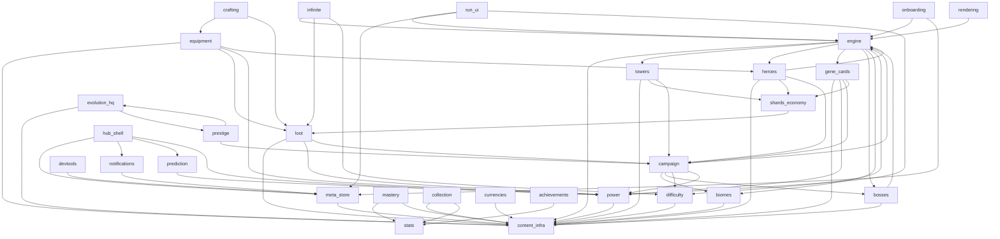

# DEPENDENCY_GRAPH.md — "what breaks if I change this?"

> **GENERATED — do not edit by hand.** Source of truth: `src/dev/systemRegistry.ts`.
> Regenerate with `npm run docs:graph`; a test fails when this file is stale.
> Read this BEFORE implementing a major feature: find your system, check its CONSUMERS
> (they break first), then walk the impact table (docs / UI / help / tutorial / save).

## The graph (A → B means "A depends on B")

## Impact index

| System | Depends on | Consumers (break first) | Power Score | Save fields | Docs |
|---|---|---|---|---|---|
| **Sim Engine** (`engine`) | `content-infra` · `towers` · `heroes` · `gene-cards` · `bosses` · `biomes` · `difficulty` | `campaign` · `infinite` · `heroes` · `onboarding` · `run-ui` · `bosses` · `rendering` | ⚡ emits the TEMPORARY in-run bucket (game.powerEffects) | — | `docs/ARCHITECTURE.md` · `docs/CODEMAP.md` · `docs/DESIGN.md` |
| **Content Infrastructure** (`content-infra`) | — | `engine` · `power` · `towers` · `mastery` · `heroes` · `equipment` · `loot` · `gene-cards` · `collection` · `evolution-hq` · `currencies` · `meta-store` · `bosses` · `biomes` · `difficulty` | — | — | `docs/CODEMAP.md` · `docs/CORE-FRAMEWORKS.md` · `docs/AUTHORING.md` |
| **Power Score** (`power`) | `content-infra` | `campaign` · `equipment` · `loot` · `gene-cards` · `hub-shell` · `run-ui` · `prediction` | ⚡ IS the model (buckets, effectsPower, FIELD_WEIGHT) | — | `docs/POWER-SCORE.md` · `docs/POWER-AUDIT.md` |
| **Campaign** (`campaign`) | `engine` · `biomes` · `bosses` · `difficulty` · `power` | `towers` · `heroes` · `loot` · `gene-cards` · `prestige` | ⚡ recommended-power display; first-clear rewards move account Power indirectly | `campaign` | `docs/CAMPAIGN.md` · `docs/MODE-IDENTITY.md` · `docs/STAGES.md` |
| **Infinite Mode** (`infinite`) | `engine` · `loot` · `difficulty` | — | — | `bestWave` | `docs/ENDLESS-SCALING.md` · `docs/MODE-IDENTITY.md` |
| **Towers, Stars, Branches & Codex** (`towers`) | `content-infra` · `shards-economy` · `campaign` | `engine` | ⚡ stars/branches feed permanent + temporary buckets | `towerStars` · `towerShards` · `towerMasteryXp` · `towerForks` | `docs/TOWER-STARS.md` · `docs/TOWER-BRANCHES.md` · `docs/TOWER-LAB.md` · `docs/TOWER-CODEX.md` · `docs/TOWERS.md` |
| **Mastery / Adaptation** (`mastery`) | `stats` · `content-infra` | — | ⚡ mastery multiplier folds into the permanent bucket | `towerMasteryXp` · `heroMasteryXp` · `adaptation` | `docs/MASTERY.md` |
| **Heroes** (`heroes`) | `content-infra` · `engine` · `shards-economy` · `campaign` | `engine` · `equipment` | ⚡ hero stars/evolution feed permanent + temporary buckets | `heroStars` · `heroShards` · `heroUnlocked` · `heroLoadout` · `heroMasteryXp` | `docs/HEROES.md` · `docs/HERO-FRAMEWORK.md` · `docs/HERO-EVOLUTION.md` · `docs/HERO-SELECTION.md` · `docs/SLOTS.md` |
| **Equipment & Armory** (`equipment`) | `content-infra` · `loot` · `power` · `heroes` | `crafting` | ⚡ equipped items score via itemPower into the gear bucket | `equipment` | `docs/EQUIPMENT.md` · `docs/EQUIPMENT-PHILOSOPHY.md` |
| **Crafting / Reforge** (`crafting`) | `equipment` · `loot` | — | ⚡ reforged items re-score through the gear bucket | `mats` · `matPity` | `docs/REFORGE.md` |
| **Loot & Bio-Containers** (`loot`) | `content-infra` · `power` · `campaign` | `infinite` · `equipment` · `crafting` · `shards-economy` | ⚡ reads Power for catch-up bias; grants move account Power | `lootQueue` · `pendingContainers` | `docs/LOOTBOX.md` · `docs/LOOT-PROGRESSION.md` · `docs/REWARD-PRESENTATION.md` |
| **Gene Cards (draft + permanent evolution)** (`gene-cards`) | `content-infra` · `power` · `campaign` · `shards-economy` | `engine` | ⚡ permanent levels fold linearly (GENE_POWER_SCALE); drafts feed the temporary bucket; validator enforces visibility | `genes` · `geneEssence` · `geneSlots` · `geneLoadout` | `docs/GENE-EVOLUTION.md` · `docs/CARDS.md` · `docs/GENE-AUDIT-REPORT.md` |
| **Shards & Star Economy** (`shards-economy`) | `loot` | `towers` · `heroes` · `gene-cards` | ⚡ stars bought with shards move the permanent bucket | `shards` · `lifetimeShards` | `docs/SHARD-ECONOMY.md` · `docs/ECONOMY.md` |
| **Collections / Codex** (`collection`) | `content-infra` · `stats` | — | ⚡ completion feeds the collection bucket | — | `docs/COLLECTION.md` |
| **Evolution HQ (Genome Cores)** (`evolution-hq`) | `content-infra` · `prestige` | `prestige` | ⚡ META_UPGRADES fold into the permanent bucket | `upgrades` | `docs/EVOLUTION-HQ.md` · `docs/GENOME-CORE.md` · `docs/EVOLUTION-CAP.md` |
| **Prestige (Molt / Ascendant)** (`prestige`) | `campaign` · `evolution-hq` | `evolution-hq` | ⚡ the P bucket (log fold of Cells + tree) | `prestige` | `docs/PROGRESSION-PHILOSOPHY.md` · `docs/PROGRESSION-REDESIGN.md` |
| **Currencies & Economy Framework** (`currencies`) | `content-infra` | — | — | — | `docs/ECONOMY.md` · `docs/LEXICON.md` · `docs/ECONOMY_FORMULAS.md` |
| **Achievements** (`achievements`) | `stats` | — | ⚡ rewards (shards) move Power indirectly | `achievements` | `docs/PROGRESSION-SYSTEMS.md` |
| **Lifetime Stats** (`stats`) | — | `mastery` · `collection` · `achievements` | — | `stats` · `totalRuns` · `bestWave` | `docs/PROGRESSION-SYSTEMS.md` |
| **Tutorials, Help & Onboarding** (`onboarding`) | `engine` · `meta-store` | — | — | `tutorial` · `help` | `docs/TUTORIAL.md` · `docs/HELP.md` |
| **Hub Shell & Home** (`hub-shell`) | `meta-store` · `notifications` · `prediction` · `power` | — | — | — | `docs/HOME-BASE.md` · `docs/ONE-MORE-RUN.md` · `docs/HUD.md` · `docs/PROGRESSION-LOOP.md` |
| **In-Run HUD & Results** (`run-ui`) | `engine` · `meta-store` · `power` | — | ⚡ renders live run Power | — | `docs/HUD.md` · `docs/READABILITY.md` · `docs/REWARD-PRESENTATION.md` |
| **Notifications** (`notifications`) | `meta-store` | `hub-shell` | — | — | `docs/NOTIFICATIONS.md` |
| **Progress Prediction** (`prediction`) | `power` | `hub-shell` | ⚡ consumes the score as its input signal | `prediction` | `docs/PREDICTION.md` |
| **Meta Store & Save** (`meta-store`) | `content-infra` | `onboarding` · `hub-shell` · `run-ui` · `notifications` · `devtools` | ⚡ recomputes the account score on every persist | `ALL (owner)` | `docs/DEV-RESET.md` · `docs/SCALABILITY.md` · `docs/PROJECT_MANIFEST.md` |
| **Bosses** (`bosses`) | `engine` · `content-infra` | `engine` · `campaign` | — | `bossesSlain` | `docs/BOSS-DESIGN.md` |
| **Biomes** (`biomes`) | `content-infra` | `engine` · `campaign` | — | — | `docs/BIOMES.md` |
| **Difficulty** (`difficulty`) | `content-infra` | `engine` · `campaign` · `infinite` | — | — | `docs/DIFFICULTY.md` · `docs/DIFFICULTY_DIRECTOR.md` |
| **Rendering & VFX** (`rendering`) | `engine` | — | — | — | `docs/RENDER-PIPELINE.md` · `docs/TOWER-VISUAL-EVOLUTION.md` · `docs/GAME-FEEL.md` |
| **Audio** (`audio`) | — | — | — | — | `docs/GAME-FEEL.md` |
| **Dev Tools & Debug** (`devtools`) | `meta-store` | — | — | — | `docs/DEV-RESET.md` |
| **Shared UI Component Kit** (`ui-kit`) | — | — | — | — | `docs/UI-STANDARDS.md` · `docs/STYLE-GUIDE.md` · `docs/UI-MOTION.md` · `docs/VISUAL_IDENTITY.md` · `docs/UI_STYLE_GUIDE.md` · `docs/DESIGN_LANGUAGE.md` · `docs/RESPONSIVE-DESIGN.md` |
| **System Registry & Doc Tooling** (`dev-registry`) | — | — | — | — | `docs/DEPENDENCY_GRAPH.md` · `docs/ENGINEERING-AUDIT.md` · `docs/GAME_CONSTITUTION.md` · `docs/PROJECT_STATUS.md` · `docs/AI_HANDOFF.md` |

## Per-system detail — the full blast radius

### Sim Engine (`engine`)

*Deterministic fixed-timestep simulation — the Game, combat, statuses, targeting, spawning, run events.*

- **Files:** `src/core/game.ts` · `src/core/combat.ts` · `src/core/status.ts` · `src/core/targeting.ts` · `src/core/reactions.ts` · `src/core/spawndirector.ts` · `src/core/runEvents.ts` · `src/core/events.ts` · `src/core/map.ts` · `src/core/ability.ts` · `src/core/mutators.ts` · `src/core/modifiers.ts` · `src/core/simharness.ts` · `src/core/director.ts` · `src/core/sim.testutil.ts`
- **Depends on:** `content-infra` · `towers` · `heroes` · `gene-cards` · `bosses` · `biomes` · `difficulty`
- **Consumers — what breaks if you change this:** `campaign` · `infinite` · `heroes` · `onboarding` · `run-ui` · `bosses` · `rendering`
- **Power Score:** emits the TEMPORARY in-run bucket (game.powerEffects)
- **Save fields:** —
- **Tutorial:** `combat` · **Help mechanics:** `hive-core` · `biomass`
- **HUD surfaces:** `Hud` · `Toolbar` · `BuildControls` · `Inspector` · `BuildPanel` · **UI screens:** `GameView`
- **Collection:** kills/usage feed collection tiers · **Achievements:** —
- **Localization:** inline English strings (no i18n layer yet — this field enumerates the surface for the day it lands)
- **Docs to update on change:** `docs/ARCHITECTURE.md` · `docs/CODEMAP.md` · `docs/DESIGN.md` · `docs/CAMPAIGN.md` · `docs/MODE-IDENTITY.md` · `docs/STAGES.md` · `docs/ENDLESS-SCALING.md` · `docs/HEROES.md` · `docs/HERO-FRAMEWORK.md` · `docs/HERO-EVOLUTION.md` · `docs/HERO-SELECTION.md` · `docs/SLOTS.md` · `docs/TUTORIAL.md` · `docs/HELP.md` · `docs/HUD.md` · `docs/READABILITY.md` · `docs/REWARD-PRESENTATION.md` · `docs/BOSS-DESIGN.md` · `docs/RENDER-PIPELINE.md` · `docs/TOWER-VISUAL-EVOLUTION.md` · `docs/GAME-FEEL.md`

### Content Infrastructure (`content-infra`)

*Registry<T>, validation, config tunables, shared types/math/rng/spatial — the data-driven backbone.*

- **Files:** `src/core/registry.ts` · `src/core/validate.ts` · `src/core/config.ts` · `src/core/types.ts` · `src/core/math.ts` · `src/core/rng.ts` · `src/core/spatial.ts` · `src/core/features.ts` · `src/vite-env.d.ts`
- **Depends on:** —
- **Consumers — what breaks if you change this:** `engine` · `power` · `towers` · `mastery` · `heroes` · `equipment` · `loot` · `gene-cards` · `collection` · `evolution-hq` · `currencies` · `meta-store` · `bosses` · `biomes` · `difficulty`
- **Power Score:** — (intentionally none)
- **Save fields:** —
- **Tutorial:** — · **Help mechanics:** —
- **HUD surfaces:** — · **UI screens:** —
- **Collection:** — · **Achievements:** —
- **Localization:** no player-facing strings
- **Docs to update on change:** `docs/CODEMAP.md` · `docs/CORE-FRAMEWORKS.md` · `docs/AUTHORING.md` · `docs/ARCHITECTURE.md` · `docs/DESIGN.md` · `docs/POWER-SCORE.md` · `docs/POWER-AUDIT.md` · `docs/TOWER-STARS.md` · `docs/TOWER-BRANCHES.md` · `docs/TOWER-LAB.md` · `docs/TOWER-CODEX.md` · `docs/TOWERS.md` · `docs/MASTERY.md` · `docs/HEROES.md` · `docs/HERO-FRAMEWORK.md` · `docs/HERO-EVOLUTION.md` · `docs/HERO-SELECTION.md` · `docs/SLOTS.md` · `docs/EQUIPMENT.md` · `docs/EQUIPMENT-PHILOSOPHY.md` · `docs/LOOTBOX.md` · `docs/LOOT-PROGRESSION.md` · `docs/REWARD-PRESENTATION.md` · `docs/GENE-EVOLUTION.md` · `docs/CARDS.md` · `docs/GENE-AUDIT-REPORT.md` · `docs/COLLECTION.md` · `docs/EVOLUTION-HQ.md` · `docs/GENOME-CORE.md` · `docs/EVOLUTION-CAP.md` · `docs/ECONOMY.md` · `docs/LEXICON.md` · `docs/ECONOMY_FORMULAS.md` · `docs/DEV-RESET.md` · `docs/SCALABILITY.md` · `docs/PROJECT_MANIFEST.md` · `docs/BOSS-DESIGN.md` · `docs/BIOMES.md` · `docs/DIFFICULTY.md` · `docs/DIFFICULTY_DIRECTOR.md`

### Power Score (`power`)

*ONE account-strength number folded from every permanent bucket + the in-run temporary bucket.*

- **Files:** `src/core/power.ts` · `src/state/itemPower.ts` · `src/state/powerEvents.ts` · `src/ui/components/PowerScore.tsx` · `src/ui/components/PowerDelta.tsx` · `src/ui/components/PowerToaster.tsx`
- **Depends on:** `content-infra`
- **Consumers — what breaks if you change this:** `campaign` · `equipment` · `loot` · `gene-cards` · `hub-shell` · `run-ui` · `prediction`
- **Power Score:** IS the model (buckets, effectsPower, FIELD_WEIGHT)
- **Save fields:** —
- **Tutorial:** — · **Help mechanics:** `power-score`
- **HUD surfaces:** `Hud (live run Power)` · **UI screens:** `ProgressDashboard` · `PlayScreen (recommended power)`
- **Collection:** collection completion feeds a bucket · **Achievements:** —
- **Localization:** inline English strings (no i18n layer yet — this field enumerates the surface for the day it lands)
- **Docs to update on change:** `docs/POWER-SCORE.md` · `docs/POWER-AUDIT.md` · `docs/CAMPAIGN.md` · `docs/MODE-IDENTITY.md` · `docs/STAGES.md` · `docs/EQUIPMENT.md` · `docs/EQUIPMENT-PHILOSOPHY.md` · `docs/LOOTBOX.md` · `docs/LOOT-PROGRESSION.md` · `docs/REWARD-PRESENTATION.md` · `docs/GENE-EVOLUTION.md` · `docs/CARDS.md` · `docs/GENE-AUDIT-REPORT.md` · `docs/HOME-BASE.md` · `docs/ONE-MORE-RUN.md` · `docs/HUD.md` · `docs/PROGRESSION-LOOP.md` · `docs/READABILITY.md` · `docs/PREDICTION.md`

### Campaign (`campaign`)

*Procedural authored-feeling stages; depth is the master progression gate.*

- **Files:** `src/core/campaign.ts` · `src/ui/CampaignScreen.tsx`
- **Depends on:** `engine` · `biomes` · `bosses` · `difficulty` · `power`
- **Consumers — what breaks if you change this:** `towers` · `heroes` · `loot` · `gene-cards` · `prestige`
- **Power Score:** recommended-power display; first-clear rewards move account Power indirectly
- **Save fields:** `campaign`
- **Tutorial:** — · **Help mechanics:** `campaign`
- **HUD surfaces:** — · **UI screens:** `CampaignScreen` · `PlayScreen`
- **Collection:** biome discovery · **Achievements:** —
- **Localization:** inline English strings (no i18n layer yet — this field enumerates the surface for the day it lands)
- **Docs to update on change:** `docs/CAMPAIGN.md` · `docs/MODE-IDENTITY.md` · `docs/STAGES.md` · `docs/TOWER-STARS.md` · `docs/TOWER-BRANCHES.md` · `docs/TOWER-LAB.md` · `docs/TOWER-CODEX.md` · `docs/TOWERS.md` · `docs/HEROES.md` · `docs/HERO-FRAMEWORK.md` · `docs/HERO-EVOLUTION.md` · `docs/HERO-SELECTION.md` · `docs/SLOTS.md` · `docs/LOOTBOX.md` · `docs/LOOT-PROGRESSION.md` · `docs/REWARD-PRESENTATION.md` · `docs/GENE-EVOLUTION.md` · `docs/CARDS.md` · `docs/GENE-AUDIT-REPORT.md` · `docs/PROGRESSION-PHILOSOPHY.md` · `docs/PROGRESSION-REDESIGN.md`

### Infinite Mode (`infinite`)

*Endless AI-Director escalation; personal bests + richest loot meter.*

- **Files:** `src/ui/InfiniteScreen.tsx`
- **Depends on:** `engine` · `loot` · `difficulty`
- **Consumers — what breaks if you change this:** —
- **Power Score:** — (intentionally none)
- **Save fields:** `bestWave`
- **Tutorial:** — · **Help mechanics:** `infinite`
- **HUD surfaces:** — · **UI screens:** `InfiniteScreen` · `PlayScreen`
- **Collection:** chest tiers unlock by best wave · **Achievements:** —
- **Localization:** inline English strings (no i18n layer yet — this field enumerates the surface for the day it lands)
- **Docs to update on change:** `docs/ENDLESS-SCALING.md` · `docs/MODE-IDENTITY.md`

### Towers, Stars, Branches & Codex (`towers`)

*Tower roster; permanent Star evolutions; in-run Branch specialization; the Codex.*

- **Files:** `src/core/stars.ts` · `src/core/branches.ts` · `src/core/branchTree.ts` · `src/ui/TowerLab.tsx` · `src/ui/TowerCodex.tsx` · `src/ui/TowerPortrait.tsx` · `src/ui/towerLabModel.ts` · `src/ui/towerCodexModel.ts` · `src/ui/StarCeremony.tsx` · `src/ui/components/BranchTree.tsx`
- **Depends on:** `content-infra` · `shards-economy` · `campaign`
- **Consumers — what breaks if you change this:** `engine`
- **Power Score:** stars/branches feed permanent + temporary buckets
- **Save fields:** `towerStars` · `towerShards` · `towerMasteryXp` · `towerForks`
- **Tutorial:** `combat` · **Help mechanics:** `towers` · `tower-stars` · `tower-branches`
- **HUD surfaces:** `tower rail` · `Inspector` · **UI screens:** `TowerLab` · `TowerCodex` · `StarCeremony`
- **Collection:** towers category (usage tiers) · **Achievements:** —
- **Localization:** inline English strings (no i18n layer yet — this field enumerates the surface for the day it lands)
- **Docs to update on change:** `docs/TOWER-STARS.md` · `docs/TOWER-BRANCHES.md` · `docs/TOWER-LAB.md` · `docs/TOWER-CODEX.md` · `docs/TOWERS.md` · `docs/ARCHITECTURE.md` · `docs/CODEMAP.md` · `docs/DESIGN.md`

### Mastery / Adaptation (`mastery`)

*Identity-through-use: titles, procedural ranks, halos, Antigen-Point decision trees.*

- **Files:** `src/core/mastery.ts` · `src/core/adaptation.ts` · `src/state/masteryEvents.ts` · `src/ui/MasteryProfile.tsx` · `src/ui/components/AdaptationTree.tsx` · `src/ui/components/MasteryToaster.tsx`
- **Depends on:** `stats` · `content-infra`
- **Consumers — what breaks if you change this:** —
- **Power Score:** mastery multiplier folds into the permanent bucket
- **Save fields:** `towerMasteryXp` · `heroMasteryXp` · `adaptation`
- **Tutorial:** — · **Help mechanics:** —
- **HUD surfaces:** `halos (renderer)` · `live projection + level-up rings (GameView)` · `Inspector craft bar` · **UI screens:** `MasteryProfile` · `MasteryToaster`
- **Collection:** — · **Achievements:** —
- **Localization:** inline English strings (no i18n layer yet — this field enumerates the surface for the day it lands)
- **Docs to update on change:** `docs/MASTERY.md`

### Heroes (`heroes`)

*Autonomous champions: AI behaviors, abilities, stars, slots, in-run Hero Evolution.*

- **Files:** `src/core/heroIdentity.ts` · `src/core/heroLore.ts` · `src/core/heroEvolution.ts` · `src/ui/HeroLab.tsx` · `src/ui/HeroSelectPanel.tsx` · `src/ui/HeroSlotUnlock.tsx` · `src/ui/HeroEvolutionPanel.tsx` · `src/state/heroView.ts` · `src/ui/components/HeroPortrait.tsx`
- **Depends on:** `content-infra` · `engine` · `shards-economy` · `campaign`
- **Consumers — what breaks if you change this:** `engine` · `equipment`
- **Power Score:** hero stars/evolution feed permanent + temporary buckets
- **Save fields:** `heroStars` · `heroShards` · `heroUnlocked` · `heroLoadout` · `heroMasteryXp`
- **Tutorial:** `combat` · **Help mechanics:** `heroes` · `hero-slots`
- **HUD surfaces:** `ability button` · `HeroSelectPanel` · **UI screens:** `HeroLab`
- **Collection:** heroes category (usage tiers) · **Achievements:** —
- **Localization:** inline English strings (no i18n layer yet — this field enumerates the surface for the day it lands)
- **Docs to update on change:** `docs/HEROES.md` · `docs/HERO-FRAMEWORK.md` · `docs/HERO-EVOLUTION.md` · `docs/HERO-SELECTION.md` · `docs/SLOTS.md` · `docs/ARCHITECTURE.md` · `docs/CODEMAP.md` · `docs/DESIGN.md` · `docs/EQUIPMENT.md` · `docs/EQUIPMENT-PHILOSOPHY.md`

### Equipment & Armory (`equipment`)

*~180 behavioral items, affixes, sets; per-hero Weapon/Armor/Relic loadouts.*

- **Files:** `src/core/equipment.ts` · `src/ui/EquipmentPanel.tsx` · `src/ui/ItemDetails.tsx` · `src/ui/components/ItemArt.tsx`
- **Depends on:** `content-infra` · `loot` · `power` · `heroes`
- **Consumers — what breaks if you change this:** `crafting`
- **Power Score:** equipped items score via itemPower into the gear bucket
- **Save fields:** `equipment`
- **Tutorial:** — · **Help mechanics:** `equipment`
- **HUD surfaces:** — · **UI screens:** `EquipmentPanel` · `ItemDetails`
- **Collection:** equipment category (owned) · **Achievements:** —
- **Localization:** inline English strings (no i18n layer yet — this field enumerates the surface for the day it lands)
- **Docs to update on change:** `docs/EQUIPMENT.md` · `docs/EQUIPMENT-PHILOSOPHY.md` · `docs/REFORGE.md`

### Crafting / Reforge (`crafting`)

*Materials sink: enhance, reroll, targeted swap, rarity upgrade.*

- **Files:** `src/core/reforge.ts` · `src/core/materialDrop.ts`
- **Depends on:** `equipment` · `loot`
- **Consumers — what breaks if you change this:** —
- **Power Score:** reforged items re-score through the gear bucket
- **Save fields:** `mats` · `matPity`
- **Tutorial:** — · **Help mechanics:** `equipment-reforge`
- **HUD surfaces:** — · **UI screens:** `EquipmentPanel (reforge overlay)`
- **Collection:** — · **Achievements:** —
- **Localization:** inline English strings (no i18n layer yet — this field enumerates the surface for the day it lands)
- **Docs to update on change:** `docs/REFORGE.md`

### Loot & Bio-Containers (`loot`)

*Meter → pre-determined containers → Vault ceremony; pity + progression catch-up.*

- **Files:** `src/core/loot.ts` · `src/core/lootQueue.ts` · `src/core/progressionLoot.ts` · `src/state/lootbox.ts` · `src/state/vaultReveal.ts` · `src/ui/GeneticVault.tsx` · `src/ui/VaultReveal.tsx` · `src/ui/LootMeter.tsx` · `src/ui/LootToaster.tsx`
- **Depends on:** `content-infra` · `power` · `campaign`
- **Consumers — what breaks if you change this:** `infinite` · `equipment` · `crafting` · `shards-economy`
- **Power Score:** reads Power for catch-up bias; grants move account Power
- **Save fields:** `lootQueue` · `pendingContainers`
- **Tutorial:** — · **Help mechanics:** `containers`
- **HUD surfaces:** `LootMeter` · `LootToaster` · **UI screens:** `GeneticVault` · `VaultReveal`
- **Collection:** chests category · **Achievements:** —
- **Localization:** inline English strings (no i18n layer yet — this field enumerates the surface for the day it lands)
- **Docs to update on change:** `docs/LOOTBOX.md` · `docs/LOOT-PROGRESSION.md` · `docs/REWARD-PRESENTATION.md` · `docs/ENDLESS-SCALING.md` · `docs/MODE-IDENTITY.md` · `docs/EQUIPMENT.md` · `docs/EQUIPMENT-PHILOSOPHY.md` · `docs/REFORGE.md` · `docs/SHARD-ECONOMY.md` · `docs/ECONOMY.md`

### Gene Cards (draft + permanent evolution) (`gene-cards`)

*Between-wave drafts + the permanent Archive: Essence-funded levels, gates, loadouts, Ascension backend.*

- **Files:** `src/core/cards.ts` · `src/core/geneCards.ts` · `src/core/geneUpgrades.ts` · `src/core/geneEssence.ts` · `src/core/geneLoadout.ts` · `src/state/geneArchive.ts` · `src/ui/GeneArchive.tsx` · `src/ui/DraftModal.tsx` · `src/ui/cardAffects.tsx` · `src/ui/components/GeneCardArt.tsx` · `src/core/doctrines.ts`
- **Depends on:** `content-infra` · `power` · `campaign` · `shards-economy`
- **Consumers — what breaks if you change this:** `engine`
- **Power Score:** permanent levels fold linearly (GENE_POWER_SCALE); drafts feed the temporary bucket; validator enforces visibility
- **Save fields:** `genes` · `geneEssence` · `geneSlots` · `geneLoadout`
- **Tutorial:** `combat` · **Help mechanics:** `gene-cards` · `gene-essence` · `gene-archive` · `gene-loadout`
- **HUD surfaces:** `DraftModal` · `BuildPanel` · `gene splash` · **UI screens:** `GeneArchive`
- **Collection:** cards category (Gene Level labels) · **Achievements:** `collector`
- **Localization:** inline English strings (no i18n layer yet — this field enumerates the surface for the day it lands)
- **Docs to update on change:** `docs/GENE-EVOLUTION.md` · `docs/CARDS.md` · `docs/GENE-AUDIT-REPORT.md` · `docs/ARCHITECTURE.md` · `docs/CODEMAP.md` · `docs/DESIGN.md`

### Shards & Star Economy (`shards-economy`)

*Strain Samples / Apex Genome income + star cost curves + duplicate→Essence conversion seam.*

- **Files:** —
- **Depends on:** `loot`
- **Consumers — what breaks if you change this:** `towers` · `heroes` · `gene-cards`
- **Power Score:** stars bought with shards move the permanent bucket
- **Save fields:** `shards` · `lifetimeShards`
- **Tutorial:** — · **Help mechanics:** `tower-stars`
- **HUD surfaces:** — · **UI screens:** `TowerLab` · `HeroLab`
- **Collection:** — · **Achievements:** —
- **Localization:** inline English strings (no i18n layer yet — this field enumerates the surface for the day it lands)
- **Docs to update on change:** `docs/SHARD-ECONOMY.md` · `docs/ECONOMY.md` · `docs/TOWER-STARS.md` · `docs/TOWER-BRANCHES.md` · `docs/TOWER-LAB.md` · `docs/TOWER-CODEX.md` · `docs/TOWERS.md` · `docs/HEROES.md` · `docs/HERO-FRAMEWORK.md` · `docs/HERO-EVOLUTION.md` · `docs/HERO-SELECTION.md` · `docs/SLOTS.md` · `docs/GENE-EVOLUTION.md` · `docs/CARDS.md` · `docs/GENE-AUDIT-REPORT.md`

### Collections / Codex (`collection`)

*Discovery + usage tiers across all content; ranks, rewards, small Power fold.*

- **Files:** `src/core/collection.ts` · `src/ui/CollectionPanel.tsx`
- **Depends on:** `content-infra` · `stats`
- **Consumers — what breaks if you change this:** —
- **Power Score:** completion feeds the collection bucket
- **Save fields:** —
- **Tutorial:** — · **Help mechanics:** —
- **HUD surfaces:** — · **UI screens:** `CollectionPanel`
- **Collection:** IS the system · **Achievements:** `collector`
- **Localization:** inline English strings (no i18n layer yet — this field enumerates the surface for the day it lands)
- **Docs to update on change:** `docs/COLLECTION.md`

### Evolution HQ (Genome Cores) (`evolution-hq`)

*Permanent categorized account upgrades bought with Genome Cores.*

- **Files:** `src/state/evolutionHQ.ts` · `src/ui/EvolutionHQ.tsx` · `src/ui/EvolutionUnlock.tsx`
- **Depends on:** `content-infra` · `prestige`
- **Consumers — what breaks if you change this:** `prestige`
- **Power Score:** META_UPGRADES fold into the permanent bucket
- **Save fields:** `upgrades`
- **Tutorial:** — · **Help mechanics:** `genome-core`
- **HUD surfaces:** — · **UI screens:** `EvolutionHQ`
- **Collection:** — · **Achievements:** —
- **Localization:** inline English strings (no i18n layer yet — this field enumerates the surface for the day it lands)
- **Docs to update on change:** `docs/EVOLUTION-HQ.md` · `docs/GENOME-CORE.md` · `docs/EVOLUTION-CAP.md` · `docs/PROGRESSION-PHILOSOPHY.md` · `docs/PROGRESSION-REDESIGN.md`

### Prestige (Molt / Ascendant) (`prestige`)

*Reset loop: mint Ascendant Cells → compounding multiplier + permanent tree.*

- **Files:** `src/core/prestige.ts` · `src/core/ascendant.ts` · `src/ui/PrestigePanel.tsx`
- **Depends on:** `campaign` · `evolution-hq`
- **Consumers — what breaks if you change this:** `evolution-hq`
- **Power Score:** the P bucket (log fold of Cells + tree)
- **Save fields:** `prestige`
- **Tutorial:** — · **Help mechanics:** `prestige` · `ascension`
- **HUD surfaces:** — · **UI screens:** `PrestigePanel` · `EvolutionHQ (Ascension section)`
- **Collection:** — · **Achievements:** —
- **Localization:** inline English strings (no i18n layer yet — this field enumerates the surface for the day it lands)
- **Docs to update on change:** `docs/PROGRESSION-PHILOSOPHY.md` · `docs/PROGRESSION-REDESIGN.md` · `docs/EVOLUTION-HQ.md` · `docs/GENOME-CORE.md` · `docs/EVOLUTION-CAP.md`

### Currencies & Economy Framework (`currencies`)

*Currency identities (icon/color/tooltip/format) + the adaptive economy framework: one factor-traced income composition per currency, adaptive seams, health guards.*

- **Files:** `src/core/currencies.ts` · `src/core/economyDirector.ts` · `src/ui/components/CurrencyIcon.tsx`
- **Depends on:** `content-infra`
- **Consumers — what breaks if you change this:** —
- **Power Score:** — (intentionally none)
- **Save fields:** —
- **Tutorial:** — · **Help mechanics:** `gene-essence`
- **HUD surfaces:** `top resource bar` · **UI screens:** `CurrencyIcon (everywhere)`
- **Collection:** — · **Achievements:** —
- **Localization:** inline English strings (no i18n layer yet — this field enumerates the surface for the day it lands)
- **Docs to update on change:** `docs/ECONOMY.md` · `docs/LEXICON.md` · `docs/ECONOMY_FORMULAS.md`

### Achievements (`achievements`)

*Milestone recognition with auto-granted Shard rewards.*

- **Files:** `src/state/achievements.ts` · `src/ui/AchievementPanel.tsx` · `src/ui/AchievementToaster.tsx`
- **Depends on:** `stats`
- **Consumers — what breaks if you change this:** —
- **Power Score:** rewards (shards) move Power indirectly
- **Save fields:** `achievements`
- **Tutorial:** — · **Help mechanics:** —
- **HUD surfaces:** `AchievementToaster` · **UI screens:** `AchievementPanel` · `RewardReveal (inline strip)`
- **Collection:** — · **Achievements:** —
- **Localization:** inline English strings (no i18n layer yet — this field enumerates the surface for the day it lands)
- **Docs to update on change:** `docs/PROGRESSION-SYSTEMS.md`

### Lifetime Stats (`stats`)

*Run summaries accumulated into lifetime stats — the substrate for mastery/collection/achievements.*

- **Files:** `src/state/stats.ts` · `src/ui/Statistics.tsx`
- **Depends on:** —
- **Consumers — what breaks if you change this:** `mastery` · `collection` · `achievements`
- **Power Score:** — (intentionally none)
- **Save fields:** `stats` · `totalRuns` · `bestWave`
- **Tutorial:** — · **Help mechanics:** —
- **HUD surfaces:** — · **UI screens:** `Statistics` · `MasteryProfile`
- **Collection:** usage counts drive tiers · **Achievements:** `collector`
- **Localization:** inline English strings (no i18n layer yet — this field enumerates the surface for the day it lands)
- **Docs to update on change:** `docs/PROGRESSION-SYSTEMS.md` · `docs/MASTERY.md` · `docs/COLLECTION.md`

### Tutorials, Help & Onboarding (`onboarding`)

*Combat Tutorial over a live sim, HUD Tour, mechanics-registry Help wiki, What's New, loading tips.*

- **Files:** `src/core/tutorial.ts` · `src/state/tutorial.ts` · `src/state/mechanics.ts` · `src/ui/TutorialRunner.tsx` · `src/ui/tutorial/*` · `src/ui/HelpWiki.tsx` · `src/ui/WhatsNew.tsx` · `src/ui/HudTour.tsx` · `src/ui/tips.ts`
- **Depends on:** `engine` · `meta-store`
- **Consumers — what breaks if you change this:** —
- **Power Score:** — (intentionally none)
- **Save fields:** `tutorial` · `help`
- **Tutorial:** `combat` · **Help mechanics:** —
- **HUD surfaces:** `TutorialOverlay` · **UI screens:** `HelpWiki` · `WhatsNew` · `HudTour` · `PlayScreen (tips)`
- **Collection:** — · **Achievements:** —
- **Localization:** inline English strings (no i18n layer yet — this field enumerates the surface for the day it lands)
- **Docs to update on change:** `docs/TUTORIAL.md` · `docs/HELP.md`

### Hub Shell & Home (`hub-shell`)

*The nav shell, home base, mission control, dashboards, next-goal + progression-loop surfacing.*

- **Files:** `src/ui/Hub.tsx` · `src/ui/PlayScreen.tsx` · `src/ui/ProgressDashboard.tsx` · `src/ui/NextGoalBanner.tsx` · `src/state/nextGoal.ts` · `src/state/progressionLoop.ts` · `src/ui/hubProgress.ts` · `src/ui/homeBaseTiers.ts` · `src/ui/LabAtmosphere.tsx` · `src/ui/App.tsx` · `src/ui/ErrorBoundary.tsx` · `src/main.tsx`
- **Depends on:** `meta-store` · `notifications` · `prediction` · `power`
- **Consumers — what breaks if you change this:** —
- **Power Score:** — (intentionally none)
- **Save fields:** —
- **Tutorial:** — · **Help mechanics:** —
- **HUD surfaces:** — · **UI screens:** `Hub` · `PlayScreen` · `ProgressDashboard`
- **Collection:** — · **Achievements:** —
- **Localization:** inline English strings (no i18n layer yet — this field enumerates the surface for the day it lands)
- **Docs to update on change:** `docs/HOME-BASE.md` · `docs/ONE-MORE-RUN.md` · `docs/HUD.md` · `docs/PROGRESSION-LOOP.md`

### In-Run HUD & Results (`run-ui`)

*The battlefield interface: HUD, toolbar, inspector, build panel, results + reward reveal.*

- **Files:** `src/ui/GameView.tsx` · `src/ui/Hud.tsx` · `src/ui/Toolbar.tsx` · `src/ui/BuildControls.tsx` · `src/ui/BuildPanel.tsx` · `src/ui/Inspector.tsx` · `src/ui/Results.tsx` · `src/ui/RewardReveal.tsx` · `src/ui/RewardPreview.tsx`
- **Depends on:** `engine` · `meta-store` · `power`
- **Consumers — what breaks if you change this:** —
- **Power Score:** renders live run Power
- **Save fields:** —
- **Tutorial:** `combat` · **Help mechanics:** —
- **HUD surfaces:** `ALL` · **UI screens:** `Results`
- **Collection:** — · **Achievements:** —
- **Localization:** inline English strings (no i18n layer yet — this field enumerates the surface for the day it lands)
- **Docs to update on change:** `docs/HUD.md` · `docs/READABILITY.md` · `docs/REWARD-PRESENTATION.md`

### Notifications (`notifications`)

*Generic menu badges: registered count(save) sources per nav channel.*

- **Files:** `src/state/notifications.ts` · `src/state/notificationSources.ts`
- **Depends on:** `meta-store`
- **Consumers — what breaks if you change this:** `hub-shell`
- **Power Score:** — (intentionally none)
- **Save fields:** —
- **Tutorial:** — · **Help mechanics:** —
- **HUD surfaces:** `nav badges` · **UI screens:** `Hub (badges)`
- **Collection:** collection channel badge · **Achievements:** —
- **Localization:** inline English strings (no i18n layer yet — this field enumerates the surface for the day it lands)
- **Docs to update on change:** `docs/NOTIFICATIONS.md` · `docs/HOME-BASE.md` · `docs/ONE-MORE-RUN.md` · `docs/HUD.md` · `docs/PROGRESSION-LOOP.md`

### Progress Prediction (`prediction`)

*Self-calibrating reach forecasts from Power history.*

- **Files:** `src/core/predict.ts` · `src/ui/PredictionPanel.tsx`
- **Depends on:** `power`
- **Consumers — what breaks if you change this:** `hub-shell`
- **Power Score:** consumes the score as its input signal
- **Save fields:** `prediction`
- **Tutorial:** — · **Help mechanics:** `power-score`
- **HUD surfaces:** — · **UI screens:** `PredictionPanel` · `ProgressDashboard`
- **Collection:** — · **Achievements:** —
- **Localization:** inline English strings (no i18n layer yet — this field enumerates the surface for the day it lands)
- **Docs to update on change:** `docs/PREDICTION.md` · `docs/HOME-BASE.md` · `docs/ONE-MORE-RUN.md` · `docs/HUD.md` · `docs/PROGRESSION-LOOP.md`

### Meta Store & Save (`meta-store`)

*The permanent progression store + versioned/checksummed persistence, backups, resets, prefs.*

- **Files:** `src/state/meta.ts` · `src/state/store.ts` · `src/state/prefs.ts` · `src/state/devReset.ts` · `src/save/*` · `src/ui/SaveManager.tsx`
- **Depends on:** `content-infra`
- **Consumers — what breaks if you change this:** `onboarding` · `hub-shell` · `run-ui` · `notifications` · `devtools`
- **Power Score:** recomputes the account score on every persist
- **Save fields:** `ALL (owner)`
- **Tutorial:** — · **Help mechanics:** —
- **HUD surfaces:** — · **UI screens:** `SaveManager`
- **Collection:** — · **Achievements:** —
- **Localization:** inline English strings (no i18n layer yet — this field enumerates the surface for the day it lands)
- **Docs to update on change:** `docs/DEV-RESET.md` · `docs/SCALABILITY.md` · `docs/PROJECT_MANIFEST.md` · `docs/TUTORIAL.md` · `docs/HELP.md` · `docs/HOME-BASE.md` · `docs/ONE-MORE-RUN.md` · `docs/HUD.md` · `docs/PROGRESSION-LOOP.md` · `docs/READABILITY.md` · `docs/REWARD-PRESENTATION.md` · `docs/NOTIFICATIONS.md`

### Bosses (`bosses`)

*Module/phase framework + procedural assembly; campaign milestone bosses.*

- **Files:** `src/core/boss.ts`
- **Depends on:** `engine` · `content-infra`
- **Consumers — what breaks if you change this:** `engine` · `campaign`
- **Power Score:** — (intentionally none)
- **Save fields:** `bossesSlain`
- **Tutorial:** — · **Help mechanics:** `bosses`
- **HUD surfaces:** `boss bar` · **UI screens:** —
- **Collection:** bosses category (chassis) · **Achievements:** —
- **Localization:** inline English strings (no i18n layer yet — this field enumerates the surface for the day it lands)
- **Docs to update on change:** `docs/BOSS-DESIGN.md` · `docs/ARCHITECTURE.md` · `docs/CODEMAP.md` · `docs/DESIGN.md` · `docs/CAMPAIGN.md` · `docs/MODE-IDENTITY.md` · `docs/STAGES.md`

### Biomes (`biomes`)

*Environmental zones with modifiers/hazards rotating with depth.*

- **Files:** `src/core/biomes.ts`
- **Depends on:** `content-infra`
- **Consumers — what breaks if you change this:** `engine` · `campaign`
- **Power Score:** — (intentionally none)
- **Save fields:** —
- **Tutorial:** — · **Help mechanics:** `biomes`
- **HUD surfaces:** `biome banner` · **UI screens:** `CampaignScreen`
- **Collection:** biomes category · **Achievements:** —
- **Localization:** inline English strings (no i18n layer yet — this field enumerates the surface for the day it lands)
- **Docs to update on change:** `docs/BIOMES.md` · `docs/ARCHITECTURE.md` · `docs/CODEMAP.md` · `docs/DESIGN.md` · `docs/CAMPAIGN.md` · `docs/MODE-IDENTITY.md` · `docs/STAGES.md`

### Difficulty (`difficulty`)

*Difficulty variants + the Universal Difficulty Director — ONE composition layer for every scaling policy (threat curves, doctrine warps, stage folds, mode economy).*

- **Files:** `src/core/difficulty.ts` · `src/core/difficultyDirector.ts`
- **Depends on:** `content-infra`
- **Consumers — what breaks if you change this:** `engine` · `campaign` · `infinite`
- **Power Score:** — (intentionally none)
- **Save fields:** —
- **Tutorial:** — · **Help mechanics:** —
- **HUD surfaces:** — · **UI screens:** `CampaignScreen` · `InfiniteScreen` · `PlayScreen`
- **Collection:** — · **Achievements:** —
- **Localization:** inline English strings (no i18n layer yet — this field enumerates the surface for the day it lands)
- **Docs to update on change:** `docs/DIFFICULTY.md` · `docs/DIFFICULTY_DIRECTOR.md` · `docs/ARCHITECTURE.md` · `docs/CODEMAP.md` · `docs/DESIGN.md` · `docs/CAMPAIGN.md` · `docs/MODE-IDENTITY.md` · `docs/STAGES.md` · `docs/ENDLESS-SCALING.md`

### Rendering & VFX (`rendering`)

*Canvas2D battlefield, tower visual evolution, particles/vfx, theme.*

- **Files:** `src/render/*`
- **Depends on:** `engine`
- **Consumers — what breaks if you change this:** —
- **Power Score:** — (intentionally none)
- **Save fields:** —
- **Tutorial:** — · **Help mechanics:** —
- **HUD surfaces:** `the battlefield itself` · **UI screens:** —
- **Collection:** — · **Achievements:** —
- **Localization:** no player-facing strings
- **Docs to update on change:** `docs/RENDER-PIPELINE.md` · `docs/TOWER-VISUAL-EVOLUTION.md` · `docs/GAME-FEEL.md`

### Audio (`audio`)

*Synthesized SFX/music bus — cues, heartbeat tempo, reward stingers.*

- **Files:** `src/audio/*`
- **Depends on:** —
- **Consumers — what breaks if you change this:** —
- **Power Score:** — (intentionally none)
- **Save fields:** —
- **Tutorial:** — · **Help mechanics:** —
- **HUD surfaces:** `(audible)` · **UI screens:** —
- **Collection:** — · **Achievements:** —
- **Localization:** no player-facing strings
- **Docs to update on change:** `docs/GAME-FEEL.md`

### Dev Tools & Debug (`devtools`)

*Debug flag/panel, dev seeding, developer reset UI.*

- **Files:** `src/debug/*` · `src/ui/DebugPanel.tsx` · `src/ui/DevTools.tsx`
- **Depends on:** `meta-store`
- **Consumers — what breaks if you change this:** —
- **Power Score:** — (intentionally none)
- **Save fields:** —
- **Tutorial:** — · **Help mechanics:** —
- **HUD surfaces:** — · **UI screens:** `DebugPanel` · `DevTools`
- **Collection:** — · **Achievements:** —
- **Localization:** no player-facing strings
- **Docs to update on change:** `docs/DEV-RESET.md`

### Shared UI Component Kit (`ui-kit`)

*Reusable presentation components every screen composes (icons, bars, count-ups) — the component library.*

- **Files:** `src/ui/components/Icon.tsx` · `src/ui/components/ProgressBar.tsx` · `src/ui/components/useCountUp.ts` · `src/ui/components/usePressRepeat.ts` · `src/ui/components/AudioToggles.tsx`
- **Depends on:** —
- **Consumers — what breaks if you change this:** —
- **Power Score:** — (intentionally none)
- **Save fields:** —
- **Tutorial:** — · **Help mechanics:** —
- **HUD surfaces:** `(embedded everywhere)` · **UI screens:** `(embedded everywhere)`
- **Collection:** — · **Achievements:** —
- **Localization:** inline English strings (no i18n layer yet — this field enumerates the surface for the day it lands)
- **Docs to update on change:** `docs/UI-STANDARDS.md` · `docs/STYLE-GUIDE.md` · `docs/UI-MOTION.md` · `docs/VISUAL_IDENTITY.md` · `docs/UI_STYLE_GUIDE.md` · `docs/DESIGN_LANGUAGE.md` · `docs/RESPONSIVE-DESIGN.md`

### System Registry & Doc Tooling (`dev-registry`)

*THIS registry + the doc-sync/validation generators (dev-only).*

- **Files:** `src/dev/*`
- **Depends on:** —
- **Consumers — what breaks if you change this:** —
- **Power Score:** — (intentionally none)
- **Save fields:** —
- **Tutorial:** — · **Help mechanics:** —
- **HUD surfaces:** — · **UI screens:** —
- **Collection:** — · **Achievements:** —
- **Localization:** no player-facing strings
- **Docs to update on change:** `docs/DEPENDENCY_GRAPH.md` · `docs/ENGINEERING-AUDIT.md` · `docs/GAME_CONSTITUTION.md` · `docs/PROJECT_STATUS.md` · `docs/AI_HANDOFF.md`

---
*Maintained automatically: edit `src/dev/systemRegistry.ts`, run `npm run docs:graph`,
and the enforcement tests (`src/dev/systemRegistry.test.ts`) keep every reference real.*
