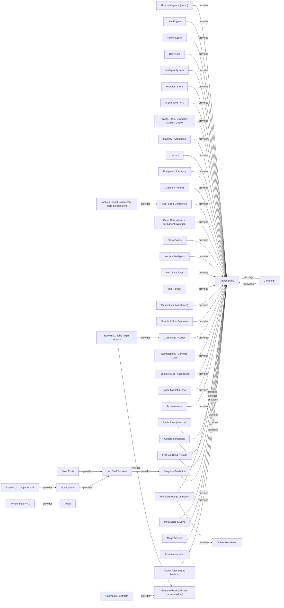
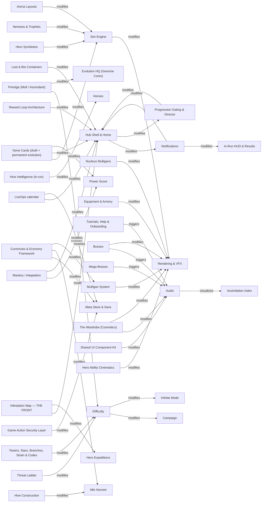

# DIL_GRAPH.md — the Design Intelligence Layer (GENERATED — `npm run dil -- regen`)

> **The project's brain** (docs/DIL.md). 996 nodes · 1940 edges, built from the live
> registries + curated knowledge (src/dev/dil/). **Query it instead of searching the repo:**
> `npm run dil -- node <id>` · `affects <id>` · `requires <id>` · `missing <kind> <edge>` ·
> `checklist tower <kind>` · `find <text>`. Edge kinds are bidirectional (19 kinds).

## Gap report (the graph's own radar)

- **Systems with no test:** `system:infinite`, `system:field-research`, `system:shards-economy`, `system:i18n`, `system:expeditions`, `system:nemesis`, `system:devtools`
- **Docs referenced by no system (review for retirement):** `ADVANCED-SYSTEMS.md`, `ARCHITECTURE-AUDIT.md`, `AUCTION-HOUSE.md`, `AUDIO_REPORT.md`, `BACKLOG.md`, `BALANCE_ARCHITECTURE.md`, `BRANCH-EVOLUTION.md`, `BUGFIX-LOG.md`, `COGLOAD_REPORT.md`, `CONTENT-ROADMAP.md`, `DEV-FRAMEWORKS.md`, `DIL_GRAPH.md`, `EA-DESIGN-AUDIT.md`, `ENEMIES.md`, `ENEMY-ROSTER.md`, `FIRST-SESSION-PROBE.md`, `FIRST_SESSION_REPORT.md`, `GAME-STATE.md`, `HISTORY.md`, `HIVE-PRODUCTION.md` · …29 more

## Indexes

### Gameplay Index

`tower:needle` · `tower:mortar` · `tower:reactor` · `tower:parasite` · `tower:obelisk` · `tower:maw` · `tower:chrysalis` · `tower:effigy` · `tower:coil` · `tower:siphon` · `tower:sower` · `tower:spire` · `tower:polyp` · `tower:spitfang` · `tower:rift` · `tower:glaive` · `tower:roost` · `tower:lung` · `tower:bell` · `tower:lancet` · `tower:basilisk` · `tower:ossuary` · `tower:warren` · `tower:tick` · `tower:quill` · `hero:ravager` · `hero:shepherd` · `hero:overseer` · `hero:vitriol` · `hero:revenant` · `hero:knell` · `hero:wyrm` · `hero:riptide` · `hero:carrion` · `hero:fovea` · `hero:chimera` · `hero:myceliarch` · `enemy:runner` · `enemy:mite` · `enemy:husk` · `enemy:flea` · `enemy:mold` · `enemy:skulker` · `enemy:larva` · `enemy:rusher` · `enemy:darter` · `enemy:lasher` · `enemy:brute` · `enemy:tank` · `enemy:golem` · `enemy:colossus` · `enemy:bulwark` · `enemy:warden` · `enemy:knitter` · `enemy:revenant` · `enemy:burrower` · `enemy:molerat` · `enemy:flyer` · `enemy:wisp` · `enemy:gargoyle` · …57 more

### Progression Index

`system:hive-mind` · `system:campaign` · `system:accounts` · `system:premium` · `system:towers` · `system:loot` · `system:gene-cards` · `system:currencies` · `system:quests` · `system:progression-gating` · `system:hub-shell` · `system:notifications` · `system:meta-store` · `system:mega-bosses` · `system:cutscenes` · `system:security` · `system:doctrines` · `system:ui-kit` · `concept:progression-gates` · `currency:tower-shards` · `tower:maw` · `tower:chrysalis` · `tower:effigy` · `tower:coil` · `tower:siphon` · `tower:sower` · `tower:spire` · `tower:polyp` · `tower:spitfang` · `tower:rift` · `tower:glaive` · `tower:roost` · `tower:lung` · `tower:bell` · `tower:lancet` · `tower:warren` · `tower:tick` · `tower:quill` · `hero:vitriol` · `hero:revenant` · `hero:knell` · `hero:wyrm` · `hero:riptide` · `hero:carrion` · `hero:chimera` · `hero:myceliarch`

### Economy / Reward Index

`currency:biomass` · `currency:genome-cores` · `currency:tower-shards` · `currency:hero-shards` · `currency:gene-essence` · `currency:materials` · `currency:stamina` · `currency:ichor` · `system:campaign` · `system:infinite` · `system:boss-rush` · `system:daily` · `system:loot` · `system:daily-login` · `system:achievements` · `system:directives` · `system:expeditions` · `system:mega-bosses` · `system:doctrines` · `enemy:runner` · `enemy:mite` · `enemy:husk` · `enemy:flea` · `enemy:mold` · `enemy:skulker` · `enemy:larva` · `enemy:rusher` · `enemy:darter` · `enemy:lasher` · `enemy:brute` · `enemy:tank` · `enemy:golem` · `enemy:colossus` · `enemy:bulwark` · `enemy:warden` · `enemy:knitter` · `enemy:revenant` · `enemy:burrower` · `enemy:molerat` · `enemy:flyer` · `enemy:wisp` · `enemy:gargoyle` · `enemy:cystwraith` · `enemy:broodmother` · `enemy:hivecaller` · `enemy:mender` · `enemy:cantor` · `enemy:bomber` · `enemy:popper` · `enemy:sapper` · `enemy:cataclyst` · `enemy:siegeworm` · `enemy:spitter` · `enemy:stratovore` · `enemy:broodweaver` · `enemy:zealot` · `enemy:carrier` · `enemy:entrencher` · `enemy:oracle` · `enemy:glutling` · …146 more

### Power Score Index

`system:hive-mind` · `system:engine` · `system:power` · `system:campaign` · `system:daily` · `system:mulligans` · `system:premium` · `system:arena` · `system:towers` · `system:mastery` · `system:heroes` · `system:equipment` · `system:crafting` · `system:loot` · `system:gene-cards` · `system:class-bonds` · `system:nucleus` · `system:hero-symbiotes` · `system:idle-harvest` · `system:metabolism` · `system:shards-economy` · `system:collection` · `system:evolution-hq` · `system:prestige` · `system:splice-market` · `system:achievements` · `system:cosmetics` · `system:battle-pass` · `system:quests` · `system:run-ui` · `system:prediction` · `system:meta-store` · `system:mega-bosses` · `system:assimilation` · `system:analytics`

### Audio Index

`music:menu` · `music:combat` · `music:boss` · `music:mega` · `music:victory` · `music:defeat` · `music:events` · `music:cinema` · `system:engine` · `system:cosmetics` · `system:onboarding` · `system:bosses` · `system:mega-bosses` · `system:cutscenes` · `system:rendering` · `system:living-battlefield` · `system:assimilation` · `system:ui-kit`

### Teaching Index

`tutorial:combat` · `help:mission-control` · `help:hive-intel` · `help:evolution-roadmap` · `help:power-advisor` · `help:field-guides` · `help:hive-core` · `help:biomorph-conveyor` · `help:strain-evolution` · `help:boss-sieges` · `help:boss-rush` · `help:bio-roulette` · `help:gene-essence` · `help:field-research` · `help:splice-market` · `help:auction-house` · `help:daily-login` · `help:hive-construction` · `help:gene-archive` · `help:gene-loadout` · `help:biomass` · `help:wave-rhythm` · `help:game-speed` · `help:early-call` · `help:emergency-defense` · `help:power-score` · `help:account-level` · `help:genome-rank` · `help:towers` · `help:tower-stars` · `help:tower-mastery` · `help:blockers` · `help:mastery-evolution` · `help:class-bonds` · `help:bonds-in-battle` · `help:tower-branches` · `help:adaptation` · `help:mulligans` · `help:nucleus` · `help:gene-cards` · `help:splice` · `help:heroes` · `help:hero-evolution` · `help:hero-slots` · `help:equipment` · `help:equipment-reforge` · `help:gear-codex` · `help:genome-core` · `help:prestige` · `help:ascension` · `help:containers` · `help:loot-meter` · `help:mega-hunt` · `help:collection-codex` · `help:phenotype-lab` · `help:idle-harvest` · `help:metabolism` · `help:specimens` · `help:arena` · `help:expeditions` · …36 more

### Testing Index

`system:hive-mind` · `system:engine` · `system:content-infra` · `system:power` · `system:campaign` · `system:pil` · `system:accounts` · `system:boss-rush` · `system:daily` · `system:mulligans` · `system:premium` · `system:net-backend` · `system:online-foundation` · `system:arena` · `system:towers` · `system:mastery` · `system:heroes` · `system:hero-cinematics` · `system:equipment` · `system:crafting` · `system:loot` · `system:gene-cards` · `system:class-bonds` · `system:nucleus` · `system:hero-symbiotes` · `system:idle-harvest` · `system:metabolism` · `system:collection` · `system:evolution-hq` · `system:hive-construction` · `system:daily-login` · `system:prestige` · `system:currencies` · `system:splice-market` · `system:achievements` · `system:stats` · `system:liveops` · `system:directives` · `system:contracts` · `system:infestation` · `system:chronicle` · `system:cosmetics` · `system:battle-pass` · `system:quests` · `system:profile` · `system:onboarding` · `system:account-level` · `system:genome-rank` · `system:progression-gating` · `system:hub-shell` · `system:run-ui` · `system:notifications` · `system:prediction` · `system:meta-store` · `system:bosses` · `system:mega-bosses` · `system:cutscenes` · `system:security` · `system:biomes` · `system:map-layouts` · …12 more

### Developer Tooling Index

`system:website` · `system:devtools` · `system:dev-registry`

## Architecture maps

### Economy & Rewards Map

```mermaid
graph LR
  system_power["Power Score"] -->|consumes| system_meta_store["Meta Store & Save"]
  system_campaign["Campaign"] -->|consumes| system_meta_store["Meta Store & Save"]
  system_infinite["Infinite Mode"] -->|consumes| system_meta_store["Meta Store & Save"]
  system_boss_rush["Boss Rush"] -->|consumes| system_meta_store["Meta Store & Save"]
  system_daily["Daily Run"] -->|consumes| system_meta_store["Meta Store & Save"]
  system_mulligans["Mulligan System"] -->|consumes| system_meta_store["Meta Store & Save"]
  system_premium["Premium Store"] -->|consumes| system_meta_store["Meta Store & Save"]
  system_field_research["Field Research (rewarded studies)"] -->|consumes| system_meta_store["Meta Store & Save"]
  system_net_backend["Backend lanes (net/)"] -->|consumes| system_meta_store["Meta Store & Save"]
  system_online_foundation["Online Foundation"] -->|consumes| system_meta_store["Meta Store & Save"]
  system_arena["Arena (Live PvP)"] -->|consumes| system_meta_store["Meta Store & Save"]
  system_towers["Towers, Stars, Branches, Strain & Codex"] -->|consumes| system_meta_store["Meta Store & Save"]
  system_mastery["Mastery / Adaptation"] -->|consumes| system_meta_store["Meta Store & Save"]
  system_heroes["Heroes"] -->|consumes| system_meta_store["Meta Store & Save"]
  system_equipment["Equipment & Armory"] -->|consumes| system_meta_store["Meta Store & Save"]
  system_crafting["Crafting / Reforge"] -->|consumes| system_meta_store["Meta Store & Save"]
  system_loot["Loot & Bio-Containers"] -->|consumes| system_meta_store["Meta Store & Save"]
  system_gene_cards["Gene Cards (draft + permanent evolution)"] -->|consumes| system_meta_store["Meta Store & Save"]
  system_class_bonds["Class Bonds"] -->|consumes| system_meta_store["Meta Store & Save"]
  system_nucleus["Nucleus Mulligans"] -->|consumes| system_meta_store["Meta Store & Save"]
  system_hero_symbiotes["Hero Symbiotes"] -->|consumes| system_meta_store["Meta Store & Save"]
  system_idle_harvest["Idle Harvest"] -->|consumes| system_meta_store["Meta Store & Save"]
  system_metabolism["Metabolism (Milestones)"] -->|consumes| system_meta_store["Meta Store & Save"]
  system_shards_economy["Shards & Star Economy"] -->|consumes| system_meta_store["Meta Store & Save"]
  system_evolution_hq["Evolution HQ (Genome Cores)"] -->|consumes| system_meta_store["Meta Store & Save"]
  system_hive_construction["Hive Construction"] -->|consumes| system_meta_store["Meta Store & Save"]
  system_daily_login["Daily Bio-Cache (login streak)"] -->|consumes| system_meta_store["Meta Store & Save"]
  system_prestige["Prestige (Molt / Ascendant)"] -->|consumes| system_meta_store["Meta Store & Save"]
  system_currencies["Currencies & Economy Framework"] -->|consumes| system_meta_store["Meta Store & Save"]
  system_splice_market["Splice Market & Ichor"] -->|consumes| system_meta_store["Meta Store & Save"]
  system_achievements["Achievements"] -->|consumes| system_meta_store["Meta Store & Save"]
  system_stats["Lifetime Stats"] -->|consumes| system_meta_store["Meta Store & Save"]
  system_liveops["LiveOps calendar"] -->|consumes| system_meta_store["Meta Store & Save"]
  system_directives["Weekly Directives"] -->|consumes| system_meta_store["Meta Store & Save"]
  system_contracts["Champion Contracts"] -->|consumes| system_meta_store["Meta Store & Save"]
  system_infestation["Infestation Map — THE FRONT"] -->|consumes| system_meta_store["Meta Store & Save"]
  system_chronicle["Chronicle (patch-note pipeline)"] -->|consumes| system_meta_store["Meta Store & Save"]
  system_expeditions["Hero Expeditions"] -->|consumes| system_meta_store["Meta Store & Save"]
  system_nemesis["Nemesis & Trophies"] -->|consumes| system_meta_store["Meta Store & Save"]
  system_cosmetics["The Wardrobe (Cosmetics)"] -->|consumes| system_meta_store["Meta Store & Save"]
  system_battle_pass["Battle Pass (Season)"] -->|consumes| system_meta_store["Meta Store & Save"]
  system_quests["Quests & Missions"] -->|consumes| system_meta_store["Meta Store & Save"]
  system_profile["Player Profile"] -->|consumes| system_meta_store["Meta Store & Save"]
  system_onboarding["Tutorials, Help & Onboarding"] -->|consumes| system_meta_store["Meta Store & Save"]
  system_account_level["Account Level (evergreen meta-progression)"] -->|consumes| system_meta_store["Meta Store & Save"]
  system_genome_rank["Genome Rank (ultimate mastery ladder)"] -->|consumes| system_meta_store["Meta Store & Save"]
  system_progression_gating["Progression Gating & Director"] -->|consumes| system_meta_store["Meta Store & Save"]
  system_hub_shell["Hub Shell & Home"] -->|consumes| system_meta_store["Meta Store & Save"]
  system_prediction["Progress Prediction"] -->|consumes| system_meta_store["Meta Store & Save"]
  system_meta_store["Meta Store & Save"] -->|consumes| system_meta_store["Meta Store & Save"]
  system_bosses["Bosses"] -->|consumes| system_meta_store["Meta Store & Save"]
  system_mega_bosses["Mega Bosses"] -->|consumes| system_meta_store["Meta Store & Save"]
  system_threat["Threat Ladder"] -->|consumes| system_meta_store["Meta Store & Save"]
  system_doctrines["Doctrines"] -->|rewards| currency_gene_essence["Gene Essence"]
  system_prestige["Prestige (Molt / Ascendant)"] -->|modifies| system_difficulty["Difficulty"]
  system_prestige["Prestige (Molt / Ascendant)"] -->|consumes| currency_genome_cores["Genome Cores (◆)"]
  system_prestige["Prestige (Molt / Ascendant)"] -->|modifies| system_evolution_hq["Evolution HQ (Genome Cores)"]
  system_hive_construction["Hive Construction"] -->|consumes| currency_genome_cores["Genome Cores (◆)"]
  system_hive_construction["Hive Construction"] -->|consumes| currency_gene_essence["Gene Essence"]
  system_hive_construction["Hive Construction"] -->|consumes| currency_tower_shards["Tower Shards (✦)"]
  system_hive_construction["Hive Construction"] -->|consumes| currency_hero_shards["Hero Shards"]
  system_hive_construction["Hive Construction"] -->|consumes| currency_materials["Materials (mutagen/scrap/catalyst)"]
  system_daily_login["Daily Bio-Cache (login streak)"] -->|consumes| system_battle_pass["Battle Pass (Season)"]
  system_daily_login["Daily Bio-Cache (login streak)"] -->|rewards| currency_genome_cores["Genome Cores (◆)"]
  system_daily_login["Daily Bio-Cache (login streak)"] -->|rewards| currency_ichor["Ichor (premium)"]
  system_daily_login["Daily Bio-Cache (login streak)"] -->|rewards| system_cosmetics["The Wardrobe (Cosmetics)"]
  system_campaign["Campaign"] -->|rewards| currency_genome_cores["Genome Cores (◆)"]
  system_campaign["Campaign"] -->|rewards| currency_tower_shards["Tower Shards (✦)"]
  system_infinite["Infinite Mode"] -->|rewards| currency_genome_cores["Genome Cores (◆)"]
  system_boss_rush["Boss Rush"] -->|rewards| currency_genome_cores["Genome Cores (◆)"]
  system_boss_rush["Boss Rush"] -->|consumes| currency_stamina["Rush Stamina"]
  system_liveops["LiveOps calendar"] -->|modifies| system_hub_shell["Hub Shell & Home"]
  system_reward_architecture["Reward Loop Architecture"] -->|modifies| system_hub_shell["Hub Shell & Home"]
  system_daily["Daily Run"] -->|rewards| currency_genome_cores["Genome Cores (◆)"]
  system_expeditions["Hero Expeditions"] -->|rewards| currency_materials["Materials (mutagen/scrap/catalyst)"]
  system_loot["Loot & Bio-Containers"] -->|rewards| currency_tower_shards["Tower Shards (✦)"]
  system_loot["Loot & Bio-Containers"] -->|rewards| currency_hero_shards["Hero Shards"]
  system_achievements["Achievements"] -->|rewards| currency_genome_cores["Genome Cores (◆)"]
  system_towers["Towers, Stars, Branches, Strain & Codex"] -->|consumes| currency_tower_shards["Tower Shards (✦)"]
  system_heroes["Heroes"] -->|consumes| currency_hero_shards["Hero Shards"]
  system_shards_economy["Shards & Star Economy"] -->|consumes| currency_materials["Materials (mutagen/scrap/catalyst)"]
  system_gene_cards["Gene Cards (draft + permanent evolution)"] -->|consumes| currency_gene_essence["Gene Essence"]
  system_gene_cards["Gene Cards (draft + permanent evolution)"] -->|modifies| system_engine["Sim Engine"]
  system_notifications["Notifications"] -->|modifies| system_hub_shell["Hub Shell & Home"]
  system_gene_cards["Gene Cards (draft + permanent evolution)"] -->|modifies| system_hub_shell["Hub Shell & Home"]
  system_nucleus["Nucleus Mulligans"] -->|modifies| system_rendering["Rendering & VFX"]
  system_mulligans["Mulligan System"] -->|consumes| currency_gene_essence["Gene Essence"]
  system_equipment["Equipment & Armory"] -->|consumes| currency_materials["Materials (mutagen/scrap/catalyst)"]
  system_mega_bosses["Mega Bosses"] -->|rewards| currency_genome_cores["Genome Cores (◆)"]
  system_meta_store["Meta Store & Save"] -->|consumes| currency_genome_cores["Genome Cores (◆)"]
  system_splice_market["Splice Market & Ichor"] -->|modifies| currency_materials["Materials (mutagen/scrap/catalyst)"]
  system_hub_shell["Hub Shell & Home"] -->|consumes| system_campaign["Campaign"]
  system_living_battlefield["Living Battlefield"] -->|consumes| system_assimilation["Assimilation Index"]
  system_mulligans["Mulligan System"] -->|modifies| system_rendering["Rendering & VFX"]
  system_equipment["Equipment & Armory"] -->|modifies| system_rendering["Rendering & VFX"]
  system_hub_shell["Hub Shell & Home"] -->|modifies| system_notifications["Notifications"]
  system_notifications["Notifications"] -->|modifies| system_run_ui["In-Run HUD & Results"]
  system_bosses["Bosses"] -->|modifies| system_rendering["Rendering & VFX"]
  system_genome_rank["Genome Rank (ultimate mastery ladder)"] -->|consumes| system_account_level["Account Level (evergreen meta-progression)"]
  system_hive_mind["Hive Intelligence (in-run)"] -->|consumes| system_engine["Sim Engine"]
  system_hive_mind["Hive Intelligence (in-run)"] -->|modifies| system_heroes["Heroes"]
  system_threat["Threat Ladder"] -->|modifies| system_difficulty["Difficulty"]
  system_heroes["Heroes"] -->|consumes| system_mega_bosses["Mega Bosses"]
  system_heroes["Heroes"] -->|consumes| system_stats["Lifetime Stats"]
  system_mulligans["Mulligan System"] -->|consumes| system_towers["Towers, Stars, Branches, Strain & Codex"]
  system_security["Game Action Security Layer"] -->|modifies| system_meta_store["Meta Store & Save"]
  system_directives["Weekly Directives"] -->|rewards| currency_genome_cores["Genome Cores (◆)"]
  system_contracts["Champion Contracts"] -->|consumes| system_towers["Towers, Stars, Branches, Strain & Codex"]
  system_contracts["Champion Contracts"] -->|consumes| system_cosmetics["The Wardrobe (Cosmetics)"]
  system_collection["Collections / Codex"] -->|consumes| system_doctrines["Doctrines"]
  system_achievements["Achievements"] -->|consumes| system_doctrines["Doctrines"]
  system_cosmetics["The Wardrobe (Cosmetics)"] -->|modifies| system_audio["Audio"]
  system_ui_kit["Shared UI Component Kit"] -->|modifies| system_audio["Audio"]
  system_cosmetics["The Wardrobe (Cosmetics)"] -->|modifies| system_rendering["Rendering & VFX"]
  system_battle_pass["Battle Pass (Season)"] -->|consumes| system_cosmetics["The Wardrobe (Cosmetics)"]
  system_battle_pass["Battle Pass (Season)"] -->|consumes| system_premium["Premium Store"]
  system_quests["Quests & Missions"] -->|consumes| system_battle_pass["Battle Pass (Season)"]
  system_quests["Quests & Missions"] -->|consumes| system_cosmetics["The Wardrobe (Cosmetics)"]
  system_idle_harvest["Idle Harvest"] -->|consumes| system_genome_rank["Genome Rank (ultimate mastery ladder)"]
  system_currencies["Currencies & Economy Framework"] -->|modifies| system_meta_store["Meta Store & Save"]
  system_towers["Towers, Stars, Branches, Strain & Codex"] -->|consumes| system_engine["Sim Engine"]
  system_hero_symbiotes["Hero Symbiotes"] -->|modifies| system_engine["Sim Engine"]
  system_hero_symbiotes["Hero Symbiotes"] -->|consumes| system_engine["Sim Engine"]
  system_engine["Sim Engine"] -->|modifies| system_rendering["Rendering & VFX"]
  system_rendering["Rendering & VFX"] -->|consumes| system_towers["Towers, Stars, Branches, Strain & Codex"]
  system_rendering["Rendering & VFX"] -->|consumes| system_audio["Audio"]
  system_hero_cinematics["Hero Ability Cinematics"] -->|consumes| system_heroes["Heroes"]
  system_hero_cinematics["Hero Ability Cinematics"] -->|modifies| system_rendering["Rendering & VFX"]
  system_nemesis["Nemesis & Trophies"] -->|modifies| system_engine["Sim Engine"]
  system_nemesis["Nemesis & Trophies"] -->|consumes| system_mega_bosses["Mega Bosses"]
  system_mastery["Mastery / Adaptation"] -->|modifies| system_hub_shell["Hub Shell & Home"]
  system_loot["Loot & Bio-Containers"] -->|modifies| system_hub_shell["Hub Shell & Home"]
  system_hive_construction["Hive Construction"] -->|modifies| system_idle_harvest["Idle Harvest"]
  system_net_backend["Backend lanes (net/)"] -->|consumes| system_online_foundation["Online Foundation"]
  system_rendering["Rendering & VFX"] -->|consumes| system_engine["Sim Engine"]
  system_hub_shell["Hub Shell & Home"] -->|modifies| system_progression_gating["Progression Gating & Director"]
  system_analytics["Player Telemetry & Analytics"] -->|consumes| system_hub_shell["Hub Shell & Home"]
  system_liveops["LiveOps calendar"] -->|modifies| system_meta_store["Meta Store & Save"]
  system_currencies["Currencies & Economy Framework"] -->|modifies| system_idle_harvest["Idle Harvest"]
  system_currencies["Currencies & Economy Framework"] -->|modifies| system_mulligans["Mulligan System"]
  system_infestation["Infestation Map — THE FRONT"] -->|modifies| system_hub_shell["Hub Shell & Home"]
  system_infestation["Infestation Map — THE FRONT"] -->|modifies| system_expeditions["Hero Expeditions"]
  system_map_layouts["Arena Layouts"] -->|modifies| system_engine["Sim Engine"]
  system_campaign["Campaign"] -->|consumes| system_map_layouts["Arena Layouts"]
  system_daily["Daily Run"] -->|consumes| system_map_layouts["Arena Layouts"]
  system_infinite["Infinite Mode"] -->|consumes| system_map_layouts["Arena Layouts"]
  system_progression_gating["Progression Gating & Director"] -->|modifies| system_hub_shell["Hub Shell & Home"]
  system_run_ui["In-Run HUD & Results"] -->|consumes| system_living_battlefield["Living Battlefield"]
  system_daily_login["Daily Bio-Cache (login streak)"] -->|consumes| system_hub_shell["Hub Shell & Home"]
  system_collection["Collections / Codex"] -->|consumes| system_equipment["Equipment & Armory"]
  system_genome_rank["Genome Rank (ultimate mastery ladder)"] -->|consumes| system_prestige["Prestige (Molt / Ascendant)"]
  system_achievements["Achievements"] -->|consumes| system_hub_shell["Hub Shell & Home"]
  system_evolution_hq["Evolution HQ (Genome Cores)"] -->|consumes| system_power["Power Score"]
  system_campaign["Campaign"] -->|consumes| system_towers["Towers, Stars, Branches, Strain & Codex"]
  system_towers["Towers, Stars, Branches, Strain & Codex"] -->|modifies| system_difficulty["Difficulty"]
  system_difficulty["Difficulty"] -->|modifies| system_campaign["Campaign"]
  system_living_battlefield["Living Battlefield"] -->|consumes| system_biomes["Biomes"]
  system_difficulty["Difficulty"] -->|modifies| system_infinite["Infinite Mode"]
```



### Power Score Map



### Determinism Map

```mermaid
graph LR
  system_hive_mind["Hive Intelligence (in-run)"] -->|dependsOn| system_engine["Sim Engine"]
  system_hive_mind["Hive Intelligence (in-run)"] -->|dependsOn| system_content_infra["Content Infrastructure"]
  system_hive_mind["Hive Intelligence (in-run)"] -->|dependsOn| system_towers["Towers, Stars, Branches, Strain & Codex"]
  system_hive_mind["Hive Intelligence (in-run)"] -->|dependsOn| system_heroes["Heroes"]
  system_hive_mind["Hive Intelligence (in-run)"] -->|dependsOn| system_power["Power Score"]
  system_engine["Sim Engine"] -->|dependsOn| system_content_infra["Content Infrastructure"]
  system_engine["Sim Engine"] -->|dependsOn| system_towers["Towers, Stars, Branches, Strain & Codex"]
  system_engine["Sim Engine"] -->|dependsOn| system_heroes["Heroes"]
  system_engine["Sim Engine"] -->|dependsOn| system_gene_cards["Gene Cards (draft + permanent evolution)"]
  system_engine["Sim Engine"] -->|dependsOn| system_bosses["Bosses"]
  system_engine["Sim Engine"] -->|dependsOn| system_biomes["Biomes"]
  system_engine["Sim Engine"] -->|dependsOn| system_difficulty["Difficulty"]
  system_engine["Sim Engine"] -->|dependsOn| system_assimilation["Assimilation Index"]
  system_power["Power Score"] -->|dependsOn| system_content_infra["Content Infrastructure"]
  system_power["Power Score"] -->|consumes| system_meta_store["Meta Store & Save"]
  system_campaign["Campaign"] -->|dependsOn| system_engine["Sim Engine"]
  system_campaign["Campaign"] -->|dependsOn| system_biomes["Biomes"]
  system_campaign["Campaign"] -->|dependsOn| system_bosses["Bosses"]
  system_campaign["Campaign"] -->|dependsOn| system_difficulty["Difficulty"]
  system_campaign["Campaign"] -->|dependsOn| system_power["Power Score"]
  system_campaign["Campaign"] -->|consumes| system_meta_store["Meta Store & Save"]
  system_infinite["Infinite Mode"] -->|dependsOn| system_engine["Sim Engine"]
  system_infinite["Infinite Mode"] -->|dependsOn| system_loot["Loot & Bio-Containers"]
  system_infinite["Infinite Mode"] -->|dependsOn| system_difficulty["Difficulty"]
  system_infinite["Infinite Mode"] -->|consumes| system_meta_store["Meta Store & Save"]
  system_pil["Public Intelligence Layer"] -->|dependsOn| system_dev_registry["System Registry & Design Intelligence Layer"]
  system_accounts["Account Platform"] -->|dependsOn| system_meta_store["Meta Store & Save"]
  system_accounts["Account Platform"] -->|dependsOn| system_profile["Player Profile"]
  system_boss_rush["Boss Rush"] -->|dependsOn| system_engine["Sim Engine"]
  system_boss_rush["Boss Rush"] -->|dependsOn| system_bosses["Bosses"]
  system_boss_rush["Boss Rush"] -->|dependsOn| system_loot["Loot & Bio-Containers"]
  system_boss_rush["Boss Rush"] -->|dependsOn| system_difficulty["Difficulty"]
  system_boss_rush["Boss Rush"] -->|consumes| system_meta_store["Meta Store & Save"]
  system_daily["Daily Run"] -->|dependsOn| system_engine["Sim Engine"]
  system_daily["Daily Run"] -->|dependsOn| system_campaign["Campaign"]
  system_daily["Daily Run"] -->|dependsOn| system_biomes["Biomes"]
  system_daily["Daily Run"] -->|dependsOn| system_bosses["Bosses"]
  system_daily["Daily Run"] -->|dependsOn| system_towers["Towers, Stars, Branches, Strain & Codex"]
  system_daily["Daily Run"] -->|consumes| system_meta_store["Meta Store & Save"]
  system_mulligans["Mulligan System"] -->|dependsOn| system_content_infra["Content Infrastructure"]
  system_mulligans["Mulligan System"] -->|dependsOn| system_towers["Towers, Stars, Branches, Strain & Codex"]
  system_mulligans["Mulligan System"] -->|dependsOn| system_power["Power Score"]
  system_mulligans["Mulligan System"] -->|dependsOn| system_meta_store["Meta Store & Save"]
  system_mulligans["Mulligan System"] -->|consumes| system_meta_store["Meta Store & Save"]
  system_premium["Premium Store"] -->|dependsOn| system_content_infra["Content Infrastructure"]
  system_premium["Premium Store"] -->|dependsOn| system_splice_market["Splice Market & Ichor"]
  system_premium["Premium Store"] -->|dependsOn| system_daily["Daily Run"]
  system_premium["Premium Store"] -->|dependsOn| system_power["Power Score"]
  system_premium["Premium Store"] -->|consumes| system_meta_store["Meta Store & Save"]
  system_field_research["Field Research (rewarded studies)"] -->|dependsOn| system_premium["Premium Store"]
  system_field_research["Field Research (rewarded studies)"] -->|dependsOn| system_meta_store["Meta Store & Save"]
  system_field_research["Field Research (rewarded studies)"] -->|dependsOn| system_splice_market["Splice Market & Ichor"]
  system_field_research["Field Research (rewarded studies)"] -->|dependsOn| system_boss_rush["Boss Rush"]
  system_field_research["Field Research (rewarded studies)"] -->|dependsOn| system_daily["Daily Run"]
  system_field_research["Field Research (rewarded studies)"] -->|consumes| system_meta_store["Meta Store & Save"]
  system_net_backend["Backend lanes (net/)"] -->|dependsOn| system_premium["Premium Store"]
  system_net_backend["Backend lanes (net/)"] -->|dependsOn| system_meta_store["Meta Store & Save"]
  system_net_backend["Backend lanes (net/)"] -->|dependsOn| system_daily["Daily Run"]
  system_net_backend["Backend lanes (net/)"] -->|dependsOn| system_power["Power Score"]
  system_net_backend["Backend lanes (net/)"] -->|consumes| system_meta_store["Meta Store & Save"]
  system_online_foundation["Online Foundation"] -->|dependsOn| system_engine["Sim Engine"]
  system_online_foundation["Online Foundation"] -->|dependsOn| system_content_infra["Content Infrastructure"]
  system_online_foundation["Online Foundation"] -->|dependsOn| system_splice_market["Splice Market & Ichor"]
  system_online_foundation["Online Foundation"] -->|consumes| system_meta_store["Meta Store & Save"]
  system_arena["Arena (Live PvP)"] -->|dependsOn| system_online_foundation["Online Foundation"]
  system_arena["Arena (Live PvP)"] -->|dependsOn| system_engine["Sim Engine"]
  system_arena["Arena (Live PvP)"] -->|dependsOn| system_battle_pass["Battle Pass (Season)"]
  system_arena["Arena (Live PvP)"] -->|dependsOn| system_idle_harvest["Idle Harvest"]
  system_arena["Arena (Live PvP)"] -->|dependsOn| system_power["Power Score"]
  system_arena["Arena (Live PvP)"] -->|dependsOn| system_meta_store["Meta Store & Save"]
  system_arena["Arena (Live PvP)"] -->|consumes| system_meta_store["Meta Store & Save"]
  system_towers["Towers, Stars, Branches, Strain & Codex"] -->|dependsOn| system_content_infra["Content Infrastructure"]
  system_towers["Towers, Stars, Branches, Strain & Codex"] -->|dependsOn| system_shards_economy["Shards & Star Economy"]
  system_towers["Towers, Stars, Branches, Strain & Codex"] -->|dependsOn| system_campaign["Campaign"]
  system_towers["Towers, Stars, Branches, Strain & Codex"] -->|consumes| system_meta_store["Meta Store & Save"]
  system_mastery["Mastery / Adaptation"] -->|dependsOn| system_stats["Lifetime Stats"]
  system_mastery["Mastery / Adaptation"] -->|dependsOn| system_content_infra["Content Infrastructure"]
  system_mastery["Mastery / Adaptation"] -->|consumes| system_meta_store["Meta Store & Save"]
  system_heroes["Heroes"] -->|dependsOn| system_content_infra["Content Infrastructure"]
  system_heroes["Heroes"] -->|dependsOn| system_engine["Sim Engine"]
  system_heroes["Heroes"] -->|dependsOn| system_shards_economy["Shards & Star Economy"]
  system_heroes["Heroes"] -->|dependsOn| system_campaign["Campaign"]
  system_heroes["Heroes"] -->|consumes| system_meta_store["Meta Store & Save"]
  system_hero_cinematics["Hero Ability Cinematics"] -->|dependsOn| system_heroes["Heroes"]
  system_hero_cinematics["Hero Ability Cinematics"] -->|dependsOn| system_engine["Sim Engine"]
  system_hero_cinematics["Hero Ability Cinematics"] -->|dependsOn| system_rendering["Rendering & VFX"]
  system_equipment["Equipment & Armory"] -->|dependsOn| system_content_infra["Content Infrastructure"]
  system_equipment["Equipment & Armory"] -->|dependsOn| system_loot["Loot & Bio-Containers"]
  system_equipment["Equipment & Armory"] -->|dependsOn| system_power["Power Score"]
  system_equipment["Equipment & Armory"] -->|dependsOn| system_heroes["Heroes"]
  system_equipment["Equipment & Armory"] -->|consumes| system_meta_store["Meta Store & Save"]
  system_crafting["Crafting / Reforge"] -->|dependsOn| system_equipment["Equipment & Armory"]
  system_crafting["Crafting / Reforge"] -->|dependsOn| system_loot["Loot & Bio-Containers"]
  system_crafting["Crafting / Reforge"] -->|consumes| system_meta_store["Meta Store & Save"]
  system_loot["Loot & Bio-Containers"] -->|dependsOn| system_content_infra["Content Infrastructure"]
  system_loot["Loot & Bio-Containers"] -->|dependsOn| system_power["Power Score"]
  system_loot["Loot & Bio-Containers"] -->|dependsOn| system_campaign["Campaign"]
  system_loot["Loot & Bio-Containers"] -->|consumes| system_meta_store["Meta Store & Save"]
  system_gene_cards["Gene Cards (draft + permanent evolution)"] -->|dependsOn| system_content_infra["Content Infrastructure"]
  system_gene_cards["Gene Cards (draft + permanent evolution)"] -->|dependsOn| system_power["Power Score"]
  system_gene_cards["Gene Cards (draft + permanent evolution)"] -->|dependsOn| system_campaign["Campaign"]
  system_gene_cards["Gene Cards (draft + permanent evolution)"] -->|dependsOn| system_shards_economy["Shards & Star Economy"]
  system_gene_cards["Gene Cards (draft + permanent evolution)"] -->|consumes| system_meta_store["Meta Store & Save"]
  system_class_bonds["Class Bonds"] -->|dependsOn| system_engine["Sim Engine"]
  system_class_bonds["Class Bonds"] -->|dependsOn| system_towers["Towers, Stars, Branches, Strain & Codex"]
  system_class_bonds["Class Bonds"] -->|dependsOn| system_heroes["Heroes"]
  system_class_bonds["Class Bonds"] -->|dependsOn| system_power["Power Score"]
  system_class_bonds["Class Bonds"] -->|dependsOn| system_meta_store["Meta Store & Save"]
  system_class_bonds["Class Bonds"] -->|dependsOn| system_progression_gating["Progression Gating & Director"]
  system_class_bonds["Class Bonds"] -->|consumes| system_meta_store["Meta Store & Save"]
  system_nucleus["Nucleus Mulligans"] -->|dependsOn| system_mulligans["Mulligan System"]
  system_nucleus["Nucleus Mulligans"] -->|dependsOn| system_content_infra["Content Infrastructure"]
  system_nucleus["Nucleus Mulligans"] -->|dependsOn| system_power["Power Score"]
  system_nucleus["Nucleus Mulligans"] -->|dependsOn| system_meta_store["Meta Store & Save"]
  system_nucleus["Nucleus Mulligans"] -->|dependsOn| system_genome_rank["Genome Rank (ultimate mastery ladder)"]
  system_nucleus["Nucleus Mulligans"] -->|consumes| system_meta_store["Meta Store & Save"]
  system_hero_symbiotes["Hero Symbiotes"] -->|dependsOn| system_mulligans["Mulligan System"]
  system_hero_symbiotes["Hero Symbiotes"] -->|dependsOn| system_heroes["Heroes"]
  system_hero_symbiotes["Hero Symbiotes"] -->|dependsOn| system_content_infra["Content Infrastructure"]
  system_hero_symbiotes["Hero Symbiotes"] -->|dependsOn| system_power["Power Score"]
  system_hero_symbiotes["Hero Symbiotes"] -->|dependsOn| system_meta_store["Meta Store & Save"]
  system_hero_symbiotes["Hero Symbiotes"] -->|dependsOn| system_genome_rank["Genome Rank (ultimate mastery ladder)"]
  system_hero_symbiotes["Hero Symbiotes"] -->|consumes| system_meta_store["Meta Store & Save"]
  system_idle_harvest["Idle Harvest"] -->|dependsOn| system_meta_store["Meta Store & Save"]
  system_idle_harvest["Idle Harvest"] -->|dependsOn| system_genome_rank["Genome Rank (ultimate mastery ladder)"]
  system_idle_harvest["Idle Harvest"] -->|dependsOn| system_collection["Collections / Codex"]
  system_idle_harvest["Idle Harvest"] -->|dependsOn| system_account_level["Account Level (evergreen meta-progression)"]
  system_idle_harvest["Idle Harvest"] -->|consumes| system_meta_store["Meta Store & Save"]
  system_metabolism["Metabolism (Milestones)"] -->|dependsOn| system_meta_store["Meta Store & Save"]
  system_metabolism["Metabolism (Milestones)"] -->|dependsOn| system_battle_pass["Battle Pass (Season)"]
  system_metabolism["Metabolism (Milestones)"] -->|dependsOn| system_notifications["Notifications"]
  system_metabolism["Metabolism (Milestones)"] -->|dependsOn| system_security["Game Action Security Layer"]
  system_metabolism["Metabolism (Milestones)"] -->|consumes| system_meta_store["Meta Store & Save"]
  system_shards_economy["Shards & Star Economy"] -->|dependsOn| system_loot["Loot & Bio-Containers"]
  system_shards_economy["Shards & Star Economy"] -->|consumes| system_meta_store["Meta Store & Save"]
  system_collection["Collections / Codex"] -->|dependsOn| system_content_infra["Content Infrastructure"]
  system_collection["Collections / Codex"] -->|dependsOn| system_stats["Lifetime Stats"]
  system_evolution_hq["Evolution HQ (Genome Cores)"] -->|dependsOn| system_content_infra["Content Infrastructure"]
  system_evolution_hq["Evolution HQ (Genome Cores)"] -->|dependsOn| system_prestige["Prestige (Molt / Ascendant)"]
  system_evolution_hq["Evolution HQ (Genome Cores)"] -->|consumes| system_meta_store["Meta Store & Save"]
  system_hive_construction["Hive Construction"] -->|dependsOn| system_meta_store["Meta Store & Save"]
  system_hive_construction["Hive Construction"] -->|dependsOn| system_hub_shell["Hub Shell & Home"]
  system_hive_construction["Hive Construction"] -->|dependsOn| system_shards_economy["Shards & Star Economy"]
  system_hive_construction["Hive Construction"] -->|consumes| system_meta_store["Meta Store & Save"]
  system_daily_login["Daily Bio-Cache (login streak)"] -->|dependsOn| system_meta_store["Meta Store & Save"]
  system_daily_login["Daily Bio-Cache (login streak)"] -->|dependsOn| system_battle_pass["Battle Pass (Season)"]
  system_daily_login["Daily Bio-Cache (login streak)"] -->|dependsOn| system_cosmetics["The Wardrobe (Cosmetics)"]
  system_daily_login["Daily Bio-Cache (login streak)"] -->|dependsOn| system_collection["Collections / Codex"]
  system_daily_login["Daily Bio-Cache (login streak)"] -->|consumes| system_meta_store["Meta Store & Save"]
  system_prestige["Prestige (Molt / Ascendant)"] -->|dependsOn| system_campaign["Campaign"]
  system_prestige["Prestige (Molt / Ascendant)"] -->|dependsOn| system_evolution_hq["Evolution HQ (Genome Cores)"]
  system_prestige["Prestige (Molt / Ascendant)"] -->|consumes| system_meta_store["Meta Store & Save"]
  system_currencies["Currencies & Economy Framework"] -->|dependsOn| system_content_infra["Content Infrastructure"]
  system_currencies["Currencies & Economy Framework"] -->|consumes| system_meta_store["Meta Store & Save"]
  system_splice_market["Splice Market & Ichor"] -->|dependsOn| system_currencies["Currencies & Economy Framework"]
  system_splice_market["Splice Market & Ichor"] -->|dependsOn| system_loot["Loot & Bio-Containers"]
  system_splice_market["Splice Market & Ichor"] -->|consumes| system_meta_store["Meta Store & Save"]
  system_achievements["Achievements"] -->|dependsOn| system_stats["Lifetime Stats"]
  system_achievements["Achievements"] -->|consumes| system_meta_store["Meta Store & Save"]
  system_stats["Lifetime Stats"] -->|consumes| system_meta_store["Meta Store & Save"]
  system_liveops["LiveOps calendar"] -->|dependsOn| system_meta_store["Meta Store & Save"]
  system_liveops["LiveOps calendar"] -->|dependsOn| system_daily["Daily Run"]
  system_liveops["LiveOps calendar"] -->|consumes| system_meta_store["Meta Store & Save"]
  system_directives["Weekly Directives"] -->|dependsOn| system_meta_store["Meta Store & Save"]
  system_directives["Weekly Directives"] -->|dependsOn| system_liveops["LiveOps calendar"]
  system_directives["Weekly Directives"] -->|dependsOn| system_daily["Daily Run"]
  system_directives["Weekly Directives"] -->|consumes| system_meta_store["Meta Store & Save"]
  system_contracts["Champion Contracts"] -->|dependsOn| system_meta_store["Meta Store & Save"]
  system_contracts["Champion Contracts"] -->|dependsOn| system_liveops["LiveOps calendar"]
  system_contracts["Champion Contracts"] -->|dependsOn| system_cosmetics["The Wardrobe (Cosmetics)"]
  system_contracts["Champion Contracts"] -->|dependsOn| system_towers["Towers, Stars, Branches, Strain & Codex"]
  system_contracts["Champion Contracts"] -->|dependsOn| system_account_level["Account Level (evergreen meta-progression)"]
  system_contracts["Champion Contracts"] -->|dependsOn| system_genome_rank["Genome Rank (ultimate mastery ladder)"]
  system_contracts["Champion Contracts"] -->|consumes| system_meta_store["Meta Store & Save"]
  system_infestation["Infestation Map — THE FRONT"] -->|dependsOn| system_meta_store["Meta Store & Save"]
  system_infestation["Infestation Map — THE FRONT"] -->|dependsOn| system_hub_shell["Hub Shell & Home"]
  system_infestation["Infestation Map — THE FRONT"] -->|consumes| system_meta_store["Meta Store & Save"]
  system_chronicle["Chronicle (patch-note pipeline)"] -->|dependsOn| system_meta_store["Meta Store & Save"]
  system_chronicle["Chronicle (patch-note pipeline)"] -->|consumes| system_meta_store["Meta Store & Save"]
  system_expeditions["Hero Expeditions"] -->|dependsOn| system_heroes["Heroes"]
  system_expeditions["Hero Expeditions"] -->|dependsOn| system_meta_store["Meta Store & Save"]
  system_expeditions["Hero Expeditions"] -->|consumes| system_meta_store["Meta Store & Save"]
  system_nemesis["Nemesis & Trophies"] -->|dependsOn| system_engine["Sim Engine"]
  system_nemesis["Nemesis & Trophies"] -->|dependsOn| system_bosses["Bosses"]
  system_nemesis["Nemesis & Trophies"] -->|dependsOn| system_meta_store["Meta Store & Save"]
  system_nemesis["Nemesis & Trophies"] -->|dependsOn| system_cosmetics["The Wardrobe (Cosmetics)"]
  system_nemesis["Nemesis & Trophies"] -->|consumes| system_meta_store["Meta Store & Save"]
  system_cosmetics["The Wardrobe (Cosmetics)"] -->|dependsOn| system_meta_store["Meta Store & Save"]
  system_cosmetics["The Wardrobe (Cosmetics)"] -->|dependsOn| system_collection["Collections / Codex"]
  system_cosmetics["The Wardrobe (Cosmetics)"] -->|dependsOn| system_hub_shell["Hub Shell & Home"]
  system_cosmetics["The Wardrobe (Cosmetics)"] -->|consumes| system_meta_store["Meta Store & Save"]
  system_battle_pass["Battle Pass (Season)"] -->|dependsOn| system_meta_store["Meta Store & Save"]
  system_battle_pass["Battle Pass (Season)"] -->|dependsOn| system_cosmetics["The Wardrobe (Cosmetics)"]
  system_battle_pass["Battle Pass (Season)"] -->|dependsOn| system_premium["Premium Store"]
  system_battle_pass["Battle Pass (Season)"] -->|dependsOn| system_hub_shell["Hub Shell & Home"]
  system_battle_pass["Battle Pass (Season)"] -->|consumes| system_meta_store["Meta Store & Save"]
  system_quests["Quests & Missions"] -->|dependsOn| system_meta_store["Meta Store & Save"]
  system_quests["Quests & Missions"] -->|dependsOn| system_battle_pass["Battle Pass (Season)"]
  system_quests["Quests & Missions"] -->|dependsOn| system_contracts["Champion Contracts"]
  system_quests["Quests & Missions"] -->|dependsOn| system_cutscenes["Story Cutscenes & Memory Archive"]
  system_quests["Quests & Missions"] -->|dependsOn| system_cosmetics["The Wardrobe (Cosmetics)"]
  system_quests["Quests & Missions"] -->|dependsOn| system_collection["Collections / Codex"]
  system_quests["Quests & Missions"] -->|dependsOn| system_hub_shell["Hub Shell & Home"]
  system_quests["Quests & Missions"] -->|consumes| system_meta_store["Meta Store & Save"]
  system_profile["Player Profile"] -->|dependsOn| system_stats["Lifetime Stats"]
  system_profile["Player Profile"] -->|dependsOn| system_power["Power Score"]
  system_profile["Player Profile"] -->|dependsOn| system_achievements["Achievements"]
  system_profile["Player Profile"] -->|dependsOn| system_collection["Collections / Codex"]
  system_profile["Player Profile"] -->|dependsOn| system_prestige["Prestige (Molt / Ascendant)"]
  system_profile["Player Profile"] -->|dependsOn| system_hub_shell["Hub Shell & Home"]
  system_profile["Player Profile"] -->|consumes| system_meta_store["Meta Store & Save"]
  system_onboarding["Tutorials, Help & Onboarding"] -->|dependsOn| system_engine["Sim Engine"]
  system_onboarding["Tutorials, Help & Onboarding"] -->|dependsOn| system_meta_store["Meta Store & Save"]
  system_onboarding["Tutorials, Help & Onboarding"] -->|dependsOn| system_profile["Player Profile"]
  system_onboarding["Tutorials, Help & Onboarding"] -->|dependsOn| system_accounts["Account Platform"]
  system_onboarding["Tutorials, Help & Onboarding"] -->|consumes| system_meta_store["Meta Store & Save"]
  system_account_level["Account Level (evergreen meta-progression)"] -->|dependsOn| system_meta_store["Meta Store & Save"]
  system_account_level["Account Level (evergreen meta-progression)"] -->|dependsOn| system_loot["Loot & Bio-Containers"]
  system_account_level["Account Level (evergreen meta-progression)"] -->|consumes| system_meta_store["Meta Store & Save"]
  system_genome_rank["Genome Rank (ultimate mastery ladder)"] -->|dependsOn| system_meta_store["Meta Store & Save"]
  system_genome_rank["Genome Rank (ultimate mastery ladder)"] -->|dependsOn| system_account_level["Account Level (evergreen meta-progression)"]
  system_genome_rank["Genome Rank (ultimate mastery ladder)"] -->|dependsOn| system_power["Power Score"]
  system_genome_rank["Genome Rank (ultimate mastery ladder)"] -->|dependsOn| system_collection["Collections / Codex"]
  system_genome_rank["Genome Rank (ultimate mastery ladder)"] -->|consumes| system_meta_store["Meta Store & Save"]
  system_progression_gating["Progression Gating & Director"] -->|dependsOn| system_meta_store["Meta Store & Save"]
  system_progression_gating["Progression Gating & Director"] -->|dependsOn| system_campaign["Campaign"]
  system_progression_gating["Progression Gating & Director"] -->|dependsOn| system_onboarding["Tutorials, Help & Onboarding"]
  system_progression_gating["Progression Gating & Director"] -->|consumes| system_meta_store["Meta Store & Save"]
  system_hub_shell["Hub Shell & Home"] -->|dependsOn| system_meta_store["Meta Store & Save"]
  system_hub_shell["Hub Shell & Home"] -->|dependsOn| system_notifications["Notifications"]
  system_hub_shell["Hub Shell & Home"] -->|dependsOn| system_prediction["Progress Prediction"]
  system_hub_shell["Hub Shell & Home"] -->|dependsOn| system_power["Power Score"]
  system_hub_shell["Hub Shell & Home"] -->|consumes| system_meta_store["Meta Store & Save"]
  system_run_ui["In-Run HUD & Results"] -->|dependsOn| system_engine["Sim Engine"]
  system_run_ui["In-Run HUD & Results"] -->|dependsOn| system_meta_store["Meta Store & Save"]
  system_run_ui["In-Run HUD & Results"] -->|dependsOn| system_power["Power Score"]
  system_run_ui["In-Run HUD & Results"] -->|dependsOn| system_assimilation["Assimilation Index"]
  system_notifications["Notifications"] -->|dependsOn| system_meta_store["Meta Store & Save"]
  system_prediction["Progress Prediction"] -->|dependsOn| system_power["Power Score"]
  system_prediction["Progress Prediction"] -->|consumes| system_meta_store["Meta Store & Save"]
  system_meta_store["Meta Store & Save"] -->|dependsOn| system_content_infra["Content Infrastructure"]
  system_meta_store["Meta Store & Save"] -->|consumes| system_meta_store["Meta Store & Save"]
  system_bosses["Bosses"] -->|dependsOn| system_engine["Sim Engine"]
  system_bosses["Bosses"] -->|dependsOn| system_content_infra["Content Infrastructure"]
  system_bosses["Bosses"] -->|consumes| system_meta_store["Meta Store & Save"]
  system_mega_bosses["Mega Bosses"] -->|dependsOn| system_engine["Sim Engine"]
  system_mega_bosses["Mega Bosses"] -->|dependsOn| system_content_infra["Content Infrastructure"]
  system_mega_bosses["Mega Bosses"] -->|dependsOn| system_bosses["Bosses"]
  system_mega_bosses["Mega Bosses"] -->|consumes| system_meta_store["Meta Store & Save"]
  system_cutscenes["Story Cutscenes & Memory Archive"] -->|dependsOn| system_mega_bosses["Mega Bosses"]
  system_cutscenes["Story Cutscenes & Memory Archive"] -->|dependsOn| system_meta_store["Meta Store & Save"]
  system_cutscenes["Story Cutscenes & Memory Archive"] -->|dependsOn| system_audio["Audio"]
  system_security["Game Action Security Layer"] -->|dependsOn| system_meta_store["Meta Store & Save"]
  system_security["Game Action Security Layer"] -->|dependsOn| system_net_backend["Backend lanes (net/)"]
  system_biomes["Biomes"] -->|dependsOn| system_content_infra["Content Infrastructure"]
  system_map_layouts["Arena Layouts"] -->|dependsOn| system_engine["Sim Engine"]
  system_map_layouts["Arena Layouts"] -->|dependsOn| system_content_infra["Content Infrastructure"]
  system_map_layouts["Arena Layouts"] -->|dependsOn| system_biomes["Biomes"]
  system_doctrines["Doctrines"] -->|dependsOn| system_content_infra["Content Infrastructure"]
  system_doctrines["Doctrines"] -->|dependsOn| system_gene_cards["Gene Cards (draft + permanent evolution)"]
  system_doctrines["Doctrines"] -->|dependsOn| system_difficulty["Difficulty"]
  system_threat["Threat Ladder"] -->|dependsOn| system_content_infra["Content Infrastructure"]
  system_threat["Threat Ladder"] -->|dependsOn| system_difficulty["Difficulty"]
  system_threat["Threat Ladder"] -->|dependsOn| system_campaign["Campaign"]
  system_threat["Threat Ladder"] -->|dependsOn| system_infinite["Infinite Mode"]
  system_threat["Threat Ladder"] -->|dependsOn| system_boss_rush["Boss Rush"]
  system_threat["Threat Ladder"] -->|dependsOn| system_reward_architecture["Reward Loop Architecture"]
  system_threat["Threat Ladder"] -->|dependsOn| system_profile["Player Profile"]
  system_threat["Threat Ladder"] -->|consumes| system_meta_store["Meta Store & Save"]
  system_difficulty["Difficulty"] -->|dependsOn| system_content_infra["Content Infrastructure"]
  system_website["Marketing Website"] -->|dependsOn| system_content_infra["Content Infrastructure"]
  system_rendering["Rendering & VFX"] -->|dependsOn| system_engine["Sim Engine"]
  system_living_battlefield["Living Battlefield"] -->|dependsOn| system_rendering["Rendering & VFX"]
  system_living_battlefield["Living Battlefield"] -->|dependsOn| system_engine["Sim Engine"]
  system_living_battlefield["Living Battlefield"] -->|dependsOn| system_audio["Audio"]
  system_living_battlefield["Living Battlefield"] -->|dependsOn| system_assimilation["Assimilation Index"]
  system_audio["Audio"] -->|dependsOn| system_engine["Sim Engine"]
  system_devtools["Dev Tools & Debug"] -->|dependsOn| system_meta_store["Meta Store & Save"]
  system_devtools["Dev Tools & Debug"] -->|dependsOn| system_assimilation["Assimilation Index"]
  system_analytics["Player Telemetry & Analytics"] -->|dependsOn| system_meta_store["Meta Store & Save"]
  system_analytics["Player Telemetry & Analytics"] -->|dependsOn| system_accounts["Account Platform"]
  system_reward_architecture["Reward Loop Architecture"] -->|dependsOn| system_progression_gating["Progression Gating & Director"]
  system_reward_architecture["Reward Loop Architecture"] -->|dependsOn| system_hub_shell["Hub Shell & Home"]
  concept_replays["Replays"] -->|dependsOn| concept_determinism["Determinism"]
  concept_daily_seed["Daily Seed"] -->|dependsOn| concept_determinism["Determinism"]
  concept_golden_test["Golden Test"] -->|tests| concept_determinism["Determinism"]
  system_engine["Sim Engine"] -->|provides| concept_determinism["Determinism"]
  system_rendering["Rendering & VFX"] -->|consumes| concept_determinism["Determinism"]
  system_living_battlefield["Living Battlefield"] -->|consumes| concept_determinism["Determinism"]
  system_prediction["Progress Prediction"] -->|dependsOn| concept_determinism["Determinism"]
  system_net_backend["Backend lanes (net/)"] -->|consumes| concept_replays["Replays"]
  system_daily_login["Daily Bio-Cache (login streak)"] -->|consumes| system_battle_pass["Battle Pass (Season)"]
  system_daily_login["Daily Bio-Cache (login streak)"] -->|provides| system_genome_rank["Genome Rank (ultimate mastery ladder)"]
  system_daily_login["Daily Bio-Cache (login streak)"] -->|provides| system_collection["Collections / Codex"]
  system_boss_rush["Boss Rush"] -->|provides| system_hub_shell["Hub Shell & Home"]
  system_equipment["Equipment & Armory"] -->|dependsOn| system_campaign["Campaign"]
  system_campaign["Campaign"] -->|dependsOn| system_mega_bosses["Mega Bosses"]
  system_boss_rush["Boss Rush"] -->|dependsOn| system_power["Power Score"]
  system_hub_shell["Hub Shell & Home"] -->|consumes| system_campaign["Campaign"]
  system_living_battlefield["Living Battlefield"] -->|consumes| system_assimilation["Assimilation Index"]
  system_hub_shell["Hub Shell & Home"] -->|dependsOn| system_rendering["Rendering & VFX"]
  system_onboarding["Tutorials, Help & Onboarding"] -->|dependsOn| system_progression_gating["Progression Gating & Director"]
  system_onboarding["Tutorials, Help & Onboarding"] -->|dependsOn| system_rendering["Rendering & VFX"]
  system_account_level["Account Level (evergreen meta-progression)"] -->|provides| system_loot["Loot & Bio-Containers"]
  system_account_level["Account Level (evergreen meta-progression)"] -->|dependsOn| system_equipment["Equipment & Armory"]
  system_genome_rank["Genome Rank (ultimate mastery ladder)"] -->|consumes| system_account_level["Account Level (evergreen meta-progression)"]
  system_hive_mind["Hive Intelligence (in-run)"] -->|consumes| system_engine["Sim Engine"]
  system_heroes["Heroes"] -->|consumes| system_mega_bosses["Mega Bosses"]
  system_heroes["Heroes"] -->|consumes| system_stats["Lifetime Stats"]
  system_mulligans["Mulligan System"] -->|consumes| system_towers["Towers, Stars, Branches, Strain & Codex"]
  system_security["Game Action Security Layer"] -->|consumes| concept_determinism["Determinism"]
  system_directives["Weekly Directives"] -->|consumes| concept_determinism["Determinism"]
  system_contracts["Champion Contracts"] -->|consumes| system_towers["Towers, Stars, Branches, Strain & Codex"]
  system_contracts["Champion Contracts"] -->|provides| system_genome_rank["Genome Rank (ultimate mastery ladder)"]
  system_contracts["Champion Contracts"] -->|consumes| system_cosmetics["The Wardrobe (Cosmetics)"]
  system_collection["Collections / Codex"] -->|consumes| system_doctrines["Doctrines"]
  system_achievements["Achievements"] -->|consumes| system_doctrines["Doctrines"]
  system_battle_pass["Battle Pass (Season)"] -->|consumes| system_cosmetics["The Wardrobe (Cosmetics)"]
  system_battle_pass["Battle Pass (Season)"] -->|consumes| system_premium["Premium Store"]
  system_quests["Quests & Missions"] -->|consumes| system_battle_pass["Battle Pass (Season)"]
  system_quests["Quests & Missions"] -->|consumes| system_cosmetics["The Wardrobe (Cosmetics)"]
  system_notifications["Notifications"] -->|provides| system_hub_shell["Hub Shell & Home"]
  system_idle_harvest["Idle Harvest"] -->|consumes| system_genome_rank["Genome Rank (ultimate mastery ladder)"]
  system_towers["Towers, Stars, Branches, Strain & Codex"] -->|consumes| system_engine["Sim Engine"]
  system_hero_symbiotes["Hero Symbiotes"] -->|consumes| system_engine["Sim Engine"]
  system_rendering["Rendering & VFX"] -->|consumes| system_towers["Towers, Stars, Branches, Strain & Codex"]
  system_rendering["Rendering & VFX"] -->|consumes| system_audio["Audio"]
  system_hero_cinematics["Hero Ability Cinematics"] -->|consumes| system_heroes["Heroes"]
  system_nemesis["Nemesis & Trophies"] -->|consumes| system_mega_bosses["Mega Bosses"]
  system_net_backend["Backend lanes (net/)"] -->|consumes| system_online_foundation["Online Foundation"]
  system_rendering["Rendering & VFX"] -->|consumes| system_engine["Sim Engine"]
  system_analytics["Player Telemetry & Analytics"] -->|consumes| system_hub_shell["Hub Shell & Home"]
  system_cosmetics["The Wardrobe (Cosmetics)"] -->|provides| system_online_foundation["Online Foundation"]
  system_campaign["Campaign"] -->|consumes| system_map_layouts["Arena Layouts"]
  system_daily["Daily Run"] -->|consumes| system_map_layouts["Arena Layouts"]
  system_infinite["Infinite Mode"] -->|consumes| system_map_layouts["Arena Layouts"]
  system_hub_shell["Hub Shell & Home"] -->|provides| system_prediction["Progress Prediction"]
  system_run_ui["In-Run HUD & Results"] -->|dependsOn| system_campaign["Campaign"]
  system_run_ui["In-Run HUD & Results"] -->|dependsOn| system_ui_kit["Shared UI Component Kit"]
  system_onboarding["Tutorials, Help & Onboarding"] -->|dependsOn| system_cutscenes["Story Cutscenes & Memory Archive"]
  system_ui_kit["Shared UI Component Kit"] -->|provides| system_notifications["Notifications"]
  system_account_level["Account Level (evergreen meta-progression)"] -->|dependsOn| system_notifications["Notifications"]
  system_rendering["Rendering & VFX"] -->|provides| system_audio["Audio"]
  system_website["Marketing Website"] -->|dependsOn| system_run_ui["In-Run HUD & Results"]
  system_run_ui["In-Run HUD & Results"] -->|consumes| system_living_battlefield["Living Battlefield"]
  system_daily_login["Daily Bio-Cache (login streak)"] -->|consumes| system_hub_shell["Hub Shell & Home"]
  system_collection["Collections / Codex"] -->|consumes| system_equipment["Equipment & Armory"]
  system_genome_rank["Genome Rank (ultimate mastery ladder)"] -->|consumes| system_prestige["Prestige (Molt / Ascendant)"]
  system_achievements["Achievements"] -->|consumes| system_hub_shell["Hub Shell & Home"]
  system_evolution_hq["Evolution HQ (Genome Cores)"] -->|consumes| system_power["Power Score"]
  system_boss_rush["Boss Rush"] -->|dependsOn| system_net_backend["Backend lanes (net/)"]
  system_campaign["Campaign"] -->|consumes| system_towers["Towers, Stars, Branches, Strain & Codex"]
  system_engine["Sim Engine"] -->|dependsOn| system_security["Game Action Security Layer"]
  system_equipment["Equipment & Armory"] -->|dependsOn| system_ui_kit["Shared UI Component Kit"]
  system_living_battlefield["Living Battlefield"] -->|consumes| system_biomes["Biomes"]
```

### Presentation Couplings Map



## Concepts (8)

### `concept:power-score` — Power Score

ONE account-strength number folded from every permanent bucket + the in-run temporary bucket (core/power.ts).

  - displays → `system:campaign` — recommended-power readiness on stage cards
  - providedBy ← `system:hive-mind` — reads the temporary bucket for exact purchase deltas (never writes)
  - providedBy ← `system:engine` — emits the TEMPORARY in-run bucket (game.powerEffects)
  - providedBy ← `system:power` — IS the model (buckets, effectsPower, FIELD_WEIGHT)
  - providedBy ← `system:campaign` — recommended-power display; first-clear rewards move account Power indirectly
  - providedBy ← `system:daily` — recommended-power readiness on the day card
  - providedBy ← `system:mulligans` — a DEDICATED, separately-inspectable PowerParts.mulligans bucket (accountMulliganPower) — modifiers × rarity × level; exactly 1 until an organism is fully assembled
  - providedBy ← `system:premium` — offerPowerPotential — the honest "up to +N when invested" estimate
  - providedBy ← `system:arena` — arena exclusives are full content pieces scored by the existing tower/hero buckets once unlocked; rank itself is deliberately zero-Power (prestige lane, like Genome Rank)
  - providedBy ← `system:towers` — stars/branches feed permanent + temporary buckets
  - providedBy ← `system:mastery` — mastery multiplier folds into the permanent bucket
  - providedBy ← `system:heroes` — hero stars/evolution feed permanent + temporary buckets
  - providedBy ← `system:equipment` — equipped items score via itemPower into the gear bucket
  - _…32 more (query: `npm run dil -- node concept:power-score`)_

### `concept:determinism` — Determinism

A run is a pure function of seed + inputs — the invariant behind replays, fair dailies and the golden test. The renderer NEVER writes into the sim.

  - requiredBy ← `concept:replays` — a replay IS a recomputation
  - requiredBy ← `concept:daily-seed` — fair boards need identical runs
  - testedBy ← `concept:golden-test` — six pinned seeds catch any sim drift
  - providedBy ← `system:engine` — fixed-timestep sim, seeded rng, render/sim wall
  - consumedBy ← `system:rendering` — render-only contract: reads snapshots, NEVER writes sim state
  - consumedBy ← `system:living-battlefield` — terrain evolution is render-side; inert at stage 0
  - requiredBy ← `system:prediction` — outcome prediction replays candidate futures
  - consumedBy ← `system:security` — guards live OUTSIDE the sim: wall-clock rate limits on in-run verbs would corrupt replays/dailies/goldens — in-run spam is absorbed at the UI input boundary instead
  - consumedBy ← `system:directives` — the weekly board rotates on the same UTC weekIndex as liveops/contracts (no server); progress banks from run FACTS at finishRun — the pinned test Monday keeps it gameplay-neutral (fresh save = 0 progress, meta-only rewards ⇒ golden-safe)
  - conflictsWith ← `system:mastery` — LOOPS ARE XP-METERED, NEVER LEVEL-WINDOWED (MASTERY.md §10.2): the ×1.12 mastery level curve makes a level-windowed loop 2 cost ×83,522 loop 1 — trackLevelFromXp walks BASE_LOOP_REQS × 1.25^prestige from masteryEvolution[key].xpAt; loop 1 must stay EXACTLY mastery levels 1..100 (100-step parity test) — do not touch MASTERY.reqGrowth or the walk without re-running scripts/sim-mastery-evolution.ts
  - conflictsWith ← `system:gene-cards` — the DRAFT POOL is the discovered set passed at LAUNCH (GameView → RunOptions.draftPool); the no-options sim path keeps the legacy ungated catalog so goldens stay byte-identical — never filter draftCards by discovery INSIDE the sim, and never roll discovery from sim code (meta-only, Math.random)
  - extendedBy ← `system:online-foundation` — DETERMINISTIC LOCKSTEP (ONLINE-FOUNDATION.md §2–3): a PvP match is TWO sims from one shared seed; only COMMANDS cross the wire; applyArenaCommand (core/online.ts) is the ONE application path (local echo, mirror, AI alike) so anti-cheat holds by construction (commands are intents — the sim itself rejects forged affordability); the MIRROR is FRONTIER-BOUNDED (never simulates past the newest received sender tick) so commands apply on their EXACT stamped ticks — the live mirror and a command-log replay are byte-identical, which makes replayRemoteFromLog the rollback AND the reconnect primitive; digest beacons (arenaStateDigest, quantized ×16) compare at exact ticks and SELF-HEAL through resyncReq on mismatch
  - _…1 more (query: `npm run dil -- node concept:determinism`)_

### `concept:golden-test` — Golden Test

Six seeded runs pinned byte-for-byte (core/golden.test.ts) — the tripwire for any accidental sim change.

  - tests → `concept:determinism` — six pinned seeds catch any sim drift
  - conflictsWith ← `system:gene-cards` — RULE SLOT (docs/CARDS.md §rules): draftCards ruleSlot re-deals the LAST slot from eligible rule cards (isRuleChangingCard = any flag/set/grant/hook op) — armed ONLY when RunOptions.unlockedCardIds holds a rule card, so every Rule Gene MUST stay progression-gated (an ungated rule card would not move goldens, but a gated one unlocked by default would)
  - conflictsWith ← `system:gene-cards` — Transcendence rides effectiveGeneEffects 4th arg + RunOptions.geneTranscends — untranscended saves MUST fold byte-identical (transcendPowerMult ×1, stale ids drop in the sanitizer); options may never use boot-only fields (dead on mid-run draft)
  - conflictsWith ← `system:nucleus` — resolveNucleus is identity until a chamber fills (empty ⇒ effects [], power 1); RunOptions.nucleusEffects folds at boot BESIDE runEffects — boot-only fields (integrityMult) are LEGAL here (always boots), unlike gene upgrades
  - conflictsWith ← `system:genome-rank` — promotion rewards are meta-only (cores/ichor/containers/titles) — NO gameplay passives may ride ranks, or goldens and pay-to-win both break
  - conflictsWith ← `system:gene-cards` — DRAFT FIT / OPENING DRAFT / SPLICE (docs/CARDS.md §fit·§opening·§splice): every deal goes through Game.dealDraft → draftCards(…, fit) — fit/opening/splice are RunOptions the APP sets (cards.ts draftFeaturesFor); omitted ⇒ the legacy uniform deal, so goldens stay byte-identical. A fit deal draws the SAME number of rng values (pickWeighted = one next() per card). rerollDraft + splice are RECORDED inputs (replay.ts REPLAY_METHODS) — an unrecorded draft spend diverges a Daily replay
  - conflictsWith ← `system:mulligans` — adaptation bonuses fold ONLY through existing MulliganStats channels inside resolveMulligan — a new sim branch for a class bonus breaks the inactive⇒identity gate
  - conflictsWith ← `system:security` — the guard layer is window-gated INERT in Node — the deterministic suite + economy personas hammer meta methods by design; a jsdom test environment would silently activate it (keep tests in Node or setSecurityEnabled(false))
  - conflictsWith ← `system:battle-pass` — permanents/stacks fold at the META seams (effects + accountEconomyBonuses) only — a fresh save must fold NOTHING or the pinned seeds break
  - conflictsWith ← `system:quests` — weekly progress NEVER carries over (rollover mails earned rewards then resets); a fresh save has empty ledgers so the quests/missions codices read zero — any starter-time credit breaks POWER_BASE
  - conflictsWith ← `system:idle-harvest` — idle is PURE economy: zero Power, zero run effects, the idle codex carries no powerWeight, soft(0)=1 — any fold at level 0 breaks POWER_BASE; the accrual anchor is MONOTONE (never rewound) or clock rollback re-farms the same span, and fixed-price drop rows need minValue floors or 5-minute dust collects mint full containers (idleHarvest.test.ts pins all three)
  - conflictsWith ← `system:hero-symbiotes` — every symbiote surface must stay inactive⇒identity: resolveHeroSymbiote power EXACTLY 1 / kit null while no slot is fully seated; a new kit verb needs BOTH an optional field (absent on fresh saves) AND a presence-gated seam read — an unconditional read or a default ≠ identity breaks the pinned seeds
  - conflictsWith ← `system:hub-shell` — HOME WIDGET FIBER INVARIANT (2026-07, CommandCenter.tsx CCWidget): the home zone renders each widget through the CCWidget COMPONENT (<CCWidget/>), never by calling the widget function inline — an inline render(ctx) flattens every widget's hooks into CommandCenter's own list, so a `when` gate flipping a widget in/out between renders (e.g. command-feed keying off pendingContainers/shards) trips React's "rendered more hooks than during the previous render" and the ErrorBoundary blanks the hub. Unit tests can't see it (React UI); the MOBILE GATE (npm run mobilecheck, run by validate) catches it on the developed-profile sweep. Any new home widget with hooks + a volatile `when` MUST route through CCWidget
  - _…9 more (query: `npm run dil -- node concept:golden-test`)_

### `concept:progression-gates` — Progression Gates

Depth/stage/shard requirements that stage content unlocks (towers, heroes, cards, modes).

  - gates → `hero:vitriol` — progression unlock requirement
  - gates → `hero:revenant` — progression unlock requirement
  - gates → `hero:knell` — progression unlock requirement
  - gates → `hero:wyrm` — progression unlock requirement
  - gates → `hero:riptide` — progression unlock requirement
  - gates → `hero:carrion` — progression unlock requirement
  - gates → `hero:chimera` — progression unlock requirement
  - gates → `hero:myceliarch` — progression unlock requirement
  - gates → `system:gene-cards` — 44 cards unlock by progression
  - gates → `system:towers` — locked kinds carry unlockShards + stage requirements
  - requiredBy ← `system:doctrines` — unlockStage campaign gates + doctrineRuns grandfathering (save/derive.ts)
  - providedBy ← `system:campaign` — depth is the master unlock axis
  - providedBy ← `system:cutscenes` — memories unlock from milestones (stages, molt, depth) and first mega defeats; each grants a small capped passive
  - providedBy ← `system:premium` — FLASH sales (state/flashOffers.ts): one-time milestone SKUs armed at achievement highs (megas/stage/passLevel/molts triggers), 48h windows anchored at FIRST SIGHT, one popup per 72h above a stage-3/5-runs floor — the SKU rows stay in core/premium.ts so functions/ prices checkout; save v42 premium.flash ledger
  - extendedBy ← `system:hub-shell` — BEHAVIOR HUBS (ui/navModel.ts): groups are hubs in reward-loop order (MISSION→REWARDS→EVOLUTION→MARKET→Store→PROFILE) — every claim surface lives in REWARDS; group headers open ui/HubLanding.tsx (registry-driven landing: attention reasons + recommendations + screen grid + recently-unlocked); NotificationSource.reason gives every badge its WHY, and state/recommendations.ts derives ranked next actions FROM the notification sources + teasers + a play backstop (never empty — no dead ends); a new screen is one navModel row and inherits ALL of it; portrait tabs derive via TAB_OF_GROUP (Home/Battle/Rewards/Evolve/More)
  - providedBy ← `system:premium` — RESTRICTED-REGION RULE (docs/PREMIUM-STORE.md §paid-loot-boxes, decided 2026-11 on the Belgian reading): in PAID_LOOTBOX_BLOCKED_COUNTRIES (default BE,NL) real money never reaches a random outcome. offerReachesChance() DERIVES it: a grant that is random (GRANT_STAKE, exhaustive over PremiumGrant) OR a currency that reaches a RANDOM_SINKS row through CURRENCY_PATHS. A new random sink or currency conversion = one row in core/premium.ts (premium.test pins the tables to the Splice Market, Ichor Exchange and Season Pass tracks). Checkout 451s those SKUs by request.cf.country; /api/config carries paidRandomContainers (private cache); the store, flash popup and the pass screen money door hide them (net/storeRegion.ts, fail-closed for stripe). Today every SKU reaches chance ⇒ no real-money sales in BE/NL; earned currencies keep every random sink

### `concept:replays` — Replays

Seed+inputs compressed to a shareable code; recomputed locally (net/replayShare.ts, Replay Theater).

  - dependsOn → `concept:determinism` — a replay IS a recomputation
  - consumedBy ← `system:net-backend` — leaderboard verification recomputes submitted runs

### `concept:daily-seed` — Daily Seed

One deterministic run per UTC day, identical worldwide (core/daily.ts).

  - dependsOn → `concept:determinism` — fair boards need identical runs
  - documentedBy ← `guide:daily`

### `concept:responsive` — Responsive / Portrait Shell

Three intentional interfaces from one codebase (layoutProfile → data-layout); portrait phones get the tab-shell game (docs/RESPONSIVE-DESIGN.md §3b), machine-enforced by mobilecheck + navModel.test.

  - providedBy ← `system:hub-shell` — PORTRAIT SHELL (docs/RESPONSIVE-DESIGN.md §3b): ui/navModel.ts is the ONLY nav IA source — desktop rail, five-tab bottom bar, index pages (MobileShell.tsx), mobilecheck, and navModel.test all derive from it; a new screen = one group row + one unlock-registry def and it is auto-indexed/explained/swept on phones
  - conflictsWith ← `system:hub-shell` — portrait strips inside grids need minmax(0,1fr) columns (intrinsic strip width widens the page past the phone viewport — the Tower Lab empty-showcase bug); flex children of height-capped roster lists need flex:none or rows compress and overlap their portraits
  - providedBy ← `system:run-ui` — RUN LAYOUT v2 (index.css §RUN LAYOUT v2, RESPONSIVE-DESIGN.md §run): per-profile grids around a max 3:4 board — desktop slim fixed HUD row + fixed deck; landscape HUD column | full-height board | tower column (run keys + briefing fixed into the columns via --bw/--col); portrait HUD strip / keys strip / full-width board / drawer+hero row / rail. Fixed chrome heights so nothing mid-run resizes the board; side panels are drawers on phones (bottom sheets in portrait); the rotate gate stands down while GameView is mounted (layoutProfile.setInRun); mobilecheck phoneRunContract + runChromeContract pin it (no scroll, no chrome overlap)
  - requiredBy ← `system:living-battlefield` — LIVING GUTTERS (render/gutters.ts + ui/components/LivingGutters.tsx): a ¼-res periphery bake BEHIND the board in its frame (.canvas-wrap / .spectate-stage), desktop profile only — it re-uses the terraform painters livingBattlefield.ts exports (terraformPalette/crustGeometry/paintVein/paintFlora/infectionField…), reads getAssimilationDebug() (the board’s last terraform) at a 4 Hz poll and re-bakes only on a key change (biome/mega + stage/creep/towers). It measures the board’s LAYOUT box inside its positioned parent — a run-layout change that stops centring the board in .canvas-wrap, or a new positioned child placed BEFORE the board, moves/covers the seam; enemies are never painted there
  - requiredBy ← `system:rendering` — STATIC BAKES (floor, obstacles) key on bakeScale(): the live transform carries the camera breath / push-in / last-kill zoom EVERY frame, so a bake keyed on the raw scale re-baked per frame (~17 ms headless). Any new scale-keyed cache must go through bakeScale (±20 % hysteresis)

### `concept:scalability` — Content-Scale Targets

Every system is built for the CLAUDE.md content targets (100 towers, 30 heroes, 1000 upgrades, 500 cards…) — registries + data-driven entries over per-item code, organized lists over flat scrolls, paged/folded UI over unbounded DOM.

  - extendedBy ← `system:hub-shell` — LIST ORG (state/listOrg.ts): organizeList<T> over a DATA spec (searchText/sorts/filters/groups/lead) — query → AND-chips → stable sort → lead-first (favorites/pins) → grouping; per-surface prefs via listOrgPrefs (sort/filters/group/collapsed, NEVER the query — stale searches trap); shared ui/components/ListControls (.lc-*) + .lc-group folds; applied to Tower Lab (class folds), Hero Lab, Evolution HQ (Affordable/Hide-maxed), Gene Archive (persisted + rarity sort), Armory — a NEW long-list screen is one spec + one control row, never hand-rolled list logic
  - extendedBy ← `system:hub-shell` — REWARD TOASTS (state/rewardToast.ts): every reward announces via ONE registry-driven placard stack — a new reward type is one REWARD_TYPES row (art/unit/merge/tier/nav), never a bespoke display; placards are pushed AT GRANT TIME in meta.ts (applyRewardList returns events; claim seams pushMany with a source string) — never from screens; the bus HOLDS events while no toaster is mounted (runs flush on hub return); dedicated full-screen ceremonies (vault clutch, roulette, premium receipts, research reveal, genome-rank cinematic) do NOT double-placard — see the NOTIFICATIONS.md coverage table before wiring a new reward lane
  - extendedBy ← `system:online-foundation` — AUCTION HOUSE (core/auction.ts + marketAuthority.ts + marketCatalog.ts): ONE rulebook, three hosts — the engine emits LedgerOps (server maps→D1 wallet ledger; sim maps→agent wallets); the AUTHORITY is bounded smooth levers (fee/tax/baseline/recBias, ≤6%/window, two-speed EWMA inflation index) advanced lazily in maintainMarket (market_windows PK = exactly-once tick, NO daemon); the CATALOG derives families/exclusivity/neverTrade from content registries — new cards/defs/cosmetics inherit market eligibility with zero wiring; ANY economy change must re-run npm run sim:market (10 scenarios, all must stay healthy)
  - extendedBy ← `system:ui-kit` — ICON LANGUAGE (ui/iconLanguage.tsx, docs/ICON-LANGUAGE.md): ONE library federates every identity axis — ACTIONS (verb glyph+token+label; the act-<verb> CSS classes MIRROR the table, change together), EFFECT_CATEGORIES, CURRENCIES, REWARD_TYPES art, statusRegistry + STATUS_GLYPHS, nav/FEATURES glyphs; dev/iconLanguage.test.ts is the INHERITANCE CONTRACT — a new currency/reward/status/screen without a face fails CI; glyphs unique per axis, cross-axis reuse only for the same concept family; color never the sole channel (a11y)
  - extendedBy ← `system:analytics` — UNIFIED EVENTS (core/analyticsEvents.ts): ONE AN_EVENTS row declares an event completely (dim/value/extras/rollup/durable/sample) and is validated identically by the client emitter, the server ingest, and the sims — a future event is one row + one telemetry.emit call; hot signals NEVER leave raw (61-bucket FPS histogram, 12×8 heat grid, FlowFold currency sums, djb2 error hashes, waveBand loss dims) so rollup cardinality = kinds×dims×versions×days, INDEPENDENT of player count — that structural bound is the whole 100k-player scale story
  - extendedBy ← `system:reward-architecture` — THE LOOP REGISTRY (core/rewardLoops.ts): ~40 REWARD_SOURCES rows classify every pathway into 5 loops with feeds[] — rewardLoopProblems() FAILS THE BUILD on a dead-end source (feeds only its own loop), a single-cadence loop, an unfed loop, or a broken 5-loop chain; a NEW reward source is one row and inherits rotation/handoffs/docs. Rebalance rule of the house: convert lumps to drips ONLY at exactly-equal window totals (campaignSurveyBonus = milestoneCore/milestoneEvery per stage, pinned; landmark cadence stays every-5th for map/finales) — never raise totals, never touch loot-meter EV or MODE_REWARDS identity lanes
  - extendedBy ← `system:currencies` — LOCALIZED WALLET LAWS (core/currencies.ts): every CurrencyDef declares domain (the ONE system it upgrades; 'account' reserved for Genome Cores + Ichor) and earnedFrom (≥2 distinct gameplay sources; prestige exempt — Molt IS its identity); currencyProblems() enforces unique names/colors and ONE specialized wallet per domain, so "add a currency" = one registry row and the anti-overlap law holds itself. Adding a CurrencyId forces every Record<CurrencyId,…> surface at compile time (CurrencyIcon SVG map)
  - extendedBy ← `system:metabolism` — DERIVE-FIRST MILESTONES (state/metabolism.ts): every META_TRACKS row watches a lifetime ledger via value(save) — veterans back-fill on load, zero writes; ONLY four ritual counters need chokepoints (openContainer/grantRouletteRewards/claimQuestMission/claimPassLevel → bumpCounter). Curves: nice-number 1/2/5 ladder forced strictly past prev (×2–2.5/step effective), rewards ceil(base×1.35^tier) — rewardGrowth < thresholdGrowth is THE anti-inflation invariant (EV per action strictly decays, pinned per-tier by metabolism.test). A future system is ONE TrackDef row; value() must read lifetime ledgers (lifetimeShards), never spendable balances (shards). MetaRewardType is BY CONSTRUCTION the applyRewardList vocabulary (toPassRewards; bpXp rides grantPassXp post-persist; mulliganTissue added to PassReward for it). claimMetabolism batch-claims a whole track under guard metabolism.claim and deliberately feeds NO counter — the recursion terminates. No Power by design

## Currencies (8)

### `currency:biomass` — Biomass

THE run currency — dropped by kills, spent on towers/upgrades; dies with the run.

  - consumedBy ← `tower:needle` — placement cost 100
  - consumedBy ← `tower:mortar` — placement cost 170
  - consumedBy ← `tower:reactor` — placement cost 120
  - consumedBy ← `tower:parasite` — placement cost 130
  - consumedBy ← `tower:obelisk` — placement cost 165
  - consumedBy ← `tower:maw` — placement cost 140
  - consumedBy ← `tower:chrysalis` — placement cost 155
  - consumedBy ← `tower:effigy` — placement cost 150
  - consumedBy ← `tower:coil` — placement cost 150
  - consumedBy ← `tower:siphon` — placement cost 175
  - consumedBy ← `tower:sower` — placement cost 130
  - consumedBy ← `tower:spire` — placement cost 150
  - _…64 more (query: `npm run dil -- node currency:biomass`)_

### `currency:genome-cores` — Genome Cores (◆)

The permanent meta currency — genome upgrades, rewards, achievement payouts.

  - rewardedBy ← `achievement:tutorial_complete` — +20 on unlock
  - rewardedBy ← `achievement:first_run` — +10 on unlock
  - rewardedBy ← `achievement:wave5` — +15 on unlock
  - rewardedBy ← `achievement:extract` — +50 on unlock
  - rewardedBy ← `achievement:centurion` — +25 on unlock
  - rewardedBy ← `achievement:veteran` — +50 on unlock
  - rewardedBy ← `achievement:hoarder` — +40 on unlock
  - rewardedBy ← `achievement:first_star` — +10 on unlock
  - rewardedBy ← `achievement:star3` — +30 on unlock
  - rewardedBy ← `achievement:specialist` — +25 on unlock
  - rewardedBy ← `achievement:mulligan_grafted` — +25 on unlock
  - rewardedBy ← `achievement:mulligan_splicer` — +40 on unlock
  - _…136 more (query: `npm run dil -- node currency:genome-cores`)_

### `currency:tower-shards` — Tower Shards (✦)

Per-tower permanent currency: unlocks locked towers, buys Star evolutions.

  - gates → `tower:maw` — 80 shards to unlock
  - gates → `tower:chrysalis` — 120 shards to unlock
  - gates → `tower:effigy` — 150 shards to unlock
  - gates → `tower:coil` — 320 shards to unlock
  - gates → `tower:siphon` — 200 shards to unlock
  - gates → `tower:sower` — 360 shards to unlock
  - gates → `tower:spire` — 400 shards to unlock
  - gates → `tower:polyp` — 440 shards to unlock
  - gates → `tower:spitfang` — 45 shards to unlock
  - gates → `tower:rift` — 640 shards to unlock
  - gates → `tower:glaive` — 420 shards to unlock
  - gates → `tower:roost` — 520 shards to unlock
  - gates → `tower:lung` — 240 shards to unlock
  - gates → `tower:bell` — 380 shards to unlock
  - gates → `tower:lancet` — 560 shards to unlock
  - gates → `tower:warren` — 110 shards to unlock
  - gates → `tower:tick` — 180 shards to unlock
  - gates → `tower:quill` — 460 shards to unlock
  - consumedBy ← `system:hive-construction` — Strain Sample lanes drain the per-kind wallet richest-first (roster tie-break) — kinds near an Evolution are touched last
  - rewardedBy ← `system:campaign` — stage rewards feed unlock gates
  - rewardedBy ← `system:loot` — chest pipeline
  - consumedBy ← `system:towers` — unlocks + Star purchases + the PRIME infinite ladder past ★max (docs/PRIME-STRAINS.md — geometric costs, log-diminishing bonus; deep levels also consume Catalyst)

### `currency:hero-shards` — Hero Shards

Per-hero permanent currency for hero Stars and unlocks.

  - consumedBy ← `system:hive-construction` — Apex Genome lanes drain the per-kind wallet richest-first
  - rewardedBy ← `system:loot` — chest pipeline
  - consumedBy ← `system:heroes` — unlocks + Star purchases + the PRIME infinite ladder past ★max (mirrors towers; direct shard lanes BANK for Prime, only container opens convert duplicates)

### `currency:gene-essence` — Gene Essence

Levels Gene Archive cards and assembles/levels Mulligan modifiers.

  - rewardedBy ← `system:doctrines` — essencePerWave protocols (Corrupted Genome / Overmind) pay at finishRun
  - consumedBy ← `system:hive-construction` — most organ recipes charge an Essence lane (Spore Garden/Vein Loom/Symbiote Pool/World-Womb)
  - consumedBy ← `system:gene-cards` — Archive leveling
  - consumedBy ← `system:mulligans` — modifier assembly + leveling

### `currency:materials` — Materials (mutagen/scrap/catalyst)

Equipment crafting + reforge inputs (Armory).

  - consumedBy ← `system:hive-construction` — mutagen/scrap/catalyst lanes compete with equipment crafting for the same mats wallet
  - rewardedBy ← `system:expeditions` — mission payouts
  - consumedBy ← `system:shards-economy` — PRIME levels ≥6 also spend Catalyst (config.PRIME.catalystTiers) — the material economy throttles infinite-ladder depth
  - consumedBy ← `system:equipment` — crafting + reforge ops
  - modifiedBy ← `system:splice-market` — exchange rates between currencies

### `currency:stamina` — Rush Stamina

Attempt gate for Boss Rush — makes each gauntlet deliberate.

  - documentedBy ← `guide:boss-rush`
  - consumedBy ← `system:boss-rush` — attempt gating

### `currency:ichor` — Ichor (premium)

The premium reserve — never farmable; bled from achievements, collection ranks, milestones and records; spent in the Splice Market.

  - rewardedBy ← `system:daily-login` — a rare small lane (weight 3, clamped 2–6/day) — deliberately below the never-farmable premium posture thresholds

## Systems (79)

### `system:hive-mind` — Hive Intelligence (in-run)

The in-run best-upgrade executive (player-facing HIVE INTELLIGENCE button): a pure provider-registry planner over every Biomass purchase (branch tiers, hero evolution, auto-cast, conveyor deploy/merge — future sinks register one provider), exact power-per-cost scoring with context multipliers (sparse board, heavy wave, pinned reserve), deterministic pulse execution through the same public APIs manual clicks use. Golden-safe: only the player button calls it. Distinct from state/hiveIntel.ts (the HUB intel FEED).

_at: src/core/hivemind.ts_

  - dependsOn → `system:engine`
  - dependsOn → `system:content-infra`
  - dependsOn → `system:towers`
  - dependsOn → `system:heroes`
  - dependsOn → `system:power`
  - provides → `concept:power-score` — reads the temporary bucket for exact purchase deltas (never writes)
  - consumes → `system:engine` — PINNED-RESERVE PULSE CONTRACT (docs/HIVE-MIND.md §scoring): Game.hivePulse computes the reserve ONCE from the wallet at pulse start and threads it through every hivePlan re-plan — per-iteration recomputation on the shrinking wallet asymptotically spends to zero (sim:hive caught 87 violations before the pin). New Biomass sinks join via registerHiveProvider (core/hivemind.ts) — one provider, no planner/UI/sim changes; execute ONLY through the public API a manual click uses so the Power audit + ceremonies fire
  - gates → `system:campaign` — AUTOMATION GATE (docs/HIVE-MIND.md §solved-content): Hive Intelligence + Auto Gene act only on SOLVED content — automationGate (core/hivemind.ts AUTOMATION_POLICY) evaluated by save/derive.ts automationFor at GameView mount, threaded as RunOptions.automationAllowed (FAIL-CLOSED: omitted ⇒ false). Headless instruments modelling solved content must pass automationAllowed: true or the pulse is a no-op
  - modifies → `system:heroes` — THIN-BOARD HOLD (docs/HIVE-MIND.md §opening): with fewer than HIVE_MIND.thinBoardTowers towers the planner values heroEvo/autocast at 0 and the favorite provider (Game.deployTower) places towers — the start-of-run glow follows the same plan. G1: the old pulse sank ~90 % of the opening Biomass into Hero Evolution
  - documentedBy ← `doc:HIVE-MIND.md`
  - testedBy ← `test:src/core/hivemind.test.ts`

### `system:engine` — Sim Engine

Deterministic fixed-timestep simulation — the Game, combat, statuses, targeting, spawning, run events.

_at: src/core/game.ts, src/core/combat.ts, src/core/status.ts, src/core/targeting.ts, src/core/reactions.ts, src/core/spawndirector.ts, src/core/runEvents.ts, src/core/events.ts, src/core/map.ts, src/core/ability.ts, src/core/mutators.ts, src/core/modifiers.ts, src/core/simharness.ts, src/core/director.ts, src/core/sim.testutil.ts_

  - dependsOn → `system:content-infra`
  - dependsOn → `system:towers`
  - dependsOn → `system:heroes`
  - dependsOn → `system:gene-cards`
  - dependsOn → `system:bosses`
  - dependsOn → `system:biomes`
  - dependsOn → `system:difficulty`
  - dependsOn → `system:assimilation`
  - provides → `concept:power-score` — emits the TEMPORARY in-run bucket (game.powerEffects)
  - provides → `concept:determinism` — fixed-timestep sim, seeded rng, render/sim wall
  - conflictsWith → `system:online-foundation` — ONE GAME = ONE BUS: meta.ts records boss/Mega kills for the PLAYER off the app-wide gameEvents bus, so any Game that is not the player’s own run (SpectateView replay, ArenaMatch remote mirror + its rollback rebuild, replayRun verification) MUST call game.isolateEvents() — otherwise someone else’s kills credit this save.
  - modifies → `system:rendering` — STATUS FX CONTRACT (2026-07, COMBAT-VISUAL-STANDARDS.md): every StatusEffectDef carries a MANDATORY fx trait block (hue/glow/pulse/overlay/particles — validator-rejected without it); render/statusFx.ts MERGES all live statuses per body (blended hue, deduped overlays, budgeted emitters) — never draw a bespoke per-status ring in the renderer again
  - dependsOn → `system:security` — EARLY CALL (Game.callWaveEarly) is a recorded input — it MUST stay in core/replay.ts REPLAY_METHODS or Daily replays diverge; opt-in RunOptions.earlyCall (never tutorial/Arena — arenaMatch forces it off)
  - requiredBy ← `system:hive-mind`
  - requiredBy ← `system:campaign`
  - requiredBy ← `system:infinite`
  - requiredBy ← `system:boss-rush`
  - requiredBy ← `system:daily`
  - requiredBy ← `system:online-foundation`
  - requiredBy ← `system:arena`
  - requiredBy ← `system:heroes`
  - requiredBy ← `system:hero-cinematics`
  - requiredBy ← `system:class-bonds`
  - requiredBy ← `system:nemesis`
  - requiredBy ← `system:onboarding`
  - _…248 more (query: `npm run dil -- node system:engine`)_

### `system:content-infra` — Content Infrastructure

Registry<T>, validation, config tunables, shared types/math/rng/spatial — the data-driven backbone.

_at: src/core/registry.ts, src/core/validate.ts, src/core/config.ts, src/core/types.ts, src/core/math.ts, src/core/rng.ts, src/core/spatial.ts, src/core/features.ts, src/vite-env.d.ts_

  - requiredBy ← `system:hive-mind`
  - requiredBy ← `system:engine`
  - requiredBy ← `system:power`
  - requiredBy ← `system:mulligans`
  - requiredBy ← `system:premium`
  - requiredBy ← `system:online-foundation`
  - requiredBy ← `system:towers`
  - requiredBy ← `system:mastery`
  - requiredBy ← `system:heroes`
  - requiredBy ← `system:equipment`
  - requiredBy ← `system:loot`
  - requiredBy ← `system:gene-cards`
  - _…21 more (query: `npm run dil -- node system:content-infra`)_

### `system:power` — Power Score

ONE account-strength number folded from every permanent bucket + the in-run temporary bucket.

_at: src/core/power.ts, src/state/itemPower.ts, src/state/powerEvents.ts, src/state/bestPurchase.ts, src/state/equipAdvisor.ts, src/state/powerAtlas.ts, src/state/powerAdvisor.ts, src/state/missionControl.ts, src/state/evolutionRoadmap.ts, src/state/powerLog.ts, src/ui/components/PowerScore.tsx, src/ui/components/PowerDelta.tsx, src/ui/components/PowerToaster.tsx, src/ui/components/BestBuyStrip.tsx, src/ui/components/GrowthPanel.tsx_

  - dependsOn → `system:content-infra`
  - provides → `concept:power-score` — IS the model (buckets, effectsPower, FIELD_WEIGHT)
  - consumes → `system:meta-store` — owns save field 'powerLog'
  - extends → `system:hub-shell` — POWER ATLAS (state/powerAtlas.ts): one row per Power system — best next move via the exact advisors (bestPurchase, now incl. a `heroes` surface + Prime rows for max-◈ units; adaptationPicks; equipAdvisor.ts free exact gear swaps with a one-click Equip in the Armory) + honest tend notes (Mulligan completion / Archive %). The Command Center `growth` widget (ui/components/GrowthPanel.tsx, homeRegistry order 15, gated on the towers reveal) renders it; save.powerLog (v43, bounded 90-day daily ledger, state/powerLog.ts — written by meta.notePowerSnapshot on boot + debounced power gains, browser-only) feeds its weekly delta + sparkline and the Profile Power Breakdown trend
  - requiredBy ← `system:hive-mind`
  - requiredBy ← `system:campaign`
  - requiredBy ← `system:mulligans`
  - requiredBy ← `system:premium`
  - requiredBy ← `system:net-backend`
  - requiredBy ← `system:arena`
  - requiredBy ← `system:equipment`
  - requiredBy ← `system:loot`
  - requiredBy ← `system:gene-cards`
  - requiredBy ← `system:class-bonds`
  - requiredBy ← `system:nucleus`
  - requiredBy ← `system:hero-symbiotes`
  - _…28 more (query: `npm run dil -- node system:power`)_

### `system:campaign` — Campaign

Procedural authored-feeling stages; depth is the master progression gate. Authored EVENTS (Elite Rush / Boss Gauntlet / Genome Cache / Mutation choice) punctuate the ladder via a data registry.

_at: src/core/campaign.ts, src/core/campaignEvents.ts, src/core/hash.ts, src/ui/CampaignScreen.tsx, src/state/missionBrief.ts_

  - dependsOn → `system:engine`
  - dependsOn → `system:biomes`
  - dependsOn → `system:bosses`
  - dependsOn → `system:difficulty`
  - dependsOn → `system:power`
  - provides → `concept:power-score` — recommended-power display; first-clear rewards move account Power indirectly
  - consumes → `system:meta-store` — owns save field 'campaign'
  - rewards → `currency:genome-cores` — first-clear + stage rewards
  - rewards → `currency:tower-shards` — stage rewards feed unlock gates
  - dependsOn → `system:mega-bosses` — mega stages read C.megaStagePremium (×1.15 since 2026-11) on the readiness bar; MEGA.expectedKillBase/PerTier are re-anchored to it (√ of the premium ratio) so Ichor efficiency stays put — change one, re-anchor the other
  - provides → `concept:progression-gates` — depth is the master unlock axis
  - references → `system:engine` — EARLY BROOD (2026-07, ENEMIES.md §early-brood — husk/flea/mold/skulker): four WEAK trait-less walkers the DERIVED campaign gate admits from stage 1 (unlockStage = max(hpTier, mechGate); tier 1 needs effectiveHp < baseHp+hpPerTier = 92 AND zero role traits — flying alone gates stage 3). Wave-1 eligibility additionally needs threatCost ≤ unitCapBase 3, damage ≤ dmgCapBase 8, speed ≤ 100. A new weak enemy is defs + three render rows ONLY — cues/bestiary/ledgers auto-classify. Golden-safe because the pinned autoplay runs the SCRIPTED WAVES table (authored kinds), never generation; campaign/daily compositions re-roll freely (earlyBrood.test pins the contract + spawn frequency)
  - consumes → `system:map-layouts` — layoutForStage: CAMPAIGN_LAYOUT_PINS for the onboarding (1–3), then a memoized-forward biome-flavored no-repeat roll on Rng(stageSeed(s, layout)); adding a layout re-rolls un-pinned stages (generated, never saved)
  - conflictsWith → `system:infinite` — Run Identity invasions: campaign passes the STAGE enemyPool as invasionPool (an all-kinds pool dropped 8 colossi on stage 1); endless keeps ENEMY_KINDS
  - conflictsWith → `concept:golden-test` — a new enemy whose DERIVED unlockStage is ≤ 3 re-rolls the pinned Stage 1–3 onboarding pools and moves campaignCurve.test — the puzzle fauna were tuned (EHP) to enter at ≥ 4; biome signatures also append to the Infinite director rosters while that biome is active
  - consumes → `system:towers` — LIVE PROBE (§6a v3→v4, campaign.ts LIVE_PROBE_ROLES + coverage.ts): every tower kind gets a DERIVED coverage vector (reach / area / pierce / burst / control from TowerDef + kit + status-framework traits — a new tower is graded by its numbers); the FIELDED board folds Strain-weighted and each probe role (air-pack, artillery, burrower, armored, sprinter, sustain — enemy-trait predicates) reads its answering axis as a GAP below the ROSTER mean coverage; a live Campaign wave swaps a share of its plain threat budget (same budget) for the lightest body of the largest-gap role; the live ratio excludes drafted cards (liveCardExp 0) so picks are pure gain; Game.liveWave feeds both the launch and the prep preview (the briefing chip names the role + the coverage it tests)
  - consumes → `system:towers` — OPENING ANSWER GIFT (core/conveyor.ts §opening): the stage ≥ 4 run-start gift rolls from owned kinds whose TOWER DATA answers the opening threats (drag-damage aura, then area damage) — a new tower is classified by its stats; Stages 1–3 keep the plain roll (campaignCurve)
  - requiredBy ← `system:daily`
  - requiredBy ← `system:towers`
  - requiredBy ← `system:heroes`
  - requiredBy ← `system:loot`
  - requiredBy ← `system:gene-cards`
  - requiredBy ← `system:prestige`
  - requiredBy ← `system:progression-gating`
  - requiredBy ← `system:threat`
  - taughtBy ← `help:campaign`
  - taughtBy ← `help:hive-adapts`
  - documentedBy ← `doc:CAMPAIGN.md`
  - documentedBy ← `doc:CAMPAIGN-EVENTS.md`
  - _…14 more (query: `npm run dil -- node system:campaign`)_

### `system:infinite` — Infinite Mode

Endless AI-Director escalation; personal bests + richest loot meter.

_at: src/ui/InfiniteScreen.tsx_

  - dependsOn → `system:engine`
  - dependsOn → `system:loot`
  - dependsOn → `system:difficulty`
  - consumes → `system:meta-store` — owns save field 'bestWave'
  - rewards → `currency:genome-cores` — depth records + chest tiers
  - consumes → `system:map-layouts` — layoutIdForDepth: biome period 0 = classic, then registry order per BIOME_PERIOD; switched at wave start (field clear). Arena runs endless rules ⇒ rotates too (both sides share the seed ⇒ fair)
  - requiredBy ← `system:threat`
  - taughtBy ← `help:infinite`
  - documentedBy ← `doc:ENDLESS-SCALING.md`
  - documentedBy ← `doc:MODE-IDENTITY.md`
  - documentedBy ← `guide:infinite`
  - balancedBy ← `system:difficulty` — endless threat curves
  - conflictsWith ← `system:campaign` — Run Identity invasions: campaign passes the STAGE enemyPool as invasionPool (an all-kinds pool dropped 8 colossi on stage 1); endless keeps ENEMY_KINDS
  - modifiedBy ← `system:difficulty` — INFINITE SQUEEZE (ENDLESS_SQUEEZE, RunOptions.squeeze): pressure band (flawless → HP pressure up to cap; bleeding → eased to floor) + per-wave breach ceiling in Game.braceHiveDamage; the Arena (also endless) forces it off

### `system:pil` — Public Intelligence Layer

The DIL public extension: page registry + media manifest joined to the knowledge graph; impact analysis (game changed -> which public surfaces update), structural rot audit (ghost refs, broken links, placeholders), staleness reporting.

_at: src/dev/pil/pil.ts, src/dev/pil/storeCopy.ts_

  - dependsOn → `system:dev-registry`
  - documentedBy ← `doc:PIL.md`
  - testedBy ← `test:src/dev/pil/pil.test.ts`

### `system:accounts` — Account Platform

Guest + email accounts over the anonymous identity; versioned modular save envelope; bidirectional cloud sync engine with conflict resolution; offline-first with server-feature gating. Guest Mode: session-only offline tryout (session-scoped save, all network features gated) converting in-place via the normal account flow.

_at: src/account/accountStore.ts, src/account/providers.ts, src/save/envelope.ts, src/save/merge.ts, src/net/syncEngine.ts, src/net/connectivity.ts, src/ui/components/AccountPanel.tsx, src/state/guestMode.ts_

  - dependsOn → `system:meta-store`
  - dependsOn → `system:profile`
  - gates → `system:premium` — GUEST MODE (state/guestMode.ts — sessionStorage flag): meta boots the SaveStore on session storage and EVERY network seam short-circuits on guestModeActive() (ensureGuestRegistered/beginCheckout → {ok:false,error:'guest-mode'}; syncStep noops; leaderboard submits + event flushes drop); the account store is NEVER written while the flag is up (no durable onboarded mark — the WelcomeGate hides via the flag) so closing the browser leaves zero trace; conversion = the normal AuthForms flow calling meta.commitGuestSession() (swapStorage to durable + purge the session copy) BEFORE syncNow
  - conflictsWith → `system:meta-store` — cloud sync merges the same save blob the local store owns — schema changes need BOTH migration paths
  - requiredBy ← `system:onboarding`
  - requiredBy ← `system:analytics`
  - documentedBy ← `doc:ACCOUNTS.md`
  - documentedBy ← `doc:DEPLOYMENT.md`
  - testedBy ← `test:src/net/syncEngine.test.ts`
  - testedBy ← `test:src/save/envelope.test.ts`
  - extendedBy ← `system:analytics` — PRIVACY POSTURE (ANALYTICS.md §privacy): pseudonymous account UUID only; GUEST MODE SENDS NOTHING (enabled() checks guestModeActive first); Settings → Gameplay Analytics toggle (assimilation.an.optout) drops the queue + folds immediately; region derives SERVER-side from request.cf.country; the /api/save deletion lane also purges analytics rows — one door for "forget me"; the legacy anonymous counter beacon (net/events.ts) is a SEPARATE lane with a separate promise and stays untouched

### `system:boss-rush` — Boss Rush

The gauntlet: wave N = N assembled bosses (staggered column + thinned escort); rewards pay per boss defeated; own records/prediction channel.

_at: src/ui/BossRushScreen.tsx, src/state/bioRoulette.ts, src/ui/BioRoulette.tsx_

  - dependsOn → `system:engine`
  - dependsOn → `system:bosses`
  - dependsOn → `system:loot`
  - dependsOn → `system:difficulty`
  - consumes → `system:meta-store` — owns save field 'rushBestWave'
  - consumes → `system:meta-store` — owns save field 'rushBestBoss'
  - consumes → `system:meta-store` — owns save field 'rushStamina'
  - rewards → `currency:genome-cores` — pays PER BOSS DEFEATED
  - consumes → `currency:stamina` — attempt gating
  - provides → `system:hub-shell` — BANKED BIO-SPORES (save.bioSpores, v48 — BOSS-RUSH.md §roulette): the wheel is a game-wide spore ENGINE, no longer rush-exclusive. Sources: rush runs (banked in App handleEnd BEFORE the ceremony opens with the whole bank), FIRST kill of each boss chassis any mode (the idempotent bossesSlain registrar in meta), quest finaleRewards rows, and Battle Pass milestone lanes (free %25 / premium %20, pushed AFTER the filler fallback so nothing is displaced). PassReward kind 'bioSpores' pays through applyRewardList (bank cap 999 = the sanitizer clamp); a wheel session CONSUMES its spend in grantRouletteRewards. The Vault's Roulette bay (GeneticVault.tsx) fires rouletteBus.open() → App opens min(bank, ROULETTE.sporeCap) menu-only and returns to the vault; vault.spores notification source lights the badge/Ready-Chain. New spore sources: pay the kind via any reward table OR meta.addBioSpores(n, source) — never mount BioRoulette directly.
  - dependsOn → `system:power` — THE WALL (BOSS-RUSH.md §wall): boss HP sized to RunOptions.rushPower (meta.power().score at launch, GameView) — S^t ramped waves 4→10; plus geometric rushStrength past wave 10 and the column overlap (columnGraceSec). predictBossRush is FIT to the measured wall (predictWall/predictPerDoubling), not derived
  - dependsOn → `system:net-backend` — RECORD EPOCH (BOSS-RUSH.md §epoch, save v56): migrate() archives a pre-v56 rushBestBoss to rushLegacyBestBoss (display only) and restarts the record; the bossRush board buckets under RUSH_BOARD_EPOCH (functions/lib/period.ts ≡ src/net/leaderboard.ts, pinned by leaderboardEpoch.test) — a new epoch bumps BOTH
  - requiredBy ← `system:field-research`
  - requiredBy ← `system:threat`
  - taughtBy ← `help:boss-rush`
  - taughtBy ← `help:bio-roulette`
  - referencedBy ← `achievement:rush_first`
  - referencedBy ← `achievement:rush_wave5`
  - referencedBy ← `achievement:rush_wave10`
  - referencedBy ← `achievement:rush_boss15`
  - referencedBy ← `achievement:rush_bosses50`
  - referencedBy ← `achievement:rush_bosses250`
  - referencedBy ← `achievement:roulette_first`
  - referencedBy ← `achievement:roulette_50`
  - _…4 more (query: `npm run dil -- node system:boss-rush`)_

### `system:daily` — Daily Run

The fourth pillar: one deterministic seed per UTC day ⇒ the SAME 20-wave run worldwide — rolled biome, seeded 3-boss roster, TWO gameplay modifiers, a 3-tower Conveyor pool.

_at: src/core/daily.ts, src/core/dailyModifiers.ts, src/ui/DailyScreen.tsx_

  - dependsOn → `system:engine`
  - dependsOn → `system:campaign`
  - dependsOn → `system:biomes`
  - dependsOn → `system:bosses`
  - dependsOn → `system:towers`
  - provides → `concept:power-score` — recommended-power readiness on the day card
  - consumes → `system:meta-store` — owns save field 'daily'
  - rewards → `currency:genome-cores` — completion reward independent of rank
  - conflictsWith → `system:mulligans` — the Daily SUBSTITUTES seeded organisms via mulliganOverride — account organisms must not leak into a daily run
  - consumes → `system:map-layouts` — the day rolls its layout on its own S_LAYOUT stream (pickLayoutId) — replays carry it inside the serialized stage, so pre-layout records replay on classic
  - requiredBy ← `system:premium`
  - requiredBy ← `system:field-research`
  - requiredBy ← `system:net-backend`
  - requiredBy ← `system:liveops`
  - requiredBy ← `system:directives`
  - documentedBy ← `doc:DAILY-RUN.md`
  - documentedBy ← `doc:MODE-IDENTITY.md`
  - documentedBy ← `guide:daily`
  - testedBy ← `test:src/core/daily.test.ts`
  - conflictsWith ← `system:nucleus` — account Nucleus organs must not leak into the shared Daily gauntlet or the tutorial sandbox — GameView zeroes nucleusEffects AND the render dress for both (the mulliganOverride fairness rule)
  - conflictsWith ← `system:doctrines` — DELIBERATE: Daily runs doctrine-less (ONE worldwide seed — a doctrine choice would fragment the fair board) and Boss Rush too (boss-count pacing is its own contract); extending the run-config axis beyond Campaign/Infinite is a future design decision, not an integration gap

### `system:mulligans` — Mulligan System

A permanent endgame pillar: each tower kind permanently owns ONE biomechanical Mulligan organism assembled from THREE genetic modifiers. Fully data-driven — a new modifier is one registry row; the organism's appearance, animation and projectile are PROCEDURALLY generated from the modifiers' stat profile. Inactive until all three slots fill ⇒ golden-safe; folds through the existing TowerMods channels (no new sim branch). OVERHAUL (v29): pieces are EXCLUSIVE (one tower at a time; catalog pinned at 3× the tower roster), the pillar gates behind 3 distinct Mega Boss kills, duplicates dissolve to Mulligan Tissue (v48 — the localized graft wallet; upgrades/ascends spend it too), and the REFORGE wheel (core/mulliganReforge.ts, ichor-fueled, 1–3 slots by combined rarity) permanently BINDS an organism to its host — legendary rolls grant GLOBAL passives.

_at: src/core/mulligan.ts, src/core/combatClass.ts, src/render/mulliganOrganism.ts, src/state/mulliganLabModel.ts, src/ui/MulliganLab.tsx, src/core/mulliganReforge.ts, src/render/reforgeWheel.ts_

  - dependsOn → `system:content-infra`
  - dependsOn → `system:towers`
  - dependsOn → `system:power`
  - dependsOn → `system:meta-store`
  - provides → `concept:power-score` — a DEDICATED, separately-inspectable PowerParts.mulligans bucket (accountMulliganPower) — modifiers × rarity × level; exactly 1 until an organism is fully assembled
  - consumes → `system:meta-store` — owns save field 'mulligans'
  - consumes → `system:meta-store` — owns save field 'mulliganDex'
  - consumes → `currency:gene-essence` — modifier assembly + leveling
  - modifies → `system:rendering` — grafted organisms recolor host towers, projectiles and Living-Battlefield ground hues
  - consumes → `system:towers` — ADAPTATIONS compare modifier classes to TowerDef.combatClass — resolveMulligan needs the HOST class everywhere (a class-less call silently drops the set bonus); COMBAT_CLASSES (core/combatClass.ts) is the ONE display table
  - conflictsWith → `concept:golden-test` — adaptation bonuses fold ONLY through existing MulliganStats channels inside resolveMulligan — a new sim branch for a class bonus breaks the inactive⇒identity gate
  - extends → `system:online-foundation` — MULLIGAN PIECES TRADE (2026-07, the fourth category): mul:<pieceId> trades the DEX UNLOCK (save.mulliganDex) — families mul.<piece>.<rarity> per SEQUENCED rarity (equipment precedent; mixed rarities poison price stats); baseline/buyback bands common+uncommon only; a grafted piece blocks as slotted (unslot first), a reforge-LOCKED host reads bound, escrow-out deletes the dex entry, delivery sequences an unowned piece at the listing rarity or dissolves an owned one to Tissue via DUP_TISSUE (core/mulligan.ts — the pillar duplicate law, shared with container opens); pinned by state/auctionCustody.test.ts + a functions wire round-trip
  - requiredBy ← `system:nucleus`
  - requiredBy ← `system:hero-symbiotes`
  - taughtBy ← `help:mulligans`
  - referencedBy ← `achievement:mulligan_grafted`
  - referencedBy ← `achievement:mulligan_splicer`
  - referencedBy ← `achievement:mulligan_transcendent`
  - referencedBy ← `achievement:mulligan_dex`
  - referencedBy ← `achievement:mulligan_perfected`
  - referencedBy ← `achievement:mulligan_ascendant`
  - referencedBy ← `achievement:mulligan_overlord`
  - documentedBy ← `doc:MULLIGANS.md`
  - documentedBy ← `guide:mulligans`
  - _…6 more (query: `npm run dil -- node system:mulligans`)_

### `system:premium` — Premium Store

Ethical monetization as pure data: Ichor bundles, permanent packs, one rotating daily pack, windowed event offers, the Season Pass pair (first-ever purchase is the half-price SKU — seasonOfferFor), and one-time milestone FLASH sales (state/flashOffers.ts: achievement-high triggers, first-sight 48h windows, one popup per 72h, eligibility floor, honesty-tested list prices) on a registry; purchases accelerate but never replace gameplay (Power moves zero until invested; money never mints prestige or crosses campaign gates).

_at: src/core/premium.ts, src/net/storeRegion.ts, src/state/flashOffers.ts, src/ui/PremiumStore.tsx, src/ui/premiumFormat.ts, src/ui/components/FlashOfferPopup.tsx_

  - dependsOn → `system:content-infra`
  - dependsOn → `system:splice-market`
  - dependsOn → `system:daily`
  - dependsOn → `system:power`
  - provides → `concept:power-score` — offerPowerPotential — the honest "up to +N when invested" estimate
  - consumes → `system:meta-store` — owns save field 'premium'
  - provides → `concept:progression-gates` — FLASH sales (state/flashOffers.ts): one-time milestone SKUs armed at achievement highs (megas/stage/passLevel/molts triggers), 48h windows anchored at FIRST SIGHT, one popup per 72h above a stage-3/5-runs floor — the SKU rows stay in core/premium.ts so functions/ prices checkout; save v42 premium.flash ledger
  - provides → `concept:progression-gates` — RESTRICTED-REGION RULE (docs/PREMIUM-STORE.md §paid-loot-boxes, decided 2026-11 on the Belgian reading): in PAID_LOOTBOX_BLOCKED_COUNTRIES (default BE,NL) real money never reaches a random outcome. offerReachesChance() DERIVES it: a grant that is random (GRANT_STAKE, exhaustive over PremiumGrant) OR a currency that reaches a RANDOM_SINKS row through CURRENCY_PATHS. A new random sink or currency conversion = one row in core/premium.ts (premium.test pins the tables to the Splice Market, Ichor Exchange and Season Pass tracks). Checkout 451s those SKUs by request.cf.country; /api/config carries paidRandomContainers (private cache); the store, flash popup and the pass screen money door hide them (net/storeRegion.ts, fail-closed for stripe). Today every SKU reaches chance ⇒ no real-money sales in BE/NL; earned currencies keep every random sink
  - requiredBy ← `system:field-research`
  - requiredBy ← `system:net-backend`
  - requiredBy ← `system:battle-pass`
  - documentedBy ← `doc:PREMIUM-STORE.md`
  - documentedBy ← `doc:PREMIUM-ECONOMY-REPORT.md`
  - testedBy ← `test:src/core/premium.test.ts`
  - testedBy ← `test:src/net/storeRegion.test.ts`
  - testedBy ← `test:src/state/flashOffers.test.ts`
  - consumedBy ← `system:battle-pass` — the store 'bp_premium' season SKU and the 250-Ichor door set the SAME per-season flag; offerValueIchor hardcodes 250 (functions/ bundle stays lean) and battlePass.test.ts pins it against BP.premiumIchor; the FIRST-ever purchase is always the half-price 'bp_premium_first' SKU (seasonOfferFor shows one door; meta.offerPurchasable refuses while premium is owned this window)
  - gatedBy ← `system:accounts` — GUEST MODE (state/guestMode.ts — sessionStorage flag): meta boots the SaveStore on session storage and EVERY network seam short-circuits on guestModeActive() (ensureGuestRegistered/beginCheckout → {ok:false,error:'guest-mode'}; syncStep noops; leaderboard submits + event flushes drop); the account store is NEVER written while the flag is up (no durable onboarded mark — the WelcomeGate hides via the flag) so closing the browser leaves zero trace; conversion = the normal AuthForms flow calling meta.commitGuestSession() (swapStorage to durable + purge the session copy) BEFORE syncNow

### `system:field-research` — Field Research (rewarded studies)

The OPTIONAL rewarded-ad lane, in-fiction: daily field studies pay small progression-scaled samples, one-run boosts, a sealed specimen, rush stamina, and a once-daily player-chosen emergency payout. Registry-driven (a holiday reward is one data row), provider-agnostic (VITE_ADS_PROVIDER; hidden when none), menus-only, never optimal (validator + tests cap ichor and boost magnitudes).

_at: src/core/research.ts, src/ads/provider.ts, src/ads/googleAdapter.ts, src/ui/components/FieldResearch.tsx, src/net/events.ts_

  - dependsOn → `system:premium`
  - dependsOn → `system:meta-store`
  - dependsOn → `system:splice-market`
  - dependsOn → `system:boss-rush`
  - dependsOn → `system:daily`
  - consumes → `system:meta-store` — owns save field 'research'
  - taughtBy ← `help:field-research`
  - documentedBy ← `doc:RESEARCH.md`
  - documentedBy ← `doc:WEBSITE.md`

### `system:net-backend` — Backend lanes (net/)

The client side of the Cloudflare Pages Functions backend (docs/DEPLOYMENT.md): anonymous identity + sync codes, Stripe Checkout begin/claim with exactly-once local application, manual cloud save backup/restore, day-ticketed leaderboard submission, and the invisible Turnstile challenge. Everything fail-soft — offline play never depends on any of it.

_at: src/net/identity.ts, src/net/checkout.ts, src/net/cloudSave.ts, src/net/syncEngine.ts, src/net/connectivity.ts, src/net/leaderboard.ts, src/net/turnstile.ts, src/core/replay.ts, src/net/replayShare.ts, src/ui/SpectateView.tsx, src/ui/components/ShareReplay.tsx, src/ui/components/CloudBackup.tsx, src/ui/components/LeaderboardBlock.tsx_

  - dependsOn → `system:premium`
  - dependsOn → `system:meta-store`
  - dependsOn → `system:daily`
  - dependsOn → `system:power`
  - consumes → `system:meta-store` — owns save field 'premium'
  - consumes → `concept:replays` — leaderboard verification recomputes submitted runs
  - extends → `system:account-level` — leaderboard modes accountLevel/weeklyXp/monthlyXp: score = XP, wave = level; the SERVER derives period bucket keys (functions/lib/period.ts mirrors core weekKey/monthKey)
  - consumes → `system:online-foundation` — AUCTION ATOMICITY (functions/lib/auctionHost.ts): wallet CHECKs (balance/escrow ≥0) + the partial UNIQUE active-listing index turn violations into FULL batch rollbacks; ordering = state transition FIRST, every money statement CONDITIONED on it via WHERE EXISTS (lost races charge nothing); exactly-once anchors: market_trades PK, wallet-ledger op-id PK, market_windows PK; client custody is SERVER-FIRST (meta.auctionEscrowOut only after 200; auctionReconcile self-heals; wallet ops ride a localStorage outbox with the same op id across restarts)
  - requiredBy ← `system:security`
  - documentedBy ← `doc:DEPLOYMENT.md`
  - documentedBy ← `doc:REPLAY-SHARE.md`
  - testedBy ← `test:src/core/replay.test.ts`
  - testedBy ← `test:src/net/replayShare.test.ts`
  - testedBy ← `test:src/net/syncEngine.test.ts`
  - extendedBy ← `system:arena` — SERVER AUTHORITY (ARENA.md §7): settleArenaMatch (guarded arena.settle, exactly-once by matchId in save.arena.settledMatchIds) and functions/api/arena/report.ts run the SAME shared validators (arenaClaimProblem/ratingDelta/arenaMatchRewards from src/core/arena.ts — the premium.ts shared-import precedent); the server derives rating from STORED state and rewards from its OWN division read — client amounts are never fields in the protocol; net/arenaReport.ts is fail-soft (offline/guest ⇒ local settle stands, reconciled later)
  - extendedBy ← `system:online-foundation` — THE RELAY (ONLINE-FOUNDATION.md §relay): human matchmaking = ArenaScreen racing findArenaOpponent (net/arenaMatchmaker.ts) against the 20s AI window — paired {room,role} → hello/loadout/boot → peerProblem gate (proto/season/LIVE bracket/bootBundleProblem/fingerprint) → role 0 proposes ready{matchId,seed}, role 1 ECHOES it (the accept); RelayTransport.setRoom re-targets reconnects at the assigned r<n> room so a mid-match rejoin NEVER re-enters the mm: pool (a stranger's cmds would corrupt the mirror); the ws server is the PURE RelayBroker (functions/lib/arenaRelayRoom.ts — pairing keys mm:s<season>.p<log2 power band>, verbatim forwarding, unpaired-ping answering, rooms HELD for the reconnect window) bound by scripts/arena-relay.ts (npm run relay, ws devDep) — portable to a Durable Object verbatim because the broker has no node imports
  - extendedBy ← `system:online-foundation` — MARKET LIQUIDITY ENGINE (AUCTION-HOUSE.md §5b): the authority's BUY side — planBuybacks (core/marketAuthority.ts, BUYBACK tunables) picks stale bid-free fairly-priced FOUNDATIONAL listings (BUYBACK_MAX_RARITY band; catalog exclusive/neverTrade is an absolute veto; AUTHORITY_ELIGIBLE_OVERRIDES is the hand-curated widening hook) under a sink-funded budget (min(cap, max(floor, prevWindowBurns × 0.5)) — injections can never outrun burns), crypto-rng shuffle + accept roll (NEVER guaranteed — no farmable sequence exists), caps 3/window · 1/family/window · 1/seller/UTC-day + 6h cooldown, valuation corridor ×0.2–×1.05 of the family estimate (overpricing is invisible, suppression bait unrewarded), velocity+population fades (busyFade/velocityFade — players ARE the liquidity); host runBuybacks settles with the normal sale discipline BUT the sold-gate adds AND bid IS NULL (a racing player bid always wins), buyer @authority, trade authority=2, item ABSORBED (never resold), and buybacks are EXCLUDED from market_history + demand metrics (no self-referential price support); conservation identity gains the explicit injection term (held+burned+withdrawn = deposited + Σ authority-2 prices); sim: all 10 scenarios must stay green with buybacks ≤ 25% of trade, never from flagged personas
  - requiredBy ← `system:boss-rush` — RECORD EPOCH (BOSS-RUSH.md §epoch, save v56): migrate() archives a pre-v56 rushBestBoss to rushLegacyBestBoss (display only) and restarts the record; the bossRush board buckets under RUSH_BOARD_EPOCH (functions/lib/period.ts ≡ src/net/leaderboard.ts, pinned by leaderboardEpoch.test) — a new epoch bumps BOTH

### `system:online-foundation` — Online Foundation

The authoritative online architecture every online feature inherits (docs/ONLINE-FOUNDATION.md): the replicated command vocabulary + ONE applyArenaCommand path onto the Game intents, the versioned wire protocol (deterministic lockstep — only commands cross the wire; command-log replay IS rollback/reconnect), state digests (desync/tamper alarm), the server-authority policy table, and the Auction House backend prep — per-item provenance stamps (source/time/season/bound/ownership history, self-healing coverage on every load) + trade eligibility/fees/fraud heuristics denominated in Ichor (docs/TRADING-PREP.md). No trading gameplay/UI exists by design.

_at: src/core/online.ts, src/core/itemIdentity.ts, src/core/trading.ts, src/core/auction.ts, src/core/marketAuthority.ts, src/core/marketCatalog.ts, src/net/arenaTransport.ts, src/net/arenaSession.ts, src/net/arenaMatchmaker.ts, src/net/auctionHouse.ts, src/state/auctionHouse.ts, src/ui/AuctionHouse.tsx_

  - dependsOn → `system:engine`
  - dependsOn → `system:content-infra`
  - dependsOn → `system:splice-market`
  - consumes → `system:meta-store` — owns save field 'provenance'
  - extends → `concept:scalability` — AUCTION HOUSE (core/auction.ts + marketAuthority.ts + marketCatalog.ts): ONE rulebook, three hosts — the engine emits LedgerOps (server maps→D1 wallet ledger; sim maps→agent wallets); the AUTHORITY is bounded smooth levers (fee/tax/baseline/recBias, ≤6%/window, two-speed EWMA inflation index) advanced lazily in maintainMarket (market_windows PK = exactly-once tick, NO daemon); the CATALOG derives families/exclusivity/neverTrade from content registries — new cards/defs/cosmetics inherit market eligibility with zero wiring; ANY economy change must re-run npm run sim:market (10 scenarios, all must stay healthy)
  - conflictsWith → `system:progression-gating` — PRINTER GUARD (marketCatalog.neverTrade): content the save sanitizer RE-SEEDS on load (STARTER_GENES, wardrobe source:starter) must never be tradable or baseline-stocked — selling a self-healing unlock mints Ichor forever; enforced at listing (server 403 never-trade), in meta.auctionEscrowOut, and via baselineCatalog riding neverTrade on the exclusive channel; if a NEW sanitizer ever seeds owned content, add it to the neverTrade derivation FIRST
  - extends → `concept:determinism` — DETERMINISTIC LOCKSTEP (ONLINE-FOUNDATION.md §2–3): a PvP match is TWO sims from one shared seed; only COMMANDS cross the wire; applyArenaCommand (core/online.ts) is the ONE application path (local echo, mirror, AI alike) so anti-cheat holds by construction (commands are intents — the sim itself rejects forged affordability); the MIRROR is FRONTIER-BOUNDED (never simulates past the newest received sender tick) so commands apply on their EXACT stamped ticks — the live mirror and a command-log replay are byte-identical, which makes replayRemoteFromLog the rollback AND the reconnect primitive; digest beacons (arenaStateDigest, quantized ×16) compare at exact ticks and SELF-HEAL through resyncReq on mismatch
  - extends → `system:meta-store` — ITEM PROVENANCE (TRADING-PREP.md, save v47): save.provenance holds one stamp per owned tradable (eq:<uid>/cos:<id>/gene:<id>/mul:<pieceId> — source/at/season/bound/transfers/history); reconcileProvenance runs inside withDefaults AND defaultSave (coverage is a LOAD-TIME INVARIANT — owned-but-unstamped backfills legacy, dead equipment uids prune, force-bound refs re-bind); applyRewardList stamps granted cosmetics at the chokepoint with its provenanceSource arg; ONLY cosmetics/equipment/geneCards/mulliganPieces are tradable categories, trading itself is server-only (PROGRESSION_AUTHORITY), and bindItem is deliberately one-way
  - extends → `system:net-backend` — THE RELAY (ONLINE-FOUNDATION.md §relay): human matchmaking = ArenaScreen racing findArenaOpponent (net/arenaMatchmaker.ts) against the 20s AI window — paired {room,role} → hello/loadout/boot → peerProblem gate (proto/season/LIVE bracket/bootBundleProblem/fingerprint) → role 0 proposes ready{matchId,seed}, role 1 ECHOES it (the accept); RelayTransport.setRoom re-targets reconnects at the assigned r<n> room so a mid-match rejoin NEVER re-enters the mm: pool (a stranger's cmds would corrupt the mirror); the ws server is the PURE RelayBroker (functions/lib/arenaRelayRoom.ts — pairing keys mm:s<season>.p<log2 power band>, verbatim forwarding, unpaired-ping answering, rooms HELD for the reconnect window) bound by scripts/arena-relay.ts (npm run relay, ws devDep) — portable to a Durable Object verbatim because the broker has no node imports
  - extends → `system:net-backend` — MARKET LIQUIDITY ENGINE (AUCTION-HOUSE.md §5b): the authority's BUY side — planBuybacks (core/marketAuthority.ts, BUYBACK tunables) picks stale bid-free fairly-priced FOUNDATIONAL listings (BUYBACK_MAX_RARITY band; catalog exclusive/neverTrade is an absolute veto; AUTHORITY_ELIGIBLE_OVERRIDES is the hand-curated widening hook) under a sink-funded budget (min(cap, max(floor, prevWindowBurns × 0.5)) — injections can never outrun burns), crypto-rng shuffle + accept roll (NEVER guaranteed — no farmable sequence exists), caps 3/window · 1/family/window · 1/seller/UTC-day + 6h cooldown, valuation corridor ×0.2–×1.05 of the family estimate (overpricing is invisible, suppression bait unrewarded), velocity+population fades (busyFade/velocityFade — players ARE the liquidity); host runBuybacks settles with the normal sale discipline BUT the sold-gate adds AND bid IS NULL (a racing player bid always wins), buyer @authority, trade authority=2, item ABSORBED (never resold), and buybacks are EXCLUDED from market_history + demand metrics (no self-referential price support); conservation identity gains the explicit injection term (held+burned+withdrawn = deposited + Σ authority-2 prices); sim: all 10 scenarios must stay green with buybacks ≤ 25% of trade, never from flagged personas
  - requiredBy ← `system:arena`
  - documentedBy ← `doc:ONLINE-FOUNDATION.md`
  - documentedBy ← `doc:TRADING-PREP.md`
  - testedBy ← `test:src/core/auction.test.ts`
  - testedBy ← `test:src/core/itemIdentity.test.ts`
  - testedBy ← `test:src/core/marketAuthority.test.ts`
  - testedBy ← `test:src/core/marketCatalog.test.ts`
  - testedBy ← `test:src/core/online.test.ts`
  - testedBy ← `test:src/net/arenaMatchmaker.test.ts`
  - conflictsWith ← `system:engine` — ONE GAME = ONE BUS: meta.ts records boss/Mega kills for the PLAYER off the app-wide gameEvents bus, so any Game that is not the player’s own run (SpectateView replay, ArenaMatch remote mirror + its rollback rebuild, replayRun verification) MUST call game.isolateEvents() — otherwise someone else’s kills credit this save.
  - consumedBy ← `system:net-backend` — AUCTION ATOMICITY (functions/lib/auctionHost.ts): wallet CHECKs (balance/escrow ≥0) + the partial UNIQUE active-listing index turn violations into FULL batch rollbacks; ordering = state transition FIRST, every money statement CONDITIONED on it via WHERE EXISTS (lost races charge nothing); exactly-once anchors: market_trades PK, wallet-ledger op-id PK, market_windows PK; client custody is SERVER-FIRST (meta.auctionEscrowOut only after 200; auctionReconcile self-heals; wallet ops ride a localStorage outbox with the same op id across restarts)
  - extendedBy ← `system:mulligans` — MULLIGAN PIECES TRADE (2026-07, the fourth category): mul:<pieceId> trades the DEX UNLOCK (save.mulliganDex) — families mul.<piece>.<rarity> per SEQUENCED rarity (equipment precedent; mixed rarities poison price stats); baseline/buyback bands common+uncommon only; a grafted piece blocks as slotted (unslot first), a reforge-LOCKED host reads bound, escrow-out deletes the dex entry, delivery sequences an unowned piece at the listing rarity or dissolves an owned one to Tissue via DUP_TISSUE (core/mulligan.ts — the pillar duplicate law, shared with container opens); pinned by state/auctionCustody.test.ts + a functions wire round-trip
  - _…5 more (query: `npm run dil -- node system:online-foundation`)_

### `system:arena` — Arena (Live PvP)

The live-PvP pillar (docs/ARENA.md): the mirror SIEGE RACE ruleset over two deterministic sims, Power-Score matchmaking with the 20s AI fallback, ranked divisions (Spore→Apex Strain; placements, streaks, decay, 30-day seasonal soft resets), the wins-only 100-level Arena Pass with procedurally rotated seasonal reward tables + the alternating arena-exclusive content crown, division-banded match rewards (wins pay containers, losses pay standard resources), and modest diminishing Idle-Harvest rank dividends.

_at: src/core/arena.ts, src/core/arenaPass.ts, src/core/arenaAi.ts, src/core/arenaMatch.ts, src/ui/ArenaScreen.tsx, src/ui/ArenaView.tsx, src/net/arenaReport.ts_

  - dependsOn → `system:online-foundation`
  - dependsOn → `system:engine`
  - dependsOn → `system:battle-pass`
  - dependsOn → `system:idle-harvest`
  - dependsOn → `system:power`
  - dependsOn → `system:meta-store`
  - provides → `concept:power-score` — arena exclusives are full content pieces scored by the existing tower/hero buckets once unlocked; rank itself is deliberately zero-Power (prestige lane, like Genome Rank)
  - consumes → `system:meta-store` — owns save field 'arena'
  - conflictsWith → `concept:golden-test` — ARENA GOLDEN SAFETY: RunOptions.noMega gates spawnMegaBoss (absent ⇒ unchanged — the arena ruleset bans megas); arenaExclusive towers have NO unlockShards yet are NOT starters (starterTowers/isTowerUnlocked/towerShardGateMet all special-case the flag — forgetting one leaks the Pass crowns to everyone); arenaIdleDividend(0) is EXACTLY 1 and idleRatePerHour/idleCapHours/idleAccrual default their arena params to identity so every pre-arena call site is byte-unchanged; a fresh save.arena (season 0, rating 0) is inert
  - extends → `system:battle-pass` — THE ARENA PASS speaks PassReward (core/battlePass.ts) so meta.applyRewardList pays both passes — but its tables are PROCEDURAL (seeded per season, arenaPassTrack cache) with a HARD Ichor cap enforced at generation (ARENA_PASS_ICHOR_CAP — overflow converts to cores; the economy law is structural, not statistical); XP is WINS-ONLY (ARENA.winPassXp via settleArenaMatch — losses/draws pay zero track progress); level 100 grants the season exclusive through grantArenaExclusive (the FOREVER ledger save.arena.exclusives — survives season rolls; heroMilestoneMet kind 'arena' reads it for the Chimera)
  - extends → `system:net-backend` — SERVER AUTHORITY (ARENA.md §7): settleArenaMatch (guarded arena.settle, exactly-once by matchId in save.arena.settledMatchIds) and functions/api/arena/report.ts run the SAME shared validators (arenaClaimProblem/ratingDelta/arenaMatchRewards from src/core/arena.ts — the premium.ts shared-import precedent); the server derives rating from STORED state and rewards from its OWN division read — client amounts are never fields in the protocol; net/arenaReport.ts is fail-soft (offline/guest ⇒ local settle stands, reconciled later)
  - extends → `system:achievements` — ARENA RECOGNITION (ARENA.md §recognition): 11 arena_* achievement rows are pure predicates over save.arena — division watermarks ride PEAK (lifetime, never soft-reset) not live rating; arena_placed requires season > 0 (a fresh record has placements=5 at season 0 and must NOT fire); streak/placements are live season values whose momentarily-true tests latch forever via save.achievements; settleArenaMatch/claimArenaPassLevel already call evaluateAchievements so the rows need NO new triggers; the pvp Profile section (state/profile.ts) is the ONE declared-empty section on a fresh save (hidden until first arena touch — profile.test.ts pins it)
  - extends → `system:online-foundation` — PRIVATE BOUTS + THE LADDER + THE SWEEP (ARENA.md §private/§ladder/§sweep): findPrivateMatch joins the direct room pm:<season>:<CODE> (codes normalize; the broker fills DIRECT rooms with the same paired handshake, first-in = role 0) with a gate that DROPS the bracket but keeps proto/season/boot/fingerprint; ArenaMatchSetup.friendly plays the full ruleset and NEVER settles (no rating/rewards/pass XP ⇒ nothing to win-trade — ArenaView branches settle vs friendly verdict); Quick Match is deliberately unshipped (pool-splitting — one mm:-prefix away if wanted); GET /api/arena/ladder reads arena_ratings top 50 + you-rank (names stored sanitized on report — migration 0006; tags derive from stored player_id); npm run arena:sweep is the bulk AI-vs-AI stability harness (every match terminates, every claim passes arenaClaimProblem, rating deltas sign-correct) → docs/ARENA_MATCH_REPORT.md
  - extends → `system:online-foundation` — MATCHMAKING TOGGLE (ARENA.md §toggle): humans-by-default wherever a relay resolves; the OPPONENTS pref (humanMatchmakingPref, assimilate.humanMM — state/prefs.ts) is read at queue ENTRY only (locked while searching); voluntary opt-out runs the short ARENA.aiOnlySearchSec beat and generates the construct at aiFallbackPower ×ARENA.aiOptOutPowerPremium (1.25) with UNCHANGED Elo stakes (hardening applies at GENERATION so boot validation/rewards/settle see an ordinary opponent); the INVOLUNTARY fallback (wanted humans, found none) stays ×1 — never punish an empty pool; arenaRelayUrl() checks device-local assimilate.relayUrl (wss?:// only) BEFORE the baked VITE_ARENA_RELAY_URL — enable human PvP on a production build without a rebuild, trust unchanged (the relay is a pipe either way)
  - taughtBy ← `help:arena`
  - referencedBy ← `achievement:arena_first_match`
  - referencedBy ← `achievement:arena_first_win`
  - referencedBy ← `achievement:arena_placed`
  - referencedBy ← `achievement:arena_streak5`
  - referencedBy ← `achievement:arena_larval`
  - referencedBy ← `achievement:arena_chrysalis`
  - referencedBy ← `achievement:arena_apex`
  - referencedBy ← `achievement:arena_wins25`
  - referencedBy ← `achievement:arena_wins100`
  - referencedBy ← `achievement:arena_crown`
  - referencedBy ← `achievement:arena_perennial`
  - _…6 more (query: `npm run dil -- node system:arena`)_

### `system:towers` — Towers, Stars, Branches, Strain & Codex

Tower roster; permanent Star evolutions; in-run Branch specialization; the in-run STRAIN evolution layer (docs/STRAIN.md); the Codex. IDLE POSTURES (docs/TOWER-IDLE.md): the three-state COMBAT/TRANSITION/PREPARATION contract — every kind carries one data-driven secondary behavior (core/towerIdle.ts registry, validator-bounded) executed in game.towerSystem; RunOptions.disableIdle reproduces the legacy sim exactly.

_at: src/core/stars.ts, src/core/branches.ts, src/core/branchTree.ts, src/core/strains.ts, src/core/conveyor.ts, src/core/towerIdle.ts, src/ui/TowerLab.tsx, src/ui/TowerCodex.tsx, src/ui/TowerPortrait.tsx, src/ui/towerLabModel.ts, src/ui/towerCodexModel.ts, src/ui/StarCeremony.tsx, src/ui/components/BranchTree.tsx_

  - dependsOn → `system:content-infra`
  - dependsOn → `system:shards-economy`
  - dependsOn → `system:campaign`
  - provides → `concept:power-score` — stars/branches feed permanent + temporary buckets
  - consumes → `system:meta-store` — owns save field 'towerStars'
  - consumes → `system:meta-store` — owns save field 'towerPrime'
  - consumes → `system:meta-store` — owns save field 'towerShards'
  - consumes → `system:meta-store` — owns save field 'towerMasteryXp'
  - consumes → `system:meta-store` — owns save field 'towerForks'
  - consumes → `currency:tower-shards` — unlocks + Star purchases + the PRIME infinite ladder past ★max (docs/PRIME-STRAINS.md — geometric costs, log-diminishing bonus; deep levels also consume Catalyst)
  - extends → `system:engine` — DRACONIC pair (2026-07, TOWERS.md §draconic): TowerFiring gained 'arc' (Wyrmwing Glaive — a RETURNING blade: out to effective range piercing everything, hitIds clears at the turnaround, dies back at the origin; pure kinematics in the projectile step, extra-projectile channels = extra blades, pierce mutators are no-ops for it) and 'summon' (Drake Roost — game.roostSystem incubates a standing brood; damage/rate/range folds bake into each hatch like mine plant-time stats). Both LOCKED by default (unlockStage 22/26 + shards) ⇒ goldens byte-identical without re-pin
  - consumes → `system:engine` — HERO-AI MINIONS (roost drakes): MinionDef.heroAI dispatches minionSystem to game.drakeBrain (deepest-threat + elites-first targeting, rally leash around homeX/homeY, retreat-to-perch < ROOST.retreatFrac with perchRegen × (1 + towerProgress.roost.roostRegenBonus), re-engage at reengageFrac) — wisp/harvester/broodling never reach it (flag-gated ⇒ byte-identical). Unit TIER climbs ROOST.unitByTier via the 'brood' star/branch grant vocabulary (roostBroodBonus/roostTierBonus/roostRegenBonus on ResolvedStarKit) — upgrades improve the UNITS, functionally AND visually (drakeling→drake→wyrmspawn defs)
  - references → `system:engine` — REACTION TRIO (2026-07, TOWERS.md §reactionTrio — Miasma Lung/Chitin Bell/Acid Lancet): the first roster growth with ZERO new sim verbs — all three compose TowerDef.abilities (aura+Infection fog · aura+Resonance react-slam · homing 130-dmg cull + Corrosion + minRange 120 deadzone). CAVEAT: a firing:'field' def WITHOUT explicit abilities inherits the DERIVED Disruption pulse kit (deriveTowerAbilities) — a field tower with its own identity MUST author abilities. Lung=second Viral, Bell=second Resonant (the two 1-tower class gaps closed); all double-gated (18/240 · 24/380 · 34/560) ⇒ goldens byte-identical. Adding a tower forces 6 new Mulligan catalog pieces (CATALOG_PER_TOWER contract, 2 per category)
  - extends → `system:engine` — IDLE POSTURES (TOWER-IDLE.md): every tower holds ONE of three states — COMBAT (targets engageable) / PREPARATION (secondary behavior running) / TRANSITION (the continuous `prep` scalar 0..1 on Tower IS the animation — renderer eases from it, nothing snaps). ONE engagement test per tick (towerHasTarget: living enemy inside effective reach, outside deadzone — field towers no longer pulse empty air, DELIBERATE); unengaged towers run their IDLE_BEHAVIORS row (core/towerIdle.ts, validator-bounded, exactly one per kind): windup (banked opener via the cast globals — dmg/range/splash/pierce/projectiles/castStatusAmountBonus), reserve (gestated burst volleys), ranging (parasite Spore Drift — weak 2×-reach suppression through the NORMAL cast pipeline: mastery/cues/reactions inherited), preheat (coil heat floors at 0.35), tending (sower cap+rate, roost hatch+perch-regen — the roost tower prep>0.5 IS the drake-brain calm signal), trickle (reactor mends integrity, siphon draws biomass), choir (ossuary +5% dmg to towers in 250, decaying choirDmg on the RECEIVER). Payoff magnitude scales INVERSELY with range band (short-reach idles most ⇒ biggest openers; the long-range meta corrective — no range nerfs). RunOptions.disableIdle reproduces the pre-idle sim BYTE-EXACTLY (pinned: golden.test GOLDEN_LEGACY block) — goldens re-pinned deliberately (wave/kills/won identical every seed; integrity only improved). RunModifiers.towerIdleChargeMult is the future card/gear hook. Mechanism suites (strains/strainVerbs/sower/finaldefense/expansion) run legacy fixtures; towerIdle.test.ts owns the layer
  - references → `system:engine` — tower extraAbilities run with cast.x/y = the TOWER position; a debuff/explosion/aura component with at: 'victim' centres on cast.target (the primary victim a projectile / chain / Coil or Siphon beam set) instead — every grant whose text says around/near/beside the victim carries it (branches.test.ts guard). No victim that cast ⇒ the component does nothing.
  - modifies → `system:difficulty` — LIVE BOARD TERM (§6a/§7): towers FIELDED vs DIRECTOR_ADAPTIVE.liveBoardOpening feed the Campaign live ratio (the Power Score temporary bucket misses board size); the live multiplier lands as HP × spawn pace × enemy SPEED (speed capped so stage × live ≤ liveSpeedCeiling = the endless readability cap) — the HUD ADAPTED chip shows the applied product
  - requiredBy ← `system:hive-mind`
  - requiredBy ← `system:engine`
  - requiredBy ← `system:daily`
  - requiredBy ← `system:mulligans`
  - requiredBy ← `system:class-bonds`
  - requiredBy ← `system:contracts`
  - contains ← `tower:needle`
  - contains ← `tower:mortar`
  - contains ← `tower:reactor`
  - contains ← `tower:parasite`
  - contains ← `tower:obelisk`
  - contains ← `tower:maw`
  - _…48 more (query: `npm run dil -- node system:towers`)_

### `system:mastery` — Mastery / Adaptation

Identity-through-use: titles, procedural ranks, halos, Antigen-Point decision trees. Adaptation lives in its OWN wing — the Adaptation Chamber (nav, badge on unspent Antigen): exact best-gain advisor across the roster + every strain/champion tree in one place.

_at: src/core/mastery.ts, src/core/masteryEvolution.ts, src/core/adaptation.ts, src/state/masteryEvents.ts, src/state/adaptationAdvisor.ts, src/ui/MasteryProfile.tsx, src/ui/AdaptationChamber.tsx, src/ui/EvolutionTrack.tsx, src/ui/evolutionTrackModel.ts, src/ui/components/AdaptationTree.tsx, src/ui/components/MasteryToaster.tsx_

  - dependsOn → `system:stats`
  - dependsOn → `system:content-infra`
  - provides → `concept:power-score` — mastery multiplier folds into the permanent bucket
  - consumes → `system:meta-store` — owns save field 'towerMasteryXp'
  - consumes → `system:meta-store` — owns save field 'heroMasteryXp'
  - consumes → `system:meta-store` — owns save field 'adaptation'
  - consumes → `system:meta-store` — owns save field 'antigen'
  - consumes → `system:meta-store` — owns save field 'masteryEvolution'
  - extends → `system:meta-store` — MASTERY EVOLUTION (MASTERY.md §10): core/masteryEvolution.ts pure generator (djb2+xorshift per unit×prestige, zero authoring per unit) → meta.claimMasteryEvolution banks reached nodes through the REAL lanes in ONE persist (shards on the unit, containers to the vault) and prestigeMasteryEvolution auto-claims then stamps the xpAt watermark (save v44 map + v45 xpAt); both guarded (mastery.claim / mastery.prestige in the security registry)
  - conflictsWith → `concept:determinism` — LOOPS ARE XP-METERED, NEVER LEVEL-WINDOWED (MASTERY.md §10.2): the ×1.12 mastery level curve makes a level-windowed loop 2 cost ×83,522 loop 1 — trackLevelFromXp walks BASE_LOOP_REQS × 1.25^prestige from masteryEvolution[key].xpAt; loop 1 must stay EXACTLY mastery levels 1..100 (100-step parity test) — do not touch MASTERY.reqGrowth or the walk without re-running scripts/sim-mastery-evolution.ts
  - conflictsWith → `system:shards-economy` — P2+ Evolution loops must NEVER pay unit shards (no infinite shard farm — masteryEvolutionProblems validator + tests enforce); P1 totals are budget-locked to 3.5–5 star-upgrades on the REAL ladder (p1ShardBudget); alt pools (cores/essence/mats/containers/rare Ichor ≤4/loop) grow +12%/loop capped ×2
  - modifies → `concept:power-score` — masteryEvolutionPowerMult: +0.5% per completed loop into accountPowerParts.meta, capped +60% — ×1 with zero prestige so v43 saves read identically; the masteryEvolution collection codex is chronicle-only (powerWeight 0) to avoid a double lane
  - modifies → `system:hub-shell` — the helix surfaces: EvolutionTrackPanel in BOTH labs (SVG double helix, unit color, crossovers=majors on the 10s), tl2 rail ⧉ badges + "Evolution rewards" sort, evolution.towers/heroes notification channels, Mission Control standings card, Profile loops row, mastery-evolution help mechanic, evoClaim/evoMilestone/evoPrestige cues
  - taughtBy ← `help:adaptation`
  - documentedBy ← `doc:MASTERY.md`
  - documentedBy ← `doc:ADAPTATION.md`
  - documentedBy ← `guide:mastery`
  - testedBy ← `test:src/core/adaptation.test.ts`
  - testedBy ← `test:src/core/mastery.test.ts`
  - testedBy ← `test:src/core/masteryEvolution.test.ts`
  - testedBy ← `test:src/state/adaptationAdvisor.test.ts`
  - testedBy ← `test:src/ui/evolutionTrackModel.test.ts`
  - referencedBy ← `system:account-level` — account titles share save.equippedTitle with mastery rewards — display surfaces MUST resolve via titleName() (profile.ts), not masteryRewardById alone
  - referencedBy ← `system:genome-rank` — grank_<n> titles share save.equippedTitle — always resolve display through titleName() (profile.ts), never per-registry lookups

### `system:heroes` — Heroes

Autonomous champions: AI behaviors, abilities, stars, slots, in-run Hero Evolution.

_at: src/core/heroIdentity.ts, src/core/heroLore.ts, src/core/heroEvolution.ts, src/ui/HeroLab.tsx, src/ui/HeroSelectPanel.tsx, src/ui/HeroSlotUnlock.tsx, src/ui/HeroEvolutionPanel.tsx, src/state/heroView.ts, src/ui/components/HeroPortrait.tsx_

  - dependsOn → `system:content-infra`
  - dependsOn → `system:engine`
  - dependsOn → `system:shards-economy`
  - dependsOn → `system:campaign`
  - provides → `concept:power-score` — hero stars/evolution feed permanent + temporary buckets
  - consumes → `system:meta-store` — owns save field 'heroStars'
  - consumes → `system:meta-store` — owns save field 'heroPrime'
  - consumes → `system:meta-store` — owns save field 'heroShards'
  - consumes → `system:meta-store` — owns save field 'heroUnlocked'
  - consumes → `system:meta-store` — owns save field 'heroLoadout'
  - consumes → `system:meta-store` — owns save field 'heroMasteryXp'
  - consumes → `currency:hero-shards` — unlocks + Star purchases + the PRIME infinite ladder past ★max (mirrors towers; direct shard lanes BANK for Prime, only container opens convert duplicates)
  - consumes → `system:mega-bosses` — the megaSlain HeroUnlockReq axis (Riptide, 2 distinct defs from megaProgress.slain) — the FOURTH milestone lens beside bossSlain/infiniteDepth/molts; each milestone hero owns ONE progression axis and never rides unlockShards
  - consumes → `system:stats` — the lifetimeKills HeroUnlockReq axis (Carrion, 20k from stats.lifetimeKills) — the FIFTH milestone lens; the corpse ledger both gates the necromancer and is what it thematically feeds on
  - extends → `system:engine` — GRAVEBIND (game.raiseFromCorpse, the Carrion): the death seam raises corpses as thralls — null-gated on the cached gravebindHero (roster boot, keyed by passive.kind) so every other run incl. golden autoplay is inert; tunables in config.GRAVEBIND; thralls ride the existing minion pool under MINION_CAP
  - extends → `system:engine` — CINDERWYRM (HEROES.md §6): HeroBehavior gained 'swoop' (game.updateSwoopHero) — the flying strafe brain: strike on the fly-by, Corrosion via WYRM.corrodePerStrike, then BANK THROUGH to Hero.bankX/bankY = WYRM.bankDist past the victim (sim fields for the flight, absent on every other hero). Unlock bossSlain 5 ⇒ never on a fresh account ⇒ golden-safe; wings render behavior-keyed (drawHeroWings) so a future flyer inherits them
  - requiredBy ← `system:hive-mind`
  - requiredBy ← `system:engine`
  - requiredBy ← `system:hero-cinematics`
  - requiredBy ← `system:equipment`
  - requiredBy ← `system:class-bonds`
  - requiredBy ← `system:hero-symbiotes`
  - requiredBy ← `system:expeditions`
  - contains ← `hero:ravager`
  - contains ← `hero:shepherd`
  - contains ← `hero:overseer`
  - contains ← `hero:vitriol`
  - contains ← `hero:revenant`
  - _…23 more (query: `npm run dil -- node system:heroes`)_

### `system:hero-cinematics` — Hero Ability Cinematics

Every hero cast stages a procedural set-piece performance (the Cinderwyrm’s dragon swoop, the Fovea’s eye-beam): game.ts publishes one-shot CastEvents and delays each ZONE payload (pendingImpacts) so the blow lands WITH the animation; render/abilityCinematics.ts drives 10 actor puppets across 10 shared motions, all data-driven from HeroAbilityDef.cinematic.

_at: src/render/abilityCinematics.ts_

  - dependsOn → `system:heroes`
  - dependsOn → `system:engine`
  - dependsOn → `system:rendering`
  - consumes → `system:heroes` — HERO ABILITY CINEMATICS (2026-07, HERO-CINEMATICS.md): every HeroAbilityDef carries cinematic {actor, motion, impactDelay} — game.ts publishes one-shot CastEvents (RenderState.castEvents, the DeathEvent seq pattern) and pendingImpacts delays the ZONE payload (explosion/debuff/pool) to land WITH the performance; support (heal/shield/buff/summon) stays instant at cast. Crit/radius locked at cast ⇒ no rng at impact; enemies re-queried at landing (the blow hits whatever stands there); the settle wind-down clears the queue
  - conflictsWith → `concept:golden-test` — cast-less runs (the golden autoplay) must never touch the cinematic path: pendingImpactSystem is length-gated, castEvents only written on cast — and any test asserting cast RESULTS must step past the def’s impactDelay before asserting (riptide/vitriol tests show the ride-through pattern)
  - modifies → `system:rendering` — render/abilityCinematics.ts ACTOR_PAINTERS (10 puppets, one per hero identity) × computePose motions (10 shared trajectories) run on SIM time between drawHeroes and the floats — calm covenant (no shake/flash, alpha-capped), reduced motion (viewFeel.motion) skips the travel theater but KEEPS the telegraph (zone + progress sweep + still contact ring — render/telegraphs.ts), and a ~0.9s wall-clock sim-stall releases performances (settle/pause safety)
  - documentedBy ← `doc:HERO-CINEMATICS.md`
  - testedBy ← `test:src/render/abilityCinematics.test.ts`

### `system:equipment` — Equipment & Armory

~180 behavioral items, affixes, sets; per-hero Weapon/Armor/Relic loadouts. Bespoke PROCEDURAL card art (render/equipmentArt.ts) — a unique rarity-graded biomechanical emblem per item, derived from slot/subtype/set/rarity/affixes (no placeholder icons; scales to hundreds for free) — and, in-game, the equipped loadout draws as hero GEAR on the battlefield.

_at: src/core/equipment.ts, src/render/equipmentArt.ts, src/ui/EquipmentPanel.tsx, src/ui/ItemDetails.tsx, src/ui/EquipmentCollection.tsx, src/ui/components/ItemArt.tsx, src/ui/components/HeroGearPreview.tsx_

  - dependsOn → `system:content-infra`
  - dependsOn → `system:loot`
  - dependsOn → `system:power`
  - dependsOn → `system:heroes`
  - provides → `concept:power-score` — equipped items score via itemPower into the gear bucket
  - consumes → `system:meta-store` — owns save field 'equipment'
  - consumes → `currency:materials` — crafting + reforge ops
  - dependsOn → `system:campaign` — THE GEAR CHASE (EQUIPMENT.md §gear-chase): a Vault drop's item level = itemLevelForDepth(highest cleared stage, Infinite best) — log, uncapped (ITEM_LEVEL_CURVE); rarity rolls from that level's GEAR_RARITY_BANDS row. gearRarityOdds is the ONE source the roll + the Armory chase line read
  - modifies → `system:rendering` — heroes render worn gear; gear color skins hero projectiles
  - dependsOn → `system:ui-kit` — ONE RARITY LANGUAGE (docs/UI-STANDARDS.md §rarity): every item surface (gear, gene cards, containers, specimens, draft) is an rfx host — rfxClass + <RarityFx> (ui/components/RarityFx RARITY_FX picks layers) + index.css "RARITY FX" (strengths); colours ONLY via rarityColorOf / --r-* (exotic = --r-exotic). A new rarity = a row in BOTH tables; render/equipmentArt RARITY_HEX mirrors the hexes for canvas
  - requiredBy ← `system:crafting`
  - taughtBy ← `help:equipment`
  - documentedBy ← `doc:EQUIPMENT.md`
  - documentedBy ← `doc:EQUIPMENT-PHILOSOPHY.md`
  - documentedBy ← `guide:heroes`
  - documentedBy ← `guide:equipment`
  - testedBy ← `test:src/core/equipment.test.ts`
  - testedBy ← `test:src/render/equipmentArt.test.ts`
  - requiredBy ← `system:account-level` — DEPTH XP (ACCOUNT-LEVEL.md §depth): a run's play XP × depthXpMult(accountDepth(deepest stage, Infinite best)) — accountDepth lives in core/equipment beside itemLevelForDepth, ONE depth for both: retuning ITEM_LEVEL_CURVE.infiniteWeight moves the gear chase AND account XP. The multiplier is paired with ACCOUNT_REWARD_DEPTH (deep payouts re-weighted) — retune them together against the cadence sim
  - consumedBy ← `system:collection` — PERMANENT GEAR CODEX (v56 equipment.discovered): meta.persist folds every def entering the inventory (any path) into the ledger at the ONE chokepoint (withGearDiscoveries); gearDiscovered(save) = ledger ∪ inventory feeds collectionContextOf.ownedDefIds (Collection %, its Power, Quartermaster), genomeSnapshot.gearRatio and the container isNew badge — salvaging the last copy never un-discovers. Migration backfills from the held inventory; merge = union

### `system:crafting` — Crafting / Reforge

Materials sink: enhance, reroll, targeted swap, rarity upgrade.

_at: src/core/reforge.ts, src/core/materialDrop.ts_

  - dependsOn → `system:equipment`
  - dependsOn → `system:loot`
  - provides → `concept:power-score` — reforged items re-score through the gear bucket
  - consumes → `system:meta-store` — owns save field 'mats'
  - consumes → `system:meta-store` — owns save field 'matPity'
  - taughtBy ← `help:equipment-reforge`
  - documentedBy ← `doc:REFORGE.md`
  - testedBy ← `test:src/core/materialDrop.test.ts`
  - testedBy ← `test:src/core/reforge.test.ts`

### `system:loot` — Loot & Bio-Containers

Meter → pre-determined containers → Vault ceremony; pity + progression catch-up.

_at: src/core/loot.ts, src/core/lootQueue.ts, src/core/progressionLoot.ts, src/state/lootbox.ts, src/state/vaultReveal.ts, src/ui/GeneticVault.tsx, src/ui/VaultReveal.tsx, src/ui/LootMeter.tsx, src/ui/LootToaster.tsx_

  - dependsOn → `system:content-infra`
  - dependsOn → `system:power`
  - dependsOn → `system:campaign`
  - provides → `concept:power-score` — reads Power for catch-up bias; grants move account Power
  - consumes → `system:meta-store` — owns save field 'lootQueue'
  - consumes → `system:meta-store` — owns save field 'pendingContainers'
  - rewards → `currency:tower-shards` — chest pipeline
  - rewards → `currency:hero-shards` — chest pipeline
  - modifies → `system:hub-shell` — CLUTCH ceremony (state/vaultReveal.ts + ui/VaultReveal.tsx): all rewards materialize AT ONCE as face-down specimens; describePull is THE data-driven adapter (a new RewardItem variant needs only its case — buildSpecimens derives tier magnitude + discovery/legendary interrupt class from the PullView alone), revealReduce is the pure flip reducer (flip/ack/revealAll/flipAll/fast/skipAnims/page — unit-pinned), revealGrid pages clutches of 12 so 100× opens mount ≤12 nodes; audio flip@N + strandFound→discovery stinger + jackpot→legendary stinger; NEVER rebuild reveal logic per reward type
  - requiredBy ← `system:infinite`
  - requiredBy ← `system:boss-rush`
  - requiredBy ← `system:equipment`
  - requiredBy ← `system:crafting`
  - requiredBy ← `system:shards-economy`
  - requiredBy ← `system:splice-market`
  - requiredBy ← `system:account-level`
  - taughtBy ← `help:containers`
  - documentedBy ← `doc:LOOTBOX.md`
  - documentedBy ← `doc:LOOT-PROGRESSION.md`
  - documentedBy ← `doc:REWARD-PRESENTATION.md`
  - testedBy ← `test:src/core/loot.test.ts`
  - _…7 more (query: `npm run dil -- node system:loot`)_

### `system:gene-cards` — Gene Cards (draft + permanent evolution)

Between-wave drafts + the permanent Archive: Essence-funded levels, gates, loadouts, Transcendence (maxed-card second lines), Ascension backend.

_at: src/core/cards.ts, src/core/effectLanguage.ts, src/core/geneCards.ts, src/core/geneDiscovery.ts, src/core/geneUpgrades.ts, src/core/geneTranscend.ts, src/core/geneEssence.ts, src/core/geneLoadout.ts, src/state/geneArchive.ts, src/ui/GeneArchive.tsx, src/ui/DraftModal.tsx, src/ui/cardAffects.tsx, src/ui/components/GeneCardArt.tsx_

  - dependsOn → `system:content-infra`
  - dependsOn → `system:power`
  - dependsOn → `system:campaign`
  - dependsOn → `system:shards-economy`
  - provides → `concept:power-score` — permanent levels + Transcendence lines fold linearly (GENE_POWER_SCALE); drafts feed the temporary bucket; validator enforces visibility
  - consumes → `system:meta-store` — owns save field 'genes'
  - consumes → `system:meta-store` — owns save field 'geneEssence'
  - consumes → `system:meta-store` — owns save field 'geneSlots'
  - consumes → `system:meta-store` — owns save field 'geneLoadout'
  - consumes → `system:meta-store` — owns save field 'genesDiscovered'
  - consumes → `currency:gene-essence` — Archive leveling
  - provides → `concept:power-score` — Transcendence (geneTranscend.ts) made mortarPoolDuration/corrosionSlow/killFractureSplash/bonusTowerSlots/integrityRegenPerWave SCORED fields — permanent second lines must be Power-visible (validate.ts errors on an invisible family option; cardProblems on overrides)
  - conflictsWith → `concept:golden-test` — RULE SLOT (docs/CARDS.md §rules): draftCards ruleSlot re-deals the LAST slot from eligible rule cards (isRuleChangingCard = any flag/set/grant/hook op) — armed ONLY when RunOptions.unlockedCardIds holds a rule card, so every Rule Gene MUST stay progression-gated (an ungated rule card would not move goldens, but a gated one unlocked by default would)
  - modifies → `system:engine` — RULE EVENTS: HookEvent eliteKilled/nucleusHit/towerDeployed/strainRaised each fire from ONE seam (kill block / hiveStrike+detonate / placeCore / raiseStrain) via fireRelicHooks(on, e, ax, ay) — a mid-run hero card also folds into per-hero bundles (foldIntoHeroBundles) or geared heroes never see it
  - conflictsWith → `concept:golden-test` — Transcendence rides effectiveGeneEffects 4th arg + RunOptions.geneTranscends — untranscended saves MUST fold byte-identical (transcendPowerMult ×1, stale ids drop in the sanitizer); options may never use boot-only fields (dead on mid-run draft)
  - modifies → `system:hub-shell` — EFFECT LANGUAGE (core/effectLanguage.ts — docs/CARDS.md §language): CardOption.lines/effects carry standardized DIGIT-FREE text generated from the SAME leveled effects a pick applies (game.ts snapshot/chooseCard feed effectiveGeneEffects into cardToOption); FIELD_VOCAB is a TOTAL Record over RunModifiers keys (typecheck fails on a new field until vocab is authored), IMPACT_SCALE 8 bands + EFFECT_CATEGORIES 12-color palette are THE game-wide effect vocabulary — new content describes effects via describeEffects/describeCard, never hand-written stat text (CardDef.simple is the only override; CardDef.description stays the precise technical line for detail expansion)
  - conflictsWith → `concept:golden-test` — DRAFT FIT / OPENING DRAFT / SPLICE (docs/CARDS.md §fit·§opening·§splice): every deal goes through Game.dealDraft → draftCards(…, fit) — fit/opening/splice are RunOptions the APP sets (cards.ts draftFeaturesFor); omitted ⇒ the legacy uniform deal, so goldens stay byte-identical. A fit deal draws the SAME number of rng values (pickWeighted = one next() per card). rerollDraft + splice are RECORDED inputs (replay.ts REPLAY_METHODS) — an unrecorded draft spend diverges a Daily replay
  - conflictsWith → `system:heroes` — heroHp card ops (Battle Stims, Thick Hide…) add FLAT max HP mid-run; any hero max-HP recompute must go through heroMaxHpFor, which folds the per-kind heroFlatMaxHp — a bare base×gear×Vitality recompute dropped it (the 359/248 HP Hive auto-buy bug)
  - extends → `system:loot` — GENE DISCOVERY (core/geneDiscovery.ts): save.genesDiscovered IS ownership — starters free (16 ungated commons), everything else recovered from Bio-Containers (openContainer additive lane: rollGeneDiscovery → discover extends the archive / echo pays Gene Essence, never a dead pull); rarity pools open on campaign milestones 0/8/15/30/60 with per-card unlock gates ON TOP; undiscovered weight ×(1+7·(1−completion)) fades as the archive fills — rebalance ONLY via GENE_DISCOVERY + scripts/sim-gene-discovery.ts
  - conflictsWith → `concept:determinism` — the DRAFT POOL is the discovered set passed at LAUNCH (GameView → RunOptions.draftPool); the no-options sim path keeps the legacy ungated catalog so goldens stay byte-identical — never filter draftCards by discovery INSIDE the sim, and never roll discovery from sim code (meta-only, Math.random)
  - modifies → `concept:power-score` — discovery credits the cards codex (CollectionContext.genesDiscovered → tier 1 = Discovered) so each find is small permanent Power via the Collection fold; a FRESH account therefore reads base × collection(starters) ≈ +5 — powerIntegration/profile tests pin this shape; upgrade Power (geneCollectionPowerMult over save.genes) is a separate lane, unchanged
  - modifies → `system:hub-shell` — discovery surfaces: Archive silhouettes + honest per-card hints (discoveryHint — pool stage, unlock kind, or container source) + completion strip (ga-completion, per-rarity chips); collector/deep_genome re-keyed to discovered count with apex_find/common_set/full_genome new; unlocks "cards" condition stays DRAFTED-based (engagement) because starters make discovered-count gates trivially true; Profile strands-found row
  - requiredBy ← `system:engine`
  - requiredBy ← `system:doctrines`
  - taughtBy ← `tutorial:combat`
  - taughtBy ← `help:gene-cards`
  - taughtBy ← `help:gene-essence`
  - taughtBy ← `help:gene-archive`
  - taughtBy ← `help:gene-loadout`
  - taughtBy ← `help:splice`
  - referencedBy ← `achievement:collector`
  - documentedBy ← `doc:GENE-EVOLUTION.md`
  - documentedBy ← `doc:CARDS.md`
  - documentedBy ← `doc:GENE-AUDIT-REPORT.md`
  - _…11 more (query: `npm run dil -- node system:gene-cards`)_

### `system:class-bonds` — Class Bonds

The class set bonus (docs/CLASS-BONDS.md): every deployed tower and fielded hero counts toward its combat class; 2/4/6 units wake Bond I/II/III for as long as they stay deployed; per-class bond levels (Genome Cores) strengthen every tier.

_at: src/core/classBonds.ts, src/ui/BondsScreen.tsx_

  - dependsOn → `system:engine`
  - dependsOn → `system:towers`
  - dependsOn → `system:heroes`
  - dependsOn → `system:power`
  - dependsOn → `system:meta-store`
  - dependsOn → `system:progression-gating`
  - provides → `concept:power-score` — classBondsPowerMult multiplies the meta PowerParts bucket (BOND.powerPerLevel per level; ×1 with no levels)
  - consumes → `system:meta-store` — owns save field 'classBonds'
  - extends → `system:towers` — CLASS BONDS (docs/CLASS-BONDS.md): reads the EXISTING six-class combatClass taxonomy of towers AND heroes (it adds none). Every deployed tower + fielded hero counts once toward its class; BOND.thresholds 2/4/6 wake I/II/III live (Game.refreshBonds, packed composition signature). Effects fold ONLY in towerAttackMods (dmg/rate — every firing path shares it) and heroDamageMult (class damage), plus the Vital wave-clear mend (after the flawless read; also at an Early Call) and the Resonant all-tower rate. Golden-safe by RunOptions.classBonds (absent ⇒ bond null, no fold). The FEATURES `bonds` reveal (BOND.revealStage, 13 — the hour-one screen cap of 18 forbade earlier) is ALSO the in-run on-switch (GameView) — a run never shows a bond the wing has not introduced; Daily runs pass {} (base strength, fair board). Levels: save.classBonds (v58), meta.upgradeBond guarded progress.upgrade + sealed-wing refusal; classBondsPowerMult folds into the meta Power bucket. Teaching = What's New `class-bonds` + GUIDES row + field note `bonds-in-battle` (FIELD_NOTE_MECHANICS — never a hub card) anchored to BuildPanel .bonds-strip
  - taughtBy ← `help:class-bonds`
  - taughtBy ← `help:bonds-in-battle`
  - documentedBy ← `doc:CLASS-BONDS.md`
  - testedBy ← `test:src/core/classBonds.test.ts`

### `system:nucleus` — Nucleus Mulligans

The Hive Nucleus’s own organ system: 3 chambers × 3 support organs, class adaptations, visible Hive mutations, multi-system chamber trials.

_at: src/core/nucleus.ts, src/render/nucleusDress.ts, src/ui/NucleusChambers.tsx_

  - dependsOn → `system:mulligans`
  - dependsOn → `system:content-infra`
  - dependsOn → `system:power`
  - dependsOn → `system:meta-store`
  - dependsOn → `system:genome-rank`
  - provides → `concept:power-score` — nucleusPower multiplies the mulligans PowerParts bucket (×1 while no chamber is complete); organs are SUPPORT-only — towerDamageMult is registry-banned
  - consumes → `system:meta-store` — owns save field 'nucleus'
  - extends → `system:mulligans` — the Hive twin: same rarity ladder/level caps (MULLIGAN_RARITY, levelCap), same triple-slot activation rule, same class taxonomy — nucleusPower multiplies the SAME PowerParts.mulligans bucket
  - conflictsWith → `concept:golden-test` — resolveNucleus is identity until a chamber fills (empty ⇒ effects [], power 1); RunOptions.nucleusEffects folds at boot BESIDE runEffects — boot-only fields (integrityMult) are LEGAL here (always boots), unlike gene upgrades
  - conflictsWith → `system:daily` — account Nucleus organs must not leak into the shared Daily gauntlet or the tutorial sandbox — GameView zeroes nucleusEffects AND the render dress for both (the mulliganOverride fairness rule)
  - modifies → `system:rendering` — render/nucleusDress.ts module-state kit (wardrobeFx pattern) — drawBase draws organ mutations; empty kit = zero draw calls (visual golden parity)
  - taughtBy ← `help:nucleus`
  - referencedBy ← `achievement:nucleus_awake`
  - referencedBy ← `achievement:nucleus_adapted`
  - referencedBy ← `achievement:nucleus_sovereign`
  - documentedBy ← `doc:NUCLEUS.md`
  - testedBy ← `test:src/core/nucleus.test.ts`

### `system:hero-symbiotes` — Hero Symbiotes

Every champion’s grafted-organism system (docs/HERO-SYMBIOTES.md): 3 gated slots × 3 organ seats per hero, a behavior-verb kit (never equipment stat dupes), per-slot Complete Hero Adaptations, multi-slot Resonance, per-hero identity trials, and staged visual mutation.

_at: src/core/heroSymbiote.ts, src/render/heroSymbiotes.ts, src/ui/SymbioteChamber.tsx_

  - dependsOn → `system:mulligans`
  - dependsOn → `system:heroes`
  - dependsOn → `system:content-infra`
  - dependsOn → `system:power`
  - dependsOn → `system:meta-store`
  - dependsOn → `system:genome-rank`
  - provides → `concept:power-score` — accountSymbiotePower multiplies the mulligans PowerParts bucket (×1 while no slot is complete); the kit TYPE has no damage/cooldown stat fields — the no-equipment-duplication contract
  - consumes → `system:meta-store` — owns save field 'heroSymbiotes'
  - extends → `system:heroes` — HeroMods gained ONE optional field `symbiote?: HeroSymbioteKit` (types.ts) — meta.heroProgress attaches resolveHeroSymbiote(save.heroSymbiotes[k]).kit ONLY while a slot is active, so a fresh save carries no field and the sim is byte-identical. The kit TYPE has no damage/cooldown stat fields — the no-equipment-duplication contract is structural
  - modifies → `system:engine` — seam map (all presence-gated on heroProgress[kind].symbiote): foldHeroSymbiotes (constructor, AFTER foldHeroEquip — the equip fold early-returns on gear-less rosters, so symbiote strike verbs fold in their OWN pass) appends strikeStatuses/strikeComponents to heroStatuses[k]/heroKits[k]; heroHaste ×killHaste while rushing; heroAbilityRadiusFor ×abilityRadiusMult; healHeroBy overflow→shield; respawn ÷reviveSpeedMult; survival override at the retreat read; castHeroAbility schedules Hero.echoT/echoX/echoY → castHeroEcho (no reposition/cooldown/crit rng); summonMinions scales by abilityCaster kit; aura folds + the three vuln-passive sums ×auraMult
  - consumes → `system:engine` — HERO KILL CREDIT (new axis): the dive/phase/swoop strike blocks + the ability dealDamage path stamp Enemy.lastHitHero on KILLING blows only; deathSystem then credits heroMasteryAccrual[].kills (feeding lifetime save.heroKills — previously never incremented) and fires the killer's symbiote kill verbs (killHaste → rushUntil, killPlague → burst the victim's corrosion/infection over grid neighbors). Pure observation + kit-gated ⇒ goldens byte-identical
  - conflictsWith → `concept:golden-test` — every symbiote surface must stay inactive⇒identity: resolveHeroSymbiote power EXACTLY 1 / kit null while no slot is fully seated; a new kit verb needs BOTH an optional field (absent on fresh saves) AND a presence-gated seam read — an unconditional read or a default ≠ identity breaks the pinned seeds
  - referencedBy ← `achievement:symbiote_grafted`
  - referencedBy ← `achievement:symbiote_adapted`
  - referencedBy ← `achievement:symbiote_resonant`
  - referencedBy ← `achievement:symbiote_apex`
  - documentedBy ← `doc:HERO-SYMBIOTES.md`
  - testedBy ← `test:src/core/heroSymbiote.test.ts`
  - testedBy ← `test:src/render/heroSymbiotes.test.ts`

### `system:idle-harvest` — Idle Harvest

Permanent passive lane (docs/IDLE-HARVEST.md): away-time accrues toward an upgradeable cap, collects roll the gated drop registry, the 10-node infinite evolution tree grows every axis — always priced far below active play (the guardrail).

_at: src/core/idleHarvest.ts, src/ui/HarvestScreen.tsx_

  - dependsOn → `system:meta-store`
  - dependsOn → `system:genome-rank`
  - dependsOn → `system:collection`
  - dependsOn → `system:account-level`
  - provides → `concept:power-score` — none — pure economy by design (idle must never buy Power); the idle codex is identity-only
  - consumes → `system:meta-store` — owns save field 'idle'
  - conflictsWith → `concept:golden-test` — idle is PURE economy: zero Power, zero run effects, the idle codex carries no powerWeight, soft(0)=1 — any fold at level 0 breaks POWER_BASE; the accrual anchor is MONOTONE (never rewound) or clock rollback re-farms the same span, and fixed-price drop rows need minValue floors or 5-minute dust collects mint full containers (idleHarvest.test.ts pins all three)
  - consumes → `system:genome-rank` — six-lens gates read rankFromRating(genomeRating(snapshot)).index via meta.idleGateContext; the journey source id 'idle' reads lifetimeHours back — keep both directions cycle-free (core never imports meta). PLUS the RANK DIVIDEND (2026-07, IDLE-HARVEST.md §rank): idleRatePerHour × (1 + IDLE.rankGrowth·(rank−1)) — rank I/omitted is EXACTLY ×1 (fresh byte-stable) and the idle<active guardrail prices the dividend in
  - requiredBy ← `system:arena`
  - taughtBy ← `help:idle-harvest`
  - referencedBy ← `achievement:idle_first`
  - referencedBy ← `achievement:idle_hours24`
  - referencedBy ← `achievement:idle_brimmed`
  - referencedBy ← `achievement:idle_bloom`
  - referencedBy ← `achievement:idle_tree25`
  - documentedBy ← `doc:IDLE-HARVEST.md`
  - testedBy ← `test:src/core/idleHarvest.test.ts`
  - modifiedBy ← `system:hive-construction` — MERGED LOOP (core/hiveProduction.ts): every built organ tier feeds ONE themed production lane (ORGAN_COUPLINGS — validator fails an organ with no coupling); fully-grown organ PAIRS reveal HIVE_SYNERGIES; hiveProductionBonus(built) is a caps-clamped bundle consumed by idleAccrual/rollIdleHarvest through OPTIONAL identity-default args — goldens/fresh saves byte-unchanged, NO save migration; guardrail re-proven with organs MAXED (hiveProduction.test.ts); organs still NEVER touch combat Power; both screens share ui/components/HiveOrganism.tsx (Growth ⇄ Production tabs) — never rebuild the diagram per screen
  - modifiedBy ← `system:currencies` — CHITIN (hiveMaterials, v48): Hive-Production organs (buyIdleNode/idleNodeCost/idleSuggestion + idleView.affordable/chitin) price in Chitin, NEVER Genome Cores; income = a GUARANTEED hopper top-slice (IDLE.hiveMatsShare of the budget BEFORE the weighted roll — deterministic so organ growth is never drought-gated; the slice comes OUT of the budget, total harvest value unchanged; the lane lands LAST in roll order so a BLOOM's rare still leads) + scavenge-expedition lanes value-SWAPPED from cores at 1:1 (patrol 15+15, harvest 80+30, graveyard 250+90 — old totals pinned in localizedEconomy.test) + the Chitin Lode rare find; migration seeds 60+20×Σ organ levels when the field is absent; pace parity ±25% pinned by npm run sim:economy

### `system:metabolism` — Metabolism (Milestones)

The recursive progression layer (docs/METABOLISM.md): every lifetime quantity — kills, discoveries, claims, rituals — climbs an infinite nice-number milestone ladder whose payouts grow strictly slower than thresholds (the anti-inflation invariant). Derive-first: veterans back-fill on load; only four ritual counters need chokepoint writes.

_at: src/state/metabolism.ts, src/ui/MetabolismScreen.tsx_

  - dependsOn → `system:meta-store`
  - dependsOn → `system:battle-pass`
  - dependsOn → `system:notifications`
  - dependsOn → `system:security`
  - provides → `concept:power-score` — none — pure economy (milestones pay currencies/containers, never Power directly)
  - consumes → `system:meta-store` — owns save field 'metabolism'
  - extends → `concept:scalability` — DERIVE-FIRST MILESTONES (state/metabolism.ts): every META_TRACKS row watches a lifetime ledger via value(save) — veterans back-fill on load, zero writes; ONLY four ritual counters need chokepoints (openContainer/grantRouletteRewards/claimQuestMission/claimPassLevel → bumpCounter). Curves: nice-number 1/2/5 ladder forced strictly past prev (×2–2.5/step effective), rewards ceil(base×1.35^tier) — rewardGrowth < thresholdGrowth is THE anti-inflation invariant (EV per action strictly decays, pinned per-tier by metabolism.test). A future system is ONE TrackDef row; value() must read lifetime ledgers (lifetimeShards), never spendable balances (shards). MetaRewardType is BY CONSTRUCTION the applyRewardList vocabulary (toPassRewards; bpXp rides grantPassXp post-persist; mulliganTissue added to PassReward for it). claimMetabolism batch-claims a whole track under guard metabolism.claim and deliberately feeds NO counter — the recursion terminates. No Power by design
  - taughtBy ← `help:metabolism`
  - documentedBy ← `doc:METABOLISM.md`
  - testedBy ← `test:src/state/metabolism.test.ts`

### `system:shards-economy` — Shards & Star Economy

Strain Samples / Apex Genome income + star cost curves + the PRIME infinite ladder past ★max (docs/PRIME-STRAINS.md; direct lanes bank, container opens convert duplicates).

_at: src/core/prime.ts_

  - dependsOn → `system:loot`
  - provides → `concept:power-score` — stars bought with shards move the permanent bucket; PRIME levels ride the towers/heroes geomeans
  - consumes → `system:meta-store` — owns save field 'shards'
  - consumes → `system:meta-store` — owns save field 'lifetimeShards'
  - consumes → `currency:materials` — PRIME levels ≥6 also spend Catalyst (config.PRIME.catalystTiers) — the material economy throttles infinite-ladder depth
  - requiredBy ← `system:towers`
  - requiredBy ← `system:heroes`
  - requiredBy ← `system:gene-cards`
  - requiredBy ← `system:hive-construction`
  - taughtBy ← `help:tower-stars`
  - documentedBy ← `doc:SHARD-ECONOMY.md`
  - documentedBy ← `doc:ECONOMY.md`
  - documentedBy ← `doc:PRIME-STRAINS.md`
  - documentedBy ← `guide:progression`
  - conflictsWith ← `system:account-level` — level-reward cores must stay a supplement — sim guard trips if they exceed 15% of lifetime cores (reward ∝ n^0.7 vs requirement ∝ n^1.25)
  - conflictsWith ← `system:mastery` — P2+ Evolution loops must NEVER pay unit shards (no infinite shard farm — masteryEvolutionProblems validator + tests enforce); P1 totals are budget-locked to 3.5–5 star-upgrades on the REAL ladder (p1ShardBudget); alt pools (cores/essence/mats/containers/rare Ichor ≤4/loop) grow +12%/loop capped ×2

### `system:collection` — Collections / Codex

Discovery + usage tiers across all content; ranks, rewards, small Power fold.

_at: src/core/collection.ts, src/ui/CollectionPanel.tsx_

  - dependsOn → `system:content-infra`
  - dependsOn → `system:stats`
  - provides → `concept:power-score` — completion feeds the collection bucket
  - consumes → `system:doctrines` — the doctrines codex tier IS 1 + doctrineRank over the stats ledgers ('none' never rows) — one ladder shared with the picker, so never author parallel codex thresholds; fresh save = 0 runs ⇒ tier 0 ⇒ golden-safe
  - consumes → `system:equipment` — PERMANENT GEAR CODEX (v56 equipment.discovered): meta.persist folds every def entering the inventory (any path) into the ledger at the ONE chokepoint (withGearDiscoveries); gearDiscovered(save) = ledger ∪ inventory feeds collectionContextOf.ownedDefIds (Collection %, its Power, Quartermaster), genomeSnapshot.gearRatio and the container isNew badge — salvaging the last copy never un-discovers. Migration backfills from the held inventory; merge = union
  - requiredBy ← `system:idle-harvest`
  - requiredBy ← `system:daily-login`
  - requiredBy ← `system:cosmetics`
  - requiredBy ← `system:quests`
  - requiredBy ← `system:profile`
  - requiredBy ← `system:genome-rank`
  - referencedBy ← `achievement:collector`
  - documentedBy ← `doc:COLLECTION.md`
  - documentedBy ← `guide:collections`
  - testedBy ← `test:src/core/collection.test.ts`
  - providedBy ← `system:daily-login` — the Devotion codex (6 lifetime milestones + best-streak watermark) is ZERO-POWER; its rank-ups bleed Ichor via the shared collection-rank faucet
  - referencedBy ← `system:hub-shell` — home surfaces show CollectionView.pct (discovery); mixing in rank-weighted .completion once put two contradictory percentages on one board

### `system:evolution-hq` — Evolution HQ (Genome Cores)

Permanent categorized account upgrades bought with Genome Cores.

_at: src/state/evolutionHQ.ts, src/ui/EvolutionHQ.tsx, src/ui/EvolutionUnlock.tsx_

  - dependsOn → `system:content-infra`
  - dependsOn → `system:prestige`
  - provides → `concept:power-score` — META_UPGRADES fold into the permanent bucket
  - consumes → `system:meta-store` — owns save field 'upgrades'
  - consumes → `system:power` — ONE-TAP GENOME REBUILD (docs/EVOLUTION-HQ.md §rebuild): genomeRebuildPlan greedy-spends the treasury along bestPurchase.purchaseCandidates('evolution') by RELATIVE Power gain per Core (only the bought upgrade re-scored per step); the confirm's after-Power is scored on meta.genomeRebuildSave — the SAME pure builder meta.applyGenomeRebuild (guard progress.rebuild) applies, refusing wholesale on drift. Account XP per level as buyUpgrade (never moves Power — pinned)
  - requiredBy ← `system:prestige`
  - taughtBy ← `help:genome-core`
  - documentedBy ← `doc:EVOLUTION-HQ.md`
  - documentedBy ← `doc:GENOME-CORE.md`
  - documentedBy ← `doc:EVOLUTION-CAP.md`
  - testedBy ← `test:src/state/evolutionHQ.test.ts`
  - modifiedBy ← `system:prestige` — MOLT IMPRINT (core/prestige.ts moltImprint/imprintedUpgrades): a Molt keeps round(level × min(0.7, 0.0125 × molts)) of every Genome upgrade — the post-Molt trough stays bounded (BALANCE_ARCHITECTURE §9.6); a new upgrade ladder inherits it, and its levels shed at 30%+ per Molt

### `system:hive-construction` — Hive Construction

The composite long-horizon sink (docs/HIVE-CONSTRUCTION.md): BUILD the Home Base — 10 organ data rows across labScore eras 0–3 (the passive ladder is the prerequisite), each a MULTI-currency recipe (Cores/Essence/Strain/Apex/materials, ≥2 lanes enforced, factor-traced geometric tiers, per-kind drains richest-first) spent through ONE atomic guarded action; built organs layer fixtures into LabAtmosphere immediately + lift ambient glow. Sidegrades only — Power Score never reads it.

_at: src/core/hiveOrgans.ts, src/core/hiveProduction.ts, src/ui/HiveScreen.tsx, src/ui/components/HiveOrganism.tsx_

  - dependsOn → `system:meta-store`
  - dependsOn → `system:hub-shell`
  - dependsOn → `system:shards-economy`
  - consumes → `system:meta-store` — owns save field 'hive'
  - consumes → `currency:genome-cores` — organ recipes MIX lanes (≥2 enforced): Cores + Gene Essence + Strain/Apex totals (per-kind drains richest-first) + materials — the composite long-horizon sink (docs/HIVE-CONSTRUCTION.md)
  - consumes → `currency:gene-essence` — most organ recipes charge an Essence lane (Spore Garden/Vein Loom/Symbiote Pool/World-Womb)
  - consumes → `currency:tower-shards` — Strain Sample lanes drain the per-kind wallet richest-first (roster tie-break) — kinds near an Evolution are touched last
  - consumes → `currency:hero-shards` — Apex Genome lanes drain the per-kind wallet richest-first
  - consumes → `currency:materials` — mutagen/scrap/catalyst lanes compete with equipment crafting for the same mats wallet
  - modifies → `system:idle-harvest` — MERGED LOOP (core/hiveProduction.ts): every built organ tier feeds ONE themed production lane (ORGAN_COUPLINGS — validator fails an organ with no coupling); fully-grown organ PAIRS reveal HIVE_SYNERGIES; hiveProductionBonus(built) is a caps-clamped bundle consumed by idleAccrual/rollIdleHarvest through OPTIONAL identity-default args — goldens/fresh saves byte-unchanged, NO save migration; guardrail re-proven with organs MAXED (hiveProduction.test.ts); organs still NEVER touch combat Power; both screens share ui/components/HiveOrganism.tsx (Growth ⇄ Production tabs) — never rebuild the diagram per screen
  - documentedBy ← `doc:HIVE-CONSTRUCTION.md`
  - documentedBy ← `doc:HOME-BASE.md`
  - testedBy ← `test:src/core/hiveOrgans.test.ts`
  - testedBy ← `test:src/core/hiveProduction.test.ts`

### `system:daily-login` — Daily Bio-Cache (login streak)

The login-streak faucet (docs/DAILY-LOGIN.md): one procedurally generated reward bundle per UTC day, sized by an internal Ichor-Value budget base(lifetime)×streakMult(streak) — the multiplier rises slightly EVERY consecutive day, uncapped, never explosive — and paid through the shared PassReward interpreter (2–3 weighted lanes anchored to live exchange/market rates + Season-XP rider + streak-milestone containers + a ~1-in-220 login-drop cosmetic jackpot). Missing a day resets ONLY the multiplier; lifetime/best feed the zero-power Devotion codex, a Genome Rank journey source and wardrobe identity exclusives.

_at: src/core/loginStreak.ts, src/ui/BioCache.tsx_

  - dependsOn → `system:meta-store`
  - dependsOn → `system:battle-pass`
  - dependsOn → `system:cosmetics`
  - dependsOn → `system:collection`
  - consumes → `system:meta-store` — owns save field 'login'
  - consumes → `system:battle-pass` — the Bio-Cache SPEAKS PassReward through the shared applyRewardList interpreter (never authors passive/stack/phenotype — loginStreak.test pins it) and rides a Season-XP faucet capped at 300/day so pass pace stays owned by play
  - rewards → `currency:genome-cores` — the IV budget (base(lifetime)×streakMult(streak), docs/DAILY-LOGIN.md) pays 2–3 weighted lanes priced off the Ichor Exchange/Splice Market anchors; cores absorb rounding top-ups
  - rewards → `currency:ichor` — a rare small lane (weight 3, clamped 2–6/day) — deliberately below the never-farmable premium posture thresholds
  - rewards → `system:cosmetics` — login-drop jackpot (~1-in-220) grants login-EXCLUSIVE items (Ichor Wake / Caul Filigree) so the Ichor boutique inventory is never devalued; the login auto-lane pays devotion titles/plaque/banner/border off lifetime claims
  - provides → `system:genome-rank` — lifetimeLogins is a journey source (weight 40, depth 0.7/1.6) — attendance credits breadth, never Power
  - provides → `system:collection` — the Devotion codex (6 lifetime milestones + best-streak watermark) is ZERO-POWER; its rank-ups bleed Ichor via the shared collection-rank faucet
  - consumes → `system:hub-shell` — BIO-CACHE §income (v56): every cache carries one guaranteed Core line = min(LOGIN.incomeMinutes × coresPerMinute, LOGIN.incomeRunCap × coresPerRun) × streakMult — read from the income ledger (state/income.ts); frozen at the claim in login.incomeCores (post-claim view shows what was paid); the card values the cache in Genome Cores (IV ÷ LANE_VALUE.cores + the line) — the old "≈ N◆" used the Core glyph for IV
  - taughtBy ← `help:daily-login`
  - documentedBy ← `doc:DAILY-LOGIN.md`
  - documentedBy ← `doc:DAILY-RUN.md`
  - documentedBy ← `doc:ECONOMY.md`
  - testedBy ← `test:src/core/loginStreak.test.ts`

### `system:prestige` — Prestige (Molt / Ascendant)

Reset loop: mint Ascendant Cells → compounding multiplier + permanent tree. MOLT IMPRINT (docs/GENOME-CORE.md §molt-imprint): a Molt keeps round(level × min(0.7, 0.0125 × molts done)) of every Genome upgrade — 0 on the first Molt — so the post-Molt trough stays bounded (≤ ×5 even on a full engine); derived from prestige.molts, no save field. MOLT VOWS (docs/VOWS.md): arm 0–3 data-row handicaps that warp the enemy world all cycle (DoctrineWarp reuse, composed multiplicatively onto the doctrine at the ONE director fold site) and multiply the next mint; geometric Core sink at arm time, never refunded; settled + cleared at molt; dailies/tutorial excluded.

_at: src/core/prestige.ts, src/core/ascendant.ts, src/core/vows.ts, src/ui/PrestigePanel.tsx_

  - dependsOn → `system:campaign`
  - dependsOn → `system:evolution-hq`
  - provides → `concept:power-score` — the P bucket (log fold of Cells + tree)
  - consumes → `system:meta-store` — owns save field 'prestige'
  - modifies → `system:difficulty` — MOLT VOWS (core/vows.ts): armed wagers compose their DoctrineWarp onto the doctrine at the ONE director fold site (composeWarps — mult axes multiply, additive add; none armed = referential passthrough)
  - consumes → `currency:genome-cores` — vow arming is a geometric post-tree Core sink (750/3k/12k), consumed at oath time and never refunded
  - modifies → `system:evolution-hq` — MOLT IMPRINT (core/prestige.ts moltImprint/imprintedUpgrades): a Molt keeps round(level × min(0.7, 0.0125 × molts)) of every Genome upgrade — the post-Molt trough stays bounded (BALANCE_ARCHITECTURE §9.6); a new upgrade ladder inherits it, and its levels shed at 30%+ per Molt
  - references → `system:cutscenes` — the Molt Chamber + ceremony reuse the cutscene molt tableau via drawCutsceneFrame — retheme it, never fork it
  - extends → `system:meta-store` — Ascendant nodes multiply the permanent buckets
  - requiredBy ← `system:evolution-hq`
  - requiredBy ← `system:profile`
  - taughtBy ← `help:prestige`
  - taughtBy ← `help:ascension`
  - documentedBy ← `doc:PROGRESSION-PHILOSOPHY.md`
  - documentedBy ← `doc:PROGRESSION-REDESIGN.md`
  - documentedBy ← `doc:SIMULATION-FRAMEWORK.md`
  - documentedBy ← `doc:BALANCE_REPORT.md`
  - documentedBy ← `doc:VOWS.md`
  - documentedBy ← `guide:prestige`
  - testedBy ← `test:src/core/ascendant.test.ts`
  - testedBy ← `test:src/core/prestige.test.ts`
  - _…2 more (query: `npm run dil -- node system:prestige`)_

### `system:currencies` — Currencies & Economy Framework

Currency identities (icon/color/tooltip/format) + the adaptive economy framework: one factor-traced income composition per currency, adaptive seams (ACTIVE 2026-07 — catch-up/ahead-taper on the frontier power gap, clamped, onboarding-floored), health guards. LOCALIZED ECONOMY (v48, docs/ECONOMY.md §localized): every CurrencyDef declares its ONE spend domain + ≥2 earn sources, machine-enforced by currencyProblems() (unique names/colors, one specialized wallet per system, prestige exempt as the single-faucet mint). Chitin (hiveMaterials) grows Hive-Production organs — guaranteed hopper top-slice (IDLE.hiveMatsShare, value SHIFTED not added) + scavenge-expedition lanes value-swapped from cores; Mulligan Tissue (mulliganTissue) upgrades/ascends tower grafts — dupe dissolves (old essence numbers 1:1) + even premium-bleed split + hopper trickle (weight carved from essence). Ichor reforge + Hive-Construction composite recipes + Nucleus/Symbiote essence sinks deliberately NOT converted. Pace parity pinned by scripts/sim-localized-economy.ts.

_at: src/core/currencies.ts, src/core/economyDirector.ts, src/ui/components/CurrencyIcon.tsx, src/state/rewardVisibility.ts, src/ui/components/MaterialsChip.tsx_

  - dependsOn → `system:content-infra`
  - consumes → `system:meta-store` — owns save field 'hiveMaterials'
  - consumes → `system:meta-store` — owns save field 'mulliganTissue'
  - modifies → `system:meta-store` — ADAPTIVE SEAM ACTIVE (2026-07, ECONOMY_FORMULAS.md §5): meta.finishRun computes powerGap = recPower(frontier)/power − 1 ONCE per settle and composes adaptive.income into BOTH core+loot chains — catchUp 0.35 (clamped gap ≤2 ⇒ ≤×1.7), aheadTaper 0.5 (|gap| ≤0.9 ⇒ ≥÷1.45), OFF below ECONOMY_ADAPTIVE.minStage 10 (fresh settles byte-identical, pinned). The catch-up side surfaces as RunOutcome.momentum (Results chip); the taper is silent by design. Re-weighting = §4 protocol (simulate first) — economyDirector.test.ts pins the values
  - extends → `concept:scalability` — LOCALIZED WALLET LAWS (core/currencies.ts): every CurrencyDef declares domain (the ONE system it upgrades; 'account' reserved for Genome Cores + Ichor) and earnedFrom (≥2 distinct gameplay sources; prestige exempt — Molt IS its identity); currencyProblems() enforces unique names/colors and ONE specialized wallet per domain, so "add a currency" = one registry row and the anti-overlap law holds itself. Adding a CurrencyId forces every Record<CurrencyId,…> surface at compile time (CurrencyIcon SVG map)
  - modifies → `system:idle-harvest` — CHITIN (hiveMaterials, v48): Hive-Production organs (buyIdleNode/idleNodeCost/idleSuggestion + idleView.affordable/chitin) price in Chitin, NEVER Genome Cores; income = a GUARANTEED hopper top-slice (IDLE.hiveMatsShare of the budget BEFORE the weighted roll — deterministic so organ growth is never drought-gated; the slice comes OUT of the budget, total harvest value unchanged; the lane lands LAST in roll order so a BLOOM's rare still leads) + scavenge-expedition lanes value-SWAPPED from cores at 1:1 (patrol 15+15, harvest 80+30, graveyard 250+90 — old totals pinned in localizedEconomy.test) + the Chitin Lode rare find; migration seeds 60+20×Σ organ levels when the field is absent; pace parity ±25% pinned by npm run sim:economy
  - modifies → `system:mulligans` — MULLIGAN TISSUE (mulliganTissue, v48): graft upgrades/ascends (meta.upgradeMulligan/ascendMulligan + mulliganLabView canAfford/tissue) spend Tissue, not Gene Essence (the v26 unification deliberately re-split); faucets: duplicate dissolves at the OLD essence numbers 1:1 (DUP_TISSUE table + the idle mulligan grant's 60-tissue dupe path), the premium-container Gene Bleed SPLIT EVENLY essence/tissue once mulligansUnlocked (same bleed total — the mid-catalog faucet, since dupes only flow when all 45 pieces are sequenced), and a hopper trickle row (weight 3 CARVED from essence 16→13). Migration seeds 25+8×Σ slot levels. Deliberately NOT converted: the Ichor reforge (premium sink), Hive-Construction composite recipes (multi-currency sink by mandate), Nucleus/Symbiote organ growth (own systems, future candidates)
  - requiredBy ← `system:splice-market`
  - taughtBy ← `help:gene-essence`
  - documentedBy ← `doc:ECONOMY.md`
  - documentedBy ← `doc:LEXICON.md`
  - documentedBy ← `doc:ECONOMY_FORMULAS.md`
  - testedBy ← `test:src/core/currencies.test.ts`
  - testedBy ← `test:src/core/economyDirector.test.ts`
  - testedBy ← `test:src/state/rewardVisibility.test.ts`
  - gatedBy ← `system:progression-gating` — PLAYER-FACING CURRENCIES (state/rewardVisibility.ts, ECONOMY.md §player-facing): REVEALED_WITH maps every currency/reward kind to the feature that spends it — the toaster, VaultReveal (visibleChests), Results rows and account-level reward lines skip unrevealed kinds (they bank silently; the save is untouched). Gene Essence/Mutagen/Scrap/Catalyst/Chitin/Tissue present as ONE Materials group (MaterialsChip, "materials" toast type)
  - extendedBy ← `system:infestation` — WAR SPOILS pay LOCALIZED wallets through applyRewardList (new PassReward kind hiveMats → Chitin; Reach/Basin pay towerShardsAll/heroShardsAll, Fields cores, Saturated adds a rare container): tierClaims[sectorId] is a HIGH-WATERMARK ledger (a fallen-and-reclimbed sector never re-pays), tribute stamps tributeWeeks[regionId]=weekKey once per ISO week scaled by regionHeldTiers/16; budgets are LAW (npm run sim:front): full-map spoils ≤15k core-eq, full-hold tribute ≤15% weekly active income — retune tierReward/tributeFor ONLY with the sim green

### `system:splice-market` — Splice Market & Ichor

The refreshing store (deterministic 5-min stock windows; cores for small goods, Ichor for premium goods + Bio-Containers) and the Ichor premium currency: front-loaded faucets (achievements, collection ranks, campaign milestones, Infinite depth records, container bleeds) with an under-water gamble EV so lucky chains always die. The ICHOR EXCHANGE (core/ichorExchange.ts, docs/MARKET.md §exchange, v30): six 30-min barter lots (two per currency — cores/essence/scrap) priced from the Ichor reserve snapshot at window roll, sublinear volume (qty ∝ cost^0.7 — bulk pays a leaner rate, anti-snowball), max-window clock-tamper rule.

_at: src/core/market.ts, src/core/ichorExchange.ts, src/state/spliceMarket.ts, src/ui/SpliceMarket.tsx_

  - dependsOn → `system:currencies`
  - dependsOn → `system:loot`
  - provides → `concept:power-score` — none by design (Ichor never feeds Power)
  - consumes → `system:meta-store` — owns save field 'ichor'
  - consumes → `system:meta-store` — owns save field 'lifetimeIchor'
  - consumes → `system:meta-store` — owns save field 'market'
  - consumes → `system:meta-store` — owns save field 'ichorExchange'
  - modifies → `currency:materials` — exchange rates between currencies
  - requiredBy ← `system:premium`
  - requiredBy ← `system:field-research`
  - requiredBy ← `system:online-foundation`
  - taughtBy ← `help:splice-market`
  - documentedBy ← `doc:MARKET.md`
  - testedBy ← `test:src/core/market.test.ts`

### `system:achievements` — Achievements

Milestone recognition with auto-granted Shard rewards.

_at: src/state/achievements.ts, src/ui/AchievementPanel.tsx, src/ui/AchievementToaster.tsx_

  - dependsOn → `system:stats`
  - provides → `concept:power-score` — rewards (shards) move Power indirectly
  - consumes → `system:meta-store` — owns save field 'achievements'
  - rewards → `currency:genome-cores` — auto-granted on unlock
  - consumes → `system:doctrines` — doctrine_first/breadth/families/exemplar read the stats doctrine ledgers registry-checked — stale/unknown ledger ids never count as commitment
  - consumes → `system:hub-shell` — ACHIEVEMENT LADDERS (docs/PROGRESSION-SYSTEMS.md §ladders): LADDER_FAMILIES data rows generate 30 geometric rungs per lifetime ledger (ids ladder_<family>_<n>, reading the income ledger's meters via readMeter) — small Core rewards through the shared payout, never Power. Kept out of AUTHORED_ACHIEVEMENTS (gallery count, Profile showcase, Genome Rank ratio); the gallery shows one card per family; DIL nodes carry each family's first rung only. BossRushScreen keys on the rush_ prefix — ladder ids never collide
  - requiredBy ← `system:profile`
  - contains ← `achievement:tutorial_complete`
  - contains ← `achievement:first_run`
  - contains ← `achievement:wave5`
  - contains ← `achievement:extract`
  - contains ← `achievement:centurion`
  - contains ← `achievement:veteran`
  - contains ← `achievement:hoarder`
  - contains ← `achievement:first_star`
  - contains ← `achievement:star3`
  - contains ← `achievement:specialist`
  - contains ← `achievement:hero_shard`
  - _…131 more (query: `npm run dil -- node system:achievements`)_

### `system:stats` — Lifetime Stats

Run summaries accumulated into lifetime stats — the substrate for mastery/collection/achievements/profile.

_at: src/state/stats.ts_

  - consumes → `system:meta-store` — owns save field 'stats'
  - consumes → `system:meta-store` — owns save field 'totalRuns'
  - consumes → `system:meta-store` — owns save field 'bestWave'
  - requiredBy ← `system:mastery`
  - requiredBy ← `system:collection`
  - requiredBy ← `system:achievements`
  - requiredBy ← `system:profile`
  - referencedBy ← `achievement:collector`
  - documentedBy ← `doc:PROGRESSION-SYSTEMS.md`
  - testedBy ← `test:src/state/stats.test.ts`
  - consumedBy ← `system:heroes` — the lifetimeKills HeroUnlockReq axis (Carrion, 20k from stats.lifetimeKills) — the FIFTH milestone lens; the corpse ledger both gates the necromancer and is what it thematically feeds on

### `system:liveops` — LiveOps calendar

Deterministic UTC event calendar (docs/LIVEOPS.md): weekend surge, a 4-way rotating weekly spotlight (rush/depth/campaign/apex-raid), recurring Mutation Wednesday / Spore Tide / Prime Hunt beats, monthly Harvest Moon + Reclamation peaks and the quarterly Bloom Cycle fold ×1-baseline lane multipliers (cores/essence/materials/mega-ichor/loot, category-tagged) into finishRun + openContainer; a schedule engine (windowEnd/nextWindow) drives the hub console countdowns + UP NEXT forecast. Clock pinned to a spotlight-only Monday under tests.

_at: src/core/liveops.ts, src/core/liveEvents.ts, src/core/eventOps.ts, src/ui/components/LiveEventsStrip.tsx, src/ui/components/LiveEventsPanel.tsx_

  - dependsOn → `system:meta-store`
  - dependsOn → `system:daily`
  - consumes → `system:meta-store` — owns save field 'liveEvents'
  - modifies → `system:hub-shell` — LIVE EVENT FRAMEWORK (core/liveEvents.ts — LIVE-EVENTS.md): three independent rotation horizons (short 3d×3 / medium 14d×3 / major 91d×2 rings from BP.epochMs) always simultaneously live; themeOwner() = major>medium>short dresses the hub, others chip. Packages COMPOSE existing vocabularies ONLY: PassReward tracks, quest MissionCond challenges, daily-modifier-id gameplay (boot-time, sim-safe), LiveEventMods lane boosts, SeasonDef.music re-voicing. Anti-inflation: window-scoped tokens (eventId:window, stale keys prune), wallet caps, per-day mint budgets short 220>medium 180>major 120 core-eq validated per window; 3y sim pins flat yearly mint. A new event is ONE LIVE_EVENTS_V2 row — liveEventProblems() gates ids/modifiers/budgets/reachability/ring sizes/accent-distinct overlaps.
  - balances → `concept:power-score` — event reward lanes (cores/essence/materials/mega-ichor/loot) fatten meta INCOME, never gameplay strength — ×1 baseline off-window so the calendar can never warp a run
  - modifies → `system:meta-store` — LIVE-EVENT WIRING (v50): creditQuests() front-runs creditEventChallenges() so ALL five judged credit seams (runs/containers/expeditions/roulette/passLevels) pay event tokens with zero extra wiring; window-scoped ledgers live in save.liveEvents {tokens,claimed,shopBought,progress} (sanitizeLiveEvents prunes stale eventId:window keys + clamps caps/targets/stock on load); claimEventMilestone (threshold claim, tokens NOT spent) + buyEventShopRow (the sink) pay via applyRewardList → repeat-safe; liveEventLaneMods(now) multiplies WITH liveopsMods() at meta's two lo-fold sites (cycle-free composition); themeOwner() dresses hub root (data-event + --event-* vars) AND menu music via applyWardrobeDressing; LiveEventsPanel (CommandCenter) is banner + claim console; event.claimable/event.endingSoon ride channel home (CHANNEL_CLASS claim 87)
  - extends → `system:cosmetics` — EVENT EXCHANGE SHOPS (v52): every event ships a THEMED storefront {name,keeper,blurb} + inventory purely in data (a future shop = rows on the event def; storefront names co-active-distinct across the super-cycle, validator law). Purchase limits live in the LEDGER KEY SHAPE: window rows plain rowId, daily/weekly composite rowId@isoDay / rowId@W<week> inside window-pruned shopBought (expiry is structural), lifetime signatures in liveEvents.lifetimeBought[eventId:rowId] — the ONE never-pruned ledger, so wd_* event exclusives (8 authored, source {kind:event}) stay sold when the event returns. shopRowView() is the single arbiter (bought/left/soldOut/restocks/onceEver/affordable + almost ≥70% banked — the UI hook); buyEventShopRow enforces it, pays via applyRewardList (owned permanents substitute), routes bpXp riders through grantPassXp(event-shop) post-persist (bpXp is NOT a PassReward kind), and toasts under the storefront name. Laws: ≥4 rows + storefront required; clear ≥1.3× pool; cheapest ≤0.35× pool; lifetime rows permanent-kinds-only; mint budget counts restocks + bpXp×0.5. npm run sim:eventshops pins: no persona clears a window (whale included), new ≥1 / F2P ≥2 buys, repeat windows absorb ≥70% veteran income (non-lifetime inventory out-costs the pool — no worthless return), hook coverage ≥20%
  - requiredBy ← `system:directives`
  - requiredBy ← `system:contracts`
  - documentedBy ← `doc:LIVEOPS.md`
  - documentedBy ← `doc:LIVE-EVENTS.md`
  - testedBy ← `test:src/core/eventOps.test.ts`
  - testedBy ← `test:src/core/liveEvents.test.ts`
  - testedBy ← `test:src/core/liveops.test.ts`
  - plannedBy ← `system:website` — community spotlight + seasonal event pages once events ship

### `system:directives` — Weekly Directives

The cumulative liveops engagement ladder (docs/LIVEOPS.md §directives): a deterministic UTC 3-directive board + shared capstone, progress banked across every run from run facts at finishRun (kills/wins/waves/boss+mega kills/weak-points/damage/flawless/towers), meta-only milestone + capstone rewards claimed in the console. Golden-safe (fresh save = 0 progress); the claim path is guarded by the security registry.

_at: src/core/directives.ts, src/ui/components/DirectivesCard.tsx_

  - dependsOn → `system:meta-store`
  - dependsOn → `system:liveops`
  - dependsOn → `system:daily`
  - consumes → `system:meta-store` — owns save field 'directives'
  - consumes → `concept:determinism` — the weekly board rotates on the same UTC weekIndex as liveops/contracts (no server); progress banks from run FACTS at finishRun — the pinned test Monday keeps it gameplay-neutral (fresh save = 0 progress, meta-only rewards ⇒ golden-safe)
  - rewards → `currency:genome-cores` — milestone + capstone payouts (also Gene Essence + Bio-Containers) — claimed explicitly in the console, guarded by security directive.claim
  - documentedBy ← `doc:LIVEOPS.md`
  - testedBy ← `test:src/core/directives.test.ts`

### `system:i18n` — Localization Core

Typed t()/locale layer (docs/I18N.md): the EN literal catalog defines MsgKey, ES/PT are Record<MsgKey, string> so a missing translation is a compile error; locale persists to localStorage and re-renders via useLocale. Chrome strings migrate through it; content registries stay English for now.

_at: src/i18n/index.ts_

  - documentedBy ← `doc:I18N.md`

### `system:contracts` — Champion Contracts

Weekly authored constraint runs (docs/CONTRACTS.md): a deterministic UTC 3-contract board (same weekIndex as LiveOps) over a 24-row/8-week pool, a 14-verb data constraint vocabulary (incl. CombatClass bans/purities) evaluated against run facts in finishRun, per-constraint near-miss reports, core+XP payouts folded into the run reward, PERFECT WEEK sweep bonuses, Gilded-phenotype marquee exclusives (one per week by pool invariant), and a Genome Rank journey source.

_at: src/core/contracts.ts, src/ui/components/ContractsCard.tsx_

  - dependsOn → `system:meta-store`
  - dependsOn → `system:liveops`
  - dependsOn → `system:cosmetics`
  - dependsOn → `system:towers`
  - dependsOn → `system:account-level`
  - dependsOn → `system:genome-rank`
  - consumes → `system:meta-store` — owns save field 'contracts'
  - consumes → `system:towers` — banClass/onlyClass verbs judge builds via TOWER_DEFS[k].combatClass; requireTower/requireHero rows must reference content EVERY account owns early or the row is dead for new players
  - provides → `system:genome-rank` — lifetime completions (save.contracts.completed.length) are the contractsHonoured journey source — a pool expansion needs NO genome change
  - consumes → `system:cosmetics` — marquee rows pay pt_gilded_* phenotypes under a pinned POOL INVARIANT: length % 3 == 0 and marquees EXACTLY at indices ≡ 0 mod 3 — one Gilded marquee per weekly window; off-stride marquees give some weeks two and others none
  - requiredBy ← `system:quests`
  - taughtBy ← `help:contracts`
  - referencedBy ← `achievement:contract_first`
  - referencedBy ← `achievement:contract_12`
  - referencedBy ← `achievement:perfect_week`
  - documentedBy ← `doc:CONTRACTS.md`
  - documentedBy ← `guide:contracts`
  - testedBy ← `test:src/core/contracts.test.ts`
  - referencedBy ← `system:account-level` — contract / perfect-week XP stay FLAT (outside the Depth XP multiplier) because ContractsCard quotes ACCOUNT_XP.contract/perfectWeek — previews == outcomes
  - referencedBy ← `system:quests` — contracts are the quest-adjacent weekly SKILL checks — same board (ContractsCard mounts in QuestBoard), same run-facts DNA (QuestRunFacts extends ContractRunFacts)

### `system:infestation` — Infestation Map — THE FRONT

The persistent conquest meta (docs/INFESTATION.md): four regions x four sectors; every finished run feeds a target with SPILLOVER, sectors climb named TIERS (Dormant->Foothold->Colony->Stronghold->Saturated), saturation halves decay, a fully-saturated region ENTRENCHES (bonus x1.25 + a 4th expedition slot). THE FRONT overhaul (v49, docs/INFESTATION.md §front) made the map a war, not a widget: held tiers mint ONE-TIME claims (region-flavored localized wallets via applyRewardList kind hiveMats et al), held regions pay a WEEKLY tribute (ISO-week watermark), a daily HOTSPOT lands feeds x1.5, one held sector a day suffers an INCURSION (win a run that feeds it to defend; an undefended day bites -12 on lazy resolution, bounded to ONE bite per return), and DEPLOY (state/frontDeploy.ts, session-scoped) arms one run with the region warp composed at game.ts's single warp fold (absent => byte-identical; dailies/Arena excluded). The screen moved to the PLAY hub (nav infestation, stage-8 reveal); the Command Center board collapsed to the one-line FrontStrip.

_at: src/core/infestation.ts, src/render/infestationMap.ts, src/ui/components/InfestationBoard.tsx, src/ui/FrontScreen.tsx, src/ui/components/FrontStrip.tsx, src/state/frontDeploy.ts_

  - dependsOn → `system:meta-store`
  - dependsOn → `system:hub-shell`
  - consumes → `system:meta-store` — owns save field 'infestation'
  - extends → `system:currencies` — WAR SPOILS pay LOCALIZED wallets through applyRewardList (new PassReward kind hiveMats → Chitin; Reach/Basin pay towerShardsAll/heroShardsAll, Fields cores, Saturated adds a rare container): tierClaims[sectorId] is a HIGH-WATERMARK ledger (a fallen-and-reclimbed sector never re-pays), tribute stamps tributeWeeks[regionId]=weekKey once per ISO week scaled by regionHeldTiers/16; budgets are LAW (npm run sim:front): full-map spoils ≤15k core-eq, full-hold tribute ≤15% weekly active income — retune tierReward/tributeFor ONLY with the sim green
  - conflictsWith → `concept:golden-test` — DEPLOY WARP GOLDEN SAFETY: RunOptions.sectorWarp joins the ONE director fold in game.ts (doctrine ∘ vows ∘ sectorWarp) — absent ⇒ byte-identical golden path; the warp is SESSION-scoped (state/frontDeploy.ts, consumed ONCE at boot via consumeWarp) and GameView passes it only when !daily && !tutorial (Arena boots elsewhere) — never persist it, never widen the band past REGION_WARPS [0.9,1.2]
  - modifies → `system:hub-shell` — THE FRONT surfaces: full screen in the PLAY hub (nav infestation, stage-8 FEATURES reveal — the guaranteed timeline's ONE open beat; moving it needs the reveal-pacing law green), Command Center collapsed to the one-line FrontStrip (region bars + hotspot + INCURSION warn + claim badge), notification source front.war (tier claims + tributes + today's undefended incursion), NextUp handoff when nothing is claimable; incursion resolution is LAZY and BOUNDED — pollFront/finishRun advance the lastIncursionDay cursor by at most YESTERDAY, so a lapsed player eats at most ONE bite (INCURSION_BITE 12) + natural decay
  - modifies → `system:expeditions` — ENTRENCHMENT PERK: expeditionSlotsFor(entrenchedRegionCount) = EXPEDITION_SLOTS + 1 while ANY region is entrenched (capped at one — felt, not stacked); BOTH readers must agree: expeditionsView slotsFree and the startExpedition gate compute it from the same isEntrenched count
  - taughtBy ← `help:infestation`
  - documentedBy ← `doc:INFESTATION.md`
  - testedBy ← `test:src/render/infestationMap.test.ts`

### `system:chronicle` — Chronicle (patch-note pipeline)

Automated git-history documentation (docs/CHANGELOG-PIPELINE.md): npm run notes classifies every commit (pure classifier, standard categories, review flags), diffs the content registries for major additions, and regenerates the committed artifacts — releases.gen.ts (in-game Update Briefing, save v28 patchNotes.seen/optOut), site/patchnotes.json (the /news/ page via npm run site), docs/HISTORY.md, dev-blog drafts every ≥10 commits.

_at: src/changelog/types.ts, src/changelog/classify.ts, src/changelog/releases.gen.ts, src/ui/UpdateBriefing.tsx_

  - dependsOn → `system:meta-store`
  - consumes → `system:meta-store` — owns save field 'patchNotes'
  - documentedBy ← `doc:CHANGELOG-PIPELINE.md`
  - testedBy ← `test:src/changelog/classify.test.ts`

### `system:expeditions` — Hero Expeditions

The benched-hero idle lane (docs/EXPEDITIONS.md): owned-but-unfielded heroes run real-time away-missions (absolute endsAt timestamps — offline-safe, testable now params) on a 7-mission board with class affinity (+25%), risk tiers (deterministic hash-rolled windfalls/setbacks), rare finds, and a per-mission mastery ledger (save v27). Expedition Command screen (own nav wing, stage-6 reveal, claimable nav badge): away-team cards with portraits/progress/pulsing claims, risk-chromed offer wall with mastery pips + projected multipliers, outcome spoils ceremony.

_at: src/core/expeditions.ts, src/ui/ExpeditionScreen.tsx_

  - dependsOn → `system:heroes`
  - dependsOn → `system:meta-store`
  - consumes → `system:meta-store` — owns save field 'expeditions'
  - rewards → `currency:materials` — mission payouts
  - taughtBy ← `help:expeditions`
  - documentedBy ← `doc:EXPEDITIONS.md`
  - modifiedBy ← `system:infestation` — ENTRENCHMENT PERK: expeditionSlotsFor(entrenchedRegionCount) = EXPEDITION_SLOTS + 1 while ANY region is entrenched (capped at one — felt, not stacked); BOTH readers must agree: expeditionsView slotsFree and the startExpedition gate compute it from the same isEntrenched count

### `system:nemesis` — Nemesis & Trophies

The personal hunt (docs/NEMESIS.md): a boss standing at your defeat becomes the Nemesis — a data-driven GRUDGE LADDER (core/nemesis.ts) escalates it by `slain` into named tiers (Marked→Apex Predator) that layer real traits (hp, armor, +Nucleus damage, faster sieges) via RunOptions ⇒ replay-deterministic + branded by tier; revenge pays tier-scaled cores + an Abyssal phenotype + a permanent VENGEANCE trophy. Trophies: tradeoff organs per chassis/mega (DERIVED ownership) PLUS pure-upside vengeance organs (save.vengeance), mounted on a RACK of up to trophySlots (grows with organs owned) folded like gear.

_at: src/core/trophies.ts, src/core/nemesis.ts_

  - dependsOn → `system:engine`
  - dependsOn → `system:bosses`
  - dependsOn → `system:meta-store`
  - dependsOn → `system:cosmetics`
  - consumes → `system:meta-store` — owns save field 'nemesis'
  - consumes → `system:meta-store` — owns save field 'equippedTrophies'
  - consumes → `system:meta-store` — owns save field 'vengeance'
  - plans → `system:bosses` — nemesis organisms escalate the boss framework with per-player memory
  - modifies → `system:engine` — nemesisTraits(slain) rides RunOptions → spawnBoss applies hp/armor/damage/attack-speed deterministically (core/nemesis.ts)
  - consumes → `system:mega-bosses` — mega + vengeance trophy organs; mega kills derive mega-source trophy ownership
  - documentedBy ← `doc:NEMESIS.md`
  - documentedBy ← `guide:nemesis`
  - conflictsWith ← `system:bosses` — SPLITTERS ARE ONE BOSS IN PIECES: every Mitotic piece is a boss to the sim (runBossKills, death spectacle, bossKilled), so anything that means "the boss is dead" must read bossKilled.final (the last piece, core/game.ts deathSystem) — nemesis revenge and the FALLEN card (GameView + SpectateView) do.

### `system:cosmetics` — The Wardrobe (Cosmetics)

The cosmetics ECOSYSTEM (docs/COSMETICS.md): unit Phenotypes (six theme families × every tower/hero, generator-driven) PLUS the account Wardrobe — 34 global cosmetic kinds in four groups (arena FX / audio packs / interface shells / commander identity) on one validated registry with typed unlock sources (campaign/depth/daily/rush/roulette/achievements/collection ranks/Ichor boutique/battle pass/milestones/events). Payloads are flat presentation params consumed by the dressing layer (root attrs + cue families + music transforms + renderer kit). Six collection codices, milestone reward track, persisted unlock-ceremony queue. v53 TWO-STATE OWNERSHIP (§claiming): every lane delivers an UNCLAIMED tradable instance into the Specimen Vault (wardrobe.inventory, uid-stamped provenance); CLAIMING binds forever (owned = the claimed set every consumer reads) and activates a tiny saturating per-lane account bonus (starters bonus-less by POWER_BASE law). PROVENANCE layer (§provenance): derived eras/availability/legacy badges/Hive Archives lore + null-provider census/market seams; meta.collectorView joins it all for the Vault Collector Panel (museum inspection, Popup-portaled). Save v31 wardrobe record + v53 inventory/granted.

_at: src/core/cosmetics.ts, src/core/wardrobe.ts, src/ui/PhenotypeLab.tsx, src/ui/Wardrobe.tsx, src/ui/SpecimenVault.tsx, src/ui/wardrobeDressing.ts, src/ui/components/WardrobeReveal.tsx, src/render/wardrobeFx.ts_

  - dependsOn → `system:meta-store`
  - dependsOn → `system:collection`
  - dependsOn → `system:hub-shell`
  - provides → `concept:power-score` — via the collection codex weights (tiny, cosmetic-first)
  - consumes → `system:meta-store` — owns save field 'cosmetics'
  - consumes → `system:meta-store` — owns save field 'wardrobe'
  - modifies → `system:audio` — Phenotype firing variants repitch tower fire cues; Wardrobe packs re-voice whole cue FAMILIES (tower/enemy/notif/hero/wave) + re-voice menu/combat music (root/tempo/brightness) — per-unit variants always win over the global pack
  - modifies → `system:rendering` — the Wardrobe render kit (render/wardrobeFx.ts) re-dresses nucleus/battlefield/trails/tower FX/placement and PRECOMPUTES enemy/boss/mega palettes — module state set by ui/wardrobeDressing.ts, never per-frame work
  - conflictsWith → `concept:power-score` — wardrobe codices carry ZERO powerWeight — starter items are pre-owned, so any weight moves a fresh account off POWER_BASE (the 1002 bug)
  - conflictsWith → `concept:golden-test` — skins/visual tiers must stay render-only; any def stat touched for looks breaks the pinned seeds
  - extends → `system:online-foundation` — TWO-STATE OWNERSHIP (v53): every cosmetic ARRIVES as an UNCLAIMED instance in the Specimen Vault (wardrobe.inventory {uid,item,at,src}, ci_-prefixed uids stamped cos:<uid> in the provenance ledger, pruned with the instance) — tradable/auction-eligible, NO bonus, NOT equippable, NOT in collections. CLAIMING (meta.claimCosmetic, guard cosmetic.claim, ONE delivery chokepoint receiveCosmetic feeds every lane) is the irreversible bind: instance consumed, id joins wardrobe.owned (the CLAIMED set every pre-v53 consumer already reads — equip/codices/dressing untouched BY CONSTRUCTION), provenance stamp cos:wd_* binds forever. Substitution RETIRED for cosmetics: repeat reward tracks mint tradable DUPES (AH supply); wardrobe.granted is the once-per-source gate for auto/boutique/direct lanes. BONUSES: claimed non-starters feed 7 saturating lanes (cap 0.06, eff=cap(1−e^(−raw/cap))) expressed ONLY in the two proven vocabularies (run CardEffect mults beside battlePassEffectsOf + accountEconomyBonuses keys) — starters bonus-less BY LAW (POWER_BASE/golden safety, wardrobeProblems). Vault screen nav specimens (Trade wing) reveals-on-need via the cosmeticInventory condition (a vault you cannot open would strand every cosmetic). Migration: pre-v53 owned stays claimed — nothing taken away
  - provides → `system:online-foundation` — PROVENANCE & COLLECTOR PRESTIGE (v53): every museum fact DERIVES, none is authored per item — cosmeticEra (COSMETIC_ERAS, launch catalog = genesis; a future wave = ONE era row + ERA_OVERRIDES), cosmeticAvailability (reissued > retired > limited(time-boxed sources) > available; RETIRED/REISSUED curated disjoint sets — retirement is data, never code), cosmeticBadges (13-badge registry with TRUTHFUL source/era/age derivations — Legacy emerges only with years, membership badges join ONLY via BADGE_OVERRIDES, pinned by wardrobe.test), cosmeticLore (HIVE_ARCHIVES, ≤400 chars law; every event-source item MUST carry an entry). Census/market are NULL-PROVIDER seams (setCosmeticCensusProvider/setCosmeticMarketProvider): the client NEVER fabricates network numbers — the UI shows "awaiting network census" until the AH feeds them (TRADING-PREP.md §7), and the future census source is the durable cos_claim analytics row emitted ONLY in SpecimenVault claim() (the state layer stays telemetry-free). meta.collectorView(id) is the ONE museum read (def+era+availability+badges+lore+family completion+your stamp+census/market); the Collector Panel renders through the Popup portal — screen-transition transforms make .screen the fixed-position containing block, so EVERY vault overlay must portal (components/Popup.tsx)
  - extends → `system:online-foundation` — CLAIM-ALL (docs/COSMETICS.md §claim-all): meta.claimAllCosmetics(['common']) (guard cosmetic.claimAll) binds ONE instance per COMMON id via claimCosmeticDraft — the same pure draft step claimCosmetic now uses — in one persist; rare+ stays a per-item decision; dupes stay tradable; SpecimenVault still emits cos_claim once per bound id (the census source)
  - requiredBy ← `system:daily-login`
  - requiredBy ← `system:contracts`
  - requiredBy ← `system:nemesis`
  - requiredBy ← `system:battle-pass`
  - requiredBy ← `system:quests`
  - documentedBy ← `doc:COSMETICS.md`
  - testedBy ← `test:src/core/cosmetics.test.ts`
  - testedBy ← `test:src/core/wardrobe.test.ts`
  - rewardedBy ← `system:daily-login` — login-drop jackpot (~1-in-220) grants login-EXCLUSIVE items (Ichor Wake / Caul Filigree) so the Ichor boutique inventory is never devalued; the login auto-lane pays devotion titles/plaque/banner/border off lifetime claims
  - conflictsWith ← `system:onboarding` — POST-RUN SEQUENCING (GUIDED-UNLOCKS.md §batching): ≥3 queued What's New cards collapse into ONE summary that also folds (and banks) pending WardrobeReveal specimens; WardrobeReveal waits while any What's New card is up and RewardToaster mounts held — a new post-run modal must join this order, not stack on it.
  - consumedBy ← `system:contracts` — marquee rows pay pt_gilded_* phenotypes under a pinned POOL INVARIANT: length % 3 == 0 and marquees EXACTLY at indices ≡ 0 mod 3 — one Gilded marquee per weekly window; off-stride marquees give some weeks two and others none
  - consumedBy ← `system:battle-pass` — reward tables DERIVE cosmetic placement from wardrobe battlepass sources — battlePass.test.ts fails if an item slot and the table disagree
  - _…3 more (query: `npm run dil -- node system:cosmetics`)_

### `system:battle-pass` — Battle Pass (Season)

Rotating 100-level dual-track season over the Wardrobe (docs/BATTLEPASS.md): data-driven SeasonDefs (theme + passives + phenotype levels), reward tables DERIVED from wardrobe battlepass sources + filler cadence (no empty levels), XP from runs/achievements/expeditions/roulette, Ichor level buys, rewarded-ad advances, premium via Ichor (250) or the store Season Pass SKU, free premium tastes at 1/50/99, permanents once-ever with repeat replacements, the infinitely-stacking Perennial Bloom, max-window tamper rule, rollover auto-claim. Save v31 battlePass record.

_at: src/core/battlePass.ts, src/ui/BattlePassScreen.tsx_

  - dependsOn → `system:meta-store`
  - dependsOn → `system:cosmetics`
  - dependsOn → `system:premium`
  - dependsOn → `system:hub-shell`
  - provides → `concept:power-score` — permanents + Perennial stacks fold into the meta bucket
  - consumes → `system:meta-store` — owns save field 'battlePass'
  - consumes → `system:cosmetics` — reward tables DERIVE cosmetic placement from wardrobe battlepass sources — battlePass.test.ts fails if an item slot and the table disagree
  - consumes → `system:premium` — the store 'bp_premium' season SKU and the 250-Ichor door set the SAME per-season flag; offerValueIchor hardcodes 250 (functions/ bundle stays lean) and battlePass.test.ts pins it against BP.premiumIchor; the FIRST-ever purchase is always the half-price 'bp_premium_first' SKU (seasonOfferFor shows one door; meta.offerPurchasable refuses while premium is owned this window)
  - conflictsWith → `concept:golden-test` — permanents/stacks fold at the META seams (effects + accountEconomyBonuses) only — a fresh save must fold NOTHING or the pinned seeds break
  - requiredBy ← `system:arena`
  - requiredBy ← `system:metabolism`
  - requiredBy ← `system:daily-login`
  - requiredBy ← `system:quests`
  - documentedBy ← `doc:BATTLEPASS.md`
  - testedBy ← `test:src/core/battlePass.test.ts`
  - consumedBy ← `system:daily-login` — the Bio-Cache SPEAKS PassReward through the shared applyRewardList interpreter (never authors passive/stack/phenotype — loginStreak.test pins it) and rides a Season-XP faucet capped at 300/day so pass pace stays owned by play
  - consumedBy ← `system:quests` — quest rewards SPEAK PassReward through the shared applyRewardList interpreter (never author stack/passive/cosmetic kinds — quests.test pins it); claims feed pass XP, pass level-ups credit passLevels missions via grantPassXp
  - extendedBy ← `system:arena` — THE ARENA PASS speaks PassReward (core/battlePass.ts) so meta.applyRewardList pays both passes — but its tables are PROCEDURAL (seeded per season, arenaPassTrack cache) with a HARD Ichor cap enforced at generation (ARENA_PASS_ICHOR_CAP — overflow converts to cores; the economy law is structural, not statistical); XP is WINS-ONLY (ARENA.winPassXp via settleArenaMatch — losses/draws pay zero track progress); level 100 grants the season exclusive through grantArenaExclusive (the FOREVER ledger save.arena.exclusives — survives season rolls; heroMilestoneMet kind 'arena' reads it for the Chimera)

### `system:quests` — Quests & Missions

The directive layer: missions compose quests. One weekly quest live from a rotating ring (7-day windows, progress never carries over, rollover mail, repeat finales substitute currency) + the permanent 3-chapter main questline. Every finale guarantees a story cutscene + exclusive cosmetic on first completion. Save v32 quests record.

_at: src/core/quests.ts, src/ui/QuestBoard.tsx_

  - dependsOn → `system:meta-store`
  - dependsOn → `system:battle-pass`
  - dependsOn → `system:contracts`
  - dependsOn → `system:cutscenes`
  - dependsOn → `system:cosmetics`
  - dependsOn → `system:collection`
  - dependsOn → `system:hub-shell`
  - provides → `concept:power-score` — quest/mission codices carry small collection weights
  - consumes → `system:meta-store` — owns save field 'quests'
  - consumes → `system:battle-pass` — quest rewards SPEAK PassReward through the shared applyRewardList interpreter (never author stack/passive/cosmetic kinds — quests.test pins it); claims feed pass XP, pass level-ups credit passLevels missions via grantPassXp
  - gates → `system:cutscenes` — every quest's finaleCutscene must exist with unlock {kind:'quest',questId} — resolved off save.quests.once ('cutscene:<questId>'), premiered from the hub via cutsceneBus; quests.test fails without the link
  - consumes → `system:cosmetics` — every quest's finaleCosmetic must be a wardrobe item with source {kind:'quest',quest} (never auto-unlocks; sourceLabel's QUEST_NAMES map is pinned against quest names by quests.test)
  - references → `system:contracts` — contracts are the quest-adjacent weekly SKILL checks — same board (ContractsCard mounts in QuestBoard), same run-facts DNA (QuestRunFacts extends ContractRunFacts)
  - conflictsWith → `concept:golden-test` — weekly progress NEVER carries over (rollover mails earned rewards then resets); a fresh save has empty ledgers so the quests/missions codices read zero — any starter-time credit breaks POWER_BASE
  - documentedBy ← `doc:QUESTS.md`
  - documentedBy ← `guide:quests`
  - testedBy ← `test:src/core/quests.test.ts`

### `system:profile` — Player Profile

The account dashboard: banner + frames + the commissioning identity (sigils, founding titles, designation generator), registry-driven career stats, power breakdown, showcase, milestone timeline, next milestones, analytics.

_at: src/state/profile.ts, src/ui/PlayerProfile.tsx, src/ui/components/CommanderName.tsx, src/core/identity.ts_

  - dependsOn → `system:stats`
  - dependsOn → `system:power`
  - dependsOn → `system:achievements`
  - dependsOn → `system:collection`
  - dependsOn → `system:prestige`
  - dependsOn → `system:hub-shell`
  - consumes → `system:meta-store` — owns save field 'createdAt'
  - consumes → `system:meta-store` — owns save field 'profileName'
  - consumes → `system:meta-store` — owns save field 'profileFrame'
  - consumes → `system:meta-store` — owns save field 'profileSigil'
  - consumes → `system:meta-store` — owns save field 'timeline'
  - requiredBy ← `system:accounts`
  - requiredBy ← `system:onboarding`
  - requiredBy ← `system:threat`
  - documentedBy ← `doc:PROFILE.md`
  - testedBy ← `test:src/core/identity.test.ts`
  - testedBy ← `test:src/state/profile.test.ts`

### `system:onboarding` — Tutorials, Help & Onboarding

Combat Tutorial over a live sim, THE COMMISSIONING (post-tutorial account-creation ceremony: rewards, designation, sigil + founding-title oath, account safeguard), HUD Tour, mechanics-registry Help wiki, What's New, loading tips.

_at: src/ui/InitCutscene.tsx, src/ui/IntroMount.tsx, src/ui/introState.ts, src/state/fieldNotes.ts, src/ui/FieldNote.tsx, src/state/firstLoop.ts, src/ui/FirstLoopCoach.tsx, src/render/introScenes.ts, src/core/tutorial.ts, src/state/tutorial.ts, src/state/mechanics.ts, src/state/mechanicsText.ts, src/ui/TutorialRunner.tsx, src/ui/tutorial/*, src/ui/HelpWiki.tsx, src/ui/helpSearch.ts, src/ui/WhatsNew.tsx, src/ui/HudTour.tsx, src/state/guidedUnlocks.ts, src/ui/GuidedUnlock.tsx, src/ui/tips.ts_

  - dependsOn → `system:engine`
  - dependsOn → `system:meta-store`
  - dependsOn → `system:profile`
  - dependsOn → `system:accounts`
  - consumes → `system:meta-store` — owns save field 'tutorial'
  - consumes → `system:meta-store` — owns save field 'help'
  - triggers → `system:audio` — the opening cinematic scores itself via the cinema track + cin_* beat cues
  - dependsOn → `system:progression-gating` — THE FIRST HOUR (2026-11, PROGRESSION-GATING.md §announcements): mechanics.isMechanicUnlocked applies the SEAL RULE (a row whose nav is a FEATURES wing never unlocks before that wing reveals — Help or What's New); meta.whatsNew() is PACED (ANNOUNCE.perBeat=2 per finished run, a revealed wing's own FEATURES.teach lesson first; session-memory beat, no save field); in-run controls (FIELD_NOTES: early call, speed, defense zone, hero evolution) teach mid-fight via ui/FieldNote and never queue; every post-minute-0 screen must teach a NON-core lesson (firstHour.test) — v57 archived the Tower Lab/Hero Hall/Infinite lessons for players who had met those screens
  - dependsOn → `system:rendering` — THE OPENING FILM CASTS THE REAL ROSTER: render/introScenes.ts draws SWARM_CAST/APEX_CAST through enemyForms.drawEnemyBody and DEFENDER_CAST through towerForms.drawTowerForm (colours from ENEMY_DEFS/TOWER_DEFS) — renaming a cast kind breaks the film; the drawers are wrapped in save/restore so their alpha writes never break the dissolve (GAME-FEEL.md §intro)
  - conflictsWith → `system:cosmetics` — POST-RUN SEQUENCING (GUIDED-UNLOCKS.md §batching): ≥3 queued What's New cards collapse into ONE summary that also folds (and banks) pending WardrobeReveal specimens; WardrobeReveal waits while any What's New card is up and RewardToaster mounts held — a new post-run modal must join this order, not stack on it.
  - conflictsWith → `system:run-ui` — DESKTOP TEACHING CONTRACT (docs/TUTORIAL-AUDIT.md §G, 2026-11): every lesson shown while a wave runs or asking for a slot tap declares callout.avoid = canvas.board (the bubble re-seats beside the lane, measured + clamped); the draft lesson anchors BELOW .overlay .cards; the ability lesson targets [data-tut="ability"] .ability-btn and runs DURING wave 2; desktop Pause/Skip take a measured seat clear of [data-tut="ability"]. A HUD/board re-layout must keep canvas.board, .ability-btn and data-tut="ability" (tutorialAnchors.test resolves them) — positions are never hard-coded
  - consumes → `system:meta-store` — ONE GRADUATION (docs/TUTORIAL.md §graduation, 2026-11): meta.grantOnboardingRewards() pays every unclaimed onboarding ledger (tutorial.rewarded: combat + hudtour) as ONE Commissioning reveal; the HUD tour pays nothing (completeHudTour only settles a LEGACY graduate still owed hudtour, Finish or Skip alike); pendingOnboardingReward() feeds the tutorial Skip confirm. Adding an onboarding grant = one ONBOARDING_LEDGERS entry, never a second reward card
  - conflictsWith → `system:run-ui` — PHONE DOCK CONTRACT (docs/TUTORIAL.md §phone): ≤700px the lesson callout DOCKS to the edge opposite its anchor and must never cover the step’s action (the step-3 slot bug); controls live top-right, the banner yields to the draft, and a missing spotlight target renders NO scrim
  - extends → `system:progression-gating` — GUIDED UNLOCKS (2026-07, GUIDED-UNLOCKS.md — Foundation #3): state/guidedUnlocks.ts GUIDES keyed by MECHANIC id (== FEATURES.teach) → ui/GuidedUnlock.tsx renders ≤4 one-sentence steps with the Combat Tutorial's own Spotlight/Callout/useTargetRect over `[data-guide]` marks the screens declare (BestBuyStrip's data-guide="bbs" covers all four spend screens — the guide teaches the ADVISOR); the interact step advances on the player's first REAL capture-phase click (the click still lands; chrome drops so ceremonies stay free); completion pays via meta.grantTutorialMilestone('guided', mech) — the tutorial ledger, replays never re-grant. Armed ONLY by What's New's "Show me ▸" (App owns the state; leaves menu ⇒ dropped; WhatsNew queue waits while a guide runs). COVERAGE IS ENFORCED over the FULL curve: EVERY FEATURES screen with teach (except campaign/store) must have a guide — a new wing FAILS guidedUnlocks.test until its guide row exists (mode/spend screens use gentle practice: a guide never forces a run start or a purchase). Missing anchor ⇒ centered callout, no dim (never traps)
  - extends → `system:progression-gating` — THE FIRST LOOP (docs/TUTORIAL.md §first-loop, state/firstLoop.ts + ui/FirstLoopCoach.tsx): after the Combat Tutorial, three hands-on coach beats own the first hub visits — DEPLOY (runs 0), GROW (runs 1–2: Evolution Hub → Tower Lab → buy a star → Power → home → the objective ledger → deploy), COLLECT (runs 2–3: Rewards Hub → Vault → crack → BEST MOVE → Daily Bio-Cache). Steps spotlight REAL controls and complete on the player's own click (capture listener) or a save change (`done`); a rail control on a narrow shell points at ☰ first; the coach yields to any other [role=dialog] (its own bubble excluded via .flcoach). While a beat is due: HudTour is skipped (marked done), What's New + UpdateBriefing wait, reward/level toasts are held. Progress = tutorial milestones `first-loop:<beat>` (no schema change); veterans (totalRuns ≥ FIRST_LOOP_MAX_RUNS) and non-graduates never see it. The Command Center GROWS with it: homeRegistry `when` gates (firstLoopDone/loopPast) hold live events, Recommended, the forecast, roadmap, feed and dashboard; the ledger shows FIRST_LOOP_LEDGER_ROWS. A new early-game lesson = a step row; firstLoop.test pins every anchor against the UI source
  - dependsOn → `system:cutscenes` — INTRO → TUTORIAL HANDOFF: InitCutscene.useIntroPlaying() holds the TutorialOverlay cold-open banner clock while the film is mounted (first boot mounts the tutorial BENEATH it), and App fades a 520ms gold .intro-afterglow when onDone(dived) — the descent ends on full-screen gold, the tutorial is dark (TUTORIAL.md §cinematic)
  - requiredBy ← `system:progression-gating`
  - contains ← `tutorial:combat`
  - contains ← `help:mission-control`
  - contains ← `help:hive-intel`
  - contains ← `help:evolution-roadmap`
  - contains ← `help:power-advisor`
  - contains ← `help:field-guides`
  - contains ← `help:hive-core`
  - contains ← `help:biomorph-conveyor`
  - contains ← `help:strain-evolution`
  - contains ← `help:boss-sieges`
  - contains ← `help:boss-rush`
  - _…77 more (query: `npm run dil -- node system:onboarding`)_

### `system:account-level` — Account Level (evergreen meta-progression)

Uncapped Account XP from nearly every activity; smooth infinite curve; deterministic weighted per-level rewards; infinite milestones with titles; week/month XP ledgers.

_at: src/core/accountLevel.ts, src/ui/components/AccountXpBar.tsx_

  - dependsOn → `system:meta-store`
  - dependsOn → `system:loot`
  - consumes → `system:meta-store` — owns save field 'accountXp'
  - consumes → `system:meta-store` — every XP-paying persist wraps in foldAccountXp — a NEW XP source is one ACCOUNT_XP row + one wrap, never a parallel pipeline
  - provides → `system:loot` — periodic levels (isContainerLevel: every 5th, widening by 5 each 50 levels) + milestones bank Bio-Containers as kind:'cache' — REUSE the cache branch, never add a PendingContainer kind for level rewards
  - dependsOn → `system:equipment` — DEPTH XP (ACCOUNT-LEVEL.md §depth): a run's play XP × depthXpMult(accountDepth(deepest stage, Infinite best)) — accountDepth lives in core/equipment beside itemLevelForDepth, ONE depth for both: retuning ITEM_LEVEL_CURVE.infiniteWeight moves the gear chase AND account XP. The multiplier is paired with ACCOUNT_REWARD_DEPTH (deep payouts re-weighted) — retune them together against the cadence sim
  - references → `system:contracts` — contract / perfect-week XP stay FLAT (outside the Depth XP multiplier) because ContractsCard quotes ACCOUNT_XP.contract/perfectWeek — previews == outcomes
  - references → `system:mastery` — account titles share save.equippedTitle with mastery rewards — display surfaces MUST resolve via titleName() (profile.ts), not masteryRewardById alone
  - conflictsWith → `system:shards-economy` — level-reward cores must stay a supplement — sim guard trips if they exceed 15% of lifetime cores (reward ∝ n^0.7 vs requirement ∝ n^1.25)
  - dependsOn → `system:notifications` — AccountLevelToast takes the RewardToaster’s `held` gate (meta.whatsNew().length > 0): post-run level-ups wait behind the "N new systems unlocked" summary and flush when it closes
  - requiredBy ← `system:idle-harvest`
  - requiredBy ← `system:contracts`
  - requiredBy ← `system:genome-rank`
  - documentedBy ← `doc:ACCOUNT-LEVEL.md`
  - documentedBy ← `guide:account-progression`
  - testedBy ← `test:src/core/accountLevel.test.ts`
  - extendedBy ← `system:net-backend` — leaderboard modes accountLevel/weeklyXp/monthlyXp: score = XP, wave = level; the SERVER derives period bucket keys (functions/lib/period.ts mirrors core weekKey/monthKey)
  - consumedBy ← `system:genome-rank` — account level is ONE weighted GENOME_SOURCES row — the rank measures breadth across every system, never one lane

### `system:genome-rank` — Genome Rank (ultimate mastery ladder)

Hidden Genome Rating from weighted contributions of EVERY major system (GENOME_SOURCES — data-driven); prestigious ranks Dormant → Living Catastrophe, then infinite; one-time promotion rewards + titles; Progress Advisor names the easiest remaining rating.

_at: src/core/genomeRank.ts, src/ui/components/GenomeRankPanel.tsx_

  - dependsOn → `system:meta-store`
  - dependsOn → `system:account-level`
  - dependsOn → `system:power`
  - dependsOn → `system:collection`
  - consumes → `system:meta-store` — owns save field 'genomeRank'
  - consumes → `system:account-level` — account level is ONE weighted GENOME_SOURCES row — the rank measures breadth across every system, never one lane
  - consumes → `concept:power-score` — power is the strength category source; if its live share exceeds 35% the sim dominance guard trips (retune exp/div in the table)
  - references → `system:mastery` — grank_<n> titles share save.equippedTitle — always resolve display through titleName() (profile.ts), never per-registry lookups
  - conflictsWith → `concept:golden-test` — promotion rewards are meta-only (cores/ichor/containers/titles) — NO gameplay passives may ride ranks, or goldens and pay-to-win both break
  - consumes → `system:prestige` — PEAK POWER (v56 genomeRank.peakPower): genomeSnapshot.powerScore = max(peak, live) — a Molt's Power trough never demotes the named rank (G2: 5 demotions in 150h → 0). withPeakPower raises it at every settle, at the top of pollGenomePromotions (the migration seed) and from the PRE-Molt save in meta.molt(). Power itself (scores, previews, readiness) is untouched. achievementRatio counts AUTHORED achievements only (ladder rungs would dilute it)
  - requiredBy ← `system:nucleus`
  - requiredBy ← `system:hero-symbiotes`
  - requiredBy ← `system:idle-harvest`
  - requiredBy ← `system:contracts`
  - documentedBy ← `doc:GENOME-RANK.md`
  - documentedBy ← `guide:account-progression`
  - testedBy ← `test:src/core/genomeRank.test.ts`
  - providedBy ← `system:daily-login` — lifetimeLogins is a journey source (weight 40, depth 0.7/1.6) — attendance credits breadth, never Power
  - providedBy ← `system:contracts` — lifetime completions (save.contracts.completed.length) are the contractsHonoured journey source — a pool expansion needs NO genome change
  - consumedBy ← `system:idle-harvest` — six-lens gates read rankFromRating(genomeRating(snapshot)).index via meta.idleGateContext; the journey source id 'idle' reads lifetimeHours back — keep both directions cycle-free (core never imports meta). PLUS the RANK DIVIDEND (2026-07, IDLE-HARVEST.md §rank): idleRatePerHour × (1 + IDLE.rankGrowth·(rank−1)) — rank I/omitted is EXACTLY ×1 (fresh byte-stable) and the idle<active guardrail prices the dividend in

### `system:progression-gating` — Progression Gating & Director

The reveal framework: one registry deciding when every hub screen/currency unlocks, teasers + unlock briefings, reveal latching, exposure tracking, cognitive-load bands.

_at: src/state/unlocks.ts, src/state/progressionDirector.ts, src/state/navBus.ts_

  - dependsOn → `system:meta-store`
  - dependsOn → `system:campaign`
  - dependsOn → `system:onboarding`
  - consumes → `system:meta-store` — owns save field 'director'
  - gates → `system:hub-shell` — nav entries, wallet chips and home widgets reveal via the FEATURES registry (teasers = next two reveals)
  - extends → `system:onboarding` — screen-linked mechanics rows delegate unlock predicates to featureRevealed — What's New fires exactly when a wing reveals
  - gates → `system:notifications` — NEVER ADVISE A SEALED WING (2026-11): unlocks.isOpenNav(save, nav) is the one 'may guidance point here?' check — recommendations, nextGoals, Mission Control's Advisor row, hub-landing attention rows, prediction lever lines, the What's New summary's Open buttons and the defeat debrief's tip all drop/neutralize sealed destinations (a notification source may COUNT before its wing reveals: the free Boss Rush entry at Stage 1).
  - gates → `system:notifications` — RE-PACE 2026-11 (PROGRESSION-GATING.md §timeline): wings spread across stages 3–30 (≈ first ~8h bot / ~20h fresh); notificationSources installs setChannelGate — a SEALED channel counts 0 in badges/reasons/live, so a hidden wing never badges and its backlog surfaces at the reveal. Past the core block every row is a pure stage gate (no resource luck-reveal); latched director.revealed grandfathers older saves, and isBossRushUnlocked honours a latched bossrush reveal
  - gates → `system:currencies` — PLAYER-FACING CURRENCIES (state/rewardVisibility.ts, ECONOMY.md §player-facing): REVEALED_WITH maps every currency/reward kind to the feature that spends it — the toaster, VaultReveal (visibleChests), Results rows and account-level reward lines skip unrevealed kinds (they bank silently; the save is untouched). Gene Essence/Mutagen/Scrap/Catalyst/Chitin/Tissue present as ONE Materials group (MaterialsChip, "materials" toast type)
  - modifies → `system:hub-shell` — ONE NAME PER SCREEN: state/unlocks FEATURES[].name + glyph are THE screen name + icon — ui/navModel row()/navLabel() DERIVE rail/breadcrumb/sibling-chip labels + monos from them (other locales translate by id in i18n SCREEN_NAMES; the rail Home door nav.home is chrome, not a name). navModel.test pins label===name, mono===glyph, unique names, no bare-letter glyphs, exactly one "Vault" (the specimen screen is the Specimen Cabinet). Renaming a screen = edit its FEATURES row + SCREEN_NAMES rows; never type a label into navModel.
  - requiredBy ← `system:class-bonds`
  - requiredBy ← `system:reward-architecture`
  - documentedBy ← `doc:PROGRESSION-GATING.md`
  - documentedBy ← `doc:UNLOCK-TREE.md`
  - testedBy ← `test:src/state/progressionDirector.test.ts`
  - testedBy ← `test:src/state/unlocks.test.ts`
  - requiredBy ← `system:onboarding` — THE FIRST HOUR (2026-11, PROGRESSION-GATING.md §announcements): mechanics.isMechanicUnlocked applies the SEAL RULE (a row whose nav is a FEATURES wing never unlocks before that wing reveals — Help or What's New); meta.whatsNew() is PACED (ANNOUNCE.perBeat=2 per finished run, a revealed wing's own FEATURES.teach lesson first; session-memory beat, no save field); in-run controls (FIELD_NOTES: early call, speed, defense zone, hero evolution) teach mid-fight via ui/FieldNote and never queue; every post-minute-0 screen must teach a NON-core lesson (firstHour.test) — v57 archived the Tower Lab/Hero Hall/Infinite lessons for players who had met those screens
  - extendedBy ← `system:onboarding` — GUIDED UNLOCKS (2026-07, GUIDED-UNLOCKS.md — Foundation #3): state/guidedUnlocks.ts GUIDES keyed by MECHANIC id (== FEATURES.teach) → ui/GuidedUnlock.tsx renders ≤4 one-sentence steps with the Combat Tutorial's own Spotlight/Callout/useTargetRect over `[data-guide]` marks the screens declare (BestBuyStrip's data-guide="bbs" covers all four spend screens — the guide teaches the ADVISOR); the interact step advances on the player's first REAL capture-phase click (the click still lands; chrome drops so ceremonies stay free); completion pays via meta.grantTutorialMilestone('guided', mech) — the tutorial ledger, replays never re-grant. Armed ONLY by What's New's "Show me ▸" (App owns the state; leaves menu ⇒ dropped; WhatsNew queue waits while a guide runs). COVERAGE IS ENFORCED over the FULL curve: EVERY FEATURES screen with teach (except campaign/store) must have a guide — a new wing FAILS guidedUnlocks.test until its guide row exists (mode/spend screens use gentle practice: a guide never forces a run start or a purchase). Missing anchor ⇒ centered callout, no dim (never traps)
  - conflictsWith ← `system:online-foundation` — PRINTER GUARD (marketCatalog.neverTrade): content the save sanitizer RE-SEEDS on load (STARTER_GENES, wardrobe source:starter) must never be tradable or baseline-stocked — selling a self-healing unlock mints Ichor forever; enforced at listing (server 403 never-trade), in meta.auctionEscrowOut, and via baselineCatalog riding neverTrade on the exclusive channel; if a NEW sanitizer ever seeds owned content, add it to the neverTrade derivation FIRST
  - modifiedBy ← `system:hub-shell` — COMPRESSED RAIL (NOTIFICATIONS.md §hubs, 2026-07): the desktop rail renders ONLY front doors — HOME + one .hub-door per hub (data-hub → HubLanding) + direct doors for headerless single-screen groups (the Store, data-nav) — NO per-screen rows/rings/teasers at rail level (they live on the landings; HubLanding cards carry data-nav); teasers still gate door visibility so an all-teaser hub renders its door; three consumers move together whenever rail anchors change: mobilecheck desktopRailWalk (door → landing audited once per hub → card), HudTour wing stops (anchor [data-hub] + nav field for the reveal gate; tutorialAnchors.test covers data-hub), and the NavGroup.compact flag is GONE (headerless now means "direct door, no landing hop")
  - extendedBy ← `system:onboarding` — THE FIRST LOOP (docs/TUTORIAL.md §first-loop, state/firstLoop.ts + ui/FirstLoopCoach.tsx): after the Combat Tutorial, three hands-on coach beats own the first hub visits — DEPLOY (runs 0), GROW (runs 1–2: Evolution Hub → Tower Lab → buy a star → Power → home → the objective ledger → deploy), COLLECT (runs 2–3: Rewards Hub → Vault → crack → BEST MOVE → Daily Bio-Cache). Steps spotlight REAL controls and complete on the player's own click (capture listener) or a save change (`done`); a rail control on a narrow shell points at ☰ first; the coach yields to any other [role=dialog] (its own bubble excluded via .flcoach). While a beat is due: HudTour is skipped (marked done), What's New + UpdateBriefing wait, reward/level toasts are held. Progress = tutorial milestones `first-loop:<beat>` (no schema change); veterans (totalRuns ≥ FIRST_LOOP_MAX_RUNS) and non-graduates never see it. The Command Center GROWS with it: homeRegistry `when` gates (firstLoopDone/loopPast) hold live events, Recommended, the forecast, roadmap, feed and dashboard; the ledger shows FIRST_LOOP_LEDGER_ROWS. A new early-game lesson = a step row; firstLoop.test pins every anchor against the UI source

### `system:hub-shell` — Hub Shell & Home

The nav shell + the Command Center home: registry-driven widgets, living World Status, mission control, feed/roadmap/army, dashboards.

_at: src/ui/Hub.tsx, src/ui/navModel.ts, src/ui/MobileShell.tsx, src/ui/components/ScreenHeader.tsx, src/ui/CommandCenter.tsx, src/ui/DeployScreen.tsx, src/ui/homeModel.ts, src/ui/WorldStatus.tsx, src/ui/ProgressDashboard.tsx, src/ui/NextGoalBanner.tsx, src/state/nextGoal.ts, src/state/income.ts, src/state/progressionLoop.ts, src/ui/hubProgress.ts, src/ui/homeBaseTiers.ts, src/ui/LabAtmosphere.tsx, src/ui/App.tsx, src/ui/ErrorBoundary.tsx, src/main.tsx, src/net/swRegister.ts, src/ui/components/UpdateToast.tsx, src/ui/components/Popup.tsx, src/state/listOrg.ts, src/ui/components/ListControls.tsx, src/ui/components/HostTabs.tsx, src/ui/browserBack.ts, src/ui/components/ScreenBoundary.tsx, src/ui/components/AdviceLink.tsx_

  - dependsOn → `system:meta-store`
  - dependsOn → `system:notifications`
  - dependsOn → `system:prediction`
  - dependsOn → `system:power`
  - consumes → `system:meta-store` — owns save field 'income'
  - consumes → `system:campaign` — buildHomeView generates the campaign frontier ONCE per save change — home widgets read ctx.view, never re-derive models
  - references → `system:collection` — home surfaces show CollectionView.pct (discovery); mixing in rank-weighted .completion once put two contradictory percentages on one board
  - dependsOn → `system:rendering` — THE MOBILE BROWSER (RESPONSIVE-DESIGN.md §browser): every full-screen height is var(--app-h) (100dvh; layoutProfile.ts stamps measured innerHeight where dvh is missing) — a bare 100vh runs under a phone browser's address bar and fails uiStandards.test; ui/mobileBrowser.ts asks for full screen on the first tap (Android/iPad, device pref assimilate.immersive) and BrowserShell.tsx renders the top-bar ⛶ + the one-time iPhone Add to Home Screen card; mobilecheck walks the browser-visible sizes (844×340, 915×356, 390×664)
  - modifies → `system:notifications` — FOLDED SCREENS (navModel FOLDED_NAVS): harvest+expeditions → hive, metabolism → quests, specimens → phenotypes, gearcodex → equipment. Hub.go resolves hostOf() + requestHostTab (ui/components/HostTabs.tsx; each host mounts <HostedScreen>), badges/reasons roll up via foldCounts/foldLines and chainNavs map through hostOf — a folded NavKey is still a valid notification channel / reward-loop nav / deep link
  - provides → `concept:responsive` — PORTRAIT SHELL (docs/RESPONSIVE-DESIGN.md §3b): ui/navModel.ts is the ONLY nav IA source — desktop rail, five-tab bottom bar, index pages (MobileShell.tsx), mobilecheck, and navModel.test all derive from it; a new screen = one group row + one unlock-registry def and it is auto-indexed/explained/swept on phones
  - conflictsWith → `concept:responsive` — portrait strips inside grids need minmax(0,1fr) columns (intrinsic strip width widens the page past the phone viewport — the Tower Lab empty-showcase bug); flex children of height-capped roster lists need flex:none or rows compress and overlap their portraits
  - conflictsWith → `concept:golden-test` — HOME WIDGET FIBER INVARIANT (2026-07, CommandCenter.tsx CCWidget): the home zone renders each widget through the CCWidget COMPONENT (<CCWidget/>), never by calling the widget function inline — an inline render(ctx) flattens every widget's hooks into CommandCenter's own list, so a `when` gate flipping a widget in/out between renders (e.g. command-feed keying off pendingContainers/shards) trips React's "rendered more hooks than during the previous render" and the ErrorBoundary blanks the hub. Unit tests can't see it (React UI); the MOBILE GATE (npm run mobilecheck, run by validate) catches it on the developed-profile sweep. Any new home widget with hooks + a volatile `when` MUST route through CCWidget
  - references → `system:power` — UX CONSOLIDATION PASS (2026-07, UX-CONSOLIDATION.md — the coalescing record): the five Foundations own guidance by KIND, one fact one owner. Absorbed: Home NEXT banner → Mission Control ledger (NextGoalBanner component+CSS deleted, only LoopDirective/NextGoalCliffhanger remain); raw command-feed → Hive Intelligence note tail; COMING UP resource goals → MC ledger (roadmap owns only the system curve); ProgressDashboard HOT/claim CTAs → the Feed's ACT rows (dashboard is now STANDINGS-ONLY — no dash-cta, no is-hot; Ascension banner KEPT as the one unique claim). command-feed mount gate re-founded (was timeline-only; now mounts on timeline OR pendingContainers OR shards — homeModel.test pins it). KEEP decisions (one engine many doors): LoopDirective ×4, BestBuyStrip ×4 + Growth, BioCacheCard ×2, HUD-Tour-vs-Guided-Unlocks. VERIFICATION CONTRACT: home probe asserts dash-cta=0 + ng-next=0 + feed-act>0 on fresh AND veteran seeds
  - extends → `concept:scalability` — LIST ORG (state/listOrg.ts): organizeList<T> over a DATA spec (searchText/sorts/filters/groups/lead) — query → AND-chips → stable sort → lead-first (favorites/pins) → grouping; per-surface prefs via listOrgPrefs (sort/filters/group/collapsed, NEVER the query — stale searches trap); shared ui/components/ListControls (.lc-*) + .lc-group folds; applied to Tower Lab (class folds), Hero Lab, Evolution HQ (Affordable/Hide-maxed), Gene Archive (persisted + rarity sort), Armory — a NEW long-list screen is one spec + one control row, never hand-rolled list logic
  - extends → `concept:scalability` — REWARD TOASTS (state/rewardToast.ts): every reward announces via ONE registry-driven placard stack — a new reward type is one REWARD_TYPES row (art/unit/merge/tier/nav), never a bespoke display; placards are pushed AT GRANT TIME in meta.ts (applyRewardList returns events; claim seams pushMany with a source string) — never from screens; the bus HOLDS events while no toaster is mounted (runs flush on hub return); dedicated full-screen ceremonies (vault clutch, roulette, premium receipts, research reveal, genome-rank cinematic) do NOT double-placard — see the NOTIFICATIONS.md coverage table before wiring a new reward lane
  - extends → `concept:progression-gates` — BEHAVIOR HUBS (ui/navModel.ts): groups are hubs in reward-loop order (MISSION→REWARDS→EVOLUTION→MARKET→Store→PROFILE) — every claim surface lives in REWARDS; group headers open ui/HubLanding.tsx (registry-driven landing: attention reasons + recommendations + screen grid + recently-unlocked); NotificationSource.reason gives every badge its WHY, and state/recommendations.ts derives ranked next actions FROM the notification sources + teasers + a play backstop (never empty — no dead ends); a new screen is one navModel row and inherits ALL of it; portrait tabs derive via TAB_OF_GROUP (Home/Battle/Rewards/Evolve/More)
  - conflictsWith → `system:cosmetics` — UI contamination (homeBaseTiers labEra → .hub[data-contam] + .hub-contam) must stay ADDITIVE — cosmetic uithemes own --line/--panel tokens; never re-tint theme tokens for the infection look
  - modifies → `system:progression-gating` — COMPRESSED RAIL (NOTIFICATIONS.md §hubs, 2026-07): the desktop rail renders ONLY front doors — HOME + one .hub-door per hub (data-hub → HubLanding) + direct doors for headerless single-screen groups (the Store, data-nav) — NO per-screen rows/rings/teasers at rail level (they live on the landings; HubLanding cards carry data-nav); teasers still gate door visibility so an all-teaser hub renders its door; three consumers move together whenever rail anchors change: mobilecheck desktopRailWalk (door → landing audited once per hub → card), HudTour wing stops (anchor [data-hub] + nav field for the reveal gate; tutorialAnchors.test covers data-hub), and the NavGroup.compact flag is GONE (headerless now means "direct door, no landing hop")
  - conflictsWith → `concept:golden-test` — CODE SPLITTING (docs/DEPLOYMENT.md §code-splitting): every hub screen + non-boot overlay in Hub.tsx/App.tsx is React.lazy via ui/lazyNamed.ts (one chunk each, Suspense + ScreenFallback); a NEW screen imported with a plain `import` silently re-fattens the boot chunk — use lazyNamed. A lazy chunk is only offline-safe because scripts/stamp-sw.mjs injects every dist/assets *.js/*.css into public/sw.js PRECACHE; npm run probe:first-session has a boot-JS gzip budget that catches regressions
  - conflictsWith → `concept:golden-test` — BOOT BUDGET (docs/DEPLOYMENT.md §boot-budget · §boot-css): the probe budgets boot JS ≤ 515 KB and the linked stylesheet ≤ 58 KB gzip. Three ways a change re-fattens boot: (1) a boot module imports ONE helper from a lazy screen file — the whole screen joins boot (put the helper in its own file: ui/premiumFormat.ts, components/FrontStrip.tsx); (2) long prose in an always-loaded registry (mechanic copy lives in state/mechanicsText.ts, patch notes arrive with lazy UpdateBriefing); (3) a rule for a class only one lazy screen renders added to src/index.css — it belongs in src/ui/<Screen>.css. Lazy sheets load AFTER index.css: at equal specificity a screen rule beats a boot rule on the same element, so a rule that must lose to a boot rule stays in index.css (.bp-claimall vs .claim-all). Style audits read appCss() (dev/docSync.ts), never index.css alone
  - conflictsWith → `system:run-ui` — BROWSER BACK (ui/browserBack.ts): one same-URL guard history entry; Back mid-run → runBus.pause (GameView subscribes — Back NEVER exits a run) + beforeunload while live; in the hub → dismiss stack top (Popup/useDismiss) else Hub.goBack via registerHubBack({atRoot, back}). Hub keeps posRef in sync inside go/goLanding/goBack so atRoot() is right between popstate and commit — a new nav entry point must update posRef + call syncBackGuard().
  - modifies → `system:notifications` — ONE FACT, ONE OWNER (2026-11): hub door badge = doorBadge() = member SCREENS with a decision (never summed counts); landings render cards FIRST and recommendationsFor({skip}) drops reason-derived recs + chain stops the cards already show (no "needs attention" strip); Home Recommended-Now skips Ready-Chain navs. A hub with one open screen (soleOpenScreen) is a direct door carrying data-nav — mobilecheck/cogload walks click it as a direct door.
  - provides → `system:prediction` — ADVICE IS A LINK: guidance returns {text, nav?} (loopAdviceLink, meta.predict().advice) and renders <AdviceGo nav> — only inside the Hub (HubScreen context), never to the open screen, never sealed (isOpenNav). Keep loopAdvice()/predict().recommendations string APIs for other callers.
  - consumes → `system:meta-store` — HONEST GOAL ETAs (docs/ONE-MORE-RUN.md §eta, save v56 `income`): state/income.ts INCOME_METERS (lifetime Cores, stage, ln peak Power, playSec, kills, damage, Molts, Mega kills, Weak Points, Infinite/Rush records, containers, per-unit Strain/Apex WEALTH = balance + everything already bought) are ticked ONCE per settle in meta.finishRun (withIncome — deltas settle→settle so containers opened between runs count; spending never reads as negative; `runCores` is a DIRECT sample = the settle's cycleShards delta, so achievement/rank/login Cores never count as run pay). nextGoals sorts by etaRuns (runsToGain / runsToStage — live Power ≥ the stage's recommendation ⇒ one run per stage, else the observed stage pace); the Results cliffhanger may say "one more run" ONLY at etaRuns ≤ INCOME.honestRuns. Molt goal = both gates (cycle Cores to the first offerable mint ÷ Resonance × vows, AND the stage gate), id prestige:<n>; ONE achievement-ladder goal (nearest rung)
  - requiredBy ← `system:hive-construction`
  - requiredBy ← `system:infestation`
  - requiredBy ← `system:cosmetics`
  - requiredBy ← `system:battle-pass`
  - requiredBy ← `system:quests`
  - requiredBy ← `system:profile`
  - requiredBy ← `system:reward-architecture`
  - documentedBy ← `doc:COMMAND-CENTER.md`
  - documentedBy ← `doc:HOME-BASE.md`
  - documentedBy ← `doc:ONE-MORE-RUN.md`
  - documentedBy ← `doc:HUD.md`
  - documentedBy ← `doc:PROGRESSION-LOOP.md`
  - _…31 more (query: `npm run dil -- node system:hub-shell`)_

### `system:run-ui` — In-Run HUD & Results

The battlefield interface: HUD, toolbar, inspector, build panel, results + reward reveal.

_at: src/ui/GameView.tsx, src/ui/components/CentreStage.tsx, src/ui/Hud.tsx, src/ui/Toolbar.tsx, src/ui/BuildControls.tsx, src/ui/BuildPanel.tsx, src/ui/Inspector.tsx, src/ui/Results.tsx, src/state/runDebrief.ts, src/ui/RewardReveal.tsx, src/ui/RewardPreview.tsx, src/render/runOutro.ts, src/ui/components/RunBackdrop.tsx_

  - dependsOn → `system:engine`
  - dependsOn → `system:meta-store`
  - dependsOn → `system:power`
  - dependsOn → `system:assimilation`
  - provides → `concept:power-score` — renders live run Power
  - provides → `concept:responsive` — RUN LAYOUT v2 (index.css §RUN LAYOUT v2, RESPONSIVE-DESIGN.md §run): per-profile grids around a max 3:4 board — desktop slim fixed HUD row + fixed deck; landscape HUD column | full-height board | tower column (run keys + briefing fixed into the columns via --bw/--col); portrait HUD strip / keys strip / full-width board / drawer+hero row / rail. Fixed chrome heights so nothing mid-run resizes the board; side panels are drawers on phones (bottom sheets in portrait); the rotate gate stands down while GameView is mounted (layoutProfile.setInRun); mobilecheck phoneRunContract + runChromeContract pin it (no scroll, no chrome overlap)
  - dependsOn → `system:campaign` — RESULTS NEXT STAGE: a Campaign WIN offers "Stage N+1 ▸" as the Results primary (App.startNextStage = the Campaign map Deploy path — campaign difficulty pref + notePredictionBaseline + the event’s default boon + begin() readiness briefing), only while N+1 is open on that track; replay stays secondary ("↻ Replay"), a loss reads "↻ Try again"; Continue stays LAST in the row (first-session probe clicks the last continue)
  - dependsOn → `system:ui-kit` — RUN-FLOW HOLD: layoutProfile.setInRun takes a named holder — GameView holds "battlefield", App holds "run-flow" across deploying/playing/results, so a portrait phone run never shows the rotate gate over its deploy breath or Results; the gate returns with the hub (RESPONSIVE-DESIGN.md §run)
  - consumes → `system:living-battlefield` — RUN-END OUTRO (render/runOutro.ts): VICTORY reveals livingBattlefield.bakeAssimilatedBoard (the SAME deriveTerraform+buildBake at Living stage / full reach, biome-accent tint) by a growing clip from the nucleus, drawn from drawGame right after the terraform (drawVictoryWash — no-op unless the canvas is the live board, so SpectateView is safe); DEFEAT drains colour + reveals seeded cracks from breachPoint. Driven by GameView wall-clock, never sim time; OUTRO.holdMs replaces GameView OUTRO_HOLD_MS
  - references → `system:hub-shell` — RESULTS BACKDROP: runOutro.capture() → one ~third-size JPEG data URL + the board rect (viewport fractions) → GameView.onEnd(result, backdrop) → App last-run state (dropped when screen leaves results; App preloads the lazy Results chunk while playing) → Results({ backdrop }) → RunBackdrop (rect while the viewport keeps its shape, else contain-fit). Absent ⇒ the old dark room (Arena, replay, tutorial, crash path)
  - taughtBy ← `tutorial:combat`
  - documentedBy ← `doc:HUD.md`
  - documentedBy ← `doc:READABILITY.md`
  - documentedBy ← `doc:REWARD-PRESENTATION.md`
  - testedBy ← `test:src/render/runOutro.test.ts`
  - testedBy ← `test:src/state/runDebrief.test.ts`
  - modifiedBy ← `system:notifications` — AUTO-CLAIM (state/autoClaim.ts, NOTIFICATIONS.md §auto-claim): Results mounts AutoClaimSummary once per result (WeakMap settle-once) → quest missions / pass levels / metabolism tiers / evolution-track nodes on REVEALED systems claim inside rewardToast.capture() and read back as ONE "Also earned" row; finales + EVOLVE stay manual; tier-3 rewards still toast; prefs.autoClaimPref (Settings) switches it off
  - conflictsWith ← `system:onboarding` — DESKTOP TEACHING CONTRACT (docs/TUTORIAL-AUDIT.md §G, 2026-11): every lesson shown while a wave runs or asking for a slot tap declares callout.avoid = canvas.board (the bubble re-seats beside the lane, measured + clamped); the draft lesson anchors BELOW .overlay .cards; the ability lesson targets [data-tut="ability"] .ability-btn and runs DURING wave 2; desktop Pause/Skip take a measured seat clear of [data-tut="ability"]. A HUD/board re-layout must keep canvas.board, .ability-btn and data-tut="ability" (tutorialAnchors.test resolves them) — positions are never hard-coded
  - conflictsWith ← `system:onboarding` — PHONE DOCK CONTRACT (docs/TUTORIAL.md §phone): ≤700px the lesson callout DOCKS to the edge opposite its anchor and must never cover the step’s action (the step-3 slot bug); controls live top-right, the banner yields to the draft, and a missing spotlight target renders NO scrim
  - conflictsWith ← `system:threat` — "THREAT" MEANS ONE THING (docs/THREAT.md §naming): the opt-in ☣ ladder. The Campaign stage rating (◆1–5, rewards ×N — CampaignScreen camp-threat row) is DANGER; the in-run swarm-load meter (Hud hud-threat cell, Inspector digest) is PRESSURE. A new difficulty readout picks one of the three words by what it measures. The Boss Rush forecast row reads "Boss strength" (the assembly tier per wave). Results names the toughest thing slain "Toughest Kill".
  - conflictsWith ← `system:hub-shell` — BROWSER BACK (ui/browserBack.ts): one same-URL guard history entry; Back mid-run → runBus.pause (GameView subscribes — Back NEVER exits a run) + beforeunload while live; in the hub → dismiss stack top (Popup/useDismiss) else Hub.goBack via registerHubBack({atRoot, back}). Hub keeps posRef in sync inside go/goLanding/goBack so atRoot() is right between popstate and commit — a new nav entry point must update posRef + call syncBackGuard().
  - requiredBy ← `system:website` — MEDIA: public/media/shots/*.webp + trailer.webm DEPICT the run HUD and Command Center — a visible HUD/board change makes them stale. `npm run media` re-shoots them at 1440×900 from the real build (stills + frame-stepped trailer via Playwright fake clock; staging rules in the script header). Copy counts come from siteCounts() (site/build.ts), never hard-coded; bump the PIL review stamp R after each website pass
  - _…1 more (query: `npm run dil -- node system:run-ui`)_

### `system:notifications` — Notifications

Generic menu badges (registered count(save) sources per nav channel) + the global claim popup every hub claim receipts through.

_at: src/state/notifications.ts, src/state/notificationSources.ts, src/state/rewardToast.ts, src/state/recommendations.ts, src/state/readyChain.ts, src/state/hiveIntel.ts, src/ui/components/RewardToaster.tsx, src/ui/components/CeremonyLayer.tsx, src/ui/components/WalletChip.tsx, src/ui/HubLanding.tsx, src/state/autoClaim.ts, src/ui/components/AutoClaimSummary.tsx_

  - dependsOn → `system:meta-store`
  - modifies → `system:hub-shell` — CEREMONY LAYER (ui/components/CeremonyLayer.tsx + WalletChip.tsx — REWARD-PRESENTATION.md §ceremony): the physical reward moment rides rewardToast.tap() — burst at the claim point, icon flight into the data-cur wallet chip, chip bump on arrival, WalletChip rolls prev→next; every bus-announced grant (all 18 meta push points) inherits it with ZERO per-surface wiring, and a silent grant is a bug in the SOURCE (push the bus), never a reason to wire the layer directly. reduced-motion disables the whole layer; placards remain the announcer.
  - modifies → `system:hub-shell` — READY CHAIN (state/readyChain.ts — docs/HUB-FLOW.md): the hub's live harvest queue derives from notifications.live() (NO seen-watermark — badges/reasons stay the attention lane, the chain is the truth lane; a visited-but-unclaimed reward must never go dark) classified by the SAME exported CHANNEL_CLASS claim/open vocabulary as recommendations. Surfaces: Command Center centerpiece leads the recommend widget, hub doors + landing cards + portrait tabs/rows pulse via chainNavs() (readiness BREATHES via .is-ready, novelty stays the numeric badge), NextUp hands node→node with the remaining count before falling back to rotated recommendations. A future claim surface joins by registering a notification source — no chain wiring.
  - modifies → `system:run-ui` — AUTO-CLAIM (state/autoClaim.ts, NOTIFICATIONS.md §auto-claim): Results mounts AutoClaimSummary once per result (WeakMap settle-once) → quest missions / pass levels / metabolism tiers / evolution-track nodes on REVEALED systems claim inside rewardToast.capture() and read back as ONE "Also earned" row; finales + EVOLVE stay manual; tier-3 rewards still toast; prefs.autoClaimPref (Settings) switches it off
  - provides → `system:hub-shell` — THE CLAIM POPUP (2026-07, NOTIFICATIONS.md §claim-popups): every hub claim — quest missions/finales, pass levels/claim-all/premium unlock, weekly directives, wardrobe milestones — pushes its PremiumReceiptLine[] to state/rewardToast; ONE RewardToaster (App, menu only) presents it bold + itemized. The "view it" jump derives from receipt ICONS (single-sourced in meta.applyRewardList/rewardLabel — change an icon there and update rewardToast DESTINATIONS) and routes via navBus. Ceremonial reveals (BioCache, VaultReveal, WardrobeReveal, PremiumStore, SpoilsCard, GenomePromotion) deliberately stay bespoke — the popup is the RECEIPT layer, not the ceremony layer
  - requiredBy ← `system:metabolism`
  - requiredBy ← `system:hub-shell`
  - taughtBy ← `help:hive-intel`
  - documentedBy ← `doc:NOTIFICATIONS.md`
  - documentedBy ← `doc:HIVE-INTEL.md`
  - testedBy ← `test:src/state/autoClaim.test.ts`
  - testedBy ← `test:src/state/hiveIntel.test.ts`
  - testedBy ← `test:src/state/notifications.test.ts`
  - testedBy ← `test:src/state/readyChain.test.ts`
  - testedBy ← `test:src/state/recommendations.test.ts`
  - testedBy ← `test:src/state/rewardToast.test.ts`
  - gatedBy ← `system:progression-gating` — NEVER ADVISE A SEALED WING (2026-11): unlocks.isOpenNav(save, nav) is the one 'may guidance point here?' check — recommendations, nextGoals, Mission Control's Advisor row, hub-landing attention rows, prediction lever lines, the What's New summary's Open buttons and the defeat debrief's tip all drop/neutralize sealed destinations (a notification source may COUNT before its wing reveals: the free Boss Rush entry at Stage 1).
  - _…5 more (query: `npm run dil -- node system:notifications`)_

### `system:prediction` — Progress Prediction

Self-calibrating reach forecasts from Power history.

_at: src/core/predict.ts, src/ui/PredictionPanel.tsx_

  - dependsOn → `system:power`
  - provides → `concept:power-score` — consumes the score as its input signal
  - consumes → `system:meta-store` — owns save field 'prediction'
  - dependsOn → `concept:determinism` — outcome prediction replays candidate futures
  - requiredBy ← `system:hub-shell`
  - taughtBy ← `help:power-score`
  - documentedBy ← `doc:PREDICTION.md`
  - testedBy ← `test:src/core/predict.test.ts`
  - providedBy ← `system:hub-shell` — ADVICE IS A LINK: guidance returns {text, nav?} (loopAdviceLink, meta.predict().advice) and renders <AdviceGo nav> — only inside the Hub (HubScreen context), never to the open screen, never sealed (isOpenNav). Keep loopAdvice()/predict().recommendations string APIs for other callers.

### `system:meta-store` — Meta Store & Save

The permanent progression store + versioned/checksummed persistence, backups, resets, prefs.

_at: src/state/meta.ts, src/state/store.ts, src/state/prefs.ts, src/state/devReset.ts, src/save/*, src/ui/SaveManager.tsx_

  - dependsOn → `system:content-infra`
  - provides → `concept:power-score` — recomputes the account score on every persist
  - consumes → `system:meta-store` — owns save field 'ALL (owner)'
  - consumes → `currency:genome-cores` — genome upgrade tree
  - consumedBy ← `system:power` — owns save field 'powerLog'
  - consumedBy ← `system:campaign` — owns save field 'campaign'
  - consumedBy ← `system:infinite` — owns save field 'bestWave'
  - requiredBy ← `system:accounts`
  - consumedBy ← `system:boss-rush` — owns save field 'rushBestWave'
  - consumedBy ← `system:boss-rush` — owns save field 'rushBestBoss'
  - consumedBy ← `system:boss-rush` — owns save field 'rushStamina'
  - consumedBy ← `system:daily` — owns save field 'daily'
  - requiredBy ← `system:mulligans`
  - consumedBy ← `system:mulligans` — owns save field 'mulligans'
  - consumedBy ← `system:mulligans` — owns save field 'mulliganDex'
  - consumedBy ← `system:premium` — owns save field 'premium'
  - _…133 more (query: `npm run dil -- node system:meta-store`)_

### `system:bosses` — Bosses

Module/phase framework + procedural assembly; campaign milestone bosses.

_at: src/core/boss.ts, src/render/telegraphs.ts_

  - dependsOn → `system:engine`
  - dependsOn → `system:content-infra`
  - consumes → `system:meta-store` — owns save field 'bossesSlain'
  - conflictsWith → `system:achievements` — framework bosses spawn as kind 'tyrant' (the Brood Tyrant render proxy) so killsByEnemy.tyrant counts EVERY boss: name bosses from RunStats.bossesSlain / runDebrief.highestThreat, and never write achievement/codex copy that promises 'a Brood Tyrant' off that count. The LIFETIME ledger (state/stats.accumulateStats) strips the proxy (tyrant − RunStats.bossKills), so the Bio-Dex counts real Brood Tyrants and Apex Slayer reads RunSummary.bossKills.
  - conflictsWith → `system:nemesis` — SPLITTERS ARE ONE BOSS IN PIECES: every Mitotic piece is a boss to the sim (runBossKills, death spectacle, bossKilled), so anything that means "the boss is dead" must read bossKilled.final (the last piece, core/game.ts deathSystem) — nemesis revenge and the FALLEN card (GameView + SpectateView) do.
  - triggers → `system:audio` — bossPhase event → boss_phase mutation roar (GameView seam; the sim itself only pushes the splice crunch)
  - modifies → `system:rendering` — BOSS TELEGRAPHS (render/telegraphs.ts, BOSS-DESIGN.md §telegraphs): wind-up tells read the sim's REAL BossRuntime.moduleCd via RenderState.bossDefs (the sim's procBosses map, presentation-only) — a module kind's tell is one BOSS_TELLS row (total Record: a new BossModuleKind fails the build until it decides); a tell's armed() must mirror the sim's own fire condition in bossSystem or it lies (corecrush only at the Hive, burrower only off it, nullwell under the 2-well cap). The same drawLandingLock/drawLandingImpact language serves the Mega cataclysm/lash and hero casts
  - modifies → `system:rendering` — chassis SIGNATURES (CHASSIS_IDENTITY/SIGNATURE_OWNER, ownership validator-enforced) ride HudSnapshot: mortarStrikes + nullWells tick like corruptionPools and draw beside them; epithet + MODULE_LABEL kit chips feed the intro card/banner/defeat beat. Reaction true damage intentionally pierces the unstoppable march (same vocabulary as carapace-vs-Shred)
  - requiredBy ← `system:engine`
  - requiredBy ← `system:campaign`
  - requiredBy ← `system:boss-rush`
  - requiredBy ← `system:daily`
  - requiredBy ← `system:nemesis`
  - requiredBy ← `system:mega-bosses`
  - contains ← `boss:progenitor`
  - contains ← `boss:first_antibody`
  - contains ← `boss:brood_cyst`
  - contains ← `boss:the_mender`
  - contains ← `boss:chitin_colossus`
  - contains ← `boss:mitotic_horror`
  - _…14 more (query: `npm run dil -- node system:bosses`)_

### `system:mega-bosses` — Mega Bosses

Battlefield-scale RAID organisms: anchored ability rotation manipulating the field, modular weak points, encounter cadence across every mode, the Daily Mega variant, efficiency-scaled Ichor.

_at: src/core/megaboss.ts, src/render/megaboss.ts_

  - dependsOn → `system:engine`
  - dependsOn → `system:content-infra`
  - dependsOn → `system:bosses`
  - provides → `concept:power-score` — megaBosses collection category weight
  - consumes → `system:meta-store` — owns save field 'megaProgress'
  - rewards → `currency:genome-cores` — THE MEGA HUNT (MEGA-BOSS.md §hunt): hunt ranks key off the LIVE lifetime organ ledger (megaProgress.weakPoints); finishRun pays each rank a run's ruptures crossed ONCE (crossing semantics, no claim ledger) = huntRankCores(frontier). A failed raid counts; an abandoned run's crossings are not paid
  - triggers → `system:audio` — the telegraph-resolve edge (banner snapshot-diff, stun-guarded so eye interrupts stay silent) fires mega_cast — the SAME edge drives the render-side CAST shock ring in megaboss.ts
  - balances → `system:towers` — the ADAPT verb (Myriad) armors against the top-damage tower kind from a per-kind ledger at the raid-fire seams — single-kind stacking is punished by design; heroes bypass it
  - conflictsWith → `system:towers` — RAID GEOMETRY CONTRACT: organ descent (MEGA.minWeakPointY..maxWeakPointY, validator-enforced) + bodyBandY are calibrated to the REAL slot grid (map.ts pads y 740–900) and the shortest combat reach (maul 170) — moving pads, shrinking ranges, or authoring organs outside the band silently makes the raid untargetable (the Voraxis targeting bug)
  - conflictsWith → `system:engine` — HIVE-GUARDIAN OVERRIDE (game.ts megaRaidYield): raid targeting YIELDS while the Core is threatened (attackers locked / enemies past FINAL_DEFENSE_TOP_Y) — organ priority without it tunnels sparse early boards while wave 1 eats the Hive (the stage-10 contract wipe); any new raid-fire seam must consult the flag
  - conflictsWith → `system:campaign` — FIGHT-TIME-ONLY MEASUREMENT (docs/MEGA-BOSS.md §feel): megaBossSystem/towerSystem run ONLY in the wave branch of step, and phase draft PAUSES advance entirely — any campaign mega instrument (scripts/sim-mega-feel.ts, npm run sim:mega) must drive chooseCard + startWave and exclude non-wave ticks, or it measures the menu (the phantom 585s stall); the organ drought valve (MEGA.organDroughtSec, megaOrganDrought) guarantees a spent-organ persisting mega regrows counterplay
  - gates → `system:loot` — THE AWAKENING GATE (docs/LOOTBOX.md §meter): the Bio-Container loot meter banks NOTHING until megaProgress.slain is non-empty (hasSlainMega) — syncRunLoot + finishRun queue leg both check it; run/stage caches, market ichor containers and the daily Bio-Cache bypass the meter and stay live from run 1
  - balances → `concept:power-score` — campaign mega stages display a RAID-PREMIUM recommended-power bar (campaign.ts C.megaStagePremium ×1.8, label/readiness only — enemy stats never read it): the raid is real threat the wave budget never priced in, and the sawtooth ladder is pinned by progressionLoop.test invariant 1
  - gates → `system:cutscenes` — ENFORCED CONTENT CONTRACT: every MEGA_BOSS_DEFS id must ship a defeat cutscene — cutscenes.test.ts fails the build without one
  - requiredBy ← `system:cutscenes`
  - contains ← `mega:voraxis`
  - contains ← `mega:meridia`
  - contains ← `mega:ossira`
  - contains ← `mega:vesperine`
  - contains ← `mega:moloch_ama`
  - contains ← `mega:sarcophage`
  - contains ← `mega:myriad`
  - referencedBy ← `achievement:mega_first`
  - referencedBy ← `achievement:mega_perfect`
  - referencedBy ← `achievement:mega_speed`
  - referencedBy ← `achievement:mega_all`
  - _…14 more (query: `npm run dil -- node system:mega-bosses`)_

### `system:cutscenes` — Story Cutscenes & Memory Archive

Unlockable animated story films: one premiere per mega boss first-defeat (ENFORCED — every mega def must ship a cutscene, cutscenes.test.ts) + four milestone story beats; collected + replayed forever in the Memory Archive, each granting a small permanent passive.

_at: src/core/cutscenes.ts, src/render/cutsceneScenes.ts, src/render/filmDirection.ts, src/ui/CutscenePlayer.tsx_

  - dependsOn → `system:mega-bosses`
  - dependsOn → `system:meta-store`
  - dependsOn → `system:audio`
  - provides → `concept:progression-gates` — memories unlock from milestones (stages, molt, depth) and first mega defeats; each grants a small capped passive
  - references → `system:mega-bosses` — MEGA PREMIERES paint the ACTUAL mega through render/megaboss.ts drawMegaPose (the raid's own drawMegaBody + drawMegaOrgans on a cached pose rig; the raid's render one-shots are parked around it) — a raid painter change (silhouette, organs, motif) shows up in every premiere; every mega film opens on painter 'mega' with a reveal/ignite/fall arc (cutscenes.test.ts). Film direction (render/filmDirection.ts: drift, impact punches, beat mid layer, foreground) is shared by the opening film too (docs/CUTSCENES.md §direction)
  - requiredBy ← `system:quests`
  - documentedBy ← `doc:CUTSCENES.md`
  - testedBy ← `test:src/core/cutscenes.test.ts`
  - testedBy ← `test:src/render/filmDirection.test.ts`
  - gatedBy ← `system:mega-bosses` — ENFORCED CONTENT CONTRACT: every MEGA_BOSS_DEFS id must ship a defeat cutscene — cutscenes.test.ts fails the build without one
  - referencedBy ← `system:prestige` — the Molt Chamber + ceremony reuse the cutscene molt tableau via drawCutsceneFrame — retheme it, never fork it
  - gatedBy ← `system:quests` — every quest's finaleCutscene must exist with unlock {kind:'quest',questId} — resolved off save.quests.once ('cutscene:<questId>'), premiered from the hub via cutsceneBus; quests.test fails without the link
  - requiredBy ← `system:onboarding` — INTRO → TUTORIAL HANDOFF: InitCutscene.useIntroPlaying() holds the TutorialOverlay cold-open banner clock while the film is mounted (first boot mounts the tutorial BENEATH it), and App fades a 520ms gold .intro-afterglow when onDone(dived) — the descent ends on full-screen gold, the tutorial is dark (TUTORIAL.md §cinematic)

### `system:security` — Game Action Security Layer

Centralized guard pipeline every meaningful player action passes before executing: data-driven rate limits, duplicate-request windows, cooldowns, a persist-level flood valve every current AND future meta mutation inherits automatically, clock-rollback detection, run-settle REPLAY protection (finishRun WeakMap settle-once cache — the same result object can never pay twice), cross-tab WRITE ARBITRATION (newest tab owns the save; stale tabs stop persisting + show a reload notice), debug release-hardening (VITE_RELEASE_HARDENED), and a block log. Enforced by securityRegistry.test.ts — new economy mutators cannot ship unguarded.

_at: src/security/actionGuard.ts, src/security/registry.ts, src/security/tabArbiter.ts, src/ui/SecurityPulse.tsx_

  - dependsOn → `system:meta-store`
  - dependsOn → `system:net-backend`
  - gates → `system:meta-store` — every economy-named meta mutator must carry a guard() or an allowlist reason (securityRegistry.test.ts name-shape scan); the persist() chokepoint gives ALL mutations flood control automatically
  - consumes → `concept:determinism` — guards live OUTSIDE the sim: wall-clock rate limits on in-run verbs would corrupt replays/dailies/goldens — in-run spam is absorbed at the UI input boundary instead
  - conflictsWith → `concept:golden-test` — the guard layer is window-gated INERT in Node — the deterministic suite + economy personas hammer meta methods by design; a jsdom test environment would silently activate it (keep tests in Node or setSecurityEnabled(false))
  - modifies → `system:meta-store` — tabArbiter: the newest writing tab owns the save — persist() stops disk writes in stale tabs (storage-event takeover latch) and finishRun replays return the settle-once cached outcome; both inherited by all future mutations/run modes
  - requiredBy ← `system:metabolism`
  - documentedBy ← `doc:SECURITY.md`
  - testedBy ← `test:src/security/actionGuard.test.ts`
  - testedBy ← `test:src/security/tabArbiter.test.ts`
  - requiredBy ← `system:engine` — EARLY CALL (Game.callWaveEarly) is a recorded input — it MUST stay in core/replay.ts REPLAY_METHODS or Daily replays diverge; opt-in RunOptions.earlyCall (never tutorial/Arena — arenaMatch forces it off)

### `system:biomes` — Biomes

Environmental zones with modifiers/hazards rotating with depth.

_at: src/core/biomes.ts_

  - dependsOn → `system:content-infra`
  - requiredBy ← `system:engine`
  - requiredBy ← `system:campaign`
  - requiredBy ← `system:daily`
  - requiredBy ← `system:map-layouts`
  - contains ← `biome:verdant`
  - contains ← `biome:necrotic`
  - contains ← `biome:frostbound`
  - contains ← `biome:ashen`
  - contains ← `biome:carapace`
  - contains ← `biome:neural`
  - contains ← `biome:molten`
  - contains ← `biome:tempest`
  - _…7 more (query: `npm run dil -- node system:biomes`)_

### `system:map-layouts` — Arena Layouts

Battlefield obstacle geometry as DATA (docs/MAP-LAYOUTS.md): one registry row per layout (obstacle rects + optional spawn spans + biome affinity + minStage), a validator proving every layout routable / clear of the defensive region + slots / pocket-free, and the deterministic selection policy (Campaign onboarding pins + biome-flavored rolls, the Daily’s seeded roll, Infinite’s biome-period rotation). Each Game owns its layout’s NavField (map.ts) — the classic arena stays the default for Skirmish, the tutorial and golden autoplay.

_at: src/core/mapLayouts.ts_

  - dependsOn → `system:engine`
  - dependsOn → `system:content-infra`
  - dependsOn → `system:biomes`
  - extends → `system:engine` — SOLID WALLS: authored layouts build NavField({solidWalls}) — a blocked cell flows ×4 toward its shallowest open neighbour (ties → LOWER path cost; ties upstream deadlocked bodies at wall corners), and the mover’s normalized blend lets the escape dominate. classic keeps the legacy straight-down fallback (golden)
  - modifies → `system:engine` — ARENA LAYOUTS: the Game OWNS its layout + NavField (ctor: RunOptions.layout pin → stage.layout → Infinite depth rotation → classic); every flowDirAt/goalDistanceAt/spawn query resolves on this.nav — map.ts module helpers stay on the DEFAULT field for legacy callers
  - conflictsWith → `concept:golden-test` — the classic layout IS config OBSTACLES and navFieldFor(classic) returns map.ts’s module field; layoutSpawn without spans is topSpawn exactly (one rng draw either way) — Skirmish/tutorial/golden must never get a stage.layout or a pin
  - taughtBy ← `help:arena-layouts`
  - documentedBy ← `doc:MAP-LAYOUTS.md`
  - testedBy ← `test:src/core/mapLayouts.test.ts`
  - consumedBy ← `system:campaign` — layoutForStage: CAMPAIGN_LAYOUT_PINS for the onboarding (1–3), then a memoized-forward biome-flavored no-repeat roll on Rng(stageSeed(s, layout)); adding a layout re-rolls un-pinned stages (generated, never saved)
  - consumedBy ← `system:daily` — the day rolls its layout on its own S_LAYOUT stream (pickLayoutId) — replays carry it inside the serialized stage, so pre-layout records replay on classic
  - consumedBy ← `system:infinite` — layoutIdForDepth: biome period 0 = classic, then registry order per BIOME_PERIOD; switched at wave start (field clear). Arena runs endless rules ⇒ rotates too (both sides share the seed ⇒ fair)

### `system:doctrines` — Doctrines

Exclusive run-start commitments in three families (build / world-warping protocol / PACT) with campaign unlock gates, mastery ranks over the doctrineWins/BestWave ledgers (+4%/rank run-end premium), and the shared family-grouped picker — adding a doctrine is one data row.

_at: src/core/doctrines.ts, src/ui/components/DoctrinePicker.tsx_

  - dependsOn → `system:content-infra`
  - dependsOn → `system:gene-cards`
  - dependsOn → `system:difficulty`
  - rewards → `currency:gene-essence` — essencePerWave protocols (Corrupted Genome / Overmind) pay at finishRun
  - dependsOn → `concept:progression-gates` — unlockStage campaign gates + doctrineRuns grandfathering (save/derive.ts)
  - conflictsWith → `system:daily` — DELIBERATE: Daily runs doctrine-less (ONE worldwide seed — a doctrine choice would fragment the fair board) and Boss Rush too (boss-count pacing is its own contract); extending the run-config axis beyond Campaign/Infinite is a future design decision, not an integration gap
  - referencedBy ← `achievement:doctrine_first`
  - referencedBy ← `achievement:doctrine_breadth`
  - referencedBy ← `achievement:doctrine_families`
  - referencedBy ← `achievement:doctrine_exemplar`
  - documentedBy ← `doc:DOCTRINES.md`
  - documentedBy ← `doc:MODE-IDENTITY.md`
  - documentedBy ← `guide:doctrines`
  - testedBy ← `test:src/core/doctrines.test.ts`
  - consumedBy ← `system:collection` — the doctrines codex tier IS 1 + doctrineRank over the stats ledgers ('none' never rows) — one ladder shared with the picker, so never author parallel codex thresholds; fresh save = 0 runs ⇒ tier 0 ⇒ golden-safe
  - consumedBy ← `system:achievements` — doctrine_first/breadth/families/exemplar read the stats doctrine ledgers registry-checked — stale/unknown ledger ids never count as commitment

### `system:threat` — Threat Ladder

The opt-in per-mode difficulty ladder (Threat 0–10) — the main replay axis on SOLVED content (Campaign replays, Infinite, Boss Rush): each rung stacks one named DoctrineWarp modifier, composed through the difficulty director, pays a modest reward bonus through the economy director's `threat.reward` factor, and grants cosmetic milestones (titles, frames, achievements) — never Power.

_at: src/core/threat.ts, src/ui/components/ThreatPicker.tsx_

  - dependsOn → `system:content-infra`
  - dependsOn → `system:difficulty`
  - dependsOn → `system:campaign`
  - dependsOn → `system:infinite`
  - dependsOn → `system:boss-rush`
  - dependsOn → `system:reward-architecture`
  - dependsOn → `system:profile`
  - consumes → `system:meta-store` — owns save field 'threat'
  - modifies → `system:difficulty` — THREAT LADDER (docs/THREAT.md): createDirector({ threat }) composes threatWarp(level) LAST via composeWarps (Threat 0 ⇒ referential passthrough ⇒ golden-safe); threatEconomy(level).rewardMult feeds the economy director’s named threat.reward factor; a Threat above the mode’s best cleared level also closes the automation gate
  - conflictsWith → `system:run-ui` — "THREAT" MEANS ONE THING (docs/THREAT.md §naming): the opt-in ☣ ladder. The Campaign stage rating (◆1–5, rewards ×N — CampaignScreen camp-threat row) is DANGER; the in-run swarm-load meter (Hud hud-threat cell, Inspector digest) is PRESSURE. A new difficulty readout picks one of the three words by what it measures. The Boss Rush forecast row reads "Boss strength" (the assembly tier per wave). Results names the toughest thing slain "Toughest Kill".
  - taughtBy ← `help:threat`
  - referencedBy ← `achievement:threat_3`
  - referencedBy ← `achievement:threat_5`
  - referencedBy ← `achievement:threat_10`
  - documentedBy ← `doc:THREAT.md`
  - testedBy ← `test:src/core/threat.test.ts`

### `system:difficulty` — Difficulty

Difficulty variants + the Universal Difficulty Director — ONE composition layer for every scaling policy (threat curves, doctrine warps, stage folds, mode economy).

_at: src/core/difficulty.ts, src/core/difficultyDirector.ts, src/core/coverage.ts_

  - dependsOn → `system:content-infra`
  - balances → `system:campaign` — the Universal Difficulty Director owns every scaling policy
  - balances → `system:infinite` — endless threat curves
  - balances → `system:bosses` — CAMPAIGN ONBOARDING (DIFFICULTY_DIRECTOR.md §onboarding, CAMPAIGN.md §curve): campaignBossStrength scales the first stages’ finale body AND kit amounts via scaleBossStrength, and campaign.onboardingKit swaps sustain (heal/bulwark/carapace/phase-shield) for the telegraphed core-shot in every phase — a weaker body alone still out-healed a needle board (the binary stage-3 wall); the core-shot GRADES integrity loss by kill speed
  - modifies → `system:campaign` — LIVE ADAPTIVE THREAT (§6a): DIRECTOR_ADAPTIVE.threatPerPowerRatio fed per wave launch with livePowerBase × effectsPower(powerEffects()) — Campaign waves ≥ liveFromWave (HP × spawn pace split) + every boss body; RunOptions.livePowerBase (GameView) opts in, omitted ⇒ ×1
  - modifies → `system:infinite` — INFINITE SQUEEZE (ENDLESS_SQUEEZE, RunOptions.squeeze): pressure band (flawless → HP pressure up to cap; bleeding → eased to floor) + per-wave breach ceiling in Game.braceHiveDamage; the Arena (also endless) forces it off
  - requiredBy ← `system:engine`
  - requiredBy ← `system:campaign`
  - requiredBy ← `system:infinite`
  - requiredBy ← `system:boss-rush`
  - requiredBy ← `system:doctrines`
  - requiredBy ← `system:threat`
  - documentedBy ← `doc:DIFFICULTY.md`
  - documentedBy ← `doc:DIFFICULTY_DIRECTOR.md`
  - testedBy ← `test:src/core/difficulty.test.ts`
  - testedBy ← `test:src/core/difficultyDirector.test.ts`
  - modifiedBy ← `system:prestige` — MOLT VOWS (core/vows.ts): armed wagers compose their DoctrineWarp onto the doctrine at the ONE director fold site (composeWarps — mult axes multiply, additive add; none armed = referential passthrough)
  - modifiedBy ← `system:threat` — THREAT LADDER (docs/THREAT.md): createDirector({ threat }) composes threatWarp(level) LAST via composeWarps (Threat 0 ⇒ referential passthrough ⇒ golden-safe); threatEconomy(level).rewardMult feeds the economy director’s named threat.reward factor; a Threat above the mode’s best cleared level also closes the automation gate
  - _…1 more (query: `npm run dil -- node system:difficulty`)_

### `system:website` — Marketing Website

The public face at the domain root (the game app lives at /play/): a GENERATED static site — home, guides, data-driven encyclopedias, dev blog, git-derived patch notes, legal — built by scripts/gen-site.ts from site/* into committed public/ pages (drift-tested by site/gen.test.ts), with SEO/OG/JSON-LD on every page, labelled ad slots (set-ads), a complete sitemap and a living-background shell.

_at: src/net/replayShare.ts_

  - dependsOn → `system:content-infra`
  - conflictsWith → `system:meta-store` — the game moved to /play/ — root share/checkout deep links rely on the home forwarder; never remove it while old links exist
  - plans → `system:liveops` — community spotlight + seasonal event pages once events ship
  - dependsOn → `system:run-ui` — MEDIA: public/media/shots/*.webp + trailer.webm DEPICT the run HUD and Command Center — a visible HUD/board change makes them stale. `npm run media` re-shoots them at 1440×900 from the real build (stills + frame-stepped trailer via Playwright fake clock; staging rules in the script header). Copy counts come from siteCounts() (site/build.ts), never hard-coded; bump the PIL review stamp R after each website pass
  - documentedBy ← `doc:WEBSITE.md`
  - documentedBy ← `doc:DEPLOYMENT.md`
  - contains ← `guide:beginner`
  - contains ← `guide:towers`
  - contains ← `guide:heroes`
  - contains ← `guide:gene-cards`
  - contains ← `guide:bosses`
  - contains ← `guide:mega-bosses`
  - contains ← `guide:power-score`
  - contains ← `guide:progression`
  - contains ← `guide:campaign`
  - contains ← `guide:infinite`
  - _…15 more (query: `npm run dil -- node system:website`)_

### `system:rendering` — Rendering & VFX

Canvas2D battlefield, tower visual evolution, particles/vfx, theme, danger-camera state machine.

_at: src/render/*, src/core/dangerCamera.ts_

  - dependsOn → `system:engine`
  - consumes → `concept:determinism` — render-only contract: reads snapshots, NEVER writes sim state
  - consumes → `system:towers` — DAMAGE LANGUAGE (render/combatFx.ts, COMBAT-VISUAL-STANDARDS.md §damage-language, 2026-11): every attack read derives from TowerDef.combatClass / HeroDef.combatClass (the FORM: shot, muzzle burst, field pulse, hit burst, splash blast, kill pop) + the striker color (the TINT) via ONE six-row DAMAGE_STYLE table — never per-kind branches; distinct forms per class are test-pinned. Splash blasts are detected render-side (a splash shell leaving rs.projectiles un-faded detonated at tx,ty with radius p.splash); field pulses read rs.effectiveRanges; the muzzle fire-edge reads cooldown JUMPS only (drift-safe)
  - consumes → `system:audio` — statusApplied event (applyEffect, hasListeners-gated ⇒ golden-safe) → GameView plays throttled category cues (status_dot / status_control); the four legacy fast-field statuses do NOT emit — only framework applications
  - consumes → `system:engine` — enemy silhouette accents: theme.ENEMY_ACCENT round-robins slot 0..2 per ENEMY_BODY form family in DECLARATION ORDER — keep family groups contiguous so new kinds auto-take the next free slot
  - consumes → `system:engine` — COOLDOWN DRIFT CONTRACT (BUGFIX-LOG #16): the projectile fire path ticks t.cooldown -= dt EVERY tick and resets only if (acted) — a tower that cannot act (raid lull, empty lane, out-of-range prey) drifts its cooldown arbitrarily far below zero, BY DESIGN (sim-harmless; the fire gate is > 0; goldens + arena lockstep replays pin the ticking). ANY render/UI consumer of tw.cooldown MUST clamp: fresh already does, and the anticipation wind-up goes through attackAnticipation (render/towerForms.ts — [0..1] by construction, pinned in renderer.test.ts) because its ctx.scale transform sits OUTSIDE drawTower's 2.2× body ceiling (the Parasite-Nest screen flood was exactly this: 60s of drift → ×2,785 nest scale). Never feed raw cooldown into a visual factor
  - provides → `system:audio` — ONE FEEL TABLE (render/feel.ts FEEL): per-cue shake + view-only hit-stop (GameView) AND duck + stinger (sound.ts) live in the same row — a new cue gets its feel from one line; src/audio/cues.test.ts fails on any cue/pushSfx/stinger literal that resolves to neither a sound.ts case nor a FEEL row. Centre-stage text (WAVE N, boss/mega intros + falls, weak-point callouts, the canvas tier banner) must go through the GameView Announcer (ANNOUNCE priorities) — never mount/draw a new centre card directly
  - consumes → `system:engine` — LAST-KILL BEAT (docs/SIGNATURE-MOMENTS.md §1, render/lastKill.ts): the sim emits `waveLastKill` ONCE per wave the tick the field empties (a collapsing Mega counts as gone; kill:false = ended on a breach) on its INSTANCE bus, listener-gated; GameView/SpectateView slow the VIEW feed (advance(dt × rate) — fixed SIM_DT steps, never a change in src/core/), nudge the camera ≤ 4 % and play the ONE `clear` fanfare (DraftModal no longer does). Gore rides rs.fxTime (stepCount × SIM_DT) — rs.time FREEZES in the settle, so anything keyed on it holds mid-air there
  - dependsOn → `concept:responsive` — STATIC BAKES (floor, obstacles) key on bakeScale(): the live transform carries the camera breath / push-in / last-kill zoom EVERY frame, so a bake keyed on the raw scale re-baked per frame (~17 ms headless). Any new scale-keyed cache must go through bakeScale (±20 % hysteresis)
  - consumes → `system:towers` — TOWER MOMENTS (render/towerMoments.ts): the deploy beat keys off Tower.bornAt and the evolve molt off Tower.mutatedAt with depth = tier + (strain − 1) — any new in-run upgrade path that should get the molt must stamp mutatedAt (raiseStrain/strainFromConveyor/deployFromConveyor already do)
  - references → `system:run-ui` — HIVE CORE INTEGRITY CROWN (renderer drawIntegrityCrown): the HUD integrity bar wrapped over the core — SAME segment size (maxIntegrity / 25) and bands (>50 % green · >25 % amber · red) as ui/Hud integrityColor + ProgressBar segments; change one, change both
  - requiredBy ← `system:hero-cinematics`
  - requiredBy ← `system:living-battlefield`
  - documentedBy ← `doc:RENDER-PIPELINE.md`
  - documentedBy ← `doc:TOWER-VISUAL-EVOLUTION.md`
  - documentedBy ← `doc:GAME-FEEL.md`
  - documentedBy ← `doc:CAMERA.md`
  - documentedBy ← `doc:COMBAT-VISUAL-STANDARDS.md`
  - testedBy ← `test:src/core/dangerCamera.test.ts`
  - testedBy ← `test:src/render/abilityCinematics.test.ts`
  - testedBy ← `test:src/render/assimilationFx.test.ts`
  - testedBy ← `test:src/render/biomeGround.test.ts`
  - testedBy ← `test:src/render/combatFx.test.ts`
  - _…32 more (query: `npm run dil -- node system:rendering`)_

### `system:living-battlefield` — Living Battlefield

A hidden per-run "biomass" (towers/strain/branches/stars/mastery/mulligans + heroes/gear + kills/boss/mega + wave + Power Score + biome) drives an evolution STAGE 0–5 that terraforms the arena beneath the entities: data-driven Environmental Influence Profiles per tower/mulligan/hero/gene (hash-default ⇒ new content needs no code), regional blooms from towers/nucleus/combat/mega, nucleus organ, biome adaptation, boss/mega scars, ambient life. Render-only + inert at Stage 0 ⇒ golden-safe. + LIVING ORGANISMS (render/organism.ts): the ENTITY life layer — per-tower approach-ANTICIPATION (alert eased from staggered proximity scans, threat-bearing lean, aperture/swell pose), post-shot recovery settle, environmental TREMOR (heavy deaths/hero ults/mega telegraphs/hive impacts), per-kind ambient emissions (spores/drips/sparks/drones/crawlers/wisps) + a throttled ambience director (org_* murmur cues); profiles auto-derive from body form + combat class ⇒ future towers inherit free. Enemy side: gaze-at-threat glints, shield-shatter stagger (statusFx already owns fear trembling). All render-side module state ⇒ sim untouched, goldens byte-identical.

_at: src/render/livingBattlefield.ts, src/render/organism.ts, src/render/gutters.ts, src/render/biomeGround.ts, src/ui/components/LivingGutters.tsx_

  - dependsOn → `system:rendering`
  - dependsOn → `system:engine`
  - dependsOn → `system:audio`
  - dependsOn → `system:assimilation`
  - consumes → `concept:determinism` — terrain evolution is render-side; inert at stage 0
  - consumes → `system:assimilation` — terrain stage comes from tierAt(game.assimilation.index) — ONE source of truth with music/HUD mood
  - plans → `system:biomes` — per-biome bespoke terrain flora beyond the BIOME_FLORA tint map
  - extends → `system:rendering` — LIVING ORGANISMS (render/organism.ts, LIVING-BATTLEFIELD.md §organisms): render-side entity-life layer — per-tower approach-anticipation (alert/bearing from staggered scans of rs.enemies vs effective range), recovery settle on fire edges, environmental tremor (deathEvents overkill, ult castEvents, mega telegraph/phase, hiveHitPulse), per-kind emissions + org_* ambience director polled by GameView. Profiles derive from TOWER_FORM + combatClass with per-kind overrides (organismProblems validator). ZERO sim writes: goldens byte-identical; updateOrganisms ≤13µs/frame measured.
  - dependsOn → `concept:responsive` — LIVING GUTTERS (render/gutters.ts + ui/components/LivingGutters.tsx): a ¼-res periphery bake BEHIND the board in its frame (.canvas-wrap / .spectate-stage), desktop profile only — it re-uses the terraform painters livingBattlefield.ts exports (terraformPalette/crustGeometry/paintVein/paintFlora/infectionField…), reads getAssimilationDebug() (the board’s last terraform) at a 4 Hz poll and re-bakes only on a key change (biome/mega + stage/creep/towers). It measures the board’s LAYOUT box inside its positioned parent — a run-layout change that stops centring the board in .canvas-wrap, or a new positioned child placed BEFORE the board, moves/covers the seam; enemies are never painted there
  - consumes → `system:biomes` — BIOME GROUND (render/biomeGround.ts): one BIOME_GROUND row per biome id (tone + relief motif + obstacle rock + air) baked into the renderer floor cache, the obstacle layer AND the gutters periphery — a NEW biome with no row derives one from its accent + id hash (groundFor), NEUTRAL has none (Stage floor untouched). Renaming a biome id silently drops its authored row to the derived fallback
  - documentedBy ← `doc:LIVING-BATTLEFIELD.md`
  - testedBy ← `test:src/render/biomeGround.test.ts`
  - testedBy ← `test:src/render/gutters.test.ts`
  - testedBy ← `test:src/render/livingBattlefield.test.ts`
  - testedBy ← `test:src/render/organism.test.ts`
  - consumedBy ← `system:run-ui` — RUN-END OUTRO (render/runOutro.ts): VICTORY reveals livingBattlefield.bakeAssimilatedBoard (the SAME deriveTerraform+buildBake at Living stage / full reach, biome-accent tint) by a growing clip from the nucleus, drawn from drawGame right after the terraform (drawVictoryWash — no-op unless the canvas is the live board, so SpectateView is safe); DEFEAT drains colour + reveals seeded cracks from breachPoint. Driven by GameView wall-clock, never sim time; OUTRO.holdMs replaces GameView OUTRO_HOLD_MS

### `system:audio` — Audio

Synthesized SFX bus (a MEASURED mix: per-category loudness targets + audit-derived per-cue trims, glue/limiter/soft-clip mastering, one shared procedural room, per-dispatch variation, category voice budgets — src/audio/sfxMix.ts; `npm run audio:audit`) + the ADAPTIVE SOUNDTRACK: a motif-library score (track library, 8 intensity-gated layers, scene/rotation/progression selection, stable per-boss themes, reward stingers, duress treatment) rendered by a pure deterministic composer + a WebAudio manager with bar-aligned equal-power crossfades and a mastering chain.

_at: src/audio/*, src/ui/MusicDebug.tsx_

  - dependsOn → `system:engine`
  - visualizes → `system:assimilation` — music intensity floor rides the index (sonifies the same state the terrain draws)
  - requiredBy ← `system:cutscenes`
  - requiredBy ← `system:living-battlefield`
  - contains ← `music:menu`
  - contains ← `music:combat`
  - contains ← `music:boss`
  - contains ← `music:mega`
  - contains ← `music:victory`
  - contains ← `music:defeat`
  - contains ← `music:events`
  - contains ← `music:cinema`
  - documentedBy ← `doc:MUSIC.md`
  - documentedBy ← `doc:GAME-FEEL.md`
  - _…11 more (query: `npm run dil -- node system:audio`)_

### `system:assimilation` — Assimilation Index

The hidden per-run MASTER STATE: one continuous 0..1 index folded from weighted contributions across every active system (the live run Power Score is the universal contributor, so nearly all present + future strength raises it for free), smoothed like the danger-camera, driving every dynamic presentation channel — music-intensity floor, camera heartbeat, screen veil, HUD glow — through ONE derived bundle. Six evolution tiers (Contained → Planetary Assimilation) blend continuously; future systems plug in via a data ContributionProfile with no gameplay-code change. Render-only ⇒ golden-safe.

_at: src/core/assimilation.ts, src/render/assimilationFx.ts, src/ui/AssimilationDebug.tsx_

  - provides → `concept:power-score` — CONSUMES the live run Power Score as its dominant contributor (never feeds Power)
  - consumes → `concept:power-score` — live Power is the universal contribution profile
  - requiredBy ← `system:engine`
  - requiredBy ← `system:run-ui`
  - requiredBy ← `system:living-battlefield`
  - requiredBy ← `system:devtools`
  - documentedBy ← `doc:ASSIMILATION.md`
  - testedBy ← `test:src/core/assimilation.test.ts`
  - testedBy ← `test:src/render/assimilationFx.test.ts`
  - consumedBy ← `system:living-battlefield` — terrain stage comes from tierAt(game.assimilation.index) — ONE source of truth with music/HUD mood
  - visualizedBy ← `system:audio` — music intensity floor rides the index (sonifies the same state the terrain draws)

### `system:devtools` — Dev Tools & Debug

Debug flag/panel, dev seeding, developer reset UI.

_at: src/debug/*, src/ui/DebugPanel.tsx, src/ui/DevTools.tsx_

  - dependsOn → `system:meta-store`
  - dependsOn → `system:assimilation`
  - documentedBy ← `doc:DEV-RESET.md`

### `system:ui-kit` — Shared UI Component Kit

Reusable presentation components every screen composes (icons, bars, count-ups) — the component library.

_at: src/ui/components/Icon.tsx, src/ui/iconLanguage.tsx, src/ui/components/Detail.tsx, src/ui/components/ProgressBar.tsx, src/ui/components/useCountUp.ts, src/ui/components/usePressRepeat.ts, src/ui/components/AudioToggles.tsx, src/ui/components/MobileSection.tsx, src/ui/components/ChipPopover.tsx, src/ui/components/SectionNav.tsx, src/ui/components/LoadoutStrip.tsx, src/ui/layoutProfile.ts, src/ui/mobileBrowser.ts, src/ui/components/BrowserShell.tsx, src/ui/components/ResponsiveDebug.tsx, src/ui/components/RotateGate.tsx, src/ui/components/ScreenFallback.tsx, src/ui/lazyNamed.ts, src/ui/components/ClaimAll.tsx, src/ui/components/MotionSettings.tsx, src/ui/components/RarityFx.tsx_

  - modifies → `system:audio` — AudioToggles (Settings + pause menu) writes the Effects/Music VOLUME device prefs (sfxVolumePref/musicVolumePref; App applies them on boot) → audio.setVolume / music.setVolume scale each engine's DESIGNED level (SFX_MASTER.output, MUSIC_LEVEL). A new sound.ts cue needs a CUE_MIX row (audio/sfxMix.ts — sound.test.ts fails otherwise) and its trim comes from `npm run audio:audit --suggest`, never a hand-tuned literal
  - conflictsWith → `concept:golden-test` — ATTENTION BUDGET (docs/INFO-HIERARCHY.md §2, npm run cogload): at most 2 attention-band animators (≤3.6s infinite pulse/breathe/glow) visible per screen — the ONE that breathes is the recommendation; ready-states live in the ambient band (>3.6s), badges announce finitely (nav-badge-pulse ×6) then rest; cogload exits 1 on violation, so a new always-on fast pulse anywhere is a BUILD-BREAKING decision, not a style choice; demote numbers via components/Detail.tsx (Layer 3 behind intent), never delete them
  - extends → `concept:scalability` — ICON LANGUAGE (ui/iconLanguage.tsx, docs/ICON-LANGUAGE.md): ONE library federates every identity axis — ACTIONS (verb glyph+token+label; the act-<verb> CSS classes MIRROR the table, change together), EFFECT_CATEGORIES, CURRENCIES, REWARD_TYPES art, statusRegistry + STATUS_GLYPHS, nav/FEATURES glyphs; dev/iconLanguage.test.ts is the INHERITANCE CONTRACT — a new currency/reward/status/screen without a face fails CI; glyphs unique per axis, cross-axis reuse only for the same concept family; color never the sole channel (a11y)
  - gates → `system:hub-shell` — LANDSCAPE MANDATE: phones play horizontal ONLY — touch+portrait renders RotateGate (full-screen hold, z 100000, live-event tinted, clears on rotate via useLayoutProfile); touch+landscape IS the phone game (narrow-shell drawer + stacked run; the .game bands fire on (max-width:900px),(max-height:520px) so 926-wide phones stack); mouse windows never gated. mobilecheck v3 walks 844×390/926×428 through the drawer + tutorial at 844×390 + asserts gate coverage on portrait and gate ABSENCE on playable orientations; the v2 portrait tab shell is legacy (mouse-narrow only, un-walked). The store app shell locks orientation natively — the gate is the browser half of the platform split
  - extends → `system:hub-shell` — LONG-SCREEN + TOUCH KIT: components/SectionNav (sticky anchor chips + folds; bodies mount only while open; per-device collapse in prefs.sectionPrefs key assimilate.sections, also used by the Gene Archive folders as genes.folders; data-driven defaultOpen; forceOpen while searching) is the ONLY long-screen pattern (Hero Hall, Evolution HQ, Gene Archive) — no per-screen jump rails. components/ChipPopover makes top-bar essentials answer on TAP (fixed-positioned: the narrow top bar scrolls sideways and clipped absolute popovers); topbarTouch.test fails a title-only essential. components/LoadoutStrip (read-only loadoutSummary: fielded heroes, gear, starting genes, doctrine; segments appear on reveal, links gated by isOpenNav) sits beside every run launch.
  - provides → `system:notifications` — CLAIM ALL (ui/components/ClaimAll.tsx, NOTIFICATIONS.md §claim-all): the ONE batch-claim control — "✹ Claim all (N)" on Quest Board missions, Season Pass levels (data-guide bp-claim) and Milestones tiers; presentation + one callback, each screen keeps its own claim API; quest finales + Evolution EVOLVE never batch
  - documentedBy ← `doc:UI-STANDARDS.md`
  - documentedBy ← `doc:STYLE-GUIDE.md`
  - documentedBy ← `doc:UI-MOTION.md`
  - documentedBy ← `doc:VISUAL_IDENTITY.md`
  - documentedBy ← `doc:UI_STYLE_GUIDE.md`
  - documentedBy ← `doc:DESIGN_LANGUAGE.md`
  - documentedBy ← `doc:RESPONSIVE-DESIGN.md`
  - documentedBy ← `doc:ICON-LANGUAGE.md`
  - documentedBy ← `doc:INFO-HIERARCHY.md`
  - testedBy ← `test:src/ui/lazyNamed.test.ts`
  - requiredBy ← `system:run-ui` — RUN-FLOW HOLD: layoutProfile.setInRun takes a named holder — GameView holds "battlefield", App holds "run-flow" across deploying/playing/results, so a portrait phone run never shows the rotate gate over its deploy breath or Results; the gate returns with the hub (RESPONSIVE-DESIGN.md §run)
  - requiredBy ← `system:equipment` — ONE RARITY LANGUAGE (docs/UI-STANDARDS.md §rarity): every item surface (gear, gene cards, containers, specimens, draft) is an rfx host — rfxClass + <RarityFx> (ui/components/RarityFx RARITY_FX picks layers) + index.css "RARITY FX" (strengths); colours ONLY via rarityColorOf / --r-* (exotic = --r-exotic). A new rarity = a row in BOTH tables; render/equipmentArt RARITY_HEX mirrors the hexes for canvas

### `system:analytics` — Player Telemetry & Analytics

The unified gameplay-intelligence platform (docs/ANALYTICS.md): ONE registry row per event (core/analyticsEvents.ts — dims/values/extras/rollup/durable/sampling all declared as data, shared verbatim by client emitter, server ingest, and sims), a batched fail-soft client pipe (net/telemetry.ts — auto-context batches, O(1) session folds for FPS/heat/currency, localStorage outbox, sendBeacon drain, Settings opt-out + guest silence), the automatic-insights engine (core/analyticsInsights.ts — z-tested findings: worst tower, abandonment hotspots, funnel cliffs, economy bottlenecks), and the A/B-ready remote-config whitelist (core/remoteConfig.ts — UI/meta lane ONLY; deterministic FNV bucket assignment). The legacy anonymous counter beacon (net/events.ts) is a separate lane with a separate promise (counts, not people).

_at: src/core/analyticsEvents.ts, src/core/analyticsInsights.ts, src/core/remoteConfig.ts, src/net/telemetry.ts_

  - dependsOn → `system:meta-store`
  - dependsOn → `system:accounts`
  - provides → `concept:power-score` — batch context carries the account Power Score (read-only)
  - extends → `concept:scalability` — UNIFIED EVENTS (core/analyticsEvents.ts): ONE AN_EVENTS row declares an event completely (dim/value/extras/rollup/durable/sample) and is validated identically by the client emitter, the server ingest, and the sims — a future event is one row + one telemetry.emit call; hot signals NEVER leave raw (61-bucket FPS histogram, 12×8 heat grid, FlowFold currency sums, djb2 error hashes, waveBand loss dims) so rollup cardinality = kinds×dims×versions×days, INDEPENDENT of player count — that structural bound is the whole 100k-player scale story
  - consumes → `system:hub-shell` — GAIN COVERAGE VIA THE TOAST BUS: telemetry taps rewardToast (state/rewardToast.ts tap() — observe-only, never consumes the hold buffer that belongs to the mounted toaster) so EVERY current and future reward source inherits cur_gain + loot_rare tracking for free; spends ride 2-line balance-delta folds at the four lab buy handlers — a new sink adopts the same pattern, never a bespoke pipeline
  - conflictsWith → `concept:determinism` — REMOTE CONFIG FIREWALL (core/remoteConfig.ts): every remote key MUST live in ui./meta./store./market./an. namespaces (remoteConfigProblems() enforces) and numbers clamp to declared bounds — a remote value can NEVER feed the deterministic sim, replays, or goldens; A/B buckets are pure FNV-1a(playerId|salt)%10000 so assignment needs no server and never touches Math.random; telemetry itself stays OUT of core/game.ts — the sim has zero analytics imports
  - extends → `system:accounts` — PRIVACY POSTURE (ANALYTICS.md §privacy): pseudonymous account UUID only; GUEST MODE SENDS NOTHING (enabled() checks guestModeActive first); Settings → Gameplay Analytics toggle (assimilation.an.optout) drops the queue + folds immediately; region derives SERVER-side from request.cf.country; the /api/save deletion lane also purges analytics rows — one door for "forget me"; the legacy anonymous counter beacon (net/events.ts) is a SEPARATE lane with a separate promise and stays untouched
  - documentedBy ← `doc:ANALYTICS.md`
  - testedBy ← `test:src/core/analyticsEvents.test.ts`
  - testedBy ← `test:src/core/analyticsInsights.test.ts`
  - testedBy ← `test:src/core/remoteConfig.test.ts`

### `system:reward-architecture` — Reward Loop Architecture

The master map of every reward pathway (docs/REWARD-ARCHITECTURE.md): core/rewardLoops.ts classifies ~40 sources into the five loops (collection/progression/upgrade/reward/economy) with machine-enforced laws — no source dead-ends in its own loop, every loop pays at multiple cadences, the full five-loop chain exists from any start. state/loopFlow.ts (session-scoped) + the rotation nudge in state/recommendations.ts hand sessions across loops (+8 other-loop/−6 same-loop, never overturning claim urgency); NextUp handoffs sit on finished claim surfaces. Rebalances are value-neutral drips: the Sector Survey (campaignSurveyBonus — the every-5th milestone lump paid per stage at identical window totals) and the Hive arrival threshold 30→20 min. Reward Frequency > Reward Quantity, validated by npm run sim:rewards personas.

_at: src/core/rewardLoops.ts, src/state/loopFlow.ts, src/core/rewardFrequency.ts_

  - dependsOn → `system:progression-gating`
  - dependsOn → `system:hub-shell`
  - modifies → `system:hub-shell` — REWARD FREQUENCY CONTRACT (core/rewardFrequency.ts — REWARD-FREQUENCY.md): interactions/hour is a MEASURED, BAND-ENFORCED quantity (floors catch starvation, ceilings catch flooding; dead-window/taps/choices/peak fatigue metrics) — the persona hour derives from LIVE registries (REWARD_SOURCES cadences, real WEEKLY_QUESTS via missionCredit, the real BP curve), so content rebalances shift the measured hour and the test gates it. Rules: every new REWARD_SOURCES row also names its verb in SOURCE_VERB (totality-checked); frequency fixes are VALUE-NEUTRAL (surface/split/handoff, never new grants — the quick-finisher wind-down is the archetype: rush.freeEntry notification + bossrush CHANNEL_CLASS play-lane at score 34, zero value added).
  - extends → `concept:scalability` — THE LOOP REGISTRY (core/rewardLoops.ts): ~40 REWARD_SOURCES rows classify every pathway into 5 loops with feeds[] — rewardLoopProblems() FAILS THE BUILD on a dead-end source (feeds only its own loop), a single-cadence loop, an unfed loop, or a broken 5-loop chain; a NEW reward source is one row and inherits rotation/handoffs/docs. Rebalance rule of the house: convert lumps to drips ONLY at exactly-equal window totals (campaignSurveyBonus = milestoneCore/milestoneEvery per stage, pinned; landmark cadence stays every-5th for map/finales) — never raise totals, never touch loot-meter EV or MODE_REWARDS identity lanes
  - modifies → `system:hub-shell` — LOOP ROTATION (state/loopFlow.ts + recommendations rotateFrom): Hub.go notes the touched loop (SESSION-scoped, never saved); recs get +8 other-loop/−6 same-loop — deliberately inside one rank band so claims still outrank rotated browses (the ~8% single-lit-wing sessions correctly stay put); NextUp passes rotateFrom=loopOfNav(exclude) and now also renders on the Quest Board (all claimed) and Season Pass (nothing claimable) — a finished claim surface hands off, never dead-ends; validate with npm run sim:rewards (4 personas: value flat exact, frequency up, advanced-loops ≈5/5)
  - requiredBy ← `system:threat`
  - documentedBy ← `doc:REWARD-ARCHITECTURE.md`
  - documentedBy ← `doc:REWARD-FREQUENCY.md`
  - testedBy ← `test:src/core/rewardFrequency.test.ts`
  - testedBy ← `test:src/core/rewardLoops.test.ts`

### `system:dev-registry` — System Registry & Design Intelligence Layer

THIS registry + the doc-sync/validation generators + the DIL (src/dev/dil/*): the typed knowledge graph over every system/entity/concept — query with `npm run dil` instead of searching the repo (docs/DIL.md).

_at: src/dev/*, src/dev/dil/*_

  - references → `system:hub-shell` — FOUNDATIONS UX SIM (2026-07, foundationsUX.test.ts): the persona spectrum (personas.ts) drives real simulateAccount runs, then asserts the five Foundation models against the LIVE end-state save — the UX-consolidation contract that the economy sim can't see: Mission Control always names a primary objective (never "what now?"); hiveIntel ≤ 6 rows and every row keeps its what/why (never a notification wall, even for the completionist at 30h); advisorPlan is never blank (moves OR an honest saveUp); and NO total dead-end (primary-under-ready OR secondary OR advisor OR roadmap.next is always non-empty). Fresh-account NPE face pinned separately: quiet feed ≤ 2, a visible roadmap.next, a guide for the first teachable wing. Pacing stays design's call (the report's job) — this suite is STRUCTURAL only
  - requiredBy ← `system:pil`
  - documentedBy ← `doc:DIL.md`
  - documentedBy ← `doc:DEPENDENCY_GRAPH.md`
  - documentedBy ← `doc:ENGINEERING-AUDIT.md`
  - documentedBy ← `doc:GAME_CONSTITUTION.md`
  - documentedBy ← `doc:PROJECT_STATUS.md`
  - documentedBy ← `doc:AI_HANDOFF.md`
  - testedBy ← `test:src/dev/balanceReport.test.ts`
  - testedBy ← `test:src/dev/dil/dil.test.ts`
  - testedBy ← `test:src/dev/foundationsUX.test.ts`
  - testedBy ← `test:src/dev/iconLanguage.test.ts`
  - testedBy ← `test:src/dev/mobileContent.test.ts`
  - _…5 more (query: `npm run dil -- node system:dev-registry`)_

## Towers (25)

### `tower:needle` — Needle Spitter

Very long range — peppers from afar, stacking Fracture (armor shred).

_at: src/core/config.ts TOWER_DEFS_

  - partOf → `system:towers`
  - consumes → `currency:biomass` — placement cost 100

### `tower:mortar` — Bone Mortar

Full-map artillery. Slow, arcing AoE; leaves Corrosion pools (DoT + slow).

_at: src/core/config.ts TOWER_DEFS_

  - partOf → `system:towers`
  - consumes → `currency:biomass` — placement cost 170

### `tower:reactor` — Flesh Reactor

Generates biomass; overcharges NEARBY towers (+dmg, +rate).

_at: src/core/config.ts TOWER_DEFS_

  - partOf → `system:towers`
  - consumes → `currency:biomass` — placement cost 120

### `tower:parasite` — Parasite Nest

Medium range — place forward. Seeds Infection: ramping armor-ignoring DoT.

_at: src/core/config.ts TOWER_DEFS_

  - partOf → `system:towers`
  - consumes → `currency:biomass` — placement cost 130
  - conflictsWith ← `tower:quill` — Resonance + Infection = RUPTURE consumes the plague stacks for a burst — a Keening Quill on a Viral board cashes Infection out early (pinned-pack probe: parasite+quill < parasite+spitfang vs tanks); its home is beside Fracture stackers (Shear)
  - referencedBy ← `tower:lung` — INFECTION HAS AN OWNER: Enemy.infectedBy = the last TOWER to infect it (ability casts pass abilitySourceKind, projectiles p.sourceKind; heroes/reactions add stacks without claiming) and spreadInfection scales its reach by THAT kind’s infectionSpreadMult — a Lung/Tick/Nest spread row works for its own plague; unclaimed ⇒ the Nest’s.

### `tower:obelisk` — Neural Obelisk

Wide control field — slows + makes enemies take more from ALL sources.

_at: src/core/config.ts TOWER_DEFS_

  - partOf → `system:towers`
  - consumes → `currency:biomass` — placement cost 165

### `tower:maw` — Carrion Maw

Short-reach jaws — CLEAVES everything inside them. The last line eats well.

_at: src/core/config.ts TOWER_DEFS_

  - partOf → `system:towers`
  - consumes → `currency:biomass` — placement cost 140
  - gatedBy ← `currency:tower-shards` — 80 shards to unlock

### `tower:chrysalis` — Amber Chrysalis

Encases the BIGGEST threat in amber — frozen solid, briefly out of the fight.

_at: src/core/config.ts TOWER_DEFS_

  - partOf → `system:towers`
  - consumes → `currency:biomass` — placement cost 155
  - gatedBy ← `currency:tower-shards` — 120 shards to unlock

### `tower:effigy` — Wailing Effigy

A shrieking totem — panics attackers into FLEEING the Hive. Buys time, not kills.

_at: src/core/config.ts TOWER_DEFS_

  - partOf → `system:towers`
  - consumes → `currency:biomass` — placement cost 150
  - gatedBy ← `currency:tower-shards` — 150 shards to unlock

### `tower:coil` — Resonance Coil

Locks a beam onto ONE target; damage RAMPS the longer it holds — melts elites & bosses.

_at: src/core/config.ts TOWER_DEFS_

  - partOf → `system:towers`
  - consumes → `currency:biomass` — placement cost 150
  - gatedBy ← `currency:tower-shards` — 320 shards to unlock

### `tower:siphon` — Marrow Siphon

Splits a draining WEB across the wounded — GORGES fatter the more the lane dies, siphoning the swarm into Biomass.

_at: src/core/config.ts TOWER_DEFS_

  - partOf → `system:towers`
  - consumes → `currency:biomass` — placement cost 175
  - gatedBy ← `currency:tower-shards` — 200 shards to unlock

### `tower:sower` — Blight Sower

Seeds the approach with ARMED spore mines — pre-placed detonations that corrode everything they catch.

_at: src/core/config.ts TOWER_DEFS_

  - partOf → `system:towers`
  - consumes → `currency:biomass` — placement cost 130
  - gatedBy ← `currency:tower-shards` — 360 shards to unlock

### `tower:spire` — Synapse Spire

Casts a synaptic ARC that leaps victim to victim — the tighter the pack, the longer the lightning.

_at: src/core/config.ts TOWER_DEFS_

  - partOf → `system:towers`
  - consumes → `currency:biomass` — placement cost 150
  - gatedBy ← `currency:tower-shards` — 400 shards to unlock

### `tower:polyp` — Undertow Polyp

A rooted undertow that DRAGS the wave back up-lane with every pulse — progress itself becomes the resource you deny.

_at: src/core/config.ts TOWER_DEFS_

  - partOf → `system:towers`
  - consumes → `currency:biomass` — placement cost 140
  - gatedBy ← `currency:tower-shards` — 440 shards to unlock

### `tower:spitfang` — Spitfang Turret

A reliable mid-range autocannon — brisk, punchy single-target fire. The dependable damage pick.

_at: src/core/config.ts TOWER_DEFS_

  - partOf → `system:towers`
  - consumes → `currency:biomass` — placement cost 90
  - gatedBy ← `currency:tower-shards` — 45 shards to unlock

### `tower:rift` — Rift Anchor

A premium void anchor — a psionic singularity that DRAGS the wave to its heart and crushes it. The deepest unlock.

_at: src/core/config.ts TOWER_DEFS_

  - partOf → `system:towers`
  - consumes → `currency:biomass` — placement cost 175
  - gatedBy ← `currency:tower-shards` — 640 shards to unlock

### `tower:glaive` — Wyrmwing Glaive

Hurls a returning wing-blade that carves THROUGH the lane twice — out and back, one cut per pass.

_at: src/core/config.ts TOWER_DEFS_

  - partOf → `system:towers`
  - consumes → `currency:biomass` — placement cost 185
  - gatedBy ← `currency:tower-shards` — 420 shards to unlock

### `tower:roost` — Drake Roost

Incubates a brood of biomech drakes — hunting units that leash to the roost, retreat to mend, and dive back in.

_at: src/core/config.ts TOWER_DEFS_

  - partOf → `system:towers`
  - consumes → `currency:biomass` — placement cost 200
  - gatedBy ← `currency:tower-shards` — 520 shards to unlock
  - conflictsWith ← `tower:warren` — MINION_CAP (16) is GLOBAL: Gristle Warren thralls, Drake Roost drakes and hero summons share it — a deep warren board can starve a roost of hatch slots (and vice versa). Tower-cast summons also ignore the tower damage fold and credit no mastery (minion hits carry a null source) — the warren earns mastery through its gnash aura

### `tower:lung` — Miasma Lung

Exhales a plague fog — every breath coats EVERYTHING in reach with Infection. The Nest drills one host; the Lung poisons the crowd.

_at: src/core/config.ts TOWER_DEFS_

  - partOf → `system:towers`
  - consumes → `currency:biomass` — placement cost 145
  - references → `tower:parasite` — INFECTION HAS AN OWNER: Enemy.infectedBy = the last TOWER to infect it (ability casts pass abilitySourceKind, projectiles p.sourceKind; heroes/reactions add stacks without claiming) and spreadInfection scales its reach by THAT kind’s infectionSpreadMult — a Lung/Tick/Nest spread row works for its own plague; unclaimed ⇒ the Nest’s.
  - gatedBy ← `currency:tower-shards` — 240 shards to unlock

### `tower:bell` — Chitin Bell

A great chitin bell — each TOLL slams everything in reach and leaves Resonance ringing in the bodies. Prime the crowd, then pair the shatter.

_at: src/core/config.ts TOWER_DEFS_

  - partOf → `system:towers`
  - consumes → `currency:biomass` — placement cost 160
  - gatedBy ← `currency:tower-shards` — 380 shards to unlock

### `tower:lancet` — Acid Lancet

A pressurized bile harpoon that CULLS the biggest body on the lane — one colossal strike, then a long, patient draw. The wound it leaves melts open.

_at: src/core/config.ts TOWER_DEFS_

  - partOf → `system:towers`
  - consumes → `currency:biomass` — placement cost 185
  - gatedBy ← `currency:tower-shards` — 560 shards to unlock

### `tower:basilisk` — Basilisk Maw

A lidless arena-bred eye on a calcified stalk. Its stare CALCIFIES — the struck body petrifies mid-stride, and the panic that follows never arrives in time.

_at: src/core/config.ts TOWER_DEFS_

  - partOf → `system:towers`
  - consumes → `currency:biomass` — placement cost 190

### `tower:ossuary` — Ossuary Choir

A choir of fused ribcages that sings in graveyard harmonics. Every CHORD slams the crowd, rings Resonance into the bone, and detonates whatever the last chord primed.

_at: src/core/config.ts TOWER_DEFS_

  - partOf → `system:towers`
  - consumes → `currency:biomass` — placement cost 210

### `tower:warren` — Gristle Warren

Musters GRISTLE THRALLS that shoulder into the lane and HOLD it — walking walls of sinew. Fliers and burrowers pass them by.

_at: src/core/config.ts TOWER_DEFS_

  - partOf → `system:towers`
  - consumes → `currency:biomass` — placement cost 115
  - conflictsWith → `tower:roost` — MINION_CAP (16) is GLOBAL: Gristle Warren thralls, Drake Roost drakes and hero summons share it — a deep warren board can starve a roost of hatch slots (and vice versa). Tower-cast summons also ignore the tower damage fold and credit no mastery (minion hits carry a null source) — the warren earns mastery through its gnash aura
  - gatedBy ← `currency:tower-shards` — 110 shards to unlock

### `tower:tick` — Tick Battery

Flings engorged ticks at THREE different hosts far up the lane — every bite seeds Infection. The Nest drills one; the Battery starts the outbreak everywhere.

_at: src/core/config.ts TOWER_DEFS_

  - partOf → `system:towers`
  - consumes → `currency:biomass` — placement cost 125
  - references → `system:towers` — the parasite projectile behavior IGNORES the extraProjectiles channel (ability.execProjectile adds extras only for homing/arc) and its impact infects via infect() (not applyStatus, so idle statusBonus misses it) — extra ticks must be projectile COMPONENTS in star/branch grants. Also: Infection spread radius reads ONLY towerProgress.parasite.infectionSpreadMult (game.spreadInfection), so infectionSpreadMult adaptation rows on any other Viral kind are inert — the Tick ships none
  - gatedBy ← `currency:tower-shards` — 180 shards to unlock

### `tower:quill` — Keening Quill

Fires a keening quill that RINGS its mark — the impact cracks the shell and the note SHEARS it: a true-damage burst and a window where its armor is gone for every tower.

_at: src/core/config.ts TOWER_DEFS_

  - partOf → `system:towers`
  - consumes → `currency:biomass` — placement cost 150
  - conflictsWith → `tower:parasite` — Resonance + Infection = RUPTURE consumes the plague stacks for a burst — a Keening Quill on a Viral board cashes Infection out early (pinned-pack probe: parasite+quill < parasite+spitfang vs tanks); its home is beside Fracture stackers (Shear)
  - gatedBy ← `currency:tower-shards` — 460 shards to unlock

## Heroes (12)

### `hero:ravager` — Ravager

AoE leap that fractures enemies.

_at: src/core/config.ts HERO_DEFS_

  - partOf → `system:heroes`

### `hero:shepherd` — Shepherd

A vital bloom: heals + self-shields the Shepherd, sprouts two Vital Wisps, then an AoE burst.

_at: src/core/config.ts HERO_DEFS_

  - partOf → `system:heroes`

### `hero:overseer` — Overseer

Floods deep Disruption (slow + heavy vulnerability) and overclocks your towers (+20% damage, 5s).

_at: src/core/config.ts HERO_DEFS_

  - partOf → `system:heroes`

### `hero:vitriol` — Vitriol

Saturates the target zone: a caustic blast that heavily corrodes everything caught, then a wide acid pool that lingers.

_at: src/core/config.ts HERO_DEFS_

  - partOf → `system:heroes`
  - gatedBy ← `concept:progression-gates` — progression unlock requirement

### `hero:revenant` — Revenant

Blinks to the target zone and RUPTURES it: a viral detonation that savages everything caught and injects a deep, spreading Infection.

_at: src/core/config.ts HERO_DEFS_

  - partOf → `system:heroes`
  - gatedBy ← `concept:progression-gates` — progression unlock requirement

### `hero:knell` — Knell

The bell SLAMS: a massive resonant blast that staggers the pack — and for 6s the whole hive answers, every tower striking +30% harder.

_at: src/core/config.ts HERO_DEFS_

  - partOf → `system:heroes`
  - gatedBy ← `concept:progression-gates` — progression unlock requirement

### `hero:wyrm` — Cinderwyrm

Sweeps low and BREATHES: a pyroclastic blast that corrodes everything caught, leaving a firestorm that burns on.

_at: src/core/config.ts HERO_DEFS_

  - partOf → `system:heroes`
  - gatedBy ← `concept:progression-gates` — progression unlock requirement

### `hero:riptide` — Riptide

Drags the pack into a crushing vortex: heavy tidal damage, a deep stagger — and the water STAYS, an undertow pool that drowns everything that lingers.

_at: src/core/config.ts HERO_DEFS_

  - partOf → `system:heroes`
  - gatedBy ← `concept:progression-gates` — progression unlock requirement

### `hero:carrion` — Carrion

The ground gives back its dead: a necrotic burst savages the pack, and three Risen Thralls claw up to fight for the hive.

_at: src/core/config.ts HERO_DEFS_

  - partOf → `system:heroes`
  - gatedBy ← `concept:progression-gates` — progression unlock requirement

### `hero:fovea` — Fovea

The eye opens fully: a single annihilating psionic lance that holds the target in the gaze — colossal damage and a deep stagger.

_at: src/core/config.ts HERO_DEFS_

  - partOf → `system:heroes`

### `hero:chimera` — Chimera

The amalgam remembers every arena it has won: a colossal slam that infects everything caught under the landing.

_at: src/core/config.ts HERO_DEFS_

  - partOf → `system:heroes`
  - gatedBy ← `concept:progression-gates` — progression unlock requirement

### `hero:myceliarch` — Myceliarch

A spore-burst erupts where the warden aims — heavy damage and deep Infection in everything caught, and the Hive drinks the rot to mend.

_at: src/core/config.ts HERO_DEFS_

  - partOf → `system:heroes`
  - consumes → `system:heroes` — second guard brain + second viralVuln consumer: zero new sim code — the guard brain never auto-attacks, so its role pulse IS the weapon (pulseDamage/pulseDisrupt), and heroInfectionVulnBonus sums every viralVuln hero generically (stacks with the Revenant)
  - gatedBy ← `concept:progression-gates` — progression unlock requirement

## Enemies (50)

- `enemy:runner` — baseline strain _(partOf `system:engine`, rewards `currency:biomass`)_
- `enemy:mite` — baseline strain _(partOf `system:engine`, rewards `currency:biomass`)_
- `enemy:husk` — baseline strain _(partOf `system:engine`, rewards `currency:biomass`)_
- `enemy:flea` — baseline strain _(partOf `system:engine`, rewards `currency:biomass`)_
- `enemy:mold` — baseline strain _(partOf `system:engine`, rewards `currency:biomass`)_
- `enemy:skulker` — baseline strain _(partOf `system:engine`, rewards `currency:biomass`)_
- `enemy:larva` — baseline strain _(partOf `system:engine`, rewards `currency:biomass`)_
- `enemy:rusher` — baseline strain _(partOf `system:engine`, rewards `currency:biomass`)_
- `enemy:darter` — baseline strain _(partOf `system:engine`, rewards `currency:biomass`)_
- `enemy:lasher` — baseline strain _(partOf `system:engine`, rewards `currency:biomass`)_
- `enemy:brute` — baseline strain _(partOf `system:engine`, rewards `currency:biomass`)_
- `enemy:tank` — baseline strain _(partOf `system:engine`, rewards `currency:biomass`)_
- `enemy:golem` — baseline strain _(partOf `system:engine`, rewards `currency:biomass`)_
- `enemy:colossus` — baseline strain _(partOf `system:engine`, rewards `currency:biomass`)_
- `enemy:bulwark` — shielded _(partOf `system:engine`, rewards `currency:biomass`)_
- `enemy:warden` — shielded _(partOf `system:engine`, rewards `currency:biomass`)_
- `enemy:knitter` — regen _(partOf `system:engine`, rewards `currency:biomass`)_
- `enemy:revenant` — regen _(partOf `system:engine`, rewards `currency:biomass`)_
- `enemy:burrower` — baseline strain _(partOf `system:engine`, rewards `currency:biomass`)_
- `enemy:molerat` — baseline strain _(partOf `system:engine`, rewards `currency:biomass`)_
- `enemy:flyer` — flying _(partOf `system:engine`, rewards `currency:biomass`)_
- `enemy:wisp` — flying _(partOf `system:engine`, rewards `currency:biomass`)_
- `enemy:gargoyle` — flying _(partOf `system:engine`, rewards `currency:biomass`)_
- `enemy:cystwraith` — regen, flying _(partOf `system:engine`, rewards `currency:biomass`)_
- `enemy:broodmother` — summoner _(partOf `system:engine`, rewards `currency:biomass`)_
- `enemy:hivecaller` — shielded, summoner _(partOf `system:engine`, rewards `currency:biomass`)_
- `enemy:mender` — baseline strain _(partOf `system:engine`, rewards `currency:biomass`)_
- `enemy:cantor` — baseline strain _(partOf `system:engine`, rewards `currency:biomass`)_
- `enemy:bomber` — volatile _(partOf `system:engine`, rewards `currency:biomass`)_
- `enemy:popper` — volatile _(partOf `system:engine`, rewards `currency:biomass`)_
- `enemy:sapper` — volatile _(partOf `system:engine`, rewards `currency:biomass`)_
- `enemy:cataclyst` — volatile _(partOf `system:engine`, rewards `currency:biomass`)_
- `enemy:siegeworm` — artillery _(partOf `system:engine`, rewards `currency:biomass`)_
- `enemy:spitter` — artillery _(partOf `system:engine`, rewards `currency:biomass`)_
- `enemy:stratovore` — artillery, flying _(partOf `system:engine`, rewards `currency:biomass`)_
- `enemy:broodweaver` — regen, summoner _(partOf `system:engine`, rewards `currency:biomass`)_
- `enemy:zealot` — shielded, regen _(partOf `system:engine`, rewards `currency:biomass`)_
- `enemy:carrier` — summoner, flying _(partOf `system:engine`, rewards `currency:biomass`)_
- `enemy:entrencher` — regen, artillery _(partOf `system:engine`, rewards `currency:biomass`)_
- `enemy:oracle` — baseline strain _(partOf `system:engine`, rewards `currency:biomass`)_
- `enemy:glutling` — volatile _(partOf `system:engine`, rewards `currency:biomass`)_
- `enemy:apex` — regen _(partOf `system:engine`, rewards `currency:biomass`)_
- `enemy:dreadnought` — shielded, summoner _(partOf `system:engine`, rewards `currency:biomass`)_
- `enemy:tyrant` — baseline strain _(partOf `system:engine`, rewards `currency:biomass`)_
- `enemy:scuttler` — baseline strain _(partOf `system:engine`, rewards `currency:biomass`)_
- `enemy:blightmoth` — volatile, flying _(partOf `system:engine`, rewards `currency:biomass`)_
- `enemy:borer` — regen _(partOf `system:engine`, rewards `currency:biomass`)_
- `enemy:shellback` — shielded, artillery _(partOf `system:engine`, rewards `currency:biomass`)_
- `enemy:wispmother` — summoner _(partOf `system:engine`, rewards `currency:biomass`)_
- `enemy:veilmoth` — flying _(partOf `system:engine`, rewards `currency:biomass`)_

## Bosses (13)

### `boss:progenitor` — The Progenitor

swarmlord chassis · 4 phases

_at: src/core/boss.ts BOSS_DEFS_

  - partOf → `system:bosses`

### `boss:first_antibody` — The First Antibody

artillery chassis · 2 phases

_at: src/core/boss.ts BOSS_DEFS_

  - partOf → `system:bosses`

### `boss:brood_cyst` — Brood Cyst

swarmlord chassis · 3 phases

_at: src/core/boss.ts BOSS_DEFS_

  - partOf → `system:bosses`

### `boss:the_mender` — The Mender

controller chassis · 2 phases

_at: src/core/boss.ts BOSS_DEFS_

  - partOf → `system:bosses`

### `boss:chitin_colossus` — Chitin Colossus

juggernaut chassis · 2 phases

_at: src/core/boss.ts BOSS_DEFS_

  - partOf → `system:bosses`

### `boss:mitotic_horror` — Mitotic Horror

bruiser chassis · 2 phases

_at: src/core/boss.ts BOSS_DEFS_

  - partOf → `system:bosses`

### `boss:purge_engine` — The Purge Engine

bruiser chassis · 4 phases

_at: src/core/boss.ts BOSS_DEFS_

  - partOf → `system:bosses`

### `boss:sunken_chorus` — The Sunken Chorus

controller chassis · 3 phases

_at: src/core/boss.ts BOSS_DEFS_

  - partOf → `system:bosses`

### `boss:vault_of_teeth` — Vault of Teeth

juggernaut chassis · 3 phases

_at: src/core/boss.ts BOSS_DEFS_

  - partOf → `system:bosses`

### `boss:hollow_matriarch` — The Hollow Matriarch

swarmlord chassis · 3 phases

_at: src/core/boss.ts BOSS_DEFS_

  - partOf → `system:bosses`

### `boss:null_tyrant` — The Null Tyrant

controller chassis · 3 phases

_at: src/core/boss.ts BOSS_DEFS_

  - partOf → `system:bosses`

### `boss:worldbreaker` — Worldbreaker

juggernaut chassis · 4 phases

_at: src/core/boss.ts BOSS_DEFS_

  - partOf → `system:bosses`

### `boss:unmaker` — The Unmaker

artillery chassis · 4 phases

_at: src/core/boss.ts BOSS_DEFS_

  - partOf → `system:bosses`

## Mega Bosses (7)

### `mega:voraxis` — VORAXIS

The Buried Maw

_at: src/core/megaboss.ts MEGA_BOSS_DEFS_

  - partOf → `system:mega-bosses`

### `mega:meridia` — MERIDIA

The Hollow Choir

_at: src/core/megaboss.ts MEGA_BOSS_DEFS_

  - partOf → `system:mega-bosses`

### `mega:ossira` — OSSIRA

The Pale Shepherd

_at: src/core/megaboss.ts MEGA_BOSS_DEFS_

  - partOf → `system:mega-bosses`

### `mega:vesperine` — VESPERINE

The Tidebinder

_at: src/core/megaboss.ts MEGA_BOSS_DEFS_

  - partOf → `system:mega-bosses`

### `mega:moloch_ama` — MOLOCH-AMA

The Tithe

_at: src/core/megaboss.ts MEGA_BOSS_DEFS_

  - partOf → `system:mega-bosses`

### `mega:sarcophage` — SARCOPHAGE

The Self-Devourer

_at: src/core/megaboss.ts MEGA_BOSS_DEFS_

  - partOf → `system:mega-bosses`

### `mega:myriad` — MYRIAD

The Thousand Answers

_at: src/core/megaboss.ts MEGA_BOSS_DEFS_

  - partOf → `system:mega-bosses`

## Biomes (10)

### `biome:verdant` — Verdant Hive

Fertile Ground

_at: src/core/biomes.ts BIOMES_

  - partOf → `system:biomes`
  - modifies → `system:engine` — wave/stat modifiers + hazard

### `biome:necrotic` — Necrotic Mire

Rot

_at: src/core/biomes.ts BIOMES_

  - partOf → `system:biomes`
  - modifies → `system:engine` — wave/stat modifiers + hazard

### `biome:frostbound` — Frostbound Reach

Permafrost

_at: src/core/biomes.ts BIOMES_

  - partOf → `system:biomes`
  - modifies → `system:engine` — wave/stat modifiers + hazard

### `biome:ashen` — Ashen Warrens

Wildfire

_at: src/core/biomes.ts BIOMES_

  - partOf → `system:biomes`
  - modifies → `system:engine` — wave/stat modifiers + hazard

### `biome:carapace` — Carapace Wastes

Chitin

_at: src/core/biomes.ts BIOMES_

  - partOf → `system:biomes`
  - modifies → `system:engine` — wave/stat modifiers + hazard

### `biome:neural` — Neural Expanse

Overcharge

_at: src/core/biomes.ts BIOMES_

  - partOf → `system:biomes`
  - modifies → `system:engine` — wave/stat modifiers + hazard

### `biome:molten` — Molten Verge

Eruption

_at: src/core/biomes.ts BIOMES_

  - partOf → `system:biomes`
  - modifies → `system:engine` — wave/stat modifiers + hazard

### `biome:tempest` — Tempest Reach

Ionstorm

_at: src/core/biomes.ts BIOMES_

  - partOf → `system:biomes`
  - modifies → `system:engine` — wave/stat modifiers + hazard

### `biome:ossuary` — Ossuary Fields

Bonechoke

_at: src/core/biomes.ts BIOMES_

  - partOf → `system:biomes`
  - modifies → `system:engine` — wave/stat modifiers + hazard

### `biome:umbral` — Umbral Depths

Lightless

_at: src/core/biomes.ts BIOMES_

  - partOf → `system:biomes`
  - modifies → `system:engine` — wave/stat modifiers + hazard

## Music (8)

### `music:menu` — menu_hive

92bpm generative track for 'menu'

_at: src/audio/music.ts TRACKS_

  - partOf → `system:audio`

### `music:combat` — combat_strain

112bpm generative track for 'combat'

_at: src/audio/music.ts TRACKS_

  - partOf → `system:audio`

### `music:boss` — boss_apex

126bpm generative track for 'boss'

_at: src/audio/music.ts TRACKS_

  - partOf → `system:audio`

### `music:mega` — mega_colossus

84bpm generative track for 'mega'

_at: src/audio/music.ts TRACKS_

  - partOf → `system:audio`

### `music:victory` — sting_victory

100bpm generative track for 'victory'

_at: src/audio/music.ts TRACKS_

  - partOf → `system:audio`

### `music:defeat` — sting_defeat

72bpm generative track for 'defeat'

_at: src/audio/music.ts TRACKS_

  - partOf → `system:audio`

### `music:events` — event_pulse

104bpm generative track for 'events'

_at: src/audio/music.ts TRACKS_

  - partOf → `system:audio`

### `music:cinema` — cinema_cold_open

62bpm generative track for 'cinema'

_at: src/audio/music.ts TRACKS_

  - partOf → `system:audio`

## Tutorials (1)

### `tutorial:combat` — Combat Tutorial

10 checkpoints

_at: src/core/tutorial.ts_

  - partOf → `system:onboarding`
  - teaches → `system:engine`
  - teaches → `system:towers`
  - teaches → `system:heroes`
  - teaches → `system:gene-cards`
  - teaches → `system:onboarding`
  - teaches → `system:run-ui`

## Help Topics (72)

- `help:mission-control` — Your standing orders — the answer to "what should I do now?" _(partOf `system:onboarding`, teaches `system:power`)_
- `help:hive-intel` — The live intel feed — banked value, ready moves, recent milestones. _(partOf `system:onboarding`, teaches `system:notifications`)_
- `help:evolution-roadmap` — Every wing of the hive on one rail, in unlock order. _(partOf `system:onboarding`, teaches `system:power`)_
- `help:power-advisor` — Exact best-value answers to “what should I buy?” _(partOf `system:onboarding`, teaches `system:power`)_
- `help:field-guides` — Short guided walkthroughs that open with each new wing. _(partOf `system:onboarding`, teaches `system:onboarding`)_
- `help:hive-core` — Your one life — defend it. _(partOf `system:onboarding`, teaches `system:engine`)_
- `help:biomorph-conveyor` — Towers arrive on a living belt — Deploy, Strain, or Discard. _(partOf `system:onboarding`)_
- `help:strain-evolution` — Consume conveyor duplicates to evolve towers — Strain I to V. _(partOf `system:onboarding`)_
- `help:boss-sieges` — Bosses are encounters: siege behaviors + HP-phase mutations, never just bigger HP bars. _(partOf `system:onboarding`)_
- `help:boss-rush` — The gauntlet: wave N deploys N assembled bosses — rewards pay per boss defeated. _(partOf `system:onboarding`, teaches `system:boss-rush`)_
- `help:bio-roulette` — The gauntlet’s second reward screen: launch earned Bio-Spores into a living wheel of reward pods. _(partOf `system:onboarding`, teaches `system:boss-rush`)_
- `help:gene-essence` — Permanent currency that upgrades Gene Cards. _(partOf `system:onboarding`, teaches `system:gene-cards`, teaches `system:currencies`)_
- `help:field-research` — Optional daily field studies — review a specimen observation for a small sample payout. Never required, never the path. _(partOf `system:onboarding`, teaches `system:field-research`)_
- `help:splice-market` — A refreshing black bazaar: small goods for Genome Cores, premium goods and Bio-Containers for Ichor. _(partOf `system:onboarding`, teaches `system:splice-market`)_
- `help:auction-house` — The player-driven market: list gene cards, gear and cosmetics for Ichor, bid or buy now, and bank proceeds in your market wallet. _(partOf `system:onboarding`)_
- `help:daily-login` — One living cache per day — its value compounds for every consecutive day you answer. _(partOf `system:onboarding`, teaches `system:daily-login`)_
- `help:hive-construction` — Build the laboratory organism — organs that visibly transform your base. _(partOf `system:onboarding`)_
- `help:gene-archive` — Permanently level your collected Gene Cards. _(partOf `system:onboarding`, teaches `system:gene-cards`)_
- `help:gene-loadout` — Equip genes that auto-activate every run. _(partOf `system:onboarding`, teaches `system:gene-cards`)_
- `help:biomass` — In-run currency from kills. _(partOf `system:onboarding`, teaches `system:engine`)_
- `help:wave-rhythm` — Fight, breathe, build — the run’s heartbeat. _(partOf `system:onboarding`)_
- `help:game-speed` — 1× / 2× / 5× — the sim, byte-identical, just faster. _(partOf `system:onboarding`)_
- `help:early-call` — Call the next wave mid-fight — the skipped wait pays Biomass. _(partOf `system:onboarding`, teaches `system:engine`)_
- `help:emergency-defense` — The red line — when enemies reach the Final Defense Zone. _(partOf `system:onboarding`)_
- `help:power-score` — Your account strength, one number. _(partOf `system:onboarding`, teaches `system:power`, teaches `system:prediction`)_
- `help:account-level` — Every kill, wave, win and acquisition feeds one ever-rising level. _(partOf `system:onboarding`)_
- `help:genome-rank` — The ultimate mastery ladder — every system you grow feeds one prestigious Rank. _(partOf `system:onboarding`)_
- `help:towers` — Automated defenders you place with Biomass. _(partOf `system:onboarding`, teaches `system:towers`)_
- `help:tower-stars` — Permanent tower power, bought with Strain Samples. _(partOf `system:onboarding`, teaches `system:towers`, teaches `system:shards-economy`)_
- `help:tower-mastery` — Infinite craft levels from USING a tower — tracked live in every run. _(partOf `system:onboarding`)_
- `help:blockers` — Friendly units that stand in the lane and HOLD whatever walks into them. _(partOf `system:onboarding`)_
- `help:mastery-evolution` — Every tower and hero owns a 100-level reward helix that renews forever. _(partOf `system:onboarding`)_
- `help:class-bonds` — Field units of one class together — 2, 4 or 6 — and their set bonus wakes. _(partOf `system:onboarding`, teaches `system:class-bonds`)_
- `help:bonds-in-battle` — Run Build lists every class you have fielded and the bond it has woken. _(partOf `system:onboarding`, teaches `system:class-bonds`)_
- `help:tower-branches` — Specialize a tower down a mutation path. _(partOf `system:onboarding`, teaches `system:towers`)_
- `help:adaptation` — Per-tower talent trees bought with Antigen. _(partOf `system:onboarding`, teaches `system:mastery`)_
- `help:mulligans` — Biomechanical organisms you assemble onto towers — stats AND flesh. _(partOf `system:onboarding`, teaches `system:mulligans`)_
- `help:nucleus` — The Hive Nucleus grows its OWN organism — chambers of support organs that mutate it visibly. _(partOf `system:onboarding`, teaches `system:nucleus`)_
- `help:gene-cards` — Discovered strands, drafted as run boosts — collected forever. _(partOf `system:onboarding`, teaches `system:gene-cards`)_
- `help:splice` — Turn a Biomass overflow into an extra gene draft — and read which card fits. _(partOf `system:onboarding`, teaches `system:gene-cards`)_
- `help:heroes` — A living unit that moves and fights on its own. _(partOf `system:onboarding`, teaches `system:heroes`)_
- `help:hero-evolution` — Spend Biomass on your hero mid-run — ten axes, ten levels. _(partOf `system:onboarding`)_
- `help:hero-slots` — Field 2, then 3 heroes at once. _(partOf `system:onboarding`, teaches `system:heroes`)_
- `help:equipment` — Weapons, armor, and relics for your heroes. _(partOf `system:onboarding`, teaches `system:equipment`)_
- `help:equipment-reforge` — Improve and reroll gear with materials. _(partOf `system:onboarding`, teaches `system:crafting`)_
- `help:gear-codex` — The full equipment gallery — sets, silhouettes, and set bonuses. _(partOf `system:onboarding`)_
- `help:genome-core` — Permanent account upgrades, by category. _(partOf `system:onboarding`, teaches `system:evolution-hq`)_
- `help:prestige` — Reset the Genome engine for permanent power. _(partOf `system:onboarding`, teaches `system:prestige`)_
- `help:ascension` — Permanent nodes that survive every Molt. _(partOf `system:onboarding`, teaches `system:prestige`)_
- `help:containers` — Loot boxes you crack open in the Vault. _(partOf `system:onboarding`, teaches `system:loot`)_
- `help:loot-meter` — The organism stirs — every wave and kill now banks toward Bio-Containers. _(partOf `system:onboarding`)_
- `help:mega-hunt` — Every organ you rupture on a Mega Boss advances your Hunt Rank — even in a raid you lose. _(partOf `system:onboarding`)_
- `help:collection-codex` — Rank badges, bonuses and Power for everything you catalogue. _(partOf `system:onboarding`)_
- `help:phenotype-lab` — Cosmetic phenotypes for every strain and champion. _(partOf `system:onboarding`)_
- `help:idle-harvest` — The Hive is the engine; the harvest is its output. It produces while you are away — collect on return, grow the body to produce more. _(partOf `system:onboarding`, teaches `system:idle-harvest`)_
- `help:metabolism` — The organism digests everything you do. Every lifetime quantity — kills, discoveries, claims, rituals — climbs an endless milestone ladder, and every reached tier pays. _(partOf `system:onboarding`, teaches `system:metabolism`)_
- `help:specimens` — Cosmetics arrive UNCLAIMED: tradable specimens in the Specimen Cabinet. Claiming binds one to your account forever — unlocking it to equip, adding it to Collections, and activating its small permanent bonus. _(partOf `system:onboarding`)_
- `help:arena` — Ranked live PvP: mirrored battlefields, one shared assault, the survivor takes the rating. _(partOf `system:onboarding`, teaches `system:arena`)_
- `help:expeditions` — Benched heroes run real-time away-missions and return carrying Cores, Essence and materials. _(partOf `system:onboarding`, teaches `system:expeditions`)_
- `help:quests` — Weekly directives and the story questline. _(partOf `system:onboarding`)_
- `help:season-pass` — A rotating 100-level reward season fed by everything you play. _(partOf `system:onboarding`)_
- `help:premium-store` — Optional support — never the path. _(partOf `system:onboarding`)_
- `help:campaign` — The main progression path — descend, stage by stage. _(partOf `system:onboarding`, teaches `system:campaign`)_
- `help:hive-adapts` — From wave 4, Campaign waves answer your board’s live Power. _(partOf `system:onboarding`, teaches `system:campaign`)_
- `help:infinite` — Endless, escalating waves — chase a best. _(partOf `system:onboarding`, teaches `system:infinite`)_
- `help:threat` — Opt-in Threat levels 0–10 — the replay ladder for content you’ve beaten. _(partOf `system:onboarding`, teaches `system:threat`)_
- `help:infestation` — The territory war — hold sectors, collect tribute, answer incursions. _(partOf `system:onboarding`, teaches `system:infestation`)_
- `help:daily-run` — One seed per day — the same gauntlet worldwide. _(partOf `system:onboarding`)_
- `help:contracts` — Three weekly constraint runs — same board for everyone. _(partOf `system:onboarding`, teaches `system:contracts`)_
- `help:biomes` — Shifting environments with their own modifiers. _(partOf `system:onboarding`, teaches `system:biomes`)_
- `help:arena-layouts` — The battlefield’s terrain reshapes how the swarm reaches you. _(partOf `system:onboarding`, teaches `system:map-layouts`)_
- `help:bosses` — Multi-phase threats with big rewards. _(partOf `system:onboarding`, teaches `system:bosses`)_

## Site Guides (23)

### `guide:beginner` — Beginner Guide — Your First Runs

Everything a new Hive Core needs: the loop, your first towers, and the five mistakes that end early runs.

_at: site/guides.ts → /guides/beginner/_

  - partOf → `system:website`
  - documents → `system:onboarding`
  - documents → `currency:biomass`

### `guide:towers` — Tower Guide — The Full Roster

Every tower in the game with live stats, plus how stars, branches, strains and mastery mutate them.

_at: site/guides.ts → /guides/towers/_

  - partOf → `system:website`
  - documents → `system:towers`

### `guide:heroes` — Hero Guide — Living Weapons

The hero roster, their doctrines and abilities, and how equipment, stars and forks build them out.

_at: site/guides.ts → /guides/heroes/_

  - partOf → `system:website`
  - documents → `system:heroes`
  - documents → `system:equipment`

### `guide:gene-cards` — Gene Card Guide — Drafting & the Archive

How the in-run draft works, what rarities mean, and why the permanent Gene Archive is your long game.

_at: site/guides.ts → /guides/gene-cards/_

  - partOf → `system:website`
  - documents → `system:gene-cards`

### `guide:bosses` — Boss Guide — Apex Organisms

Chassis, modules and phases: how framework bosses work and how to disassemble each body plan.

_at: site/guides.ts → /guides/bosses/_

  - partOf → `system:website`
  - documents → `system:bosses`

### `guide:mega-bosses` — Mega Boss Guide — Raid Organisms

Battlefield-scale raids: weak-point surgery, ability rotations, and the rewards ledger.

_at: site/guides.ts → /guides/mega-bosses/_

  - partOf → `system:website`
  - documents → `system:mega-bosses`

### `guide:power-score` — Power Score Guide

The one number that folds your whole account — what feeds it and how to raise it efficiently.

_at: site/guides.ts → /guides/power-score/_

  - partOf → `system:website`
  - documents → `concept:power-score`
  - documents → `system:power`

### `guide:progression` — Progression Guide — The Permanent Game

Every run pays forward: the currencies, the labs, and a sane order to spend in.

_at: site/guides.ts → /guides/progression/_

  - partOf → `system:website`
  - documents → `system:meta-store`
  - documents → `system:shards-economy`

### `guide:campaign` — Campaign Guide

The stage ladder: events, biomes, milestone bosses and how depth gates the wider game.

_at: site/guides.ts → /guides/campaign/_

  - partOf → `system:website`
  - documents → `system:campaign`

### `guide:infinite` — Infinite Mode Guide

Endless escalation against the AI Director — pacing, biome rotations and personal bests.

_at: site/guides.ts → /guides/infinite/_

  - partOf → `system:website`
  - documents → `system:infinite`

### `guide:boss-rush` — Boss Rush Guide

The gauntlet: wave N is N bosses. Stamina, rewards per kill, and the builds that survive it.

_at: site/guides.ts → /guides/boss-rush/_

  - partOf → `system:website`
  - documents → `system:boss-rush`
  - documents → `currency:stamina`

### `guide:daily` — Daily Run Guide

One deterministic seed per day, worldwide — same biome, same bosses, same modifiers for everyone.

_at: site/guides.ts → /guides/daily/_

  - partOf → `system:website`
  - documents → `system:daily`
  - documents → `concept:daily-seed`

### `guide:mulligans` — Mulligan Guide — Tower Organisms

Assembling a permanent biomechanical organism onto each tower kind from three genetic modifiers.

_at: site/guides.ts → /guides/mulligans/_

  - partOf → `system:website`
  - documents → `system:mulligans`

### `guide:collections` — Collection Guide

The account-wide record: categories, ranks and the passive bonuses completion pays.

_at: site/guides.ts → /guides/collections/_

  - partOf → `system:website`
  - documents → `system:collection`

### `guide:mastery` — Mastery Guide

Kill-fed XP per tower and hero: ranks, lore, and the cosmetic evolution that shows your history.

_at: site/guides.ts → /guides/mastery/_

  - partOf → `system:website`
  - documents → `system:mastery`

### `guide:doctrines` — Doctrine Guide — Run Commitments

Nineteen exclusive run-start commitments in three families — what each family changes, and how mastery ranks pay you back for specializing.

_at: site/guides.ts → /guides/doctrines/_

  - partOf → `system:website`
  - documents → `system:doctrines`

### `guide:contracts` — Champion Contracts Guide — The Weekly Board

Three constraint runs a week, the same board for everyone — difficulty pips, the Gilded marquee, near-misses and the Perfect Week.

_at: site/guides.ts → /guides/contracts/_

  - partOf → `system:website`
  - documents → `system:contracts`

### `guide:quests` — Quest Guide — Missions & The Descent Below

The directive layer: a weekly ring of rotating quests and a permanent three-chapter questline, both fed by everything you already do.

_at: site/guides.ts → /guides/quests/_

  - partOf → `system:website`
  - documents → `system:quests`

### `guide:account-progression` — Account Level & Genome Rank Guide

The two account-wide meters: an uncapped XP level that pays on everything, and the prestigious rank that measures your breadth.

_at: site/guides.ts → /guides/account-progression/_

  - partOf → `system:website`
  - documents → `system:account-level`
  - documents → `system:genome-rank`

### `guide:nemesis` — Nemesis Guide — The Grudge Ladder

Losses create a hunter that comes back stronger — tiers, vengeance organs, and the trophy rack that pays for revenge.

_at: site/guides.ts → /guides/nemesis/_

  - partOf → `system:website`
  - documents → `system:nemesis`

### `guide:equipment` — Equipment Guide — The Armory

Weapon, Armor and Relic loadouts with behavioral affixes: acquisition, sets, crafting, reforging and salvage without regret.

_at: site/guides.ts → /guides/equipment/_

  - partOf → `system:website`
  - documents → `system:equipment`

### `guide:prestige` — Prestige Guide — The Ascendant Layer

When to reset, what carries over, and how Ascendant nodes reshape the early game.

_at: site/guides.ts → /guides/prestige/_

  - partOf → `system:website`
  - documents → `system:prestige`

### `guide:live-events` — Live Events Guide — The Rotating Hive

Three event horizons run at once — surges, seasons and epochs — each with its own identity, currency, reward track and ceremony.

_at: site/guides.ts → /guides/live-events/_

  - partOf → `system:website`

## Achievements (138)

- `achievement:tutorial_complete` — Complete the Combat Tutorial. _(partOf `system:achievements`, rewards `currency:genome-cores`)_
- `achievement:first_run` — Finish your first run. _(partOf `system:achievements`, rewards `currency:genome-cores`)_
- `achievement:wave5` — Reach wave 5. _(partOf `system:achievements`, rewards `currency:genome-cores`)_
- `achievement:extract` — Survive every wave and extract. _(partOf `system:achievements`, rewards `currency:genome-cores`)_
- `achievement:centurion` — Score 100 kills in a single run. _(partOf `system:achievements`, rewards `currency:genome-cores`)_
- `achievement:veteran` — Complete 10 runs. _(partOf `system:achievements`, rewards `currency:genome-cores`)_
- `achievement:hoarder` — Bank 500 lifetime Genome Cores. _(partOf `system:achievements`, rewards `currency:genome-cores`)_
- `achievement:first_star` — Upgrade a tower to one star. _(partOf `system:achievements`, rewards `currency:genome-cores`)_
- `achievement:star3` — Bring a tower to three stars. _(partOf `system:achievements`, rewards `currency:genome-cores`)_
- `achievement:specialist` — Reach 2,000 Mastery XP on a tower. _(partOf `system:achievements`, rewards `currency:genome-cores`)_
- `achievement:hero_shard` — Collect a Hero Shard. _(partOf `system:achievements`)_
- `achievement:mulligan_grafted` — Fully assemble a Mulligan (all three modifier slots) on a tower. _(partOf `system:achievements`, rewards `currency:genome-cores`, references `system:mulligans`)_
- `achievement:mulligan_splicer` — Discover 12 distinct Mulligan modifiers. _(partOf `system:achievements`, rewards `currency:genome-cores`, references `system:mulligans`)_
- `achievement:mulligan_transcendent` — Bring a slotted modifier to Legendary rarity or beyond. _(partOf `system:achievements`, rewards `currency:genome-cores`, references `system:mulligans`)_
- `achievement:mulligan_dex` — Discover every known Mulligan modifier. _(partOf `system:achievements`, rewards `currency:genome-cores`, references `system:mulligans`)_
- `achievement:mulligan_perfected` — Grow a slotted modifier to its rarity level cap. _(partOf `system:achievements`, rewards `currency:genome-cores`, references `system:mulligans`)_
- `achievement:mulligan_ascendant` — Slot an Ascendant-rarity modifier — the apex strain. _(partOf `system:achievements`, rewards `currency:genome-cores`, references `system:mulligans`)_
- `achievement:nucleus_awake` — Awaken a Nucleus chamber (all three organs grafted). _(partOf `system:achievements`, rewards `currency:genome-cores`, references `system:nucleus`)_
- `achievement:nucleus_adapted` — Complete a Nucleus class adaptation (three matching organ classes in one chamber). _(partOf `system:achievements`, rewards `currency:genome-cores`, references `system:nucleus`)_
- `achievement:nucleus_sovereign` — Awaken all three Nucleus chambers — the Hive complete. _(partOf `system:achievements`, rewards `currency:genome-cores`, references `system:nucleus`)_
- `achievement:mulligan_overlord` — Reach ×1.5 account Power from Mulligan organisms. _(partOf `system:achievements`, rewards `currency:genome-cores`, references `system:mulligans`)_
- `achievement:symbiote_grafted` — Awaken a Symbiote slot on a champion (all three organ seats filled). _(partOf `system:achievements`, rewards `currency:genome-cores`, references `system:hero-symbiotes`)_
- `achievement:symbiote_adapted` — Awaken a class adaptation (three matching organ classes in one Symbiote slot). _(partOf `system:achievements`, rewards `currency:genome-cores`, references `system:hero-symbiotes`)_
- `achievement:symbiote_resonant` — Witness a Symbiote Resonance — all three slots grafted on one champion. _(partOf `system:achievements`, rewards `currency:genome-cores`, references `system:hero-symbiotes`)_
- `achievement:symbiote_apex` — Fully evolve every fielded champion class — three complete organisms in the roster. _(partOf `system:achievements`, rewards `currency:genome-cores`, references `system:hero-symbiotes`)_
- `achievement:exterminator` — Kill 1,000 enemies (lifetime). _(partOf `system:achievements`, rewards `currency:genome-cores`)_
- `achievement:biomass_baron` — Harvest 50,000 biomass (lifetime). _(partOf `system:achievements`, rewards `currency:genome-cores`)_
- `achievement:collector` — Discover 30 Gene strands (starters included). _(partOf `system:achievements`, rewards `currency:genome-cores`, references `system:gene-cards`)_
- `achievement:persistent` — Complete 5 runs to extraction. _(partOf `system:achievements`, rewards `currency:genome-cores`)_
- `achievement:first_strain` — Evolve a tower to Strain II. _(partOf `system:achievements`, rewards `currency:genome-cores`)_
- `achievement:strain5` — Evolve a tower to Strain V. _(partOf `system:achievements`, rewards `currency:genome-cores`)_
- `achievement:strains10` — Commit 10 strain evolutions (lifetime). _(partOf `system:achievements`, rewards `currency:genome-cores`)_
- `achievement:strains50` — Commit 50 strain evolutions (lifetime). _(partOf `system:achievements`, rewards `currency:genome-cores`)_
- `achievement:rush_first` — Settle a Boss Rush run. _(partOf `system:achievements`, rewards `currency:genome-cores`, references `system:boss-rush`)_
- `achievement:rush_wave5` — Reach wave 5 in Boss Rush. _(partOf `system:achievements`, rewards `currency:genome-cores`, references `system:boss-rush`)_
- `achievement:rush_wave10` — Reach wave 10 in Boss Rush. _(partOf `system:achievements`, rewards `currency:genome-cores`, references `system:boss-rush`)_
- `achievement:rush_boss15` — Defeat 15 bosses in a single Boss Rush run. _(partOf `system:achievements`, rewards `currency:genome-cores`, references `system:boss-rush`)_
- `achievement:roulette_first` — Launch a Bio-Spore into the Bio-Roulette. _(partOf `system:achievements`, rewards `currency:genome-cores`, references `system:boss-rush`)_
- `achievement:roulette_50` — Absorb 50 lifetime Bio-Spores. _(partOf `system:achievements`, rewards `currency:genome-cores`, references `system:boss-rush`)_
- `achievement:rush_bosses50` — Defeat 50 bosses in Boss Rush (lifetime). _(partOf `system:achievements`, rewards `currency:genome-cores`, references `system:boss-rush`)_
- `achievement:rush_bosses250` — Defeat 250 bosses in Boss Rush (lifetime). _(partOf `system:achievements`, rewards `currency:genome-cores`, references `system:boss-rush`)_
- `achievement:threat_3` — Clear Threat 3 in any mode (Campaign replay, Infinite or Boss Rush). _(partOf `system:achievements`, rewards `currency:genome-cores`, references `system:threat`)_
- `achievement:threat_5` — Clear Threat 5 in any mode (Campaign replay, Infinite or Boss Rush). _(partOf `system:achievements`, rewards `currency:genome-cores`, references `system:threat`)_
- `achievement:threat_10` — Clear Threat 10 in any mode (Campaign replay, Infinite or Boss Rush). _(partOf `system:achievements`, rewards `currency:genome-cores`, references `system:threat`)_
- `achievement:doctrine_first` — Win a run under any Doctrine. _(partOf `system:achievements`, rewards `currency:genome-cores`, references `system:doctrines`)_
- `achievement:doctrine_breadth` — Win under five different Doctrines. _(partOf `system:achievements`, rewards `currency:genome-cores`, references `system:doctrines`)_
- `achievement:doctrine_families` — Win under a Build doctrine, a Protocol, and a Pact. _(partOf `system:achievements`, rewards `currency:genome-cores`, references `system:doctrines`)_
- `achievement:doctrine_exemplar` — Reach the Exemplar mastery rank with any Doctrine. _(partOf `system:achievements`, rewards `currency:genome-cores`, references `system:doctrines`)_
- `achievement:contract_first` — Honour your first Champion Contract. _(partOf `system:achievements`, rewards `currency:genome-cores`, references `system:contracts`)_
- `achievement:contract_12` — Honour 12 Champion Contracts (lifetime). _(partOf `system:achievements`, rewards `currency:genome-cores`, references `system:contracts`)_
- `achievement:perfect_week` — Honour all three Champion Contracts in one week. _(partOf `system:achievements`, rewards `currency:genome-cores`, references `system:contracts`)_
- `achievement:idle_first` — Collect your first Idle Harvest. _(partOf `system:achievements`, rewards `currency:genome-cores`, references `system:idle-harvest`)_
- `achievement:idle_hours24` — Bank 24 idle hours (lifetime). _(partOf `system:achievements`, rewards `currency:genome-cores`, references `system:idle-harvest`)_
- `achievement:idle_hours240` — Bank 240 idle hours (lifetime). _(partOf `system:achievements`, rewards `currency:genome-cores`)_
- `achievement:idle_hours2400` — Bank 2,400 idle hours (lifetime). _(partOf `system:achievements`, rewards `currency:genome-cores`)_
- `achievement:idle_brimmed` — Return to a single harvest of 12 banked hours or more. _(partOf `system:achievements`, rewards `currency:genome-cores`, references `system:idle-harvest`)_
- `achievement:idle_bloom` — Witness a Bloom — the Hive doubling its own harvest. _(partOf `system:achievements`, rewards `currency:genome-cores`, references `system:idle-harvest`)_
- `achievement:idle_tree25` — Grow 25 total Hive Evolution levels. _(partOf `system:achievements`, rewards `currency:genome-cores`, references `system:idle-harvest`)_
- `achievement:apex_slayer` — Slay your first boss. _(partOf `system:achievements`, rewards `currency:genome-cores`)_
- `achievement:annihilation` — Deal 1,000,000 total damage (lifetime). _(partOf `system:achievements`, rewards `currency:genome-cores`)_
- `achievement:deep_fauna` — Slay all five Deep-Fauna strains. _(partOf `system:achievements`, rewards `currency:genome-cores`)_
- `achievement:puzzle_fauna` — Slay all six Puzzle Fauna strains — every puzzle, answered. _(partOf `system:achievements`, rewards `currency:genome-cores`)_
- `achievement:stage15` — Clear Campaign Stage 15. _(partOf `system:achievements`, rewards `currency:genome-cores`)_
- `achievement:stage30` — Clear Campaign Stage 30. _(partOf `system:achievements`, rewards `currency:genome-cores`)_
- `achievement:stage50` — Clear Campaign Stage 50. _(partOf `system:achievements`, rewards `currency:genome-cores`)_
- `achievement:stage75` — Clear Campaign Stage 75. _(partOf `system:achievements`, rewards `currency:genome-cores`)_
- `achievement:stage100` — Clear Campaign Stage 100. _(partOf `system:achievements`, rewards `currency:genome-cores`)_
- `achievement:stage150` — Clear Campaign Stage 150. _(partOf `system:achievements`, rewards `currency:genome-cores`)_
- `achievement:wave25` — Reach Infinite Depth 25. _(partOf `system:achievements`, rewards `currency:genome-cores`)_
- `achievement:wave50` — Reach Infinite Depth 50. _(partOf `system:achievements`, rewards `currency:genome-cores`)_
- `achievement:wave75` — Reach Infinite Depth 75. _(partOf `system:achievements`, rewards `currency:genome-cores`)_
- `achievement:wave100` — Reach Infinite Depth 100. _(partOf `system:achievements`, rewards `currency:genome-cores`)_
- `achievement:wave140` — Reach Infinite Depth 140. _(partOf `system:achievements`, rewards `currency:genome-cores`)_
- `achievement:molt1` — Molt for the first time. _(partOf `system:achievements`, rewards `currency:genome-cores`)_
- `achievement:molt5` — Molt 5 times. _(partOf `system:achievements`, rewards `currency:genome-cores`)_
- `achievement:molt10` — Molt 10 times. _(partOf `system:achievements`, rewards `currency:genome-cores`)_
- `achievement:molt20` — Molt 20 times. _(partOf `system:achievements`, rewards `currency:genome-cores`)_
- `achievement:molt35` — Molt 35 times. _(partOf `system:achievements`, rewards `currency:genome-cores`)_
- `achievement:star5` — Bring a tower to 5 stars. _(partOf `system:achievements`, rewards `currency:genome-cores`)_
- `achievement:star7` — Bring a tower to 7 stars. _(partOf `system:achievements`, rewards `currency:genome-cores`)_
- `achievement:star9` — Bring a tower to 9 stars. _(partOf `system:achievements`, rewards `currency:genome-cores`)_
- `achievement:adapt1` — Commit an Adaptation across your strains. _(partOf `system:achievements`, rewards `currency:genome-cores`)_
- `achievement:adapt12` — Commit 12 Adaptations across your strains. _(partOf `system:achievements`, rewards `currency:genome-cores`)_
- `achievement:adapt30` — Commit 30 Adaptations across your strains. _(partOf `system:achievements`, rewards `currency:genome-cores`)_
- `achievement:kills10000` — Kill 10,000 enemies (lifetime). _(partOf `system:achievements`, rewards `currency:genome-cores`)_
- `achievement:kills100000` — Kill 100,000 enemies (lifetime). _(partOf `system:achievements`, rewards `currency:genome-cores`)_
- `achievement:mega_first` — Fell your first Mega Boss. _(partOf `system:achievements`, rewards `currency:genome-cores`, references `system:mega-bosses`)_
- `achievement:mega_perfect` — Fell a Mega Boss without losing a point of Integrity. _(partOf `system:achievements`, rewards `currency:genome-cores`, references `system:mega-bosses`)_
- `achievement:mega_speed` — Fell a Mega Boss faster than expected of your Power. _(partOf `system:achievements`, rewards `currency:genome-cores`, references `system:mega-bosses`)_
- `achievement:mega_all` — Fell every known Mega Boss. _(partOf `system:achievements`, rewards `currency:genome-cores`, references `system:mega-bosses`)_
- `achievement:mega_10` — Fell 10 Mega Bosses (lifetime). _(partOf `system:achievements`, rewards `currency:genome-cores`, references `system:mega-bosses`)_
- `achievement:wp_first` — Destroy your first Weak Point. _(partOf `system:achievements`, rewards `currency:genome-cores`, references `system:mega-bosses`)_
- `achievement:wp_100` — Destroy 100 Weak Points (lifetime). _(partOf `system:achievements`, rewards `currency:genome-cores`, references `system:mega-bosses`)_
- `achievement:wp_all_kinds` — Destroy every kind of Weak Point. _(partOf `system:achievements`, rewards `currency:genome-cores`, references `system:mega-bosses`)_
- `achievement:interrupt_50` — Interrupt 50 Mega Boss abilities (lifetime). _(partOf `system:achievements`, rewards `currency:genome-cores`, references `system:mega-bosses`)_
- `achievement:mega_attrition` — Outlast a Mega Boss in a battle of ten minutes or more. _(partOf `system:achievements`, rewards `currency:genome-cores`, references `system:mega-bosses`)_
- `achievement:mega_survivor` — Survive 100 Mega Boss abilities (lifetime). _(partOf `system:achievements`, rewards `currency:genome-cores`, references `system:mega-bosses`)_
- `achievement:deploy_coil` — Deploy the Resonance Coil in a run. _(partOf `system:achievements`, rewards `currency:genome-cores`)_
- `achievement:deploy_siphon` — Deploy the Marrow Siphon in a run. _(partOf `system:achievements`, rewards `currency:genome-cores`)_
- `achievement:beam_arsenal` — Deploy BOTH beam towers — the Resonance Coil and the Marrow Siphon. _(partOf `system:achievements`, rewards `currency:genome-cores`)_
- `achievement:beam_veteran` — Deploy a beam tower 25 times (the Coil or Siphon Veteran tier). _(partOf `system:achievements`, rewards `currency:genome-cores`)_
- `achievement:field_vitriol` — Field Vitriol, the siege caste, in a run. _(partOf `system:achievements`, rewards `currency:genome-cores`)_
- `achievement:field_revenant` — Field the Revenant — the phase-stalking assassin. _(partOf `system:achievements`, rewards `currency:genome-cores`)_
- `achievement:field_knell` — Field the Knell — the resonance cast from your first Molt. _(partOf `system:achievements`, rewards `currency:genome-cores`)_
- `achievement:field_myceliarch` — Field the Myceliarch — the hive's immune response, rooted at the Core. _(partOf `system:achievements`, rewards `currency:genome-cores`)_
- `achievement:answer_arsenal` — Deploy all three answer organs — the Gristle Warren, the Tick Battery and the Keening Quill. _(partOf `system:achievements`, rewards `currency:genome-cores`)_
- `achievement:full_menagerie` — Field every hero at least once (lifetime). _(partOf `system:achievements`, rewards `currency:genome-cores`)_
- `achievement:complete_arsenal` — Unlock every tower — the launch five, the expansion three, and both beam towers. _(partOf `system:achievements`, rewards `currency:genome-cores`)_
- `achievement:deep_genome` — Discover 60 Gene strands — deep into the sealed pools. _(partOf `system:achievements`, rewards `currency:genome-cores`)_
- `achievement:apex_find` — Discover your first LEGENDARY gene card. _(partOf `system:achievements`, rewards `currency:genome-cores`)_
- `achievement:common_set` — Discover every COMMON strand in the Archive. _(partOf `system:achievements`, rewards `currency:genome-cores`)_
- `achievement:full_genome` — Discover EVERY strand — the Archive holds nothing more. _(partOf `system:achievements`, rewards `currency:genome-cores`)_
- `achievement:return_from_deep` — Reach Infinite Depth 40 — the abyss that awakens the Revenant. _(partOf `system:achievements`, rewards `currency:genome-cores`)_
- `achievement:evo_first_loop` — EVOLVE a Mastery Evolution Track for the first time — complete a 100-level loop and prestige it. _(partOf `system:achievements`, rewards `currency:genome-cores`)_
- `achievement:evo_five_loops` — Complete five Evolution loops across the roster. _(partOf `system:achievements`, rewards `currency:genome-cores`)_
- `achievement:evo_ancestral` — Carry one organism into its fourth loop (Prestige 4). _(partOf `system:achievements`, rewards `currency:genome-cores`)_
- `achievement:arena_first_match` — Settle your first Arena match — win or lose, the Grounds remember. _(partOf `system:achievements`, rewards `currency:genome-cores`, references `system:arena`)_
- `achievement:arena_first_win` — Take your first Arena victory. _(partOf `system:achievements`, rewards `currency:genome-cores`, references `system:arena`)_
- `achievement:arena_placed` — Complete all five placement matches in a season. _(partOf `system:achievements`, rewards `currency:genome-cores`, references `system:arena`)_
- `achievement:arena_streak5` — Win five Arena matches in a row. _(partOf `system:achievements`, rewards `currency:genome-cores`, references `system:arena`)_
- `achievement:arena_larval` — Reach the Larval division (1000 rating). _(partOf `system:achievements`, rewards `currency:genome-cores`, references `system:arena`)_
- `achievement:arena_chrysalis` — Reach the Chrysalis division (1800 rating) — where the decay bites. _(partOf `system:achievements`, rewards `currency:genome-cores`, references `system:arena`)_
- `achievement:arena_apex` — Reach the Apex Strain division (2800 rating) — the ladder holds nothing higher. _(partOf `system:achievements`, rewards `currency:genome-cores`, references `system:arena`)_
- `achievement:arena_wins25` — Win 25 Arena matches (lifetime). _(partOf `system:achievements`, rewards `currency:genome-cores`, references `system:arena`)_
- `achievement:arena_wins100` — Win 100 Arena matches (lifetime). _(partOf `system:achievements`, rewards `currency:genome-cores`, references `system:arena`)_
- `achievement:arena_crown` — Claim Arena Pass level 100 — a permanently arena-exclusive strain is yours forever. _(partOf `system:achievements`, rewards `currency:genome-cores`, references `system:arena`)_
- `achievement:arena_perennial` — Close three Arena seasons with a record on the books. _(partOf `system:achievements`, rewards `currency:genome-cores`, references `system:arena`)_
- `achievement:ladder_culling_1` — Reach 150,000 enemies killed (lifetime). _(partOf `system:achievements`, rewards `currency:genome-cores`)_
- `achievement:ladder_carnage_1` — Reach 5,000,000 damage dealt (lifetime). _(partOf `system:achievements`, rewards `currency:genome-cores`)_
- `achievement:ladder_hoard_1` — Reach 100,000 Genome Cores earned (lifetime). _(partOf `system:achievements`, rewards `currency:genome-cores`)_
- `achievement:ladder_vaults_1` — Reach 1,000 Bio-Containers opened. _(partOf `system:achievements`, rewards `currency:genome-cores`)_
- `achievement:ladder_hours_1` — Reach 50 hours of play. _(partOf `system:achievements`, rewards `currency:genome-cores`)_
- `achievement:ladder_molts_1` — Reach 50 Molts. _(partOf `system:achievements`, rewards `currency:genome-cores`)_
- `achievement:ladder_leviathans_1` — Reach 20 Mega Bosses felled. _(partOf `system:achievements`, rewards `currency:genome-cores`)_
- `achievement:ladder_depth_1` — Reach 160 Infinite Depth. _(partOf `system:achievements`, rewards `currency:genome-cores`)_
- `achievement:ladder_gauntlet_1` — Reach 15 Boss Rush wave. _(partOf `system:achievements`, rewards `currency:genome-cores`)_
- `achievement:ladder_skulls_1` — Reach 500 Boss Rush bosses (lifetime). _(partOf `system:achievements`, rewards `currency:genome-cores`)_
- `achievement:ladder_anatomy_1` — Reach 250 Weak Points destroyed. _(partOf `system:achievements`, rewards `currency:genome-cores`)_

## Documentation (197)

- `doc:ACCOUNT-LEVEL.md` — project documentation _(documents `system:account-level`)_
- `doc:ACCOUNTS.md` — project documentation _(documents `system:accounts`)_
- `doc:ADAPTATION.md` — project documentation _(documents `system:mastery`)_
- `doc:ADVANCED-SYSTEMS.md` — project documentation
- `doc:AI_HANDOFF.md` — project documentation _(documents `system:dev-registry`)_
- `doc:ANALYTICS.md` — project documentation _(documents `system:analytics`)_
- `doc:ARCHITECTURE-AUDIT.md` — project documentation
- `doc:ARCHITECTURE.md` — project documentation _(documents `system:engine`)_
- `doc:ARENA.md` — project documentation _(documents `system:arena`)_
- `doc:ARENA_MATCH_REPORT.md` — project documentation _(documents `system:arena`)_
- `doc:ASSIMILATION.md` — project documentation _(documents `system:assimilation`)_
- `doc:AUCTION-HOUSE.md` — project documentation
- `doc:AUDIO.md` — project documentation _(documents `system:audio`)_
- `doc:AUDIO_REPORT.md` — project documentation
- `doc:AUTHORING.md` — project documentation _(documents `system:content-infra`)_
- `doc:BACKLOG.md` — project documentation
- `doc:BALANCE_ARCHITECTURE.md` — project documentation
- `doc:BALANCE_REPORT.md` — project documentation _(documents `system:prestige`)_
- `doc:BATTLEPASS.md` — project documentation _(documents `system:battle-pass`)_
- `doc:BIOMES.md` — project documentation _(documents `system:biomes`)_
- `doc:BOSS-DESIGN.md` — project documentation _(documents `system:bosses`)_
- `doc:BOSS-RUSH.md` — project documentation _(documents `system:boss-rush`)_
- `doc:BRANCH-EVOLUTION.md` — project documentation
- `doc:BUGFIX-LOG.md` — project documentation
- `doc:CAMERA.md` — project documentation _(documents `system:rendering`)_
- `doc:CAMPAIGN-EVENTS.md` — project documentation _(documents `system:campaign`)_
- `doc:CAMPAIGN.md` — project documentation _(documents `system:campaign`)_
- `doc:CARDS.md` — project documentation _(documents `system:gene-cards`)_
- `doc:CHANGELOG-PIPELINE.md` — project documentation _(documents `system:chronicle`)_
- `doc:CLASS-BONDS.md` — project documentation _(documents `system:class-bonds`)_
- `doc:CODEMAP.md` — project documentation _(documents `system:engine`, documents `system:content-infra`)_
- `doc:COGLOAD_REPORT.md` — project documentation
- `doc:COLLECTION.md` — project documentation _(documents `system:collection`)_
- `doc:COMBAT-VISUAL-STANDARDS.md` — project documentation _(documents `system:rendering`)_
- `doc:COMMAND-CENTER.md` — project documentation _(documents `system:hub-shell`)_
- `doc:CONTENT-ROADMAP.md` — project documentation
- `doc:CONTRACTS.md` — project documentation _(documents `system:contracts`)_
- `doc:CORE-FRAMEWORKS.md` — project documentation _(documents `system:content-infra`)_
- `doc:COSMETICS.md` — project documentation _(documents `system:cosmetics`)_
- `doc:CUTSCENES.md` — project documentation _(documents `system:cutscenes`)_
- `doc:DAILY-LOGIN.md` — project documentation _(documents `system:daily-login`)_
- `doc:DAILY-RUN.md` — project documentation _(documents `system:daily`, documents `system:daily-login`)_
- `doc:DEPENDENCY_GRAPH.md` — project documentation _(documents `system:dev-registry`)_
- `doc:DEPLOYMENT.md` — project documentation _(documents `system:accounts`, documents `system:net-backend`, documents `system:website`)_
- `doc:DESIGN.md` — project documentation _(documents `system:engine`)_
- `doc:DESIGN_LANGUAGE.md` — project documentation _(documents `system:ui-kit`)_
- `doc:DEV-FRAMEWORKS.md` — project documentation
- `doc:DEV-RESET.md` — project documentation _(documents `system:meta-store`, documents `system:devtools`)_
- `doc:DIFFICULTY.md` — project documentation _(documents `system:difficulty`)_
- `doc:DIFFICULTY_DIRECTOR.md` — project documentation _(documents `system:difficulty`)_
- `doc:DIL.md` — project documentation _(documents `system:dev-registry`)_
- `doc:DIL_GRAPH.md` — project documentation
- `doc:DOCTRINES.md` — project documentation _(documents `system:doctrines`)_
- `doc:EA-DESIGN-AUDIT.md` — project documentation
- `doc:EARLY-CALL.md` — project documentation _(documents `system:engine`)_
- `doc:ECONOMY.md` — project documentation _(documents `system:shards-economy`, documents `system:daily-login`, documents `system:currencies`)_
- `doc:ECONOMY_FORMULAS.md` — project documentation _(documents `system:currencies`)_
- `doc:ENDLESS-SCALING.md` — project documentation _(documents `system:infinite`)_
- `doc:ENEMIES.md` — project documentation
- `doc:ENEMY-ROSTER.md` — project documentation
- `doc:ENGINEERING-AUDIT.md` — project documentation _(documents `system:dev-registry`)_
- `doc:EQUIPMENT-PHILOSOPHY.md` — project documentation _(documents `system:equipment`)_
- `doc:EQUIPMENT.md` — project documentation _(documents `system:equipment`)_
- `doc:EVOLUTION-CAP.md` — project documentation _(documents `system:evolution-hq`)_
- `doc:EVOLUTION-HQ.md` — project documentation _(documents `system:evolution-hq`)_
- `doc:EVOLUTION-ROADMAP.md` — project documentation _(documents `system:power`)_
- `doc:EXPEDITIONS.md` — project documentation _(documents `system:expeditions`)_
- `doc:FIRST-SESSION-PROBE.md` — project documentation
- `doc:FIRST_SESSION_REPORT.md` — project documentation
- `doc:GAME-FEEL.md` — project documentation _(documents `system:rendering`, documents `system:audio`)_
- `doc:GAME-STATE.md` — project documentation
- `doc:GAME_CONSTITUTION.md` — project documentation _(documents `system:dev-registry`)_
- `doc:GENE-AUDIT-REPORT.md` — project documentation _(documents `system:gene-cards`)_
- `doc:GENE-EVOLUTION.md` — project documentation _(documents `system:gene-cards`)_
- `doc:GENOME-CORE.md` — project documentation _(documents `system:evolution-hq`)_
- `doc:GENOME-RANK.md` — project documentation _(documents `system:genome-rank`)_
- `doc:GUIDED-UNLOCKS.md` — project documentation _(documents `system:onboarding`)_
- `doc:HELP.md` — project documentation _(documents `system:onboarding`)_
- `doc:HERO-CINEMATICS.md` — project documentation _(documents `system:hero-cinematics`)_
- `doc:HERO-EVOLUTION.md` — project documentation _(documents `system:heroes`)_
- `doc:HERO-FRAMEWORK.md` — project documentation _(documents `system:heroes`)_
- `doc:HERO-SELECTION.md` — project documentation _(documents `system:heroes`)_
- `doc:HERO-SYMBIOTES.md` — project documentation _(documents `system:hero-symbiotes`)_
- `doc:HEROES.md` — project documentation _(documents `system:heroes`)_
- `doc:HISTORY.md` — project documentation
- `doc:HIVE-CONSTRUCTION.md` — project documentation _(documents `system:hive-construction`)_
- `doc:HIVE-INTEL.md` — project documentation _(documents `system:notifications`)_
- `doc:HIVE-MIND.md` — project documentation _(documents `system:hive-mind`)_
- `doc:HIVE-PRODUCTION.md` — project documentation
- `doc:HIVE-SIEGE.md` — project documentation
- `doc:HOME-BASE.md` — project documentation _(documents `system:hive-construction`, documents `system:hub-shell`)_
- `doc:HUB-FLOW.md` — project documentation
- `doc:HUD.md` — project documentation _(documents `system:hub-shell`, documents `system:run-ui`)_
- `doc:I18N.md` — project documentation _(documents `system:i18n`)_
- `doc:ICON-LANGUAGE.md` — project documentation _(documents `system:ui-kit`)_
- `doc:IDENTITY-AUDIT.md` — project documentation
- `doc:IDLE-HARVEST.md` — project documentation _(documents `system:idle-harvest`)_
- `doc:INFESTATION.md` — project documentation _(documents `system:infestation`)_
- `doc:INFO-HIERARCHY.md` — project documentation _(documents `system:ui-kit`)_
- `doc:LEXICON.md` — project documentation _(documents `system:currencies`)_
- `doc:LIVE-EVENTS.md` — project documentation _(documents `system:liveops`)_
- `doc:LIVEOPS.md` — project documentation _(documents `system:liveops`, documents `system:directives`)_
- `doc:LIVING-BATTLEFIELD.md` — project documentation _(documents `system:living-battlefield`)_
- `doc:LIVING-HIVE.md` — project documentation
- `doc:LOOT-PROGRESSION.md` — project documentation _(documents `system:loot`)_
- `doc:LOOTBOX.md` — project documentation _(documents `system:loot`)_
- `doc:MAP-LAYOUTS.md` — project documentation _(documents `system:map-layouts`)_
- `doc:MARKET.md` — project documentation _(documents `system:splice-market`)_
- `doc:MASTERY.md` — project documentation _(documents `system:mastery`)_
- `doc:MEGA-BOSS.md` — project documentation _(documents `system:mega-bosses`)_
- `doc:METABOLISM.md` — project documentation _(documents `system:metabolism`)_
- `doc:MISSION-CONTROL.md` — project documentation _(documents `system:power`)_
- `doc:MODE-IDENTITY.md` — project documentation _(documents `system:campaign`, documents `system:infinite`, documents `system:boss-rush`)_
- `doc:MULLIGANS.md` — project documentation _(documents `system:mulligans`)_
- `doc:MUSIC.md` — project documentation _(documents `system:audio`)_
- `doc:NEMESIS.md` — project documentation _(documents `system:nemesis`)_
- `doc:NOTIFICATIONS.md` — project documentation _(documents `system:notifications`)_
- `doc:NUCLEUS.md` — project documentation _(documents `system:nucleus`)_
- `doc:ONE-MORE-RUN.md` — project documentation _(documents `system:hub-shell`)_
- `doc:ONLINE-FOUNDATION.md` — project documentation _(documents `system:online-foundation`)_
- `doc:PIL.md` — project documentation _(documents `system:pil`)_
- `doc:PIL_REPORT.md` — project documentation
- `doc:PLACEHOLDER-ART.md` — project documentation
- `doc:PLAYTEST-CHECKLIST.md` — project documentation
- `doc:POLYP.md` — project documentation
- `doc:POWER-ADVISOR.md` — project documentation _(documents `system:power`)_
- `doc:POWER-AUDIT.md` — project documentation _(documents `system:power`)_
- `doc:POWER-SCORE.md` — project documentation _(documents `system:power`)_
- `doc:PREDICTION.md` — project documentation _(documents `system:prediction`)_
- `doc:PREMIUM-ECONOMY-REPORT.md` — project documentation _(documents `system:premium`)_
- `doc:PREMIUM-STORE.md` — project documentation _(documents `system:premium`)_
- `doc:PRIME-STRAINS.md` — project documentation _(documents `system:shards-economy`)_
- `doc:PRODUCTION-READINESS.md` — project documentation
- `doc:PROFILE.md` — project documentation _(documents `system:profile`)_
- `doc:PROGRESSION-GATING.md` — project documentation _(documents `system:progression-gating`)_
- `doc:PROGRESSION-LOOP.md` — project documentation _(documents `system:hub-shell`)_
- `doc:PROGRESSION-PHILOSOPHY.md` — project documentation _(documents `system:prestige`)_
- `doc:PROGRESSION-REDESIGN.md` — project documentation _(documents `system:prestige`)_
- `doc:PROGRESSION-SYSTEMS.md` — project documentation _(documents `system:achievements`, documents `system:stats`)_
- `doc:PROGRESSION.md` — project documentation
- `doc:PROGRESSION_FORMULAS.md` — project documentation
- `doc:PROGRESSION_REPORT.md` — project documentation
- `doc:PROJECT_MANIFEST.md` — project documentation _(documents `system:meta-store`)_
- `doc:PROJECT_STATUS.md` — project documentation _(documents `system:dev-registry`)_
- `doc:QUESTS.md` — project documentation _(documents `system:quests`)_
- `doc:RANGE.md` — project documentation
- `doc:READABILITY.md` — project documentation _(documents `system:run-ui`)_
- `doc:REFORGE.md` — project documentation _(documents `system:crafting`)_
- `doc:RELEASE-CANDIDATE.md` — project documentation
- `doc:RELEASE-GUIDE.md` — project documentation
- `doc:RENDER-PIPELINE.md` — project documentation _(documents `system:rendering`)_
- `doc:REPLAY-SHARE.md` — project documentation _(documents `system:net-backend`)_
- `doc:RESEARCH.md` — project documentation _(documents `system:field-research`)_
- `doc:RESPONSIVE-DESIGN.md` — project documentation _(documents `system:ui-kit`)_
- `doc:RETENTION-ANALYSIS.md` — project documentation
- `doc:REWARD-ARCHITECTURE.md` — project documentation _(documents `system:reward-architecture`)_
- `doc:REWARD-FREQUENCY.md` — project documentation _(documents `system:reward-architecture`)_
- `doc:REWARD-PRESENTATION.md` — project documentation _(documents `system:loot`, documents `system:run-ui`)_
- `doc:ROADMAP.md` — project documentation
- `doc:RUN-IDENTITY.md` — project documentation
- `doc:SCALABILITY.md` — project documentation _(documents `system:meta-store`)_
- `doc:SECURITY-AUDIT.md` — project documentation
- `doc:SECURITY.md` — project documentation _(documents `system:security`)_
- `doc:SHARD-ECONOMY.md` — project documentation _(documents `system:shards-economy`)_
- `doc:SIGNATURE-MOMENTS.md` — project documentation
- `doc:SIMULATION-FRAMEWORK.md` — project documentation _(documents `system:prestige`)_
- `doc:SIPHON.md` — project documentation
- `doc:SLOTS.md` — project documentation _(documents `system:heroes`)_
- `doc:SOWER.md` — project documentation
- `doc:SPIRE.md` — project documentation
- `doc:STAGES.md` — project documentation _(documents `system:campaign`)_
- `doc:STRAIN.md` — project documentation _(documents `system:towers`)_
- `doc:STRIPE-SETUP.md` — project documentation
- `doc:STYLE-GUIDE.md` — project documentation _(documents `system:ui-kit`)_
- `doc:THREAT.md` — project documentation _(documents `system:threat`)_
- `doc:TOWER-BRANCHES.md` — project documentation _(documents `system:towers`)_
- `doc:TOWER-CODEX.md` — project documentation _(documents `system:towers`)_
- `doc:TOWER-IDLE.md` — project documentation
- `doc:TOWER-LAB.md` — project documentation _(documents `system:towers`)_
- `doc:TOWER-MANAGEMENT.md` — project documentation
- `doc:TOWER-STARS.md` — project documentation _(documents `system:towers`)_
- `doc:TOWER-VISUAL-EVOLUTION.md` — project documentation _(documents `system:rendering`)_
- `doc:TOWERS.md` — project documentation _(documents `system:towers`)_
- `doc:TRADING-PREP.md` — project documentation _(documents `system:online-foundation`)_
- `doc:TUTORIAL-AUDIT.md` — project documentation _(documents `system:onboarding`)_
- `doc:TUTORIAL.md` — project documentation _(documents `system:onboarding`)_
- `doc:UI-MOTION.md` — project documentation _(documents `system:ui-kit`)_
- `doc:UI-STANDARDS.md` — project documentation _(documents `system:ui-kit`)_
- `doc:UI_STYLE_GUIDE.md` — project documentation _(documents `system:ui-kit`)_
- `doc:UNLOCK-TREE.md` — project documentation _(documents `system:progression-gating`)_
- `doc:UX-AUDIT-2026-07.md` — project documentation
- `doc:UX-CONSOLIDATION.md` — project documentation _(documents `system:hub-shell`)_
- `doc:VALIDATION_REPORT.md` — project documentation
- `doc:VISUAL-AUDIT.md` — project documentation
- `doc:VISUAL_IDENTITY.md` — project documentation _(documents `system:ui-kit`)_
- `doc:VOWS.md` — project documentation _(documents `system:prestige`)_
- `doc:WEBSITE.md` — project documentation _(documents `system:field-research`, documents `system:website`)_

## Tests (345)

- `test:src/audio/cues.test.ts` — automated validation _(tests `system:audio`)_
- `test:src/audio/music.test.ts` — automated validation _(tests `system:audio`)_
- `test:src/audio/sound.test.ts` — automated validation _(tests `system:audio`)_
- `test:src/changelog/classify.test.ts` — automated validation _(tests `system:chronicle`)_
- `test:src/changelog/siteSync.test.ts` — automated validation _(tests `system:engine`)_
- `test:src/core/ability.test.ts` — automated validation _(tests `system:engine`)_
- `test:src/core/accountLevel.test.ts` — automated validation _(tests `system:account-level`)_
- `test:src/core/adaptation.test.ts` — automated validation _(tests `system:mastery`)_
- `test:src/core/analyticsEvents.test.ts` — automated validation _(tests `system:analytics`)_
- `test:src/core/analyticsInsights.test.ts` — automated validation _(tests `system:analytics`)_
- `test:src/core/answerRoster.test.ts` — automated validation _(tests `system:engine`)_
- `test:src/core/arena.test.ts` — automated validation _(tests `system:arena`)_
- `test:src/core/arenaAi.test.ts` — automated validation _(tests `system:arena`)_
- `test:src/core/arenaMatch.test.ts` — automated validation _(tests `system:arena`)_
- `test:src/core/arenaPass.test.ts` — automated validation _(tests `system:arena`)_
- `test:src/core/artillery.test.ts` — automated validation _(tests `system:engine`)_
- `test:src/core/ascendant.test.ts` — automated validation _(tests `system:prestige`)_
- `test:src/core/assimilation.test.ts` — automated validation _(tests `system:assimilation`)_
- `test:src/core/auction.test.ts` — automated validation _(tests `system:online-foundation`)_
- `test:src/core/autocast.test.ts` — automated validation _(tests `system:engine`)_
- `test:src/core/autowave.test.ts` — automated validation _(tests `system:engine`)_
- `test:src/core/battlePass.test.ts` — automated validation _(tests `system:battle-pass`)_
- `test:src/core/behavior.test.ts` — automated validation _(tests `system:engine`)_
- `test:src/core/biomes.test.ts` — automated validation _(tests `system:biomes`)_
- `test:src/core/biomesNew.test.ts` — automated validation _(tests `system:engine`)_
- `test:src/core/boss.test.ts` — automated validation _(tests `system:bosses`)_
- `test:src/core/bossmodules.test.ts` — automated validation _(tests `system:engine`)_
- `test:src/core/bossrush.test.ts` — automated validation _(tests `system:engine`)_
- `test:src/core/boundaries.test.ts` — automated validation _(tests `system:engine`)_
- `test:src/core/branchTree.test.ts` — automated validation _(tests `system:towers`)_
- `test:src/core/branches.test.ts` — automated validation _(tests `system:towers`)_
- `test:src/core/buffs.test.ts` — automated validation _(tests `system:engine`)_
- `test:src/core/campaign.test.ts` — automated validation _(tests `system:campaign`)_
- `test:src/core/campaignEvents.test.ts` — automated validation _(tests `system:campaign`)_
- `test:src/core/cards.test.ts` — automated validation _(tests `system:gene-cards`)_
- `test:src/core/carrion.test.ts` — automated validation _(tests `system:engine`)_
- `test:src/core/classBonds.test.ts` — automated validation _(tests `system:class-bonds`)_
- `test:src/core/coil.test.ts` — automated validation _(tests `system:engine`)_
- `test:src/core/collection.test.ts` — automated validation _(tests `system:collection`)_
- `test:src/core/combat.test.ts` — automated validation _(tests `system:engine`)_
- `test:src/core/content-integrity.test.ts` — automated validation _(tests `system:engine`)_
- `test:src/core/contracts.test.ts` — automated validation _(tests `system:contracts`)_
- `test:src/core/conveyor.test.ts` — automated validation _(tests `system:towers`)_
- `test:src/core/cosmetics.test.ts` — automated validation _(tests `system:cosmetics`)_
- `test:src/core/currencies.test.ts` — automated validation _(tests `system:currencies`)_
- `test:src/core/cutscenes.test.ts` — automated validation _(tests `system:cutscenes`)_
- `test:src/core/daily.test.ts` — automated validation _(tests `system:daily`)_
- `test:src/core/dailySim.test.ts` — automated validation _(tests `system:engine`)_
- `test:src/core/dangerCamera.test.ts` — automated validation _(tests `system:rendering`)_
- `test:src/core/deadzone.test.ts` — automated validation _(tests `system:engine`)_
- `test:src/core/difficulty.test.ts` — automated validation _(tests `system:difficulty`)_
- `test:src/core/difficultyDirector.test.ts` — automated validation _(tests `system:difficulty`)_
- `test:src/core/difficultyEconomy.test.ts` — automated validation _(tests `system:engine`)_
- `test:src/core/directives.test.ts` — automated validation _(tests `system:directives`)_
- `test:src/core/director.test.ts` — automated validation _(tests `system:engine`)_
- `test:src/core/doctrines.test.ts` — automated validation _(tests `system:doctrines`)_
- `test:src/core/draftFit.test.ts` — automated validation _(tests `system:engine`)_
- `test:src/core/draftcadence.test.ts` — automated validation _(tests `system:engine`)_
- `test:src/core/earlyBrood.test.ts` — automated validation _(tests `system:engine`)_
- `test:src/core/economyDirector.test.ts` — automated validation _(tests `system:currencies`)_
- `test:src/core/effectLanguage.test.ts` — automated validation _(tests `system:gene-cards`)_
- `test:src/core/endlessTaper.test.ts` — automated validation _(tests `system:engine`)_
- `test:src/core/enemies.test.ts` — automated validation _(tests `system:engine`)_
- `test:src/core/engagement.test.ts` — automated validation _(tests `system:engine`)_
- `test:src/core/equipment.behavior.test.ts` — automated validation _(tests `system:engine`)_
- `test:src/core/equipment.test.ts` — automated validation _(tests `system:equipment`)_
- `test:src/core/eventOps.test.ts` — automated validation _(tests `system:liveops`)_
- `test:src/core/events.test.ts` — automated validation _(tests `system:engine`)_
- `test:src/core/evolutioncap.test.ts` — automated validation _(tests `system:engine`)_
- `test:src/core/expansion.test.ts` — automated validation _(tests `system:engine`)_
- `test:src/core/feel.test.ts` — automated validation _(tests `system:engine`)_
- `test:src/core/finaldefense.test.ts` — automated validation _(tests `system:engine`)_
- `test:src/core/fovea.test.ts` — automated validation _(tests `system:engine`)_
- `test:src/core/gait.test.ts` — automated validation _(tests `system:engine`)_
- `test:src/core/gameBoss.test.ts` — automated validation _(tests `system:engine`)_
- `test:src/core/geneAscension.test.ts` — automated validation _(tests `system:engine`)_
- `test:src/core/geneCards.test.ts` — automated validation _(tests `system:gene-cards`)_
- `test:src/core/geneDiscovery.test.ts` — automated validation _(tests `system:gene-cards`)_
- `test:src/core/geneEssence.test.ts` — automated validation _(tests `system:gene-cards`)_
- `test:src/core/geneLoadout.test.ts` — automated validation _(tests `system:gene-cards`)_
- `test:src/core/geneTranscend.test.ts` — automated validation _(tests `system:gene-cards`)_
- `test:src/core/geneUpgrades.test.ts` — automated validation _(tests `system:gene-cards`)_
- `test:src/core/genomeRank.test.ts` — automated validation _(tests `system:genome-rank`)_
- `test:src/core/golden.test.ts` — automated validation _(tests `system:engine`)_
- `test:src/core/grindLevers.test.ts` — automated validation _(tests `system:engine`)_
- `test:src/core/heroCinematics.test.ts` — automated validation _(tests `system:engine`)_
- `test:src/core/heroEquip.test.ts` — automated validation _(tests `system:engine`)_
- `test:src/core/heroEvoGame.test.ts` — automated validation _(tests `system:engine`)_
- `test:src/core/heroEvolution.test.ts` — automated validation _(tests `system:heroes`)_
- `test:src/core/heroForks.test.ts` — automated validation _(tests `system:engine`)_
- `test:src/core/heroIdentity.test.ts` — automated validation _(tests `system:heroes`)_
- `test:src/core/heroKit.test.ts` — automated validation _(tests `system:engine`)_
- `test:src/core/heroSelect.test.ts` — automated validation _(tests `system:engine`)_
- `test:src/core/heroSymbiote.test.ts` — automated validation _(tests `system:hero-symbiotes`)_
- `test:src/core/heroes.test.ts` — automated validation _(tests `system:engine`)_
- `test:src/core/heroshield.test.ts` — automated validation _(tests `system:engine`)_
- `test:src/core/hiveOrgans.test.ts` — automated validation _(tests `system:hive-construction`)_
- `test:src/core/hiveProduction.test.ts` — automated validation _(tests `system:hive-construction`)_
- `test:src/core/hiveSiege.test.ts` — automated validation _(tests `system:engine`)_
- `test:src/core/hivemind.test.ts` — automated validation _(tests `system:hive-mind`)_
- `test:src/core/identity.test.ts` — automated validation _(tests `system:profile`)_
- `test:src/core/idleHarvest.test.ts` — automated validation _(tests `system:idle-harvest`)_
- `test:src/core/itemIdentity.test.ts` — automated validation _(tests `system:online-foundation`)_
- `test:src/core/keystones.test.ts` — automated validation _(tests `system:engine`)_
- `test:src/core/knell.test.ts` — automated validation _(tests `system:engine`)_
- `test:src/core/lastKill.test.ts` — automated validation _(tests `system:engine`)_
- `test:src/core/liveEvents.test.ts` — automated validation _(tests `system:liveops`)_
- `test:src/core/liveops.test.ts` — automated validation _(tests `system:liveops`)_
- `test:src/core/loginStreak.test.ts` — automated validation _(tests `system:daily-login`)_
- `test:src/core/loot.test.ts` — automated validation _(tests `system:loot`)_
- `test:src/core/lootQueue.test.ts` — automated validation _(tests `system:loot`)_
- `test:src/core/mapLayouts.test.ts` — automated validation _(tests `system:map-layouts`)_
- `test:src/core/market.test.ts` — automated validation _(tests `system:splice-market`)_
- `test:src/core/marketAuthority.test.ts` — automated validation _(tests `system:online-foundation`)_
- `test:src/core/marketCatalog.test.ts` — automated validation _(tests `system:online-foundation`)_
- `test:src/core/mastery.test.ts` — automated validation _(tests `system:mastery`)_
- `test:src/core/masteryEvolution.test.ts` — automated validation _(tests `system:mastery`)_
- `test:src/core/materialDrop.test.ts` — automated validation _(tests `system:crafting`)_
- `test:src/core/megaboss.test.ts` — automated validation _(tests `system:mega-bosses`)_
- `test:src/core/modifiers.test.ts` — automated validation _(tests `system:engine`)_
- `test:src/core/mulligan.test.ts` — automated validation _(tests `system:mulligans`)_
- `test:src/core/mutators.test.ts` — automated validation _(tests `system:engine`)_
- `test:src/core/myceliarch.test.ts` — automated validation _(tests `system:engine`)_
- `test:src/core/nucleus.test.ts` — automated validation _(tests `system:nucleus`)_
- `test:src/core/online.test.ts` — automated validation _(tests `system:online-foundation`)_
- `test:src/core/pacing.test.ts` — automated validation _(tests `system:engine`)_
- `test:src/core/polyp.test.ts` — automated validation _(tests `system:engine`)_
- `test:src/core/power.test.ts` — automated validation _(tests `system:power`)_
- `test:src/core/powerCoverage.test.ts` — automated validation _(tests `system:engine`)_
- `test:src/core/predict.test.ts` — automated validation _(tests `system:prediction`)_
- `test:src/core/premium.test.ts` — automated validation _(tests `system:premium`)_
- `test:src/core/prepcountdown.test.ts` — automated validation _(tests `system:engine`)_
- `test:src/core/prestige.test.ts` — automated validation _(tests `system:prestige`)_
- `test:src/core/progressionLoot.test.ts` — automated validation _(tests `system:loot`)_
- `test:src/core/puzzleFauna.test.ts` — automated validation _(tests `system:engine`)_
- `test:src/core/quests.test.ts` — automated validation _(tests `system:quests`)_
- `test:src/core/reactionTrio.test.ts` — automated validation _(tests `system:engine`)_
- `test:src/core/reactions.test.ts` — automated validation _(tests `system:engine`)_
- `test:src/core/reactionsSim.test.ts` — automated validation _(tests `system:engine`)_
- `test:src/core/reactor.test.ts` — automated validation _(tests `system:engine`)_
- `test:src/core/reforge.test.ts` — automated validation _(tests `system:crafting`)_
- `test:src/core/registry.test.ts` — automated validation _(tests `system:content-infra`)_
- `test:src/core/remoteConfig.test.ts` — automated validation _(tests `system:analytics`)_
- `test:src/core/replay.test.ts` — automated validation _(tests `system:net-backend`)_
- `test:src/core/revenant.test.ts` — automated validation _(tests `system:engine`)_
- `test:src/core/rewardFrequency.test.ts` — automated validation _(tests `system:reward-architecture`)_
- `test:src/core/rewardLoops.test.ts` — automated validation _(tests `system:reward-architecture`)_
- `test:src/core/riptide.test.ts` — automated validation _(tests `system:engine`)_
- `test:src/core/rng.test.ts` — automated validation _(tests `system:content-infra`)_
- `test:src/core/ruleGenes.test.ts` — automated validation _(tests `system:engine`)_
- `test:src/core/runEvents.test.ts` — automated validation _(tests `system:engine`)_
- `test:src/core/runEventsSim.test.ts` — automated validation _(tests `system:engine`)_
- `test:src/core/runPower.test.ts` — automated validation _(tests `system:engine`)_
- `test:src/core/setBonus.test.ts` — automated validation _(tests `system:engine`)_
- `test:src/core/sim.test.ts` — automated validation _(tests `system:engine`)_
- `test:src/core/simharness.test.ts` — automated validation _(tests `system:engine`)_
- `test:src/core/siphon.test.ts` — automated validation _(tests `system:engine`)_
- `test:src/core/slots.test.ts` — automated validation _(tests `system:engine`)_
- `test:src/core/sower.test.ts` — automated validation _(tests `system:engine`)_
- `test:src/core/spatial.test.ts` — automated validation _(tests `system:content-infra`)_
- `test:src/core/spawndirector.test.ts` — automated validation _(tests `system:engine`)_
- `test:src/core/spire.test.ts` — automated validation _(tests `system:engine`)_
- `test:src/core/stars.test.ts` — automated validation _(tests `system:towers`)_
- `test:src/core/status.test.ts` — automated validation _(tests `system:engine`)_
- `test:src/core/strainVerbs.test.ts` — automated validation _(tests `system:engine`)_
- `test:src/core/strains.test.ts` — automated validation _(tests `system:towers`)_
- `test:src/core/summon.test.ts` — automated validation _(tests `system:engine`)_
- `test:src/core/targeting.test.ts` — automated validation _(tests `system:engine`)_
- `test:src/core/targetlast.test.ts` — automated validation _(tests `system:engine`)_
- `test:src/core/threat.test.ts` — automated validation _(tests `system:threat`)_
- `test:src/core/towerIdle.test.ts` — automated validation _(tests `system:towers`)_
- `test:src/core/towerManagement.test.ts` — automated validation _(tests `system:engine`)_
- `test:src/core/towers.test.ts` — automated validation _(tests `system:engine`)_
- `test:src/core/tutorial.test.ts` — automated validation _(tests `system:onboarding`)_
- `test:src/core/tutorialGate.test.ts` — automated validation _(tests `system:engine`)_
- `test:src/core/validate.test.ts` — automated validation _(tests `system:content-infra`)_
- `test:src/core/validatereport.test.ts` — automated validation _(tests `system:engine`)_
- `test:src/core/visuals.test.ts` — automated validation _(tests `system:engine`)_
- `test:src/core/vitriol.test.ts` — automated validation _(tests `system:engine`)_
- `test:src/core/vows.test.ts` — automated validation _(tests `system:prestige`)_
- `test:src/core/wardrobe.test.ts` — automated validation _(tests `system:cosmetics`)_
- `test:src/dev/balanceReport.test.ts` — automated validation _(tests `system:dev-registry`)_
- `test:src/dev/dil/dil.test.ts` — automated validation _(tests `system:dev-registry`)_
- `test:src/dev/foundationsUX.test.ts` — automated validation _(tests `system:dev-registry`)_
- `test:src/dev/iconLanguage.test.ts` — automated validation _(tests `system:dev-registry`)_
- `test:src/dev/mobileContent.test.ts` — automated validation _(tests `system:dev-registry`)_
- `test:src/dev/pil/pil.test.ts` — automated validation _(tests `system:pil`)_
- `test:src/dev/progressionSim.test.ts` — automated validation _(tests `system:dev-registry`)_
- `test:src/dev/systemRegistry.test.ts` — automated validation _(tests `system:dev-registry`)_
- `test:src/dev/tokenContrast.test.ts` — automated validation _(tests `system:dev-registry`)_
- `test:src/dev/tutorialAnchors.test.ts` — automated validation _(tests `system:dev-registry`)_
- `test:src/dev/uiStandards.test.ts` — automated validation _(tests `system:dev-registry`)_
- `test:src/i18n/i18n.test.ts` — automated validation _(tests `system:engine`)_
- `test:src/net/arenaMatchmaker.test.ts` — automated validation _(tests `system:online-foundation`)_
- `test:src/net/arenaNetcode.test.ts` — automated validation _(tests `system:engine`)_
- `test:src/net/leaderboardEpoch.test.ts` — automated validation _(tests `system:engine`)_
- `test:src/net/replayShare.test.ts` — automated validation _(tests `system:net-backend`, tests `system:website`)_
- `test:src/net/storeRegion.test.ts` — automated validation _(tests `system:premium`)_
- `test:src/net/syncEngine.test.ts` — automated validation _(tests `system:accounts`, tests `system:net-backend`)_
- `test:src/render/abilityCinematics.test.ts` — automated validation _(tests `system:rendering`, tests `system:hero-cinematics`)_
- `test:src/render/assimilationFx.test.ts` — automated validation _(tests `system:rendering`, tests `system:assimilation`)_
- `test:src/render/biomeGround.test.ts` — automated validation _(tests `system:rendering`, tests `system:living-battlefield`)_
- `test:src/render/combatFx.test.ts` — automated validation _(tests `system:rendering`)_
- `test:src/render/equipmentArt.test.ts` — automated validation _(tests `system:rendering`, tests `system:equipment`)_
- `test:src/render/feel.test.ts` — automated validation _(tests `system:rendering`)_
- `test:src/render/filmDirection.test.ts` — automated validation _(tests `system:rendering`, tests `system:cutscenes`)_
- `test:src/render/gutters.test.ts` — automated validation _(tests `system:rendering`, tests `system:living-battlefield`)_
- `test:src/render/heroEvolution.test.ts` — automated validation _(tests `system:rendering`)_
- `test:src/render/heroSymbiotes.test.ts` — automated validation _(tests `system:rendering`, tests `system:hero-symbiotes`)_
- `test:src/render/impactFx.test.ts` — automated validation _(tests `system:rendering`)_
- `test:src/render/infestationMap.test.ts` — automated validation _(tests `system:rendering`, tests `system:infestation`)_
- `test:src/render/introScenes.test.ts` — automated validation _(tests `system:rendering`, tests `system:onboarding`)_
- `test:src/render/lastKill.test.ts` — automated validation _(tests `system:rendering`)_
- `test:src/render/livingBattlefield.test.ts` — automated validation _(tests `system:rendering`, tests `system:living-battlefield`)_
- `test:src/render/mulliganOrganism.test.ts` — automated validation _(tests `system:rendering`, tests `system:mulligans`)_
- `test:src/render/organism.test.ts` — automated validation _(tests `system:rendering`, tests `system:living-battlefield`)_
- `test:src/render/renderer.test.ts` — automated validation _(tests `system:rendering`)_
- `test:src/render/runOutro.test.ts` — automated validation _(tests `system:rendering`, tests `system:run-ui`)_
- `test:src/render/starEvolution.test.ts` — automated validation _(tests `system:rendering`)_
- `test:src/render/statusFx.test.ts` — automated validation _(tests `system:rendering`)_
- `test:src/render/statusVfx.test.ts` — automated validation _(tests `system:rendering`)_
- `test:src/render/telegraphs.test.ts` — automated validation _(tests `system:rendering`, tests `system:bosses`)_
- `test:src/render/towerEvolution.test.ts` — automated validation _(tests `system:rendering`)_
- `test:src/render/towerMoments.test.ts` — automated validation _(tests `system:rendering`)_
- `test:src/save/envelope.test.ts` — automated validation _(tests `system:meta-store`, tests `system:accounts`)_
- `test:src/save/saveStore.test.ts` — automated validation _(tests `system:meta-store`)_
- `test:src/save/v56.test.ts` — automated validation _(tests `system:meta-store`)_
- `test:src/save/v57.test.ts` — automated validation _(tests `system:meta-store`)_
- `test:src/security/actionGuard.test.ts` — automated validation _(tests `system:security`)_
- `test:src/security/securityRegistry.test.ts` — automated validation _(tests `system:engine`)_
- `test:src/security/tabArbiter.test.ts` — automated validation _(tests `system:security`)_
- `test:src/state/abandon.test.ts` — automated validation _(tests `system:engine`)_
- `test:src/state/achievements.framework.test.ts` — automated validation _(tests `system:engine`)_
- `test:src/state/achievements.test.ts` — automated validation _(tests `system:achievements`)_
- `test:src/state/adaptationAdvisor.test.ts` — automated validation _(tests `system:mastery`)_
- `test:src/state/arenaMeta.test.ts` — automated validation _(tests `system:engine`)_
- `test:src/state/armory.test.ts` — automated validation _(tests `system:engine`)_
- `test:src/state/auctionCustody.test.ts` — automated validation _(tests `system:engine`)_
- `test:src/state/autoClaim.test.ts` — automated validation _(tests `system:notifications`)_
- `test:src/state/battlePassEconomy.test.ts` — automated validation _(tests `system:engine`)_
- `test:src/state/battlePassMeta.test.ts` — automated validation _(tests `system:engine`)_
- `test:src/state/bestPurchase.test.ts` — automated validation _(tests `system:power`)_
- `test:src/state/bioRoulette.test.ts` — automated validation _(tests `system:boss-rush`)_
- `test:src/state/bosscollection.test.ts` — automated validation _(tests `system:engine`)_
- `test:src/state/bossrushMeta.test.ts` — automated validation _(tests `system:engine`)_
- `test:src/state/campaignCurve.test.ts` — automated validation _(tests `system:engine`)_
- `test:src/state/commanderName.test.ts` — automated validation _(tests `system:engine`)_
- `test:src/state/contracts.test.ts` — automated validation _(tests `system:engine`)_
- `test:src/state/cutscenePremiere.test.ts` — automated validation _(tests `system:engine`)_
- `test:src/state/devReset.test.ts` — automated validation _(tests `system:meta-store`)_
- `test:src/state/directShardGrants.test.ts` — automated validation _(tests `system:engine`)_
- `test:src/state/endlessTaperBanking.test.ts` — automated validation _(tests `system:engine`)_
- `test:src/state/equipAdvisor.test.ts` — automated validation _(tests `system:power`)_
- `test:src/state/evolutionHQ.test.ts` — automated validation _(tests `system:evolution-hq`)_
- `test:src/state/evolutionRoadmap.test.ts` — automated validation _(tests `system:power`)_
- `test:src/state/evolutioncap.test.ts` — automated validation _(tests `system:engine`)_
- `test:src/state/expeditions.test.ts` — automated validation _(tests `system:engine`)_
- `test:src/state/firstHour.test.ts` — automated validation _(tests `system:engine`)_
- `test:src/state/firstLoop.test.ts` — automated validation _(tests `system:onboarding`)_
- `test:src/state/flashOffers.test.ts` — automated validation _(tests `system:premium`)_
- `test:src/state/front.test.ts` — automated validation _(tests `system:engine`)_
- `test:src/state/geneArchive.test.ts` — automated validation _(tests `system:gene-cards`)_
- `test:src/state/geneDiscoveryMeta.test.ts` — automated validation _(tests `system:engine`)_
- `test:src/state/geneStress.test.ts` — automated validation _(tests `system:engine`)_
- `test:src/state/grind.test.ts` — automated validation _(tests `system:engine`)_
- `test:src/state/guidedUnlocks.test.ts` — automated validation _(tests `system:onboarding`)_
- `test:src/state/heroCollection.test.ts` — automated validation _(tests `system:engine`)_
- `test:src/state/heroLab.test.ts` — automated validation _(tests `system:engine`)_
- `test:src/state/heroSlots.test.ts` — automated validation _(tests `system:engine`)_
- `test:src/state/hiveIntel.test.ts` — automated validation _(tests `system:notifications`)_
- `test:src/state/hiveMeta.test.ts` — automated validation _(tests `system:engine`)_
- `test:src/state/ichorExchange.test.ts` — automated validation _(tests `system:engine`)_
- `test:src/state/idleMeta.test.ts` — automated validation _(tests `system:engine`)_
- `test:src/state/infestation.test.ts` — automated validation _(tests `system:engine`)_
- `test:src/state/itemDetails.test.ts` — automated validation _(tests `system:engine`)_
- `test:src/state/itemPower.test.ts` — automated validation _(tests `system:power`)_
- `test:src/state/listOrg.test.ts` — automated validation _(tests `system:hub-shell`)_
- `test:src/state/liveEventsMeta.test.ts` — automated validation _(tests `system:engine`)_
- `test:src/state/localizedEconomy.test.ts` — automated validation _(tests `system:engine`)_
- `test:src/state/loginMeta.test.ts` — automated validation _(tests `system:engine`)_
- `test:src/state/lootbox.test.ts` — automated validation _(tests `system:loot`)_
- `test:src/state/marketEconomy.test.ts` — automated validation _(tests `system:engine`)_
- `test:src/state/masteryEvolutionMeta.test.ts` — automated validation _(tests `system:engine`)_
- `test:src/state/mechanics.test.ts` — automated validation _(tests `system:onboarding`)_
- `test:src/state/mechanicsText.test.ts` — automated validation _(tests `system:onboarding`)_
- `test:src/state/megacollection.test.ts` — automated validation _(tests `system:engine`)_
- `test:src/state/meta.test.ts` — automated validation _(tests `system:meta-store`)_
- `test:src/state/metabolism.test.ts` — automated validation _(tests `system:metabolism`)_
- `test:src/state/missionBrief.test.ts` — automated validation _(tests `system:campaign`)_
- `test:src/state/missionControl.test.ts` — automated validation _(tests `system:power`)_
- `test:src/state/modeGates.test.ts` — automated validation _(tests `system:engine`)_
- `test:src/state/mulligan.test.ts` — automated validation _(tests `system:engine`)_
- `test:src/state/mulliganLabModel.test.ts` — automated validation _(tests `system:mulligans`)_
- `test:src/state/mulliganOverhaul.test.ts` — automated validation _(tests `system:engine`)_
- `test:src/state/nemesis.test.ts` — automated validation _(tests `system:engine`)_
- `test:src/state/nextGoal.test.ts` — automated validation _(tests `system:hub-shell`)_
- `test:src/state/notificationSources.season.test.ts` — automated validation _(tests `system:engine`)_
- `test:src/state/notifications.test.ts` — automated validation _(tests `system:notifications`)_
- `test:src/state/patchNotes.test.ts` — automated validation _(tests `system:engine`)_
- `test:src/state/powerAdvisor.test.ts` — automated validation _(tests `system:power`)_
- `test:src/state/powerAtlas.test.ts` — automated validation _(tests `system:power`)_
- `test:src/state/powerEvents.test.ts` — automated validation _(tests `system:power`)_
- `test:src/state/powerIntegration.test.ts` — automated validation _(tests `system:engine`)_
- `test:src/state/powerLog.test.ts` — automated validation _(tests `system:power`)_
- `test:src/state/premiumEconomy.test.ts` — automated validation _(tests `system:engine`)_
- `test:src/state/premiumSafeguards.test.ts` — automated validation _(tests `system:engine`)_
- `test:src/state/prestigeView.test.ts` — automated validation _(tests `system:engine`)_
- `test:src/state/prime.test.ts` — automated validation _(tests `system:engine`)_
- `test:src/state/profile.test.ts` — automated validation _(tests `system:profile`)_
- `test:src/state/progression.test.ts` — automated validation _(tests `system:engine`)_
- `test:src/state/progressionDirector.test.ts` — automated validation _(tests `system:progression-gating`)_
- `test:src/state/progressionLoop.test.ts` — automated validation _(tests `system:hub-shell`)_
- `test:src/state/questsMeta.test.ts` — automated validation _(tests `system:engine`)_
- `test:src/state/readyChain.test.ts` — automated validation _(tests `system:notifications`)_
- `test:src/state/recommendations.test.ts` — automated validation _(tests `system:notifications`)_
- `test:src/state/research.test.ts` — automated validation _(tests `system:engine`)_
- `test:src/state/rewardEligibility.test.ts` — automated validation _(tests `system:engine`)_
- `test:src/state/rewardToast.test.ts` — automated validation _(tests `system:notifications`)_
- `test:src/state/rewardVisibility.test.ts` — automated validation _(tests `system:currencies`)_
- `test:src/state/runDebrief.test.ts` — automated validation _(tests `system:run-ui`)_
- `test:src/state/rushStamina.test.ts` — automated validation _(tests `system:engine`)_
- `test:src/state/stats.test.ts` — automated validation _(tests `system:stats`)_
- `test:src/state/threatMeta.test.ts` — automated validation _(tests `system:engine`)_
- `test:src/state/tutorialRewards.test.ts` — automated validation _(tests `system:engine`)_
- `test:src/state/unlocks.test.ts` — automated validation _(tests `system:progression-gating`)_
- `test:src/state/vaultReveal.test.ts` — automated validation _(tests `system:loot`)_
- `test:src/state/verifiedPurchase.test.ts` — automated validation _(tests `system:engine`)_
- `test:src/state/vowsMeta.test.ts` — automated validation _(tests `system:engine`)_
- `test:src/state/wardrobeMeta.test.ts` — automated validation _(tests `system:engine`)_
- `test:src/ui/HubLanding.test.ts` — automated validation _(tests `system:engine`)_
- `test:src/ui/browserBack.test.ts` — automated validation _(tests `system:hub-shell`)_
- `test:src/ui/components/RunBackdrop.test.ts` — automated validation _(tests `system:engine`)_
- `test:src/ui/components/loadoutStrip.test.ts` — automated validation _(tests `system:engine`)_
- `test:src/ui/components/rarityFx.test.ts` — automated validation _(tests `system:engine`)_
- `test:src/ui/components/sectionNav.test.ts` — automated validation _(tests `system:engine`)_
- `test:src/ui/components/topbarTouch.test.ts` — automated validation _(tests `system:engine`)_
- `test:src/ui/evolutionTrackModel.test.ts` — automated validation _(tests `system:mastery`)_
- `test:src/ui/helpSearch.test.ts` — automated validation _(tests `system:onboarding`)_
- `test:src/ui/homeBaseTiers.test.ts` — automated validation _(tests `system:hub-shell`)_
- `test:src/ui/homeModel.test.ts` — automated validation _(tests `system:hub-shell`)_
- `test:src/ui/hubProgress.test.ts` — automated validation _(tests `system:hub-shell`)_
- `test:src/ui/lazyNamed.test.ts` — automated validation _(tests `system:ui-kit`)_
- `test:src/ui/navModel.test.ts` — automated validation _(tests `system:hub-shell`)_
- `test:src/ui/towerCodexModel.test.ts` — automated validation _(tests `system:towers`)_
- `test:site/gen.test.ts` — automated validation _(tests `system:website`)_
