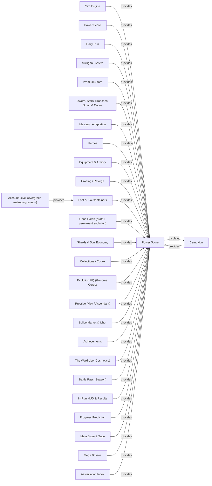
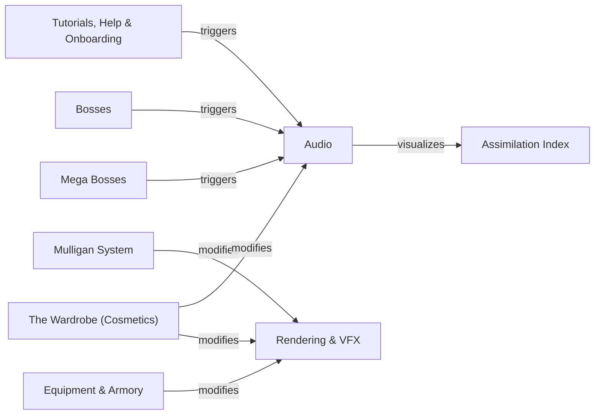

# DIL_GRAPH.md — the Design Intelligence Layer (GENERATED — `npm run dil -- regen`)

> **The project's brain** (docs/DIL.md). 679 nodes · 1146 edges, built from the live
> registries + curated knowledge (src/dev/dil/). **Query it instead of searching the repo:**
> `npm run dil -- node <id>` · `affects <id>` · `requires <id>` · `missing <kind> <edge>` ·
> `checklist tower <kind>` · `find <text>`. Edge kinds are bidirectional (19 kinds).

## Gap report (the graph's own radar)

- **Systems with no test:** `system:infinite`, `system:field-research`, `system:shards-economy`, `system:i18n`, `system:expeditions`, `system:nemesis`, `system:run-ui`, `system:devtools`, `system:ui-kit`
- **Docs referenced by no system (review for retirement):** `ADVANCED-SYSTEMS.md`, `ARCHITECTURE-AUDIT.md`, `BACKLOG.md`, `BALANCE_ARCHITECTURE.md`, `BRANCH-EVOLUTION.md`, `BUGFIX-LOG.md`, `CONTENT-ROADMAP.md`, `DEV-FRAMEWORKS.md`, `DIL_GRAPH.md`, `EA-DESIGN-AUDIT.md`, `ENEMIES.md`, `ENEMY-ROSTER.md`, `GAME-STATE.md`, `HISTORY.md`, `HIVE-SIEGE.md`, `IDENTITY-AUDIT.md`, `LIVING-HIVE.md`, `PIL_REPORT.md`, `PLACEHOLDER-ART.md`, `PLAYTEST-CHECKLIST.md` · …19 more

## Indexes

### Gameplay Index

`tower:needle` · `tower:mortar` · `tower:reactor` · `tower:parasite` · `tower:obelisk` · `tower:maw` · `tower:chrysalis` · `tower:effigy` · `tower:coil` · `tower:siphon` · `tower:sower` · `tower:spire` · `tower:polyp` · `tower:spitfang` · `tower:rift` · `hero:ravager` · `hero:shepherd` · `hero:overseer` · `hero:vitriol` · `hero:revenant` · `enemy:runner` · `enemy:mite` · `enemy:larva` · `enemy:rusher` · `enemy:darter` · `enemy:lasher` · `enemy:brute` · `enemy:tank` · `enemy:golem` · `enemy:colossus` · `enemy:bulwark` · `enemy:warden` · `enemy:knitter` · `enemy:revenant` · `enemy:burrower` · `enemy:molerat` · `enemy:flyer` · `enemy:wisp` · `enemy:gargoyle` · `enemy:cystwraith` · `enemy:broodmother` · `enemy:hivecaller` · `enemy:mender` · `enemy:cantor` · `enemy:bomber` · `enemy:popper` · `enemy:sapper` · `enemy:cataclyst` · `enemy:siegeworm` · `enemy:spitter` · `enemy:stratovore` · `enemy:broodweaver` · `enemy:zealot` · `enemy:carrier` · `enemy:entrencher` · `enemy:oracle` · `enemy:glutling` · `enemy:apex` · `enemy:dreadnought` · `enemy:tyrant` · …30 more

### Progression Index

`system:campaign` · `system:towers` · `system:gene-cards` · `system:progression-gating` · `system:hub-shell` · `system:mega-bosses` · `system:cutscenes` · `concept:progression-gates` · `currency:tower-shards` · `tower:maw` · `tower:chrysalis` · `tower:effigy` · `tower:coil` · `tower:siphon` · `tower:sower` · `tower:spire` · `tower:polyp` · `tower:spitfang` · `tower:rift` · `hero:vitriol` · `hero:revenant`

### Economy / Reward Index

`currency:biomass` · `currency:genome-cores` · `currency:tower-shards` · `currency:hero-shards` · `currency:gene-essence` · `currency:materials` · `currency:stamina` · `system:campaign` · `system:infinite` · `system:boss-rush` · `system:daily` · `system:loot` · `system:achievements` · `system:expeditions` · `enemy:runner` · `enemy:mite` · `enemy:larva` · `enemy:rusher` · `enemy:darter` · `enemy:lasher` · `enemy:brute` · `enemy:tank` · `enemy:golem` · `enemy:colossus` · `enemy:bulwark` · `enemy:warden` · `enemy:knitter` · `enemy:revenant` · `enemy:burrower` · `enemy:molerat` · `enemy:flyer` · `enemy:wisp` · `enemy:gargoyle` · `enemy:cystwraith` · `enemy:broodmother` · `enemy:hivecaller` · `enemy:mender` · `enemy:cantor` · `enemy:bomber` · `enemy:popper` · `enemy:sapper` · `enemy:cataclyst` · `enemy:siegeworm` · `enemy:spitter` · `enemy:stratovore` · `enemy:broodweaver` · `enemy:zealot` · `enemy:carrier` · `enemy:entrencher` · `enemy:oracle` · `enemy:glutling` · `enemy:apex` · `enemy:dreadnought` · `enemy:tyrant` · `achievement:tutorial_complete` · `achievement:first_run` · `achievement:wave5` · `achievement:extract` · `achievement:centurion` · `achievement:veteran` · …75 more

### Power Score Index

`system:engine` · `system:power` · `system:campaign` · `system:daily` · `system:mulligans` · `system:premium` · `system:towers` · `system:mastery` · `system:heroes` · `system:equipment` · `system:crafting` · `system:loot` · `system:gene-cards` · `system:shards-economy` · `system:collection` · `system:evolution-hq` · `system:prestige` · `system:splice-market` · `system:achievements` · `system:cosmetics` · `system:battle-pass` · `system:run-ui` · `system:prediction` · `system:meta-store` · `system:mega-bosses` · `system:assimilation`

### Audio Index

`music:menu` · `music:combat` · `music:boss` · `music:mega` · `music:victory` · `music:defeat` · `music:events` · `music:cinema` · `system:engine` · `system:cosmetics` · `system:onboarding` · `system:bosses` · `system:mega-bosses` · `system:cutscenes` · `system:living-battlefield` · `system:assimilation`

### Teaching Index

`tutorial:combat` · `help:hive-core` · `help:biomorph-conveyor` · `help:strain-evolution` · `help:boss-sieges` · `help:boss-rush` · `help:bio-roulette` · `help:gene-essence` · `help:field-research` · `help:splice-market` · `help:gene-archive` · `help:gene-loadout` · `help:biomass` · `help:wave-rhythm` · `help:game-speed` · `help:emergency-defense` · `help:power-score` · `help:account-level` · `help:genome-rank` · `help:towers` · `help:tower-stars` · `help:tower-mastery` · `help:tower-branches` · `help:adaptation` · `help:mulligans` · `help:gene-cards` · `help:heroes` · `help:hero-evolution` · `help:hero-slots` · `help:equipment` · `help:equipment-reforge` · `help:gear-codex` · `help:genome-core` · `help:prestige` · `help:ascension` · `help:containers` · `help:collection-codex` · `help:phenotype-lab` · `help:season-pass` · `help:premium-store` · `help:campaign` · `help:infinite` · `help:daily-run` · `help:biomes` · `help:bosses` · `guide:beginner` · `guide:towers` · `guide:heroes` · `guide:gene-cards` · `guide:bosses` · `guide:mega-bosses` · `guide:power-score` · `guide:progression` · `guide:campaign` · `guide:infinite` · `guide:boss-rush` · `guide:daily` · `guide:mulligans` · `guide:collections` · `guide:mastery` · …1 more

### Testing Index

`system:engine` · `system:content-infra` · `system:power` · `system:campaign` · `system:pil` · `system:accounts` · `system:boss-rush` · `system:daily` · `system:mulligans` · `system:premium` · `system:net-backend` · `system:towers` · `system:mastery` · `system:heroes` · `system:equipment` · `system:crafting` · `system:loot` · `system:gene-cards` · `system:collection` · `system:evolution-hq` · `system:prestige` · `system:currencies` · `system:splice-market` · `system:achievements` · `system:stats` · `system:liveops` · `system:contracts` · `system:infestation` · `system:chronicle` · `system:cosmetics` · `system:battle-pass` · `system:profile` · `system:onboarding` · `system:account-level` · `system:genome-rank` · `system:progression-gating` · `system:hub-shell` · `system:notifications` · `system:prediction` · `system:meta-store` · `system:bosses` · `system:mega-bosses` · `system:cutscenes` · `system:biomes` · `system:difficulty` · `system:website` · `system:rendering` · `system:living-battlefield` · `system:audio` · `system:assimilation` · `system:dev-registry`

### Developer Tooling Index

`system:website` · `system:devtools` · `system:dev-registry`

## Architecture maps

### Economy & Rewards Map

```mermaid
graph LR
  system_campaign["Campaign"] -->|consumes| system_meta_store["Meta Store & Save"]
  system_infinite["Infinite Mode"] -->|consumes| system_meta_store["Meta Store & Save"]
  system_boss_rush["Boss Rush"] -->|consumes| system_meta_store["Meta Store & Save"]
  system_daily["Daily Run"] -->|consumes| system_meta_store["Meta Store & Save"]
  system_mulligans["Mulligan System"] -->|consumes| system_meta_store["Meta Store & Save"]
  system_premium["Premium Store"] -->|consumes| system_meta_store["Meta Store & Save"]
  system_field_research["Field Research (rewarded studies)"] -->|consumes| system_meta_store["Meta Store & Save"]
  system_net_backend["Backend lanes (net/)"] -->|consumes| system_meta_store["Meta Store & Save"]
  system_towers["Towers, Stars, Branches, Strain & Codex"] -->|consumes| system_meta_store["Meta Store & Save"]
  system_mastery["Mastery / Adaptation"] -->|consumes| system_meta_store["Meta Store & Save"]
  system_heroes["Heroes"] -->|consumes| system_meta_store["Meta Store & Save"]
  system_equipment["Equipment & Armory"] -->|consumes| system_meta_store["Meta Store & Save"]
  system_crafting["Crafting / Reforge"] -->|consumes| system_meta_store["Meta Store & Save"]
  system_loot["Loot & Bio-Containers"] -->|consumes| system_meta_store["Meta Store & Save"]
  system_gene_cards["Gene Cards (draft + permanent evolution)"] -->|consumes| system_meta_store["Meta Store & Save"]
  system_shards_economy["Shards & Star Economy"] -->|consumes| system_meta_store["Meta Store & Save"]
  system_evolution_hq["Evolution HQ (Genome Cores)"] -->|consumes| system_meta_store["Meta Store & Save"]
  system_prestige["Prestige (Molt / Ascendant)"] -->|consumes| system_meta_store["Meta Store & Save"]
  system_splice_market["Splice Market & Ichor"] -->|consumes| system_meta_store["Meta Store & Save"]
  system_achievements["Achievements"] -->|consumes| system_meta_store["Meta Store & Save"]
  system_stats["Lifetime Stats"] -->|consumes| system_meta_store["Meta Store & Save"]
  system_contracts["Champion Contracts"] -->|consumes| system_meta_store["Meta Store & Save"]
  system_infestation["Infestation Map"] -->|consumes| system_meta_store["Meta Store & Save"]
  system_chronicle["Chronicle (patch-note pipeline)"] -->|consumes| system_meta_store["Meta Store & Save"]
  system_expeditions["Hero Expeditions"] -->|consumes| system_meta_store["Meta Store & Save"]
  system_nemesis["Nemesis & Trophies"] -->|consumes| system_meta_store["Meta Store & Save"]
  system_cosmetics["The Wardrobe (Cosmetics)"] -->|consumes| system_meta_store["Meta Store & Save"]
  system_battle_pass["Battle Pass (Season)"] -->|consumes| system_meta_store["Meta Store & Save"]
  system_profile["Player Profile"] -->|consumes| system_meta_store["Meta Store & Save"]
  system_onboarding["Tutorials, Help & Onboarding"] -->|consumes| system_meta_store["Meta Store & Save"]
  system_account_level["Account Level (evergreen meta-progression)"] -->|consumes| system_meta_store["Meta Store & Save"]
  system_genome_rank["Genome Rank (ultimate mastery ladder)"] -->|consumes| system_meta_store["Meta Store & Save"]
  system_progression_gating["Progression Gating & Director"] -->|consumes| system_meta_store["Meta Store & Save"]
  system_prediction["Progress Prediction"] -->|consumes| system_meta_store["Meta Store & Save"]
  system_meta_store["Meta Store & Save"] -->|consumes| system_meta_store["Meta Store & Save"]
  system_bosses["Bosses"] -->|consumes| system_meta_store["Meta Store & Save"]
  system_mega_bosses["Mega Bosses"] -->|consumes| system_meta_store["Meta Store & Save"]
  system_campaign["Campaign"] -->|rewards| currency_genome_cores["Genome Cores (◆)"]
  system_campaign["Campaign"] -->|rewards| currency_tower_shards["Tower Shards (✦)"]
  system_infinite["Infinite Mode"] -->|rewards| currency_genome_cores["Genome Cores (◆)"]
  system_boss_rush["Boss Rush"] -->|rewards| currency_genome_cores["Genome Cores (◆)"]
  system_boss_rush["Boss Rush"] -->|consumes| currency_stamina["Rush Stamina"]
  system_daily["Daily Run"] -->|rewards| currency_genome_cores["Genome Cores (◆)"]
  system_expeditions["Hero Expeditions"] -->|rewards| currency_materials["Materials (mutagen/scrap/catalyst)"]
  system_loot["Loot & Bio-Containers"] -->|rewards| currency_tower_shards["Tower Shards (✦)"]
  system_loot["Loot & Bio-Containers"] -->|rewards| currency_hero_shards["Hero Shards"]
  system_achievements["Achievements"] -->|rewards| currency_genome_cores["Genome Cores (◆)"]
  system_towers["Towers, Stars, Branches, Strain & Codex"] -->|consumes| currency_tower_shards["Tower Shards (✦)"]
  system_heroes["Heroes"] -->|consumes| currency_hero_shards["Hero Shards"]
  system_gene_cards["Gene Cards (draft + permanent evolution)"] -->|consumes| currency_gene_essence["Gene Essence"]
  system_mulligans["Mulligan System"] -->|consumes| currency_gene_essence["Gene Essence"]
  system_equipment["Equipment & Armory"] -->|consumes| currency_materials["Materials (mutagen/scrap/catalyst)"]
  system_meta_store["Meta Store & Save"] -->|consumes| currency_genome_cores["Genome Cores (◆)"]
  system_splice_market["Splice Market & Ichor"] -->|modifies| currency_materials["Materials (mutagen/scrap/catalyst)"]
  system_hub_shell["Hub Shell & Home"] -->|consumes| system_campaign["Campaign"]
  system_living_battlefield["Living Battlefield"] -->|consumes| system_assimilation["Assimilation Index"]
  system_mulligans["Mulligan System"] -->|modifies| system_rendering["Rendering & VFX"]
  system_equipment["Equipment & Armory"] -->|modifies| system_rendering["Rendering & VFX"]
  system_genome_rank["Genome Rank (ultimate mastery ladder)"] -->|consumes| system_account_level["Account Level (evergreen meta-progression)"]
  system_mulligans["Mulligan System"] -->|consumes| system_towers["Towers, Stars, Branches, Strain & Codex"]
  system_cosmetics["The Wardrobe (Cosmetics)"] -->|modifies| system_audio["Audio"]
  system_cosmetics["The Wardrobe (Cosmetics)"] -->|modifies| system_rendering["Rendering & VFX"]
  system_battle_pass["Battle Pass (Season)"] -->|consumes| system_cosmetics["The Wardrobe (Cosmetics)"]
  system_battle_pass["Battle Pass (Season)"] -->|consumes| system_premium["Premium Store"]
```



### Power Score Map



### Determinism Map

```mermaid
graph LR
  system_engine["Sim Engine"] -->|dependsOn| system_content_infra["Content Infrastructure"]
  system_engine["Sim Engine"] -->|dependsOn| system_towers["Towers, Stars, Branches, Strain & Codex"]
  system_engine["Sim Engine"] -->|dependsOn| system_heroes["Heroes"]
  system_engine["Sim Engine"] -->|dependsOn| system_gene_cards["Gene Cards (draft + permanent evolution)"]
  system_engine["Sim Engine"] -->|dependsOn| system_bosses["Bosses"]
  system_engine["Sim Engine"] -->|dependsOn| system_biomes["Biomes"]
  system_engine["Sim Engine"] -->|dependsOn| system_difficulty["Difficulty"]
  system_engine["Sim Engine"] -->|dependsOn| system_assimilation["Assimilation Index"]
  system_power["Power Score"] -->|dependsOn| system_content_infra["Content Infrastructure"]
  system_campaign["Campaign"] -->|dependsOn| system_engine["Sim Engine"]
  system_campaign["Campaign"] -->|dependsOn| system_biomes["Biomes"]
  system_campaign["Campaign"] -->|dependsOn| system_bosses["Bosses"]
  system_campaign["Campaign"] -->|dependsOn| system_difficulty["Difficulty"]
  system_campaign["Campaign"] -->|dependsOn| system_power["Power Score"]
  system_campaign["Campaign"] -->|consumes| system_meta_store["Meta Store & Save"]
  system_infinite["Infinite Mode"] -->|dependsOn| system_engine["Sim Engine"]
  system_infinite["Infinite Mode"] -->|dependsOn| system_loot["Loot & Bio-Containers"]
  system_infinite["Infinite Mode"] -->|dependsOn| system_difficulty["Difficulty"]
  system_infinite["Infinite Mode"] -->|consumes| system_meta_store["Meta Store & Save"]
  system_pil["Public Intelligence Layer"] -->|dependsOn| system_dev_registry["System Registry & Design Intelligence Layer"]
  system_accounts["Account Platform"] -->|dependsOn| system_meta_store["Meta Store & Save"]
  system_accounts["Account Platform"] -->|dependsOn| system_profile["Player Profile"]
  system_boss_rush["Boss Rush"] -->|dependsOn| system_engine["Sim Engine"]
  system_boss_rush["Boss Rush"] -->|dependsOn| system_bosses["Bosses"]
  system_boss_rush["Boss Rush"] -->|dependsOn| system_loot["Loot & Bio-Containers"]
  system_boss_rush["Boss Rush"] -->|dependsOn| system_difficulty["Difficulty"]
  system_boss_rush["Boss Rush"] -->|consumes| system_meta_store["Meta Store & Save"]
  system_daily["Daily Run"] -->|dependsOn| system_engine["Sim Engine"]
  system_daily["Daily Run"] -->|dependsOn| system_campaign["Campaign"]
  system_daily["Daily Run"] -->|dependsOn| system_biomes["Biomes"]
  system_daily["Daily Run"] -->|dependsOn| system_bosses["Bosses"]
  system_daily["Daily Run"] -->|dependsOn| system_towers["Towers, Stars, Branches, Strain & Codex"]
  system_daily["Daily Run"] -->|consumes| system_meta_store["Meta Store & Save"]
  system_mulligans["Mulligan System"] -->|dependsOn| system_content_infra["Content Infrastructure"]
  system_mulligans["Mulligan System"] -->|dependsOn| system_towers["Towers, Stars, Branches, Strain & Codex"]
  system_mulligans["Mulligan System"] -->|dependsOn| system_power["Power Score"]
  system_mulligans["Mulligan System"] -->|dependsOn| system_meta_store["Meta Store & Save"]
  system_mulligans["Mulligan System"] -->|consumes| system_meta_store["Meta Store & Save"]
  system_premium["Premium Store"] -->|dependsOn| system_content_infra["Content Infrastructure"]
  system_premium["Premium Store"] -->|dependsOn| system_splice_market["Splice Market & Ichor"]
  system_premium["Premium Store"] -->|dependsOn| system_daily["Daily Run"]
  system_premium["Premium Store"] -->|dependsOn| system_power["Power Score"]
  system_premium["Premium Store"] -->|consumes| system_meta_store["Meta Store & Save"]
  system_field_research["Field Research (rewarded studies)"] -->|dependsOn| system_premium["Premium Store"]
  system_field_research["Field Research (rewarded studies)"] -->|dependsOn| system_meta_store["Meta Store & Save"]
  system_field_research["Field Research (rewarded studies)"] -->|dependsOn| system_splice_market["Splice Market & Ichor"]
  system_field_research["Field Research (rewarded studies)"] -->|dependsOn| system_boss_rush["Boss Rush"]
  system_field_research["Field Research (rewarded studies)"] -->|dependsOn| system_daily["Daily Run"]
  system_field_research["Field Research (rewarded studies)"] -->|consumes| system_meta_store["Meta Store & Save"]
  system_net_backend["Backend lanes (net/)"] -->|dependsOn| system_premium["Premium Store"]
  system_net_backend["Backend lanes (net/)"] -->|dependsOn| system_meta_store["Meta Store & Save"]
  system_net_backend["Backend lanes (net/)"] -->|dependsOn| system_daily["Daily Run"]
  system_net_backend["Backend lanes (net/)"] -->|dependsOn| system_power["Power Score"]
  system_net_backend["Backend lanes (net/)"] -->|consumes| system_meta_store["Meta Store & Save"]
  system_towers["Towers, Stars, Branches, Strain & Codex"] -->|dependsOn| system_content_infra["Content Infrastructure"]
  system_towers["Towers, Stars, Branches, Strain & Codex"] -->|dependsOn| system_shards_economy["Shards & Star Economy"]
  system_towers["Towers, Stars, Branches, Strain & Codex"] -->|dependsOn| system_campaign["Campaign"]
  system_towers["Towers, Stars, Branches, Strain & Codex"] -->|consumes| system_meta_store["Meta Store & Save"]
  system_mastery["Mastery / Adaptation"] -->|dependsOn| system_stats["Lifetime Stats"]
  system_mastery["Mastery / Adaptation"] -->|dependsOn| system_content_infra["Content Infrastructure"]
  system_mastery["Mastery / Adaptation"] -->|consumes| system_meta_store["Meta Store & Save"]
  system_heroes["Heroes"] -->|dependsOn| system_content_infra["Content Infrastructure"]
  system_heroes["Heroes"] -->|dependsOn| system_engine["Sim Engine"]
  system_heroes["Heroes"] -->|dependsOn| system_shards_economy["Shards & Star Economy"]
  system_heroes["Heroes"] -->|dependsOn| system_campaign["Campaign"]
  system_heroes["Heroes"] -->|consumes| system_meta_store["Meta Store & Save"]
  system_equipment["Equipment & Armory"] -->|dependsOn| system_content_infra["Content Infrastructure"]
  system_equipment["Equipment & Armory"] -->|dependsOn| system_loot["Loot & Bio-Containers"]
  system_equipment["Equipment & Armory"] -->|dependsOn| system_power["Power Score"]
  system_equipment["Equipment & Armory"] -->|dependsOn| system_heroes["Heroes"]
  system_equipment["Equipment & Armory"] -->|consumes| system_meta_store["Meta Store & Save"]
  system_crafting["Crafting / Reforge"] -->|dependsOn| system_equipment["Equipment & Armory"]
  system_crafting["Crafting / Reforge"] -->|dependsOn| system_loot["Loot & Bio-Containers"]
  system_crafting["Crafting / Reforge"] -->|consumes| system_meta_store["Meta Store & Save"]
  system_loot["Loot & Bio-Containers"] -->|dependsOn| system_content_infra["Content Infrastructure"]
  system_loot["Loot & Bio-Containers"] -->|dependsOn| system_power["Power Score"]
  system_loot["Loot & Bio-Containers"] -->|dependsOn| system_campaign["Campaign"]
  system_loot["Loot & Bio-Containers"] -->|consumes| system_meta_store["Meta Store & Save"]
  system_gene_cards["Gene Cards (draft + permanent evolution)"] -->|dependsOn| system_content_infra["Content Infrastructure"]
  system_gene_cards["Gene Cards (draft + permanent evolution)"] -->|dependsOn| system_power["Power Score"]
  system_gene_cards["Gene Cards (draft + permanent evolution)"] -->|dependsOn| system_campaign["Campaign"]
  system_gene_cards["Gene Cards (draft + permanent evolution)"] -->|dependsOn| system_shards_economy["Shards & Star Economy"]
  system_gene_cards["Gene Cards (draft + permanent evolution)"] -->|consumes| system_meta_store["Meta Store & Save"]
  system_shards_economy["Shards & Star Economy"] -->|dependsOn| system_loot["Loot & Bio-Containers"]
  system_shards_economy["Shards & Star Economy"] -->|consumes| system_meta_store["Meta Store & Save"]
  system_collection["Collections / Codex"] -->|dependsOn| system_content_infra["Content Infrastructure"]
  system_collection["Collections / Codex"] -->|dependsOn| system_stats["Lifetime Stats"]
  system_evolution_hq["Evolution HQ (Genome Cores)"] -->|dependsOn| system_content_infra["Content Infrastructure"]
  system_evolution_hq["Evolution HQ (Genome Cores)"] -->|dependsOn| system_prestige["Prestige (Molt / Ascendant)"]
  system_evolution_hq["Evolution HQ (Genome Cores)"] -->|consumes| system_meta_store["Meta Store & Save"]
  system_prestige["Prestige (Molt / Ascendant)"] -->|dependsOn| system_campaign["Campaign"]
  system_prestige["Prestige (Molt / Ascendant)"] -->|dependsOn| system_evolution_hq["Evolution HQ (Genome Cores)"]
  system_prestige["Prestige (Molt / Ascendant)"] -->|consumes| system_meta_store["Meta Store & Save"]
  system_currencies["Currencies & Economy Framework"] -->|dependsOn| system_content_infra["Content Infrastructure"]
  system_splice_market["Splice Market & Ichor"] -->|dependsOn| system_currencies["Currencies & Economy Framework"]
  system_splice_market["Splice Market & Ichor"] -->|dependsOn| system_loot["Loot & Bio-Containers"]
  system_splice_market["Splice Market & Ichor"] -->|consumes| system_meta_store["Meta Store & Save"]
  system_achievements["Achievements"] -->|dependsOn| system_stats["Lifetime Stats"]
  system_achievements["Achievements"] -->|consumes| system_meta_store["Meta Store & Save"]
  system_stats["Lifetime Stats"] -->|consumes| system_meta_store["Meta Store & Save"]
  system_liveops["LiveOps calendar"] -->|dependsOn| system_meta_store["Meta Store & Save"]
  system_liveops["LiveOps calendar"] -->|dependsOn| system_daily["Daily Run"]
  system_contracts["Champion Contracts"] -->|dependsOn| system_meta_store["Meta Store & Save"]
  system_contracts["Champion Contracts"] -->|dependsOn| system_liveops["LiveOps calendar"]
  system_contracts["Champion Contracts"] -->|dependsOn| system_cosmetics["The Wardrobe (Cosmetics)"]
  system_contracts["Champion Contracts"] -->|consumes| system_meta_store["Meta Store & Save"]
  system_infestation["Infestation Map"] -->|dependsOn| system_meta_store["Meta Store & Save"]
  system_infestation["Infestation Map"] -->|dependsOn| system_hub_shell["Hub Shell & Home"]
  system_infestation["Infestation Map"] -->|consumes| system_meta_store["Meta Store & Save"]
  system_chronicle["Chronicle (patch-note pipeline)"] -->|dependsOn| system_meta_store["Meta Store & Save"]
  system_chronicle["Chronicle (patch-note pipeline)"] -->|consumes| system_meta_store["Meta Store & Save"]
  system_expeditions["Hero Expeditions"] -->|dependsOn| system_heroes["Heroes"]
  system_expeditions["Hero Expeditions"] -->|dependsOn| system_meta_store["Meta Store & Save"]
  system_expeditions["Hero Expeditions"] -->|consumes| system_meta_store["Meta Store & Save"]
  system_nemesis["Nemesis & Trophies"] -->|dependsOn| system_engine["Sim Engine"]
  system_nemesis["Nemesis & Trophies"] -->|dependsOn| system_bosses["Bosses"]
  system_nemesis["Nemesis & Trophies"] -->|dependsOn| system_meta_store["Meta Store & Save"]
  system_nemesis["Nemesis & Trophies"] -->|dependsOn| system_cosmetics["The Wardrobe (Cosmetics)"]
  system_nemesis["Nemesis & Trophies"] -->|consumes| system_meta_store["Meta Store & Save"]
  system_cosmetics["The Wardrobe (Cosmetics)"] -->|dependsOn| system_meta_store["Meta Store & Save"]
  system_cosmetics["The Wardrobe (Cosmetics)"] -->|dependsOn| system_collection["Collections / Codex"]
  system_cosmetics["The Wardrobe (Cosmetics)"] -->|dependsOn| system_hub_shell["Hub Shell & Home"]
  system_cosmetics["The Wardrobe (Cosmetics)"] -->|consumes| system_meta_store["Meta Store & Save"]
  system_battle_pass["Battle Pass (Season)"] -->|dependsOn| system_meta_store["Meta Store & Save"]
  system_battle_pass["Battle Pass (Season)"] -->|dependsOn| system_cosmetics["The Wardrobe (Cosmetics)"]
  system_battle_pass["Battle Pass (Season)"] -->|dependsOn| system_premium["Premium Store"]
  system_battle_pass["Battle Pass (Season)"] -->|dependsOn| system_hub_shell["Hub Shell & Home"]
  system_battle_pass["Battle Pass (Season)"] -->|consumes| system_meta_store["Meta Store & Save"]
  system_profile["Player Profile"] -->|dependsOn| system_stats["Lifetime Stats"]
  system_profile["Player Profile"] -->|dependsOn| system_power["Power Score"]
  system_profile["Player Profile"] -->|dependsOn| system_achievements["Achievements"]
  system_profile["Player Profile"] -->|dependsOn| system_collection["Collections / Codex"]
  system_profile["Player Profile"] -->|dependsOn| system_prestige["Prestige (Molt / Ascendant)"]
  system_profile["Player Profile"] -->|dependsOn| system_hub_shell["Hub Shell & Home"]
  system_profile["Player Profile"] -->|consumes| system_meta_store["Meta Store & Save"]
  system_onboarding["Tutorials, Help & Onboarding"] -->|dependsOn| system_engine["Sim Engine"]
  system_onboarding["Tutorials, Help & Onboarding"] -->|dependsOn| system_meta_store["Meta Store & Save"]
  system_onboarding["Tutorials, Help & Onboarding"] -->|consumes| system_meta_store["Meta Store & Save"]
  system_account_level["Account Level (evergreen meta-progression)"] -->|dependsOn| system_meta_store["Meta Store & Save"]
  system_account_level["Account Level (evergreen meta-progression)"] -->|dependsOn| system_loot["Loot & Bio-Containers"]
  system_account_level["Account Level (evergreen meta-progression)"] -->|consumes| system_meta_store["Meta Store & Save"]
  system_genome_rank["Genome Rank (ultimate mastery ladder)"] -->|dependsOn| system_meta_store["Meta Store & Save"]
  system_genome_rank["Genome Rank (ultimate mastery ladder)"] -->|dependsOn| system_account_level["Account Level (evergreen meta-progression)"]
  system_genome_rank["Genome Rank (ultimate mastery ladder)"] -->|dependsOn| system_power["Power Score"]
  system_genome_rank["Genome Rank (ultimate mastery ladder)"] -->|dependsOn| system_collection["Collections / Codex"]
  system_genome_rank["Genome Rank (ultimate mastery ladder)"] -->|consumes| system_meta_store["Meta Store & Save"]
  system_progression_gating["Progression Gating & Director"] -->|dependsOn| system_meta_store["Meta Store & Save"]
  system_progression_gating["Progression Gating & Director"] -->|dependsOn| system_campaign["Campaign"]
  system_progression_gating["Progression Gating & Director"] -->|dependsOn| system_onboarding["Tutorials, Help & Onboarding"]
  system_progression_gating["Progression Gating & Director"] -->|consumes| system_meta_store["Meta Store & Save"]
  system_hub_shell["Hub Shell & Home"] -->|dependsOn| system_meta_store["Meta Store & Save"]
  system_hub_shell["Hub Shell & Home"] -->|dependsOn| system_notifications["Notifications"]
  system_hub_shell["Hub Shell & Home"] -->|dependsOn| system_prediction["Progress Prediction"]
  system_hub_shell["Hub Shell & Home"] -->|dependsOn| system_power["Power Score"]
  system_run_ui["In-Run HUD & Results"] -->|dependsOn| system_engine["Sim Engine"]
  system_run_ui["In-Run HUD & Results"] -->|dependsOn| system_meta_store["Meta Store & Save"]
  system_run_ui["In-Run HUD & Results"] -->|dependsOn| system_power["Power Score"]
  system_run_ui["In-Run HUD & Results"] -->|dependsOn| system_assimilation["Assimilation Index"]
  system_notifications["Notifications"] -->|dependsOn| system_meta_store["Meta Store & Save"]
  system_prediction["Progress Prediction"] -->|dependsOn| system_power["Power Score"]
  system_prediction["Progress Prediction"] -->|consumes| system_meta_store["Meta Store & Save"]
  system_meta_store["Meta Store & Save"] -->|dependsOn| system_content_infra["Content Infrastructure"]
  system_meta_store["Meta Store & Save"] -->|consumes| system_meta_store["Meta Store & Save"]
  system_bosses["Bosses"] -->|dependsOn| system_engine["Sim Engine"]
  system_bosses["Bosses"] -->|dependsOn| system_content_infra["Content Infrastructure"]
  system_bosses["Bosses"] -->|consumes| system_meta_store["Meta Store & Save"]
  system_mega_bosses["Mega Bosses"] -->|dependsOn| system_engine["Sim Engine"]
  system_mega_bosses["Mega Bosses"] -->|dependsOn| system_content_infra["Content Infrastructure"]
  system_mega_bosses["Mega Bosses"] -->|dependsOn| system_bosses["Bosses"]
  system_mega_bosses["Mega Bosses"] -->|consumes| system_meta_store["Meta Store & Save"]
  system_cutscenes["Story Cutscenes & Memory Archive"] -->|dependsOn| system_mega_bosses["Mega Bosses"]
  system_cutscenes["Story Cutscenes & Memory Archive"] -->|dependsOn| system_meta_store["Meta Store & Save"]
  system_cutscenes["Story Cutscenes & Memory Archive"] -->|dependsOn| system_audio["Audio"]
  system_biomes["Biomes"] -->|dependsOn| system_content_infra["Content Infrastructure"]
  system_difficulty["Difficulty"] -->|dependsOn| system_content_infra["Content Infrastructure"]
  system_website["Marketing Website"] -->|dependsOn| system_content_infra["Content Infrastructure"]
  system_rendering["Rendering & VFX"] -->|dependsOn| system_engine["Sim Engine"]
  system_living_battlefield["Living Battlefield"] -->|dependsOn| system_rendering["Rendering & VFX"]
  system_living_battlefield["Living Battlefield"] -->|dependsOn| system_engine["Sim Engine"]
  system_living_battlefield["Living Battlefield"] -->|dependsOn| system_audio["Audio"]
  system_living_battlefield["Living Battlefield"] -->|dependsOn| system_assimilation["Assimilation Index"]
  system_audio["Audio"] -->|dependsOn| system_engine["Sim Engine"]
  system_devtools["Dev Tools & Debug"] -->|dependsOn| system_meta_store["Meta Store & Save"]
  system_devtools["Dev Tools & Debug"] -->|dependsOn| system_assimilation["Assimilation Index"]
  concept_replays["Replays"] -->|dependsOn| concept_determinism["Determinism"]
  concept_daily_seed["Daily Seed"] -->|dependsOn| concept_determinism["Determinism"]
  concept_golden_test["Golden Test"] -->|tests| concept_determinism["Determinism"]
  system_engine["Sim Engine"] -->|provides| concept_determinism["Determinism"]
  system_rendering["Rendering & VFX"] -->|consumes| concept_determinism["Determinism"]
  system_living_battlefield["Living Battlefield"] -->|consumes| concept_determinism["Determinism"]
  system_prediction["Progress Prediction"] -->|dependsOn| concept_determinism["Determinism"]
  system_net_backend["Backend lanes (net/)"] -->|consumes| concept_replays["Replays"]
  system_hub_shell["Hub Shell & Home"] -->|consumes| system_campaign["Campaign"]
  system_living_battlefield["Living Battlefield"] -->|consumes| system_assimilation["Assimilation Index"]
  system_account_level["Account Level (evergreen meta-progression)"] -->|provides| system_loot["Loot & Bio-Containers"]
  system_genome_rank["Genome Rank (ultimate mastery ladder)"] -->|consumes| system_account_level["Account Level (evergreen meta-progression)"]
  system_mulligans["Mulligan System"] -->|consumes| system_towers["Towers, Stars, Branches, Strain & Codex"]
  system_battle_pass["Battle Pass (Season)"] -->|consumes| system_cosmetics["The Wardrobe (Cosmetics)"]
  system_battle_pass["Battle Pass (Season)"] -->|consumes| system_premium["Premium Store"]
```

### Presentation Couplings Map



## Concepts (6)

### `concept:power-score` — Power Score

ONE account-strength number folded from every permanent bucket + the in-run temporary bucket (core/power.ts).

  - displays → `system:campaign` — recommended-power readiness on stage cards
  - providedBy ← `system:engine` — emits the TEMPORARY in-run bucket (game.powerEffects)
  - providedBy ← `system:power` — IS the model (buckets, effectsPower, FIELD_WEIGHT)
  - providedBy ← `system:campaign` — recommended-power display; first-clear rewards move account Power indirectly
  - providedBy ← `system:daily` — recommended-power readiness on the day card
  - providedBy ← `system:mulligans` — a DEDICATED, separately-inspectable PowerParts.mulligans bucket (accountMulliganPower) — modifiers × rarity × level; exactly 1 until an organism is fully assembled
  - providedBy ← `system:premium` — offerPowerPotential — the honest "up to +N when invested" estimate
  - providedBy ← `system:towers` — stars/branches feed permanent + temporary buckets
  - providedBy ← `system:mastery` — mastery multiplier folds into the permanent bucket
  - providedBy ← `system:heroes` — hero stars/evolution feed permanent + temporary buckets
  - providedBy ← `system:equipment` — equipped items score via itemPower into the gear bucket
  - providedBy ← `system:crafting` — reforged items re-score through the gear bucket
  - providedBy ← `system:loot` — reads Power for catch-up bias; grants move account Power
  - _…18 more (query: `npm run dil -- node concept:power-score`)_

### `concept:determinism` — Determinism

A run is a pure function of seed + inputs — the invariant behind replays, fair dailies and the golden test. The renderer NEVER writes into the sim.

  - requiredBy ← `concept:replays` — a replay IS a recomputation
  - requiredBy ← `concept:daily-seed` — fair boards need identical runs
  - testedBy ← `concept:golden-test` — six pinned seeds catch any sim drift
  - providedBy ← `system:engine` — fixed-timestep sim, seeded rng, render/sim wall
  - consumedBy ← `system:rendering` — render-only contract: reads snapshots, NEVER writes sim state
  - consumedBy ← `system:living-battlefield` — terrain evolution is render-side; inert at stage 0
  - requiredBy ← `system:prediction` — outcome prediction replays candidate futures

### `concept:golden-test` — Golden Test

Six seeded runs pinned byte-for-byte (core/golden.test.ts) — the tripwire for any accidental sim change.

  - tests → `concept:determinism` — six pinned seeds catch any sim drift
  - conflictsWith ← `system:genome-rank` — promotion rewards are meta-only (cores/ichor/containers/titles) — NO gameplay passives may ride ranks, or goldens and pay-to-win both break
  - conflictsWith ← `system:mulligans` — adaptation bonuses fold ONLY through existing MulliganStats channels inside resolveMulligan — a new sim branch for a class bonus breaks the inactive⇒identity gate
  - conflictsWith ← `system:battle-pass` — permanents/stacks fold at the META seams (effects + accountEconomyBonuses) only — a fresh save must fold NOTHING or the pinned seeds break
  - conflictsWith ← `system:cosmetics` — skins/visual tiers must stay render-only; any def stat touched for looks breaks the pinned seeds

### `concept:progression-gates` — Progression Gates

Depth/stage/shard requirements that stage content unlocks (towers, heroes, cards, modes).

  - gates → `hero:vitriol` — progression unlock requirement
  - gates → `hero:revenant` — progression unlock requirement
  - gates → `system:gene-cards` — 44 cards unlock by progression
  - gates → `system:towers` — locked kinds carry unlockShards + stage requirements
  - providedBy ← `system:campaign` — depth is the master unlock axis
  - providedBy ← `system:cutscenes` — memories unlock from milestones (stages, molt, depth) and first mega defeats; each grants a small capped passive

### `concept:replays` — Replays

Seed+inputs compressed to a shareable code; recomputed locally (net/replayShare.ts, Replay Theater).

  - dependsOn → `concept:determinism` — a replay IS a recomputation
  - consumedBy ← `system:net-backend` — leaderboard verification recomputes submitted runs

### `concept:daily-seed` — Daily Seed

One deterministic run per UTC day, identical worldwide (core/daily.ts).

  - dependsOn → `concept:determinism` — fair boards need identical runs
  - documentedBy ← `guide:daily`

## Currencies (7)

### `currency:biomass` — Biomass

THE run currency — dropped by kills, spent on towers/upgrades; dies with the run.

  - consumedBy ← `tower:needle` — placement cost 100
  - consumedBy ← `tower:mortar` — placement cost 170
  - consumedBy ← `tower:reactor` — placement cost 120
  - consumedBy ← `tower:parasite` — placement cost 130
  - consumedBy ← `tower:obelisk` — placement cost 165
  - consumedBy ← `tower:maw` — placement cost 140
  - consumedBy ← `tower:chrysalis` — placement cost 155
  - consumedBy ← `tower:effigy` — placement cost 150
  - consumedBy ← `tower:coil` — placement cost 150
  - consumedBy ← `tower:siphon` — placement cost 175
  - consumedBy ← `tower:sower` — placement cost 130
  - consumedBy ← `tower:spire` — placement cost 150
  - _…44 more (query: `npm run dil -- node currency:biomass`)_

### `currency:genome-cores` — Genome Cores (◆)

The permanent meta currency — genome upgrades, rewards, achievement payouts.

  - rewardedBy ← `achievement:tutorial_complete` — +20 on unlock
  - rewardedBy ← `achievement:first_run` — +10 on unlock
  - rewardedBy ← `achievement:wave5` — +15 on unlock
  - rewardedBy ← `achievement:extract` — +50 on unlock
  - rewardedBy ← `achievement:centurion` — +25 on unlock
  - rewardedBy ← `achievement:veteran` — +50 on unlock
  - rewardedBy ← `achievement:hoarder` — +40 on unlock
  - rewardedBy ← `achievement:first_star` — +10 on unlock
  - rewardedBy ← `achievement:star3` — +30 on unlock
  - rewardedBy ← `achievement:specialist` — +25 on unlock
  - rewardedBy ← `achievement:mulligan_grafted` — +25 on unlock
  - rewardedBy ← `achievement:mulligan_splicer` — +40 on unlock
  - _…75 more (query: `npm run dil -- node currency:genome-cores`)_

### `currency:tower-shards` — Tower Shards (✦)

Per-tower permanent currency: unlocks locked towers, buys Star evolutions.

  - gates → `tower:maw` — 80 shards to unlock
  - gates → `tower:chrysalis` — 120 shards to unlock
  - gates → `tower:effigy` — 150 shards to unlock
  - gates → `tower:coil` — 320 shards to unlock
  - gates → `tower:siphon` — 200 shards to unlock
  - gates → `tower:sower` — 360 shards to unlock
  - gates → `tower:spire` — 400 shards to unlock
  - gates → `tower:polyp` — 440 shards to unlock
  - gates → `tower:spitfang` — 45 shards to unlock
  - gates → `tower:rift` — 640 shards to unlock
  - rewardedBy ← `system:campaign` — stage rewards feed unlock gates
  - rewardedBy ← `system:loot` — chest pipeline
  - consumedBy ← `system:towers` — unlocks + Star purchases

### `currency:hero-shards` — Hero Shards

Per-hero permanent currency for hero Stars and unlocks.

  - rewardedBy ← `system:loot` — chest pipeline
  - consumedBy ← `system:heroes` — unlocks + Star purchases

### `currency:gene-essence` — Gene Essence

Levels Gene Archive cards and assembles/levels Mulligan modifiers.

  - consumedBy ← `system:gene-cards` — Archive leveling
  - consumedBy ← `system:mulligans` — modifier assembly + leveling

### `currency:materials` — Materials (mutagen/scrap/catalyst)

Equipment crafting + reforge inputs (Armory).

  - rewardedBy ← `system:expeditions` — mission payouts
  - consumedBy ← `system:equipment` — crafting + reforge ops
  - modifiedBy ← `system:splice-market` — exchange rates between currencies

### `currency:stamina` — Rush Stamina

Attempt gate for Boss Rush — makes each gauntlet deliberate.

  - documentedBy ← `guide:boss-rush`
  - consumedBy ← `system:boss-rush` — attempt gating

## Systems (60)

### `system:engine` — Sim Engine

Deterministic fixed-timestep simulation — the Game, combat, statuses, targeting, spawning, run events.

_at: src/core/game.ts, src/core/combat.ts, src/core/status.ts, src/core/targeting.ts, src/core/reactions.ts, src/core/spawndirector.ts, src/core/runEvents.ts, src/core/events.ts, src/core/map.ts, src/core/ability.ts, src/core/mutators.ts, src/core/modifiers.ts, src/core/simharness.ts, src/core/director.ts, src/core/sim.testutil.ts_

  - dependsOn → `system:content-infra`
  - dependsOn → `system:towers`
  - dependsOn → `system:heroes`
  - dependsOn → `system:gene-cards`
  - dependsOn → `system:bosses`
  - dependsOn → `system:biomes`
  - dependsOn → `system:difficulty`
  - dependsOn → `system:assimilation`
  - provides → `concept:power-score` — emits the TEMPORARY in-run bucket (game.powerEffects)
  - provides → `concept:determinism` — fixed-timestep sim, seeded rng, render/sim wall
  - requiredBy ← `system:campaign`
  - requiredBy ← `system:infinite`
  - requiredBy ← `system:boss-rush`
  - requiredBy ← `system:daily`
  - requiredBy ← `system:heroes`
  - requiredBy ← `system:nemesis`
  - requiredBy ← `system:onboarding`
  - requiredBy ← `system:run-ui`
  - requiredBy ← `system:bosses`
  - requiredBy ← `system:mega-bosses`
  - requiredBy ← `system:rendering`
  - requiredBy ← `system:living-battlefield`
  - _…167 more (query: `npm run dil -- node system:engine`)_

### `system:content-infra` — Content Infrastructure

Registry<T>, validation, config tunables, shared types/math/rng/spatial — the data-driven backbone.

_at: src/core/registry.ts, src/core/validate.ts, src/core/config.ts, src/core/types.ts, src/core/math.ts, src/core/rng.ts, src/core/spatial.ts, src/core/features.ts, src/vite-env.d.ts_

  - requiredBy ← `system:engine`
  - requiredBy ← `system:power`
  - requiredBy ← `system:mulligans`
  - requiredBy ← `system:premium`
  - requiredBy ← `system:towers`
  - requiredBy ← `system:mastery`
  - requiredBy ← `system:heroes`
  - requiredBy ← `system:equipment`
  - requiredBy ← `system:loot`
  - requiredBy ← `system:gene-cards`
  - requiredBy ← `system:collection`
  - requiredBy ← `system:evolution-hq`
  - _…14 more (query: `npm run dil -- node system:content-infra`)_

### `system:power` — Power Score

ONE account-strength number folded from every permanent bucket + the in-run temporary bucket.

_at: src/core/power.ts, src/state/itemPower.ts, src/state/powerEvents.ts, src/ui/components/PowerScore.tsx, src/ui/components/PowerDelta.tsx, src/ui/components/PowerToaster.tsx_

  - dependsOn → `system:content-infra`
  - provides → `concept:power-score` — IS the model (buckets, effectsPower, FIELD_WEIGHT)
  - requiredBy ← `system:campaign`
  - requiredBy ← `system:mulligans`
  - requiredBy ← `system:premium`
  - requiredBy ← `system:net-backend`
  - requiredBy ← `system:equipment`
  - requiredBy ← `system:loot`
  - requiredBy ← `system:gene-cards`
  - requiredBy ← `system:profile`
  - requiredBy ← `system:genome-rank`
  - requiredBy ← `system:hub-shell`
  - requiredBy ← `system:run-ui`
  - requiredBy ← `system:prediction`
  - _…7 more (query: `npm run dil -- node system:power`)_

### `system:campaign` — Campaign

Procedural authored-feeling stages; depth is the master progression gate. Authored EVENTS (Elite Rush / Boss Gauntlet / Genome Cache / Mutation choice) punctuate the ladder via a data registry.

_at: src/core/campaign.ts, src/core/campaignEvents.ts, src/core/hash.ts, src/ui/CampaignScreen.tsx_

  - dependsOn → `system:engine`
  - dependsOn → `system:biomes`
  - dependsOn → `system:bosses`
  - dependsOn → `system:difficulty`
  - dependsOn → `system:power`
  - provides → `concept:power-score` — recommended-power display; first-clear rewards move account Power indirectly
  - consumes → `system:meta-store` — owns save field 'campaign'
  - rewards → `currency:genome-cores` — first-clear + stage rewards
  - rewards → `currency:tower-shards` — stage rewards feed unlock gates
  - provides → `concept:progression-gates` — depth is the master unlock axis
  - requiredBy ← `system:daily`
  - requiredBy ← `system:towers`
  - requiredBy ← `system:heroes`
  - requiredBy ← `system:loot`
  - requiredBy ← `system:gene-cards`
  - requiredBy ← `system:prestige`
  - requiredBy ← `system:progression-gating`
  - taughtBy ← `help:campaign`
  - documentedBy ← `doc:CAMPAIGN.md`
  - documentedBy ← `doc:CAMPAIGN-EVENTS.md`
  - documentedBy ← `doc:MODE-IDENTITY.md`
  - documentedBy ← `doc:STAGES.md`
  - _…6 more (query: `npm run dil -- node system:campaign`)_

### `system:infinite` — Infinite Mode

Endless AI-Director escalation; personal bests + richest loot meter.

_at: src/ui/InfiniteScreen.tsx_

  - dependsOn → `system:engine`
  - dependsOn → `system:loot`
  - dependsOn → `system:difficulty`
  - consumes → `system:meta-store` — owns save field 'bestWave'
  - rewards → `currency:genome-cores` — depth records + chest tiers
  - taughtBy ← `help:infinite`
  - documentedBy ← `doc:ENDLESS-SCALING.md`
  - documentedBy ← `doc:MODE-IDENTITY.md`
  - documentedBy ← `guide:infinite`
  - balancedBy ← `system:difficulty` — endless threat curves

### `system:pil` — Public Intelligence Layer

The DIL public extension: page registry + media manifest joined to the knowledge graph; impact analysis (game changed -> which public surfaces update), structural rot audit (ghost refs, broken links, placeholders), staleness reporting.

_at: src/dev/pil/pil.ts, src/dev/pil/storeCopy.ts_

  - dependsOn → `system:dev-registry`
  - documentedBy ← `doc:PIL.md`
  - testedBy ← `test:src/dev/pil/pil.test.ts`

### `system:accounts` — Account Platform

Guest + email accounts over the anonymous identity; versioned modular save envelope; bidirectional cloud sync engine with conflict resolution; offline-first with server-feature gating.

_at: src/account/accountStore.ts, src/account/providers.ts, src/save/envelope.ts, src/save/merge.ts, src/net/syncEngine.ts, src/net/connectivity.ts, src/ui/components/AccountPanel.tsx_

  - dependsOn → `system:meta-store`
  - dependsOn → `system:profile`
  - conflictsWith → `system:meta-store` — cloud sync merges the same save blob the local store owns — schema changes need BOTH migration paths
  - documentedBy ← `doc:ACCOUNTS.md`
  - documentedBy ← `doc:DEPLOYMENT.md`
  - testedBy ← `test:src/net/syncEngine.test.ts`
  - testedBy ← `test:src/save/envelope.test.ts`

### `system:boss-rush` — Boss Rush

The gauntlet: wave N = N assembled bosses (staggered column + thinned escort); rewards pay per boss defeated; own records/prediction channel.

_at: src/ui/BossRushScreen.tsx, src/state/bioRoulette.ts, src/ui/BioRoulette.tsx_

  - dependsOn → `system:engine`
  - dependsOn → `system:bosses`
  - dependsOn → `system:loot`
  - dependsOn → `system:difficulty`
  - consumes → `system:meta-store` — owns save field 'rushBestWave'
  - consumes → `system:meta-store` — owns save field 'rushBestBoss'
  - consumes → `system:meta-store` — owns save field 'rushStamina'
  - rewards → `currency:genome-cores` — pays PER BOSS DEFEATED
  - consumes → `currency:stamina` — attempt gating
  - requiredBy ← `system:field-research`
  - taughtBy ← `help:boss-rush`
  - taughtBy ← `help:bio-roulette`
  - referencedBy ← `achievement:rush_first`
  - referencedBy ← `achievement:rush_wave5`
  - referencedBy ← `achievement:rush_wave10`
  - referencedBy ← `achievement:rush_boss15`
  - referencedBy ← `achievement:rush_bosses50`
  - referencedBy ← `achievement:rush_bosses250`
  - referencedBy ← `achievement:roulette_first`
  - referencedBy ← `achievement:roulette_50`
  - documentedBy ← `doc:BOSS-RUSH.md`
  - _…3 more (query: `npm run dil -- node system:boss-rush`)_

### `system:daily` — Daily Run

The fourth pillar: one deterministic seed per UTC day ⇒ the SAME 20-wave run worldwide — rolled biome, seeded 3-boss roster, TWO gameplay modifiers, a 3-tower Conveyor pool.

_at: src/core/daily.ts, src/core/dailyModifiers.ts, src/ui/DailyScreen.tsx_

  - dependsOn → `system:engine`
  - dependsOn → `system:campaign`
  - dependsOn → `system:biomes`
  - dependsOn → `system:bosses`
  - dependsOn → `system:towers`
  - provides → `concept:power-score` — recommended-power readiness on the day card
  - consumes → `system:meta-store` — owns save field 'daily'
  - rewards → `currency:genome-cores` — completion reward independent of rank
  - conflictsWith → `system:mulligans` — the Daily SUBSTITUTES seeded organisms via mulliganOverride — account organisms must not leak into a daily run
  - requiredBy ← `system:premium`
  - requiredBy ← `system:field-research`
  - requiredBy ← `system:net-backend`
  - requiredBy ← `system:liveops`
  - documentedBy ← `doc:DAILY-RUN.md`
  - documentedBy ← `doc:MODE-IDENTITY.md`
  - documentedBy ← `guide:daily`
  - testedBy ← `test:src/core/daily.test.ts`

### `system:mulligans` — Mulligan System

A permanent endgame pillar: each tower kind permanently owns ONE biomechanical Mulligan organism assembled from THREE genetic modifiers. Fully data-driven — a new modifier is one registry row; the organism's appearance, animation and projectile are PROCEDURALLY generated from the modifiers' stat profile. Inactive until all three slots fill ⇒ golden-safe; folds through the existing TowerMods channels (no new sim branch). OVERHAUL (v29): pieces are EXCLUSIVE (one tower at a time; catalog pinned at 3× the tower roster), the pillar gates behind 3 distinct Mega Boss kills, duplicates dissolve to Gene Essence, and the REFORGE wheel (core/mulliganReforge.ts, ichor-fueled, 1–3 slots by combined rarity) permanently BINDS an organism to its host — legendary rolls grant GLOBAL passives.

_at: src/core/mulligan.ts, src/core/combatClass.ts, src/render/mulliganOrganism.ts, src/state/mulliganLabModel.ts, src/ui/MulliganLab.tsx, src/core/mulliganReforge.ts, src/render/reforgeWheel.ts_

  - dependsOn → `system:content-infra`
  - dependsOn → `system:towers`
  - dependsOn → `system:power`
  - dependsOn → `system:meta-store`
  - provides → `concept:power-score` — a DEDICATED, separately-inspectable PowerParts.mulligans bucket (accountMulliganPower) — modifiers × rarity × level; exactly 1 until an organism is fully assembled
  - consumes → `system:meta-store` — owns save field 'mulligans'
  - consumes → `system:meta-store` — owns save field 'mulliganDex'
  - consumes → `currency:gene-essence` — modifier assembly + leveling
  - modifies → `system:rendering` — grafted organisms recolor host towers, projectiles and Living-Battlefield ground hues
  - consumes → `system:towers` — ADAPTATIONS compare modifier classes to TowerDef.combatClass — resolveMulligan needs the HOST class everywhere (a class-less call silently drops the set bonus); COMBAT_CLASSES (core/combatClass.ts) is the ONE display table
  - conflictsWith → `concept:golden-test` — adaptation bonuses fold ONLY through existing MulliganStats channels inside resolveMulligan — a new sim branch for a class bonus breaks the inactive⇒identity gate
  - taughtBy ← `help:mulligans`
  - referencedBy ← `achievement:mulligan_grafted`
  - referencedBy ← `achievement:mulligan_splicer`
  - referencedBy ← `achievement:mulligan_transcendent`
  - referencedBy ← `achievement:mulligan_dex`
  - referencedBy ← `achievement:mulligan_perfected`
  - referencedBy ← `achievement:mulligan_ascendant`
  - referencedBy ← `achievement:mulligan_overlord`
  - documentedBy ← `doc:MULLIGANS.md`
  - documentedBy ← `guide:mulligans`
  - testedBy ← `test:src/core/mulligan.test.ts`
  - testedBy ← `test:src/render/mulliganOrganism.test.ts`
  - _…2 more (query: `npm run dil -- node system:mulligans`)_

### `system:premium` — Premium Store

Ethical monetization as pure data: Ichor bundles, permanent packs, one rotating daily pack, and windowed event offers on a registry; purchases accelerate but never replace gameplay (Power moves zero until invested; money never mints prestige or crosses campaign gates).

_at: src/core/premium.ts, src/ui/PremiumStore.tsx_

  - dependsOn → `system:content-infra`
  - dependsOn → `system:splice-market`
  - dependsOn → `system:daily`
  - dependsOn → `system:power`
  - provides → `concept:power-score` — offerPowerPotential — the honest "up to +N when invested" estimate
  - consumes → `system:meta-store` — owns save field 'premium'
  - requiredBy ← `system:field-research`
  - requiredBy ← `system:net-backend`
  - requiredBy ← `system:battle-pass`
  - documentedBy ← `doc:PREMIUM-STORE.md`
  - documentedBy ← `doc:PREMIUM-ECONOMY-REPORT.md`
  - testedBy ← `test:src/core/premium.test.ts`
  - consumedBy ← `system:battle-pass` — the store 'bp_premium' season SKU and the 250-Ichor door set the SAME per-season flag; offerValueIchor hardcodes 250 (functions/ bundle stays lean) and battlePass.test.ts pins it against BP.premiumIchor

### `system:field-research` — Field Research (rewarded studies)

The OPTIONAL rewarded-ad lane, in-fiction: daily field studies pay small progression-scaled samples, one-run boosts, a sealed specimen, rush stamina, and a once-daily player-chosen emergency payout. Registry-driven (a holiday reward is one data row), provider-agnostic (VITE_ADS_PROVIDER; hidden when none), menus-only, never optimal (validator + tests cap ichor and boost magnitudes).

_at: src/core/research.ts, src/ads/provider.ts, src/ads/googleAdapter.ts, src/ui/components/FieldResearch.tsx, src/net/events.ts_

  - dependsOn → `system:premium`
  - dependsOn → `system:meta-store`
  - dependsOn → `system:splice-market`
  - dependsOn → `system:boss-rush`
  - dependsOn → `system:daily`
  - consumes → `system:meta-store` — owns save field 'research'
  - taughtBy ← `help:field-research`
  - documentedBy ← `doc:RESEARCH.md`
  - documentedBy ← `doc:WEBSITE.md`

### `system:net-backend` — Backend lanes (net/)

The client side of the Cloudflare Pages Functions backend (docs/DEPLOYMENT.md): anonymous identity + sync codes, Stripe Checkout begin/claim with exactly-once local application, manual cloud save backup/restore, day-ticketed leaderboard submission, and the invisible Turnstile challenge. Everything fail-soft — offline play never depends on any of it.

_at: src/net/identity.ts, src/net/checkout.ts, src/net/cloudSave.ts, src/net/syncEngine.ts, src/net/connectivity.ts, src/net/leaderboard.ts, src/net/turnstile.ts, src/core/replay.ts, src/net/replayShare.ts, src/ui/SpectateView.tsx, src/ui/components/ShareReplay.tsx, src/ui/components/CloudBackup.tsx, src/ui/components/LeaderboardBlock.tsx_

  - dependsOn → `system:premium`
  - dependsOn → `system:meta-store`
  - dependsOn → `system:daily`
  - dependsOn → `system:power`
  - consumes → `system:meta-store` — owns save field 'premium'
  - consumes → `concept:replays` — leaderboard verification recomputes submitted runs
  - extends → `system:account-level` — leaderboard modes accountLevel/weeklyXp/monthlyXp: score = XP, wave = level; the SERVER derives period bucket keys (functions/lib/period.ts mirrors core weekKey/monthKey)
  - documentedBy ← `doc:DEPLOYMENT.md`
  - documentedBy ← `doc:REPLAY-SHARE.md`
  - testedBy ← `test:src/core/replay.test.ts`
  - testedBy ← `test:src/net/replayShare.test.ts`
  - testedBy ← `test:src/net/syncEngine.test.ts`

### `system:towers` — Towers, Stars, Branches, Strain & Codex

Tower roster; permanent Star evolutions; in-run Branch specialization; the in-run STRAIN evolution layer (docs/STRAIN.md); the Codex.

_at: src/core/stars.ts, src/core/branches.ts, src/core/branchTree.ts, src/core/strains.ts, src/core/conveyor.ts, src/ui/TowerLab.tsx, src/ui/TowerCodex.tsx, src/ui/TowerPortrait.tsx, src/ui/towerLabModel.ts, src/ui/towerCodexModel.ts, src/ui/StarCeremony.tsx, src/ui/components/BranchTree.tsx_

  - dependsOn → `system:content-infra`
  - dependsOn → `system:shards-economy`
  - dependsOn → `system:campaign`
  - provides → `concept:power-score` — stars/branches feed permanent + temporary buckets
  - consumes → `system:meta-store` — owns save field 'towerStars'
  - consumes → `system:meta-store` — owns save field 'towerShards'
  - consumes → `system:meta-store` — owns save field 'towerMasteryXp'
  - consumes → `system:meta-store` — owns save field 'towerForks'
  - consumes → `currency:tower-shards` — unlocks + Star purchases
  - requiredBy ← `system:engine`
  - requiredBy ← `system:daily`
  - requiredBy ← `system:mulligans`
  - contains ← `tower:needle`
  - contains ← `tower:mortar`
  - contains ← `tower:reactor`
  - contains ← `tower:parasite`
  - contains ← `tower:obelisk`
  - contains ← `tower:maw`
  - contains ← `tower:chrysalis`
  - contains ← `tower:effigy`
  - contains ← `tower:coil`
  - _…26 more (query: `npm run dil -- node system:towers`)_

### `system:mastery` — Mastery / Adaptation

Identity-through-use: titles, procedural ranks, halos, Antigen-Point decision trees.

_at: src/core/mastery.ts, src/core/adaptation.ts, src/state/masteryEvents.ts, src/ui/MasteryProfile.tsx, src/ui/components/AdaptationTree.tsx, src/ui/components/MasteryToaster.tsx_

  - dependsOn → `system:stats`
  - dependsOn → `system:content-infra`
  - provides → `concept:power-score` — mastery multiplier folds into the permanent bucket
  - consumes → `system:meta-store` — owns save field 'towerMasteryXp'
  - consumes → `system:meta-store` — owns save field 'heroMasteryXp'
  - consumes → `system:meta-store` — owns save field 'adaptation'
  - consumes → `system:meta-store` — owns save field 'antigen'
  - documentedBy ← `doc:MASTERY.md`
  - documentedBy ← `doc:ADAPTATION.md`
  - documentedBy ← `guide:mastery`
  - testedBy ← `test:src/core/adaptation.test.ts`
  - testedBy ← `test:src/core/mastery.test.ts`
  - referencedBy ← `system:account-level` — account titles share save.equippedTitle with mastery rewards — display surfaces MUST resolve via titleName() (profile.ts), not masteryRewardById alone
  - referencedBy ← `system:genome-rank` — grank_<n> titles share save.equippedTitle — always resolve display through titleName() (profile.ts), never per-registry lookups

### `system:heroes` — Heroes

Autonomous champions: AI behaviors, abilities, stars, slots, in-run Hero Evolution.

_at: src/core/heroIdentity.ts, src/core/heroLore.ts, src/core/heroEvolution.ts, src/ui/HeroLab.tsx, src/ui/HeroSelectPanel.tsx, src/ui/HeroSlotUnlock.tsx, src/ui/HeroEvolutionPanel.tsx, src/state/heroView.ts, src/ui/components/HeroPortrait.tsx_

  - dependsOn → `system:content-infra`
  - dependsOn → `system:engine`
  - dependsOn → `system:shards-economy`
  - dependsOn → `system:campaign`
  - provides → `concept:power-score` — hero stars/evolution feed permanent + temporary buckets
  - consumes → `system:meta-store` — owns save field 'heroStars'
  - consumes → `system:meta-store` — owns save field 'heroShards'
  - consumes → `system:meta-store` — owns save field 'heroUnlocked'
  - consumes → `system:meta-store` — owns save field 'heroLoadout'
  - consumes → `system:meta-store` — owns save field 'heroMasteryXp'
  - consumes → `currency:hero-shards` — unlocks + Star purchases
  - requiredBy ← `system:engine`
  - requiredBy ← `system:equipment`
  - requiredBy ← `system:expeditions`
  - contains ← `hero:ravager`
  - contains ← `hero:shepherd`
  - contains ← `hero:overseer`
  - contains ← `hero:vitriol`
  - contains ← `hero:revenant`
  - taughtBy ← `tutorial:combat`
  - taughtBy ← `help:heroes`
  - taughtBy ← `help:hero-slots`
  - documentedBy ← `doc:HEROES.md`
  - _…7 more (query: `npm run dil -- node system:heroes`)_

### `system:equipment` — Equipment & Armory

~180 behavioral items, affixes, sets; per-hero Weapon/Armor/Relic loadouts. Bespoke PROCEDURAL card art (render/equipmentArt.ts) — a unique rarity-graded biomechanical emblem per item, derived from slot/subtype/set/rarity/affixes (no placeholder icons; scales to hundreds for free) — and, in-game, the equipped loadout draws as hero GEAR on the battlefield.

_at: src/core/equipment.ts, src/render/equipmentArt.ts, src/ui/EquipmentPanel.tsx, src/ui/ItemDetails.tsx, src/ui/EquipmentCollection.tsx, src/ui/components/ItemArt.tsx, src/ui/components/HeroGearPreview.tsx_

  - dependsOn → `system:content-infra`
  - dependsOn → `system:loot`
  - dependsOn → `system:power`
  - dependsOn → `system:heroes`
  - provides → `concept:power-score` — equipped items score via itemPower into the gear bucket
  - consumes → `system:meta-store` — owns save field 'equipment'
  - consumes → `currency:materials` — crafting + reforge ops
  - modifies → `system:rendering` — heroes render worn gear; gear color skins hero projectiles
  - requiredBy ← `system:crafting`
  - taughtBy ← `help:equipment`
  - documentedBy ← `doc:EQUIPMENT.md`
  - documentedBy ← `doc:EQUIPMENT-PHILOSOPHY.md`
  - documentedBy ← `guide:heroes`
  - testedBy ← `test:src/core/equipment.test.ts`
  - testedBy ← `test:src/render/equipmentArt.test.ts`

### `system:crafting` — Crafting / Reforge

Materials sink: enhance, reroll, targeted swap, rarity upgrade.

_at: src/core/reforge.ts, src/core/materialDrop.ts_

  - dependsOn → `system:equipment`
  - dependsOn → `system:loot`
  - provides → `concept:power-score` — reforged items re-score through the gear bucket
  - consumes → `system:meta-store` — owns save field 'mats'
  - consumes → `system:meta-store` — owns save field 'matPity'
  - taughtBy ← `help:equipment-reforge`
  - documentedBy ← `doc:REFORGE.md`
  - testedBy ← `test:src/core/materialDrop.test.ts`
  - testedBy ← `test:src/core/reforge.test.ts`

### `system:loot` — Loot & Bio-Containers

Meter → pre-determined containers → Vault ceremony; pity + progression catch-up.

_at: src/core/loot.ts, src/core/lootQueue.ts, src/core/progressionLoot.ts, src/state/lootbox.ts, src/state/vaultReveal.ts, src/ui/GeneticVault.tsx, src/ui/VaultReveal.tsx, src/ui/LootMeter.tsx, src/ui/LootToaster.tsx_

  - dependsOn → `system:content-infra`
  - dependsOn → `system:power`
  - dependsOn → `system:campaign`
  - provides → `concept:power-score` — reads Power for catch-up bias; grants move account Power
  - consumes → `system:meta-store` — owns save field 'lootQueue'
  - consumes → `system:meta-store` — owns save field 'pendingContainers'
  - rewards → `currency:tower-shards` — chest pipeline
  - rewards → `currency:hero-shards` — chest pipeline
  - requiredBy ← `system:infinite`
  - requiredBy ← `system:boss-rush`
  - requiredBy ← `system:equipment`
  - requiredBy ← `system:crafting`
  - requiredBy ← `system:shards-economy`
  - requiredBy ← `system:splice-market`
  - requiredBy ← `system:account-level`
  - taughtBy ← `help:containers`
  - documentedBy ← `doc:LOOTBOX.md`
  - documentedBy ← `doc:LOOT-PROGRESSION.md`
  - documentedBy ← `doc:REWARD-PRESENTATION.md`
  - testedBy ← `test:src/core/loot.test.ts`
  - _…5 more (query: `npm run dil -- node system:loot`)_

### `system:gene-cards` — Gene Cards (draft + permanent evolution)

Between-wave drafts + the permanent Archive: Essence-funded levels, gates, loadouts, Ascension backend.

_at: src/core/cards.ts, src/core/geneCards.ts, src/core/geneUpgrades.ts, src/core/geneEssence.ts, src/core/geneLoadout.ts, src/state/geneArchive.ts, src/ui/GeneArchive.tsx, src/ui/DraftModal.tsx, src/ui/cardAffects.tsx, src/ui/components/GeneCardArt.tsx, src/core/doctrines.ts_

  - dependsOn → `system:content-infra`
  - dependsOn → `system:power`
  - dependsOn → `system:campaign`
  - dependsOn → `system:shards-economy`
  - provides → `concept:power-score` — permanent levels fold linearly (GENE_POWER_SCALE); drafts feed the temporary bucket; validator enforces visibility
  - consumes → `system:meta-store` — owns save field 'genes'
  - consumes → `system:meta-store` — owns save field 'geneEssence'
  - consumes → `system:meta-store` — owns save field 'geneSlots'
  - consumes → `system:meta-store` — owns save field 'geneLoadout'
  - consumes → `currency:gene-essence` — Archive leveling
  - requiredBy ← `system:engine`
  - taughtBy ← `tutorial:combat`
  - taughtBy ← `help:gene-cards`
  - taughtBy ← `help:gene-essence`
  - taughtBy ← `help:gene-archive`
  - taughtBy ← `help:gene-loadout`
  - referencedBy ← `achievement:collector`
  - documentedBy ← `doc:GENE-EVOLUTION.md`
  - documentedBy ← `doc:CARDS.md`
  - documentedBy ← `doc:GENE-AUDIT-REPORT.md`
  - documentedBy ← `guide:gene-cards`
  - testedBy ← `test:src/core/cards.test.ts`
  - _…7 more (query: `npm run dil -- node system:gene-cards`)_

### `system:shards-economy` — Shards & Star Economy

Strain Samples / Apex Genome income + star cost curves + duplicate→Essence conversion seam.

  - dependsOn → `system:loot`
  - provides → `concept:power-score` — stars bought with shards move the permanent bucket
  - consumes → `system:meta-store` — owns save field 'shards'
  - consumes → `system:meta-store` — owns save field 'lifetimeShards'
  - requiredBy ← `system:towers`
  - requiredBy ← `system:heroes`
  - requiredBy ← `system:gene-cards`
  - taughtBy ← `help:tower-stars`
  - documentedBy ← `doc:SHARD-ECONOMY.md`
  - documentedBy ← `doc:ECONOMY.md`
  - documentedBy ← `guide:progression`
  - conflictsWith ← `system:account-level` — level-reward cores must stay a supplement — sim guard trips if they exceed 15% of lifetime cores (reward ∝ n^0.7 vs requirement ∝ n^1.25)

### `system:collection` — Collections / Codex

Discovery + usage tiers across all content; ranks, rewards, small Power fold.

_at: src/core/collection.ts, src/ui/CollectionPanel.tsx_

  - dependsOn → `system:content-infra`
  - dependsOn → `system:stats`
  - provides → `concept:power-score` — completion feeds the collection bucket
  - requiredBy ← `system:cosmetics`
  - requiredBy ← `system:profile`
  - requiredBy ← `system:genome-rank`
  - referencedBy ← `achievement:collector`
  - documentedBy ← `doc:COLLECTION.md`
  - documentedBy ← `guide:collections`
  - testedBy ← `test:src/core/collection.test.ts`
  - referencedBy ← `system:hub-shell` — home surfaces show CollectionView.pct (discovery); mixing in rank-weighted .completion once put two contradictory percentages on one board

### `system:evolution-hq` — Evolution HQ (Genome Cores)

Permanent categorized account upgrades bought with Genome Cores.

_at: src/state/evolutionHQ.ts, src/ui/EvolutionHQ.tsx, src/ui/EvolutionUnlock.tsx_

  - dependsOn → `system:content-infra`
  - dependsOn → `system:prestige`
  - provides → `concept:power-score` — META_UPGRADES fold into the permanent bucket
  - consumes → `system:meta-store` — owns save field 'upgrades'
  - requiredBy ← `system:prestige`
  - taughtBy ← `help:genome-core`
  - documentedBy ← `doc:EVOLUTION-HQ.md`
  - documentedBy ← `doc:GENOME-CORE.md`
  - documentedBy ← `doc:EVOLUTION-CAP.md`
  - testedBy ← `test:src/state/evolutionHQ.test.ts`

### `system:prestige` — Prestige (Molt / Ascendant)

Reset loop: mint Ascendant Cells → compounding multiplier + permanent tree.

_at: src/core/prestige.ts, src/core/ascendant.ts, src/ui/PrestigePanel.tsx_

  - dependsOn → `system:campaign`
  - dependsOn → `system:evolution-hq`
  - provides → `concept:power-score` — the P bucket (log fold of Cells + tree)
  - consumes → `system:meta-store` — owns save field 'prestige'
  - references → `system:cutscenes` — the Molt Chamber + ceremony reuse the cutscene molt tableau via drawCutsceneFrame — retheme it, never fork it
  - extends → `system:meta-store` — Ascendant nodes multiply the permanent buckets
  - requiredBy ← `system:evolution-hq`
  - requiredBy ← `system:profile`
  - taughtBy ← `help:prestige`
  - taughtBy ← `help:ascension`
  - documentedBy ← `doc:PROGRESSION-PHILOSOPHY.md`
  - documentedBy ← `doc:PROGRESSION-REDESIGN.md`
  - documentedBy ← `doc:SIMULATION-FRAMEWORK.md`
  - documentedBy ← `doc:BALANCE_REPORT.md`
  - documentedBy ← `guide:prestige`
  - testedBy ← `test:src/core/ascendant.test.ts`
  - testedBy ← `test:src/core/prestige.test.ts`

### `system:currencies` — Currencies & Economy Framework

Currency identities (icon/color/tooltip/format) + the adaptive economy framework: one factor-traced income composition per currency, adaptive seams, health guards.

_at: src/core/currencies.ts, src/core/economyDirector.ts, src/ui/components/CurrencyIcon.tsx_

  - dependsOn → `system:content-infra`
  - requiredBy ← `system:splice-market`
  - taughtBy ← `help:gene-essence`
  - documentedBy ← `doc:ECONOMY.md`
  - documentedBy ← `doc:LEXICON.md`
  - documentedBy ← `doc:ECONOMY_FORMULAS.md`
  - testedBy ← `test:src/core/economyDirector.test.ts`

### `system:splice-market` — Splice Market & Ichor

The refreshing store (deterministic 5-min stock windows; cores for small goods, Ichor for premium goods + Bio-Containers) and the Ichor premium currency: front-loaded faucets (achievements, collection ranks, campaign milestones, Infinite depth records, container bleeds) with an under-water gamble EV so lucky chains always die. The ICHOR EXCHANGE (core/ichorExchange.ts, docs/MARKET.md §exchange, v30): six 30-min barter lots (two per currency — cores/essence/scrap) priced from the Ichor reserve snapshot at window roll, sublinear volume (qty ∝ cost^0.7 — bulk pays a leaner rate, anti-snowball), max-window clock-tamper rule.

_at: src/core/market.ts, src/core/ichorExchange.ts, src/state/spliceMarket.ts, src/ui/SpliceMarket.tsx_

  - dependsOn → `system:currencies`
  - dependsOn → `system:loot`
  - provides → `concept:power-score` — none by design (Ichor never feeds Power)
  - consumes → `system:meta-store` — owns save field 'ichor'
  - consumes → `system:meta-store` — owns save field 'lifetimeIchor'
  - consumes → `system:meta-store` — owns save field 'market'
  - consumes → `system:meta-store` — owns save field 'ichorExchange'
  - modifies → `currency:materials` — exchange rates between currencies
  - requiredBy ← `system:premium`
  - requiredBy ← `system:field-research`
  - taughtBy ← `help:splice-market`
  - documentedBy ← `doc:MARKET.md`
  - testedBy ← `test:src/core/market.test.ts`

### `system:achievements` — Achievements

Milestone recognition with auto-granted Shard rewards.

_at: src/state/achievements.ts, src/ui/AchievementPanel.tsx, src/ui/AchievementToaster.tsx_

  - dependsOn → `system:stats`
  - provides → `concept:power-score` — rewards (shards) move Power indirectly
  - consumes → `system:meta-store` — owns save field 'achievements'
  - rewards → `currency:genome-cores` — auto-granted on unlock
  - requiredBy ← `system:profile`
  - contains ← `achievement:tutorial_complete`
  - contains ← `achievement:first_run`
  - contains ← `achievement:wave5`
  - contains ← `achievement:extract`
  - contains ← `achievement:centurion`
  - contains ← `achievement:veteran`
  - contains ← `achievement:hoarder`
  - contains ← `achievement:first_star`
  - contains ← `achievement:star3`
  - contains ← `achievement:specialist`
  - contains ← `achievement:hero_shard`
  - _…73 more (query: `npm run dil -- node system:achievements`)_

### `system:stats` — Lifetime Stats

Run summaries accumulated into lifetime stats — the substrate for mastery/collection/achievements/profile.

_at: src/state/stats.ts_

  - consumes → `system:meta-store` — owns save field 'stats'
  - consumes → `system:meta-store` — owns save field 'totalRuns'
  - consumes → `system:meta-store` — owns save field 'bestWave'
  - requiredBy ← `system:mastery`
  - requiredBy ← `system:collection`
  - requiredBy ← `system:achievements`
  - requiredBy ← `system:profile`
  - referencedBy ← `achievement:collector`
  - documentedBy ← `doc:PROGRESSION-SYSTEMS.md`
  - testedBy ← `test:src/state/stats.test.ts`

### `system:liveops` — LiveOps calendar

Deterministic UTC event calendar (docs/LIVEOPS.md): weekend surge, rotating weekly spotlights, Mutation Wednesday, monthly Harvest Moon + quarterly Bloom Cycle fold ×1-baseline lane multipliers (cores/essence/materials) into finishRun + openContainer; a schedule engine (windowEnd/nextWindow) drives the hub console countdowns + UP NEXT forecast. Clock pinned under tests.

_at: src/core/liveops.ts, src/ui/components/LiveEventsStrip.tsx_

  - dependsOn → `system:meta-store`
  - dependsOn → `system:daily`
  - requiredBy ← `system:contracts`
  - documentedBy ← `doc:LIVEOPS.md`
  - testedBy ← `test:src/core/liveops.test.ts`
  - plannedBy ← `system:website` — community spotlight + seasonal event pages once events ship

### `system:i18n` — Localization Core

Typed t()/locale layer (docs/I18N.md): the EN literal catalog defines MsgKey, ES/PT are Record<MsgKey, string> so a missing translation is a compile error; locale persists to localStorage and re-renders via useLocale. Chrome strings migrate through it; content registries stay English for now.

_at: src/i18n/index.ts_

  - documentedBy ← `doc:I18N.md`

### `system:contracts` — Champion Contracts

Weekly authored constraint runs (docs/CONTRACTS.md): a deterministic UTC 3-contract board (same weekIndex as LiveOps), a data constraint vocabulary evaluated against run facts in finishRun, core payouts folded into the run reward, and Gilded-phenotype marquee exclusives.

_at: src/core/contracts.ts, src/ui/components/ContractsCard.tsx_

  - dependsOn → `system:meta-store`
  - dependsOn → `system:liveops`
  - dependsOn → `system:cosmetics`
  - consumes → `system:meta-store` — owns save field 'contracts'
  - documentedBy ← `doc:CONTRACTS.md`
  - testedBy ← `test:src/core/contracts.test.ts`

### `system:infestation` — Infestation Map

The persistent conquest meta (docs/INFESTATION.md): four regions x four sectors; every finished run feeds a target with SPILLOVER (overflow pours into the same region, then the emptiest anywhere), sectors climb named TIERS (Dormant->Foothold->Colony->Stronghold->Saturated), saturation halves decay, a fully-saturated region ENTRENCHES (bonus x1.25). Passives scale by LIVE fractions; neglect decays lazily from wall-clock timestamps (nothing ticks). Pin a sector, a region (feeds its emptiest), or spread. A LIVING canvas territory map (render/infestationMap.ts): organic region lobes + creeping cell fills + pinned pulse + feed reticle + entrenchment auras, with an a11y button overlay.

_at: src/core/infestation.ts, src/render/infestationMap.ts, src/ui/components/InfestationBoard.tsx_

  - dependsOn → `system:meta-store`
  - dependsOn → `system:hub-shell`
  - consumes → `system:meta-store` — owns save field 'infestation'
  - documentedBy ← `doc:INFESTATION.md`
  - testedBy ← `test:src/render/infestationMap.test.ts`

### `system:chronicle` — Chronicle (patch-note pipeline)

Automated git-history documentation (docs/CHANGELOG-PIPELINE.md): npm run notes classifies every commit (pure classifier, standard categories, review flags), diffs the content registries for major additions, and regenerates the committed artifacts — releases.gen.ts (in-game Update Briefing, save v28 patchNotes.seen/optOut), site/patchnotes.json (the /news/ page via npm run site), docs/HISTORY.md, dev-blog drafts every ≥10 commits.

_at: src/changelog/types.ts, src/changelog/classify.ts, src/changelog/releases.gen.ts, src/ui/UpdateBriefing.tsx_

  - dependsOn → `system:meta-store`
  - consumes → `system:meta-store` — owns save field 'patchNotes'
  - documentedBy ← `doc:CHANGELOG-PIPELINE.md`
  - testedBy ← `test:src/changelog/classify.test.ts`

### `system:expeditions` — Hero Expeditions

The benched-hero idle lane (docs/EXPEDITIONS.md): owned-but-unfielded heroes run real-time away-missions (absolute endsAt timestamps — offline-safe, testable now params) on a 7-mission board with class affinity (+25%), risk tiers (deterministic hash-rolled windfalls/setbacks), rare finds, and a per-mission mastery ledger (save v27). HeroLab panel: offer matrix with projected multipliers, progress bars, outcome claim ceremony.

_at: src/core/expeditions.ts_

  - dependsOn → `system:heroes`
  - dependsOn → `system:meta-store`
  - consumes → `system:meta-store` — owns save field 'expeditions'
  - rewards → `currency:materials` — mission payouts
  - documentedBy ← `doc:EXPEDITIONS.md`

### `system:nemesis` — Nemesis & Trophies

The personal hunt (docs/NEMESIS.md): a boss standing at your defeat becomes the Nemesis — it returns buffed (+15%/slay hp, capped, via RunOptions ⇒ replay-deterministic) and branded; revenge pays scaled cores + an Abyssal phenotype. Boss trophies: one organ per chassis/mega, DERIVED ownership, ONE equipped tradeoff pair folded like gear.

_at: src/core/trophies.ts_

  - dependsOn → `system:engine`
  - dependsOn → `system:bosses`
  - dependsOn → `system:meta-store`
  - dependsOn → `system:cosmetics`
  - consumes → `system:meta-store` — owns save field 'nemesis'
  - consumes → `system:meta-store` — owns save field 'equippedTrophy'
  - plans → `system:bosses` — nemesis organisms escalate the boss framework with per-player memory
  - documentedBy ← `doc:NEMESIS.md`

### `system:cosmetics` — The Wardrobe (Cosmetics)

The cosmetics ECOSYSTEM (docs/COSMETICS.md): unit Phenotypes (six theme families × every tower/hero, generator-driven) PLUS the account Wardrobe — 34 global cosmetic kinds in four groups (arena FX / audio packs / interface shells / commander identity) on one validated registry with typed unlock sources (campaign/depth/daily/rush/roulette/achievements/collection ranks/Ichor boutique/battle pass/milestones/events). Payloads are flat presentation params consumed by the dressing layer (root attrs + cue families + music transforms + renderer kit). Six collection codices, milestone reward track, persisted unlock-ceremony queue. Save v31 wardrobe record.

_at: src/core/cosmetics.ts, src/core/wardrobe.ts, src/ui/PhenotypeLab.tsx, src/ui/Wardrobe.tsx, src/ui/wardrobeDressing.ts, src/ui/components/WardrobeReveal.tsx, src/render/wardrobeFx.ts_

  - dependsOn → `system:meta-store`
  - dependsOn → `system:collection`
  - dependsOn → `system:hub-shell`
  - provides → `concept:power-score` — via the collection codex weights (tiny, cosmetic-first)
  - consumes → `system:meta-store` — owns save field 'cosmetics'
  - consumes → `system:meta-store` — owns save field 'wardrobe'
  - modifies → `system:audio` — Phenotype firing variants repitch tower fire cues; Wardrobe packs re-voice whole cue FAMILIES (tower/enemy/notif/hero/wave) + re-voice menu/combat music (root/tempo/brightness) — per-unit variants always win over the global pack
  - modifies → `system:rendering` — the Wardrobe render kit (render/wardrobeFx.ts) re-dresses nucleus/battlefield/trails/tower FX/placement and PRECOMPUTES enemy/boss/mega palettes — module state set by ui/wardrobeDressing.ts, never per-frame work
  - conflictsWith → `concept:power-score` — wardrobe codices carry ZERO powerWeight — starter items are pre-owned, so any weight moves a fresh account off POWER_BASE (the 1002 bug)
  - conflictsWith → `concept:golden-test` — skins/visual tiers must stay render-only; any def stat touched for looks breaks the pinned seeds
  - requiredBy ← `system:contracts`
  - requiredBy ← `system:nemesis`
  - requiredBy ← `system:battle-pass`
  - documentedBy ← `doc:COSMETICS.md`
  - testedBy ← `test:src/core/cosmetics.test.ts`
  - testedBy ← `test:src/core/wardrobe.test.ts`
  - consumedBy ← `system:battle-pass` — reward tables DERIVE cosmetic placement from wardrobe battlepass sources — battlePass.test.ts fails if an item slot and the table disagree

### `system:battle-pass` — Battle Pass (Season)

Rotating 100-level dual-track season over the Wardrobe (docs/BATTLEPASS.md): data-driven SeasonDefs (theme + passives + phenotype levels), reward tables DERIVED from wardrobe battlepass sources + filler cadence (no empty levels), XP from runs/achievements/expeditions/roulette, Ichor level buys, rewarded-ad advances, premium via Ichor (250) or the store Season Pass SKU, free premium tastes at 1/50/99, permanents once-ever with repeat replacements, the infinitely-stacking Perennial Bloom, max-window tamper rule, rollover auto-claim. Save v31 battlePass record.

_at: src/core/battlePass.ts, src/ui/BattlePassScreen.tsx_

  - dependsOn → `system:meta-store`
  - dependsOn → `system:cosmetics`
  - dependsOn → `system:premium`
  - dependsOn → `system:hub-shell`
  - provides → `concept:power-score` — permanents + Perennial stacks fold into the meta bucket
  - consumes → `system:meta-store` — owns save field 'battlePass'
  - consumes → `system:cosmetics` — reward tables DERIVE cosmetic placement from wardrobe battlepass sources — battlePass.test.ts fails if an item slot and the table disagree
  - consumes → `system:premium` — the store 'bp_premium' season SKU and the 250-Ichor door set the SAME per-season flag; offerValueIchor hardcodes 250 (functions/ bundle stays lean) and battlePass.test.ts pins it against BP.premiumIchor
  - conflictsWith → `concept:golden-test` — permanents/stacks fold at the META seams (effects + accountEconomyBonuses) only — a fresh save must fold NOTHING or the pinned seeds break
  - documentedBy ← `doc:BATTLEPASS.md`
  - testedBy ← `test:src/core/battlePass.test.ts`

### `system:profile` — Player Profile

The account dashboard: banner + frames, registry-driven career stats, power breakdown, showcase, milestone timeline, next milestones, analytics.

_at: src/state/profile.ts, src/ui/PlayerProfile.tsx, src/ui/components/CommanderName.tsx_

  - dependsOn → `system:stats`
  - dependsOn → `system:power`
  - dependsOn → `system:achievements`
  - dependsOn → `system:collection`
  - dependsOn → `system:prestige`
  - dependsOn → `system:hub-shell`
  - consumes → `system:meta-store` — owns save field 'createdAt'
  - consumes → `system:meta-store` — owns save field 'profileName'
  - consumes → `system:meta-store` — owns save field 'profileFrame'
  - consumes → `system:meta-store` — owns save field 'timeline'
  - requiredBy ← `system:accounts`
  - documentedBy ← `doc:PROFILE.md`
  - testedBy ← `test:src/state/profile.test.ts`

### `system:onboarding` — Tutorials, Help & Onboarding

Combat Tutorial over a live sim, HUD Tour, mechanics-registry Help wiki, What's New, loading tips.

_at: src/ui/InitCutscene.tsx, src/render/introScenes.ts, src/core/tutorial.ts, src/state/tutorial.ts, src/state/mechanics.ts, src/ui/TutorialRunner.tsx, src/ui/tutorial/*, src/ui/HelpWiki.tsx, src/ui/WhatsNew.tsx, src/ui/HudTour.tsx, src/ui/tips.ts_

  - dependsOn → `system:engine`
  - dependsOn → `system:meta-store`
  - consumes → `system:meta-store` — owns save field 'tutorial'
  - consumes → `system:meta-store` — owns save field 'help'
  - triggers → `system:audio` — the opening cinematic scores itself via the cinema track + cin_* beat cues
  - requiredBy ← `system:progression-gating`
  - contains ← `tutorial:combat`
  - contains ← `help:hive-core`
  - contains ← `help:biomorph-conveyor`
  - contains ← `help:strain-evolution`
  - contains ← `help:boss-sieges`
  - contains ← `help:boss-rush`
  - contains ← `help:bio-roulette`
  - contains ← `help:gene-essence`
  - contains ← `help:field-research`
  - contains ← `help:splice-market`
  - contains ← `help:gene-archive`
  - _…43 more (query: `npm run dil -- node system:onboarding`)_

### `system:account-level` — Account Level (evergreen meta-progression)

Uncapped Account XP from nearly every activity; smooth infinite curve; deterministic weighted per-level rewards; infinite milestones with titles; week/month XP ledgers.

_at: src/core/accountLevel.ts, src/ui/components/AccountXpBar.tsx_

  - dependsOn → `system:meta-store`
  - dependsOn → `system:loot`
  - consumes → `system:meta-store` — owns save field 'accountXp'
  - consumes → `system:meta-store` — every XP-paying persist wraps in foldAccountXp — a NEW XP source is one ACCOUNT_XP row + one wrap, never a parallel pipeline
  - provides → `system:loot` — every 5th level + milestones bank Bio-Containers as kind:'cache' — REUSE the cache branch, never add a PendingContainer kind for level rewards
  - references → `system:mastery` — account titles share save.equippedTitle with mastery rewards — display surfaces MUST resolve via titleName() (profile.ts), not masteryRewardById alone
  - conflictsWith → `system:shards-economy` — level-reward cores must stay a supplement — sim guard trips if they exceed 15% of lifetime cores (reward ∝ n^0.7 vs requirement ∝ n^1.25)
  - requiredBy ← `system:genome-rank`
  - documentedBy ← `doc:ACCOUNT-LEVEL.md`
  - testedBy ← `test:src/core/accountLevel.test.ts`
  - extendedBy ← `system:net-backend` — leaderboard modes accountLevel/weeklyXp/monthlyXp: score = XP, wave = level; the SERVER derives period bucket keys (functions/lib/period.ts mirrors core weekKey/monthKey)
  - consumedBy ← `system:genome-rank` — account level is ONE weighted GENOME_SOURCES row — the rank measures breadth across every system, never one lane

### `system:genome-rank` — Genome Rank (ultimate mastery ladder)

Hidden Genome Rating from weighted contributions of EVERY major system (GENOME_SOURCES — data-driven); prestigious ranks Dormant → Living Catastrophe, then infinite; one-time promotion rewards + titles; Progress Advisor names the easiest remaining rating.

_at: src/core/genomeRank.ts, src/ui/components/GenomeRankPanel.tsx_

  - dependsOn → `system:meta-store`
  - dependsOn → `system:account-level`
  - dependsOn → `system:power`
  - dependsOn → `system:collection`
  - consumes → `system:meta-store` — owns save field 'genomeRank'
  - consumes → `system:account-level` — account level is ONE weighted GENOME_SOURCES row — the rank measures breadth across every system, never one lane
  - consumes → `concept:power-score` — power is the strength category source; if its live share exceeds 35% the sim dominance guard trips (retune exp/div in the table)
  - references → `system:mastery` — grank_<n> titles share save.equippedTitle — always resolve display through titleName() (profile.ts), never per-registry lookups
  - conflictsWith → `concept:golden-test` — promotion rewards are meta-only (cores/ichor/containers/titles) — NO gameplay passives may ride ranks, or goldens and pay-to-win both break
  - documentedBy ← `doc:GENOME-RANK.md`
  - testedBy ← `test:src/core/genomeRank.test.ts`

### `system:progression-gating` — Progression Gating & Director

The reveal framework: one registry deciding when every hub screen/currency unlocks, teasers + unlock briefings, reveal latching, exposure tracking, cognitive-load bands.

_at: src/state/unlocks.ts, src/state/progressionDirector.ts, src/state/navBus.ts_

  - dependsOn → `system:meta-store`
  - dependsOn → `system:campaign`
  - dependsOn → `system:onboarding`
  - consumes → `system:meta-store` — owns save field 'director'
  - gates → `system:hub-shell` — nav entries, wallet chips and home widgets reveal via the FEATURES registry (teasers = next two reveals)
  - extends → `system:onboarding` — screen-linked mechanics rows delegate unlock predicates to featureRevealed — What's New fires exactly when a wing reveals
  - documentedBy ← `doc:PROGRESSION-GATING.md`
  - documentedBy ← `doc:UNLOCK-TREE.md`
  - testedBy ← `test:src/state/progressionDirector.test.ts`
  - testedBy ← `test:src/state/unlocks.test.ts`

### `system:hub-shell` — Hub Shell & Home

The nav shell + the Command Center home: registry-driven widgets, living World Status, mission control, feed/roadmap/army, dashboards.

_at: src/ui/Hub.tsx, src/ui/CommandCenter.tsx, src/ui/DeployScreen.tsx, src/ui/homeModel.ts, src/ui/WorldStatus.tsx, src/ui/ProgressDashboard.tsx, src/ui/NextGoalBanner.tsx, src/state/nextGoal.ts, src/state/progressionLoop.ts, src/ui/hubProgress.ts, src/ui/homeBaseTiers.ts, src/ui/LabAtmosphere.tsx, src/ui/App.tsx, src/ui/ErrorBoundary.tsx, src/main.tsx, src/net/swRegister.ts, src/ui/components/UpdateToast.tsx, src/ui/components/Popup.tsx_

  - dependsOn → `system:meta-store`
  - dependsOn → `system:notifications`
  - dependsOn → `system:prediction`
  - dependsOn → `system:power`
  - consumes → `system:campaign` — buildHomeView generates the campaign frontier ONCE per save change — home widgets read ctx.view, never re-derive models
  - references → `system:collection` — home surfaces show CollectionView.pct (discovery); mixing in rank-weighted .completion once put two contradictory percentages on one board
  - requiredBy ← `system:infestation`
  - requiredBy ← `system:cosmetics`
  - requiredBy ← `system:battle-pass`
  - requiredBy ← `system:profile`
  - documentedBy ← `doc:COMMAND-CENTER.md`
  - documentedBy ← `doc:HOME-BASE.md`
  - documentedBy ← `doc:ONE-MORE-RUN.md`
  - documentedBy ← `doc:HUD.md`
  - documentedBy ← `doc:PROGRESSION-LOOP.md`
  - testedBy ← `test:src/state/nextGoal.test.ts`
  - testedBy ← `test:src/state/progressionLoop.test.ts`
  - testedBy ← `test:src/ui/homeBaseTiers.test.ts`
  - _…3 more (query: `npm run dil -- node system:hub-shell`)_

### `system:run-ui` — In-Run HUD & Results

The battlefield interface: HUD, toolbar, inspector, build panel, results + reward reveal.

_at: src/ui/GameView.tsx, src/ui/Hud.tsx, src/ui/Toolbar.tsx, src/ui/BuildControls.tsx, src/ui/BuildPanel.tsx, src/ui/Inspector.tsx, src/ui/Results.tsx, src/ui/RewardReveal.tsx, src/ui/RewardPreview.tsx_

  - dependsOn → `system:engine`
  - dependsOn → `system:meta-store`
  - dependsOn → `system:power`
  - dependsOn → `system:assimilation`
  - provides → `concept:power-score` — renders live run Power
  - taughtBy ← `tutorial:combat`
  - documentedBy ← `doc:HUD.md`
  - documentedBy ← `doc:READABILITY.md`
  - documentedBy ← `doc:REWARD-PRESENTATION.md`

### `system:notifications` — Notifications

Generic menu badges: registered count(save) sources per nav channel.

_at: src/state/notifications.ts, src/state/notificationSources.ts_

  - dependsOn → `system:meta-store`
  - requiredBy ← `system:hub-shell`
  - documentedBy ← `doc:NOTIFICATIONS.md`
  - testedBy ← `test:src/state/notifications.test.ts`

### `system:prediction` — Progress Prediction

Self-calibrating reach forecasts from Power history.

_at: src/core/predict.ts, src/ui/PredictionPanel.tsx_

  - dependsOn → `system:power`
  - provides → `concept:power-score` — consumes the score as its input signal
  - consumes → `system:meta-store` — owns save field 'prediction'
  - dependsOn → `concept:determinism` — outcome prediction replays candidate futures
  - requiredBy ← `system:hub-shell`
  - taughtBy ← `help:power-score`
  - documentedBy ← `doc:PREDICTION.md`
  - testedBy ← `test:src/core/predict.test.ts`

### `system:meta-store` — Meta Store & Save

The permanent progression store + versioned/checksummed persistence, backups, resets, prefs.

_at: src/state/meta.ts, src/state/store.ts, src/state/prefs.ts, src/state/devReset.ts, src/save/*, src/ui/SaveManager.tsx_

  - dependsOn → `system:content-infra`
  - provides → `concept:power-score` — recomputes the account score on every persist
  - consumes → `system:meta-store` — owns save field 'ALL (owner)'
  - consumes → `currency:genome-cores` — genome upgrade tree
  - consumedBy ← `system:campaign` — owns save field 'campaign'
  - consumedBy ← `system:infinite` — owns save field 'bestWave'
  - requiredBy ← `system:accounts`
  - consumedBy ← `system:boss-rush` — owns save field 'rushBestWave'
  - consumedBy ← `system:boss-rush` — owns save field 'rushBestBoss'
  - consumedBy ← `system:boss-rush` — owns save field 'rushStamina'
  - consumedBy ← `system:daily` — owns save field 'daily'
  - requiredBy ← `system:mulligans`
  - consumedBy ← `system:mulligans` — owns save field 'mulligans'
  - consumedBy ← `system:mulligans` — owns save field 'mulliganDex'
  - consumedBy ← `system:premium` — owns save field 'premium'
  - requiredBy ← `system:field-research`
  - _…88 more (query: `npm run dil -- node system:meta-store`)_

### `system:bosses` — Bosses

Module/phase framework + procedural assembly; campaign milestone bosses.

_at: src/core/boss.ts_

  - dependsOn → `system:engine`
  - dependsOn → `system:content-infra`
  - consumes → `system:meta-store` — owns save field 'bossesSlain'
  - triggers → `system:audio` — bossPhase event → boss_phase mutation roar (GameView seam; the sim itself only pushes the splice crunch)
  - requiredBy ← `system:engine`
  - requiredBy ← `system:campaign`
  - requiredBy ← `system:boss-rush`
  - requiredBy ← `system:daily`
  - requiredBy ← `system:nemesis`
  - requiredBy ← `system:mega-bosses`
  - contains ← `boss:progenitor`
  - contains ← `boss:first_antibody`
  - contains ← `boss:brood_cyst`
  - contains ← `boss:the_mender`
  - contains ← `boss:chitin_colossus`
  - contains ← `boss:mitotic_horror`
  - _…12 more (query: `npm run dil -- node system:bosses`)_

### `system:mega-bosses` — Mega Bosses

Battlefield-scale RAID organisms: anchored ability rotation manipulating the field, modular weak points, encounter cadence across every mode, the Daily Mega variant, efficiency-scaled Ichor.

_at: src/core/megaboss.ts, src/render/megaboss.ts_

  - dependsOn → `system:engine`
  - dependsOn → `system:content-infra`
  - dependsOn → `system:bosses`
  - provides → `concept:power-score` — megaBosses collection category weight
  - consumes → `system:meta-store` — owns save field 'megaProgress'
  - triggers → `system:audio` — the telegraph-resolve edge (banner snapshot-diff, stun-guarded so eye interrupts stay silent) fires mega_cast — the SAME edge drives the render-side CAST shock ring in megaboss.ts
  - balances → `system:towers` — the ADAPT verb (Myriad) armors against the top-damage tower kind from a per-kind ledger at the raid-fire seams — single-kind stacking is punished by design; heroes bypass it
  - gates → `system:cutscenes` — ENFORCED CONTENT CONTRACT: every MEGA_BOSS_DEFS id must ship a defeat cutscene — cutscenes.test.ts fails the build without one
  - requiredBy ← `system:cutscenes`
  - contains ← `mega:voraxis`
  - contains ← `mega:meridia`
  - contains ← `mega:ossira`
  - contains ← `mega:vesperine`
  - contains ← `mega:moloch_ama`
  - contains ← `mega:sarcophage`
  - contains ← `mega:myriad`
  - referencedBy ← `achievement:mega_first`
  - referencedBy ← `achievement:mega_perfect`
  - referencedBy ← `achievement:mega_speed`
  - referencedBy ← `achievement:mega_all`
  - _…10 more (query: `npm run dil -- node system:mega-bosses`)_

### `system:cutscenes` — Story Cutscenes & Memory Archive

Unlockable animated story films: one premiere per mega boss first-defeat (ENFORCED — every mega def must ship a cutscene, cutscenes.test.ts) + four milestone story beats; collected + replayed forever in the Memory Archive, each granting a small permanent passive.

_at: src/core/cutscenes.ts, src/render/cutsceneScenes.ts, src/ui/CutscenePlayer.tsx_

  - dependsOn → `system:mega-bosses`
  - dependsOn → `system:meta-store`
  - dependsOn → `system:audio`
  - provides → `concept:progression-gates` — memories unlock from milestones (stages, molt, depth) and first mega defeats; each grants a small capped passive
  - documentedBy ← `doc:CUTSCENES.md`
  - testedBy ← `test:src/core/cutscenes.test.ts`
  - gatedBy ← `system:mega-bosses` — ENFORCED CONTENT CONTRACT: every MEGA_BOSS_DEFS id must ship a defeat cutscene — cutscenes.test.ts fails the build without one
  - referencedBy ← `system:prestige` — the Molt Chamber + ceremony reuse the cutscene molt tableau via drawCutsceneFrame — retheme it, never fork it

### `system:biomes` — Biomes

Environmental zones with modifiers/hazards rotating with depth.

_at: src/core/biomes.ts_

  - dependsOn → `system:content-infra`
  - requiredBy ← `system:engine`
  - requiredBy ← `system:campaign`
  - requiredBy ← `system:daily`
  - contains ← `biome:verdant`
  - contains ← `biome:necrotic`
  - contains ← `biome:frostbound`
  - contains ← `biome:ashen`
  - contains ← `biome:carapace`
  - contains ← `biome:neural`
  - contains ← `biome:molten`
  - contains ← `biome:tempest`
  - contains ← `biome:ossuary`
  - _…5 more (query: `npm run dil -- node system:biomes`)_

### `system:difficulty` — Difficulty

Difficulty variants + the Universal Difficulty Director — ONE composition layer for every scaling policy (threat curves, doctrine warps, stage folds, mode economy).

_at: src/core/difficulty.ts, src/core/difficultyDirector.ts_

  - dependsOn → `system:content-infra`
  - balances → `system:campaign` — the Universal Difficulty Director owns every scaling policy
  - balances → `system:infinite` — endless threat curves
  - requiredBy ← `system:engine`
  - requiredBy ← `system:campaign`
  - requiredBy ← `system:infinite`
  - requiredBy ← `system:boss-rush`
  - documentedBy ← `doc:DIFFICULTY.md`
  - documentedBy ← `doc:DIFFICULTY_DIRECTOR.md`
  - testedBy ← `test:src/core/difficulty.test.ts`
  - testedBy ← `test:src/core/difficultyDirector.test.ts`

### `system:website` — Marketing Website

The public face at the domain root (the game app lives at /play/): a GENERATED static site — home, guides, data-driven encyclopedias, dev blog, git-derived patch notes, legal — built by scripts/gen-site.ts from site/* into committed public/ pages (drift-tested by site/gen.test.ts), with SEO/OG/JSON-LD on every page, labelled ad slots (set-ads), a complete sitemap and a living-background shell.

_at: src/net/replayShare.ts_

  - dependsOn → `system:content-infra`
  - conflictsWith → `system:meta-store` — the game moved to /play/ — root share/checkout deep links rely on the home forwarder; never remove it while old links exist
  - plans → `system:liveops` — community spotlight + seasonal event pages once events ship
  - documentedBy ← `doc:WEBSITE.md`
  - documentedBy ← `doc:DEPLOYMENT.md`
  - contains ← `guide:beginner`
  - contains ← `guide:towers`
  - contains ← `guide:heroes`
  - contains ← `guide:gene-cards`
  - contains ← `guide:bosses`
  - contains ← `guide:mega-bosses`
  - contains ← `guide:power-score`
  - contains ← `guide:progression`
  - contains ← `guide:campaign`
  - contains ← `guide:infinite`
  - _…8 more (query: `npm run dil -- node system:website`)_

### `system:rendering` — Rendering & VFX

Canvas2D battlefield, tower visual evolution, particles/vfx, theme, danger-camera state machine.

_at: src/render/*, src/core/dangerCamera.ts_

  - dependsOn → `system:engine`
  - consumes → `concept:determinism` — render-only contract: reads snapshots, NEVER writes sim state
  - requiredBy ← `system:living-battlefield`
  - documentedBy ← `doc:RENDER-PIPELINE.md`
  - documentedBy ← `doc:TOWER-VISUAL-EVOLUTION.md`
  - documentedBy ← `doc:GAME-FEEL.md`
  - documentedBy ← `doc:CAMERA.md`
  - testedBy ← `test:src/core/dangerCamera.test.ts`
  - testedBy ← `test:src/render/assimilationFx.test.ts`
  - testedBy ← `test:src/render/equipmentArt.test.ts`
  - testedBy ← `test:src/render/heroEvolution.test.ts`
  - testedBy ← `test:src/render/infestationMap.test.ts`
  - testedBy ← `test:src/render/introScenes.test.ts`
  - testedBy ← `test:src/render/livingBattlefield.test.ts`
  - _…8 more (query: `npm run dil -- node system:rendering`)_

### `system:living-battlefield` — Living Battlefield

A hidden per-run "biomass" (towers/strain/branches/stars/mastery/mulligans + heroes/gear + kills/boss/mega + wave + Power Score + biome) drives an evolution STAGE 0–5 that terraforms the arena beneath the entities: data-driven Environmental Influence Profiles per tower/mulligan/hero/gene (hash-default ⇒ new content needs no code), regional blooms from towers/nucleus/combat/mega, nucleus organ, biome adaptation, boss/mega scars, ambient life. Render-only + inert at Stage 0 ⇒ golden-safe.

_at: src/render/livingBattlefield.ts_

  - dependsOn → `system:rendering`
  - dependsOn → `system:engine`
  - dependsOn → `system:audio`
  - dependsOn → `system:assimilation`
  - consumes → `concept:determinism` — terrain evolution is render-side; inert at stage 0
  - consumes → `system:assimilation` — terrain stage comes from tierAt(game.assimilation.index) — ONE source of truth with music/HUD mood
  - plans → `system:biomes` — per-biome bespoke terrain flora beyond the BIOME_FLORA tint map
  - documentedBy ← `doc:LIVING-BATTLEFIELD.md`
  - testedBy ← `test:src/render/livingBattlefield.test.ts`

### `system:audio` — Audio

Synthesized SFX bus + the ADAPTIVE SOUNDTRACK: a motif-library score (track library, 8 intensity-gated layers, scene/rotation/progression selection, stable per-boss themes, reward stingers, duress treatment) rendered by a pure deterministic composer + a WebAudio manager with bar-aligned equal-power crossfades and a mastering chain.

_at: src/audio/*, src/ui/MusicDebug.tsx_

  - dependsOn → `system:engine`
  - visualizes → `system:assimilation` — music intensity floor rides the index (sonifies the same state the terrain draws)
  - requiredBy ← `system:cutscenes`
  - requiredBy ← `system:living-battlefield`
  - contains ← `music:menu`
  - contains ← `music:combat`
  - contains ← `music:boss`
  - contains ← `music:mega`
  - contains ← `music:victory`
  - contains ← `music:defeat`
  - contains ← `music:events`
  - contains ← `music:cinema`
  - documentedBy ← `doc:MUSIC.md`
  - documentedBy ← `doc:GAME-FEEL.md`
  - _…5 more (query: `npm run dil -- node system:audio`)_

### `system:assimilation` — Assimilation Index

The hidden per-run MASTER STATE: one continuous 0..1 index folded from weighted contributions across every active system (the live run Power Score is the universal contributor, so nearly all present + future strength raises it for free), smoothed like the danger-camera, driving every dynamic presentation channel — music-intensity floor, camera heartbeat, screen veil, HUD glow — through ONE derived bundle. Six evolution tiers (Contained → Planetary Assimilation) blend continuously; future systems plug in via a data ContributionProfile with no gameplay-code change. Render-only ⇒ golden-safe.

_at: src/core/assimilation.ts, src/render/assimilationFx.ts, src/ui/AssimilationDebug.tsx_

  - provides → `concept:power-score` — CONSUMES the live run Power Score as its dominant contributor (never feeds Power)
  - consumes → `concept:power-score` — live Power is the universal contribution profile
  - requiredBy ← `system:engine`
  - requiredBy ← `system:run-ui`
  - requiredBy ← `system:living-battlefield`
  - requiredBy ← `system:devtools`
  - documentedBy ← `doc:ASSIMILATION.md`
  - testedBy ← `test:src/core/assimilation.test.ts`
  - testedBy ← `test:src/render/assimilationFx.test.ts`
  - consumedBy ← `system:living-battlefield` — terrain stage comes from tierAt(game.assimilation.index) — ONE source of truth with music/HUD mood
  - visualizedBy ← `system:audio` — music intensity floor rides the index (sonifies the same state the terrain draws)

### `system:devtools` — Dev Tools & Debug

Debug flag/panel, dev seeding, developer reset UI.

_at: src/debug/*, src/ui/DebugPanel.tsx, src/ui/DevTools.tsx_

  - dependsOn → `system:meta-store`
  - dependsOn → `system:assimilation`
  - documentedBy ← `doc:DEV-RESET.md`

### `system:ui-kit` — Shared UI Component Kit

Reusable presentation components every screen composes (icons, bars, count-ups) — the component library.

_at: src/ui/components/Icon.tsx, src/ui/components/ProgressBar.tsx, src/ui/components/useCountUp.ts, src/ui/components/usePressRepeat.ts, src/ui/components/AudioToggles.tsx, src/ui/layoutProfile.ts, src/ui/components/ResponsiveDebug.tsx_

  - documentedBy ← `doc:UI-STANDARDS.md`
  - documentedBy ← `doc:STYLE-GUIDE.md`
  - documentedBy ← `doc:UI-MOTION.md`
  - documentedBy ← `doc:VISUAL_IDENTITY.md`
  - documentedBy ← `doc:UI_STYLE_GUIDE.md`
  - documentedBy ← `doc:DESIGN_LANGUAGE.md`
  - documentedBy ← `doc:RESPONSIVE-DESIGN.md`

### `system:dev-registry` — System Registry & Design Intelligence Layer

THIS registry + the doc-sync/validation generators + the DIL (src/dev/dil/*): the typed knowledge graph over every system/entity/concept — query with `npm run dil` instead of searching the repo (docs/DIL.md).

_at: src/dev/*, src/dev/dil/*_

  - requiredBy ← `system:pil`
  - documentedBy ← `doc:DIL.md`
  - documentedBy ← `doc:DEPENDENCY_GRAPH.md`
  - documentedBy ← `doc:ENGINEERING-AUDIT.md`
  - documentedBy ← `doc:GAME_CONSTITUTION.md`
  - documentedBy ← `doc:PROJECT_STATUS.md`
  - documentedBy ← `doc:AI_HANDOFF.md`
  - testedBy ← `test:src/dev/balanceReport.test.ts`
  - testedBy ← `test:src/dev/dil/dil.test.ts`
  - testedBy ← `test:src/dev/mobileContent.test.ts`
  - testedBy ← `test:src/dev/progressionSim.test.ts`
  - testedBy ← `test:src/dev/systemRegistry.test.ts`
  - _…2 more (query: `npm run dil -- node system:dev-registry`)_

## Towers (15)

### `tower:needle` — Needle Spitter

Very long range — peppers from afar, stacking Fracture (armor shred).

_at: src/core/config.ts TOWER_DEFS_

  - partOf → `system:towers`
  - consumes → `currency:biomass` — placement cost 100

### `tower:mortar` — Bone Mortar

Full-map artillery. Slow, arcing AoE; leaves Corrosion pools (DoT + slow).

_at: src/core/config.ts TOWER_DEFS_

  - partOf → `system:towers`
  - consumes → `currency:biomass` — placement cost 170

### `tower:reactor` — Flesh Reactor

Generates biomass; overcharges NEARBY towers (+dmg, +rate).

_at: src/core/config.ts TOWER_DEFS_

  - partOf → `system:towers`
  - consumes → `currency:biomass` — placement cost 120

### `tower:parasite` — Parasite Nest

Medium range — place forward. Seeds Infection: ramping armor-ignoring DoT.

_at: src/core/config.ts TOWER_DEFS_

  - partOf → `system:towers`
  - consumes → `currency:biomass` — placement cost 130

### `tower:obelisk` — Neural Obelisk

Wide control field — slows + makes enemies take more from ALL sources.

_at: src/core/config.ts TOWER_DEFS_

  - partOf → `system:towers`
  - consumes → `currency:biomass` — placement cost 165

### `tower:maw` — Carrion Maw

Short-reach jaws — CLEAVES everything inside them. The last line eats well.

_at: src/core/config.ts TOWER_DEFS_

  - partOf → `system:towers`
  - consumes → `currency:biomass` — placement cost 140
  - gatedBy ← `currency:tower-shards` — 80 shards to unlock

### `tower:chrysalis` — Amber Chrysalis

Encases the BIGGEST threat in amber — frozen solid, briefly out of the fight.

_at: src/core/config.ts TOWER_DEFS_

  - partOf → `system:towers`
  - consumes → `currency:biomass` — placement cost 155
  - gatedBy ← `currency:tower-shards` — 120 shards to unlock

### `tower:effigy` — Wailing Effigy

A shrieking totem — panics attackers into FLEEING the Hive. Buys time, not kills.

_at: src/core/config.ts TOWER_DEFS_

  - partOf → `system:towers`
  - consumes → `currency:biomass` — placement cost 150
  - gatedBy ← `currency:tower-shards` — 150 shards to unlock

### `tower:coil` — Resonance Coil

Locks a beam onto ONE target; damage RAMPS the longer it holds — melts elites & bosses.

_at: src/core/config.ts TOWER_DEFS_

  - partOf → `system:towers`
  - consumes → `currency:biomass` — placement cost 150
  - gatedBy ← `currency:tower-shards` — 320 shards to unlock

### `tower:siphon` — Marrow Siphon

Splits a draining WEB across the wounded — GORGES fatter the more the lane dies, siphoning the swarm into Biomass.

_at: src/core/config.ts TOWER_DEFS_

  - partOf → `system:towers`
  - consumes → `currency:biomass` — placement cost 175
  - gatedBy ← `currency:tower-shards` — 200 shards to unlock

### `tower:sower` — Blight Sower

Seeds the approach with ARMED spore mines — pre-placed detonations that corrode everything they catch.

_at: src/core/config.ts TOWER_DEFS_

  - partOf → `system:towers`
  - consumes → `currency:biomass` — placement cost 130
  - gatedBy ← `currency:tower-shards` — 360 shards to unlock

### `tower:spire` — Synapse Spire

Casts a synaptic ARC that leaps victim to victim — the tighter the pack, the longer the lightning.

_at: src/core/config.ts TOWER_DEFS_

  - partOf → `system:towers`
  - consumes → `currency:biomass` — placement cost 150
  - gatedBy ← `currency:tower-shards` — 400 shards to unlock

### `tower:polyp` — Undertow Polyp

A rooted undertow that DRAGS the wave back up-lane with every pulse — progress itself becomes the resource you deny.

_at: src/core/config.ts TOWER_DEFS_

  - partOf → `system:towers`
  - consumes → `currency:biomass` — placement cost 140
  - gatedBy ← `currency:tower-shards` — 440 shards to unlock

### `tower:spitfang` — Spitfang Turret

A reliable mid-range autocannon — brisk, punchy single-target fire. The dependable damage pick.

_at: src/core/config.ts TOWER_DEFS_

  - partOf → `system:towers`
  - consumes → `currency:biomass` — placement cost 90
  - gatedBy ← `currency:tower-shards` — 45 shards to unlock

### `tower:rift` — Rift Anchor

A premium void anchor — a psionic singularity that DRAGS the wave to its heart and crushes it. The deepest unlock.

_at: src/core/config.ts TOWER_DEFS_

  - partOf → `system:towers`
  - consumes → `currency:biomass` — placement cost 175
  - gatedBy ← `currency:tower-shards` — 640 shards to unlock

## Heroes (5)

### `hero:ravager` — Ravager

AoE leap that fractures enemies.

_at: src/core/config.ts HERO_DEFS_

  - partOf → `system:heroes`

### `hero:shepherd` — Shepherd

A vital bloom: heals + self-shields the Shepherd, sprouts two Vital Wisps, then an AoE burst.

_at: src/core/config.ts HERO_DEFS_

  - partOf → `system:heroes`

### `hero:overseer` — Overseer

Floods deep Disruption (slow + heavy vulnerability) and overclocks your towers (+20% damage, 5s).

_at: src/core/config.ts HERO_DEFS_

  - partOf → `system:heroes`

### `hero:vitriol` — Vitriol

Saturates the target zone: a caustic blast that heavily corrodes everything caught, then a wide acid pool that lingers.

_at: src/core/config.ts HERO_DEFS_

  - partOf → `system:heroes`
  - gatedBy ← `concept:progression-gates` — progression unlock requirement

### `hero:revenant` — Revenant

Blinks to the target zone and RUPTURES it: a viral detonation that savages everything caught and injects a deep, spreading Infection.

_at: src/core/config.ts HERO_DEFS_

  - partOf → `system:heroes`
  - gatedBy ← `concept:progression-gates` — progression unlock requirement

## Enemies (40)

- `enemy:runner` — baseline strain _(partOf `system:engine`, rewards `currency:biomass`)_
- `enemy:mite` — baseline strain _(partOf `system:engine`, rewards `currency:biomass`)_
- `enemy:larva` — baseline strain _(partOf `system:engine`, rewards `currency:biomass`)_
- `enemy:rusher` — baseline strain _(partOf `system:engine`, rewards `currency:biomass`)_
- `enemy:darter` — baseline strain _(partOf `system:engine`, rewards `currency:biomass`)_
- `enemy:lasher` — baseline strain _(partOf `system:engine`, rewards `currency:biomass`)_
- `enemy:brute` — baseline strain _(partOf `system:engine`, rewards `currency:biomass`)_
- `enemy:tank` — baseline strain _(partOf `system:engine`, rewards `currency:biomass`)_
- `enemy:golem` — baseline strain _(partOf `system:engine`, rewards `currency:biomass`)_
- `enemy:colossus` — baseline strain _(partOf `system:engine`, rewards `currency:biomass`)_
- `enemy:bulwark` — shielded _(partOf `system:engine`, rewards `currency:biomass`)_
- `enemy:warden` — shielded _(partOf `system:engine`, rewards `currency:biomass`)_
- `enemy:knitter` — regen _(partOf `system:engine`, rewards `currency:biomass`)_
- `enemy:revenant` — regen _(partOf `system:engine`, rewards `currency:biomass`)_
- `enemy:burrower` — baseline strain _(partOf `system:engine`, rewards `currency:biomass`)_
- `enemy:molerat` — baseline strain _(partOf `system:engine`, rewards `currency:biomass`)_
- `enemy:flyer` — flying _(partOf `system:engine`, rewards `currency:biomass`)_
- `enemy:wisp` — flying _(partOf `system:engine`, rewards `currency:biomass`)_
- `enemy:gargoyle` — flying _(partOf `system:engine`, rewards `currency:biomass`)_
- `enemy:cystwraith` — regen, flying _(partOf `system:engine`, rewards `currency:biomass`)_
- `enemy:broodmother` — summoner _(partOf `system:engine`, rewards `currency:biomass`)_
- `enemy:hivecaller` — shielded, summoner _(partOf `system:engine`, rewards `currency:biomass`)_
- `enemy:mender` — baseline strain _(partOf `system:engine`, rewards `currency:biomass`)_
- `enemy:cantor` — baseline strain _(partOf `system:engine`, rewards `currency:biomass`)_
- `enemy:bomber` — volatile _(partOf `system:engine`, rewards `currency:biomass`)_
- `enemy:popper` — volatile _(partOf `system:engine`, rewards `currency:biomass`)_
- `enemy:sapper` — volatile _(partOf `system:engine`, rewards `currency:biomass`)_
- `enemy:cataclyst` — volatile _(partOf `system:engine`, rewards `currency:biomass`)_
- `enemy:siegeworm` — artillery _(partOf `system:engine`, rewards `currency:biomass`)_
- `enemy:spitter` — artillery _(partOf `system:engine`, rewards `currency:biomass`)_
- `enemy:stratovore` — artillery, flying _(partOf `system:engine`, rewards `currency:biomass`)_
- `enemy:broodweaver` — regen, summoner _(partOf `system:engine`, rewards `currency:biomass`)_
- `enemy:zealot` — shielded, regen _(partOf `system:engine`, rewards `currency:biomass`)_
- `enemy:carrier` — summoner, flying _(partOf `system:engine`, rewards `currency:biomass`)_
- `enemy:entrencher` — regen, artillery _(partOf `system:engine`, rewards `currency:biomass`)_
- `enemy:oracle` — baseline strain _(partOf `system:engine`, rewards `currency:biomass`)_
- `enemy:glutling` — volatile _(partOf `system:engine`, rewards `currency:biomass`)_
- `enemy:apex` — regen _(partOf `system:engine`, rewards `currency:biomass`)_
- `enemy:dreadnought` — shielded, summoner _(partOf `system:engine`, rewards `currency:biomass`)_
- `enemy:tyrant` — baseline strain _(partOf `system:engine`, rewards `currency:biomass`)_

## Bosses (13)

### `boss:progenitor` — The Progenitor

swarmlord chassis · 4 phases

_at: src/core/boss.ts BOSS_DEFS_

  - partOf → `system:bosses`

### `boss:first_antibody` — The First Antibody

artillery chassis · 2 phases

_at: src/core/boss.ts BOSS_DEFS_

  - partOf → `system:bosses`

### `boss:brood_cyst` — Brood Cyst

swarmlord chassis · 3 phases

_at: src/core/boss.ts BOSS_DEFS_

  - partOf → `system:bosses`

### `boss:the_mender` — The Mender

controller chassis · 2 phases

_at: src/core/boss.ts BOSS_DEFS_

  - partOf → `system:bosses`

### `boss:chitin_colossus` — Chitin Colossus

juggernaut chassis · 2 phases

_at: src/core/boss.ts BOSS_DEFS_

  - partOf → `system:bosses`

### `boss:mitotic_horror` — Mitotic Horror

bruiser chassis · 2 phases

_at: src/core/boss.ts BOSS_DEFS_

  - partOf → `system:bosses`

### `boss:purge_engine` — The Purge Engine

bruiser chassis · 4 phases

_at: src/core/boss.ts BOSS_DEFS_

  - partOf → `system:bosses`

### `boss:sunken_chorus` — The Sunken Chorus

controller chassis · 3 phases

_at: src/core/boss.ts BOSS_DEFS_

  - partOf → `system:bosses`

### `boss:vault_of_teeth` — Vault of Teeth

juggernaut chassis · 3 phases

_at: src/core/boss.ts BOSS_DEFS_

  - partOf → `system:bosses`

### `boss:hollow_matriarch` — The Hollow Matriarch

swarmlord chassis · 3 phases

_at: src/core/boss.ts BOSS_DEFS_

  - partOf → `system:bosses`

### `boss:null_tyrant` — The Null Tyrant

controller chassis · 3 phases

_at: src/core/boss.ts BOSS_DEFS_

  - partOf → `system:bosses`

### `boss:worldbreaker` — Worldbreaker

juggernaut chassis · 4 phases

_at: src/core/boss.ts BOSS_DEFS_

  - partOf → `system:bosses`

### `boss:unmaker` — The Unmaker

artillery chassis · 4 phases

_at: src/core/boss.ts BOSS_DEFS_

  - partOf → `system:bosses`

## Mega Bosses (7)

### `mega:voraxis` — VORAXIS

The Buried Maw

_at: src/core/megaboss.ts MEGA_BOSS_DEFS_

  - partOf → `system:mega-bosses`

### `mega:meridia` — MERIDIA

The Hollow Choir

_at: src/core/megaboss.ts MEGA_BOSS_DEFS_

  - partOf → `system:mega-bosses`

### `mega:ossira` — OSSIRA

The Pale Shepherd

_at: src/core/megaboss.ts MEGA_BOSS_DEFS_

  - partOf → `system:mega-bosses`

### `mega:vesperine` — VESPERINE

The Tidebinder

_at: src/core/megaboss.ts MEGA_BOSS_DEFS_

  - partOf → `system:mega-bosses`

### `mega:moloch_ama` — MOLOCH-AMA

The Tithe

_at: src/core/megaboss.ts MEGA_BOSS_DEFS_

  - partOf → `system:mega-bosses`

### `mega:sarcophage` — SARCOPHAGE

The Self-Devourer

_at: src/core/megaboss.ts MEGA_BOSS_DEFS_

  - partOf → `system:mega-bosses`

### `mega:myriad` — MYRIAD

The Thousand Answers

_at: src/core/megaboss.ts MEGA_BOSS_DEFS_

  - partOf → `system:mega-bosses`

## Biomes (10)

### `biome:verdant` — Verdant Hive

Fertile Ground

_at: src/core/biomes.ts BIOMES_

  - partOf → `system:biomes`
  - modifies → `system:engine` — wave/stat modifiers + hazard

### `biome:necrotic` — Necrotic Mire

Rot

_at: src/core/biomes.ts BIOMES_

  - partOf → `system:biomes`
  - modifies → `system:engine` — wave/stat modifiers + hazard

### `biome:frostbound` — Frostbound Reach

Permafrost

_at: src/core/biomes.ts BIOMES_

  - partOf → `system:biomes`
  - modifies → `system:engine` — wave/stat modifiers + hazard

### `biome:ashen` — Ashen Warrens

Wildfire

_at: src/core/biomes.ts BIOMES_

  - partOf → `system:biomes`
  - modifies → `system:engine` — wave/stat modifiers + hazard

### `biome:carapace` — Carapace Wastes

Chitin

_at: src/core/biomes.ts BIOMES_

  - partOf → `system:biomes`
  - modifies → `system:engine` — wave/stat modifiers + hazard

### `biome:neural` — Neural Expanse

Overcharge

_at: src/core/biomes.ts BIOMES_

  - partOf → `system:biomes`
  - modifies → `system:engine` — wave/stat modifiers + hazard

### `biome:molten` — Molten Verge

Eruption

_at: src/core/biomes.ts BIOMES_

  - partOf → `system:biomes`
  - modifies → `system:engine` — wave/stat modifiers + hazard

### `biome:tempest` — Tempest Reach

Ionstorm

_at: src/core/biomes.ts BIOMES_

  - partOf → `system:biomes`
  - modifies → `system:engine` — wave/stat modifiers + hazard

### `biome:ossuary` — Ossuary Fields

Bonechoke

_at: src/core/biomes.ts BIOMES_

  - partOf → `system:biomes`
  - modifies → `system:engine` — wave/stat modifiers + hazard

### `biome:umbral` — Umbral Depths

Lightless

_at: src/core/biomes.ts BIOMES_

  - partOf → `system:biomes`
  - modifies → `system:engine` — wave/stat modifiers + hazard

## Music (8)

### `music:menu` — menu_hive

92bpm generative track for 'menu'

_at: src/audio/music.ts TRACKS_

  - partOf → `system:audio`

### `music:combat` — combat_strain

112bpm generative track for 'combat'

_at: src/audio/music.ts TRACKS_

  - partOf → `system:audio`

### `music:boss` — boss_apex

126bpm generative track for 'boss'

_at: src/audio/music.ts TRACKS_

  - partOf → `system:audio`

### `music:mega` — mega_colossus

84bpm generative track for 'mega'

_at: src/audio/music.ts TRACKS_

  - partOf → `system:audio`

### `music:victory` — sting_victory

100bpm generative track for 'victory'

_at: src/audio/music.ts TRACKS_

  - partOf → `system:audio`

### `music:defeat` — sting_defeat

72bpm generative track for 'defeat'

_at: src/audio/music.ts TRACKS_

  - partOf → `system:audio`

### `music:events` — event_pulse

104bpm generative track for 'events'

_at: src/audio/music.ts TRACKS_

  - partOf → `system:audio`

### `music:cinema` — cinema_cold_open

62bpm generative track for 'cinema'

_at: src/audio/music.ts TRACKS_

  - partOf → `system:audio`

## Tutorials (1)

### `tutorial:combat` — Combat Tutorial

10 checkpoints

_at: src/core/tutorial.ts_

  - partOf → `system:onboarding`
  - teaches → `system:engine`
  - teaches → `system:towers`
  - teaches → `system:heroes`
  - teaches → `system:gene-cards`
  - teaches → `system:onboarding`
  - teaches → `system:run-ui`

## Help Topics (44)

- `help:hive-core` — Your one life — defend it. _(partOf `system:onboarding`, teaches `system:engine`)_
- `help:biomorph-conveyor` — Towers arrive on a living belt — Deploy, Strain, or Discard. _(partOf `system:onboarding`)_
- `help:strain-evolution` — Consume conveyor duplicates to evolve towers — Strain I to V. _(partOf `system:onboarding`)_
- `help:boss-sieges` — Bosses are encounters: siege behaviors + HP-phase mutations, never just bigger HP bars. _(partOf `system:onboarding`)_
- `help:boss-rush` — The gauntlet: wave N deploys N assembled bosses — rewards pay per boss defeated. _(partOf `system:onboarding`, teaches `system:boss-rush`)_
- `help:bio-roulette` — The gauntlet’s second reward screen: launch earned Bio-Spores into a living wheel of reward pods. _(partOf `system:onboarding`, teaches `system:boss-rush`)_
- `help:gene-essence` — Permanent currency that upgrades Gene Cards. _(partOf `system:onboarding`, teaches `system:gene-cards`, teaches `system:currencies`)_
- `help:field-research` — Optional daily field studies — review a specimen observation for a small sample payout. Never required, never the path. _(partOf `system:onboarding`, teaches `system:field-research`)_
- `help:splice-market` — A refreshing black bazaar: small goods for Genome Cores, premium goods and Bio-Containers for Ichor. _(partOf `system:onboarding`, teaches `system:splice-market`)_
- `help:gene-archive` — Permanently level your collected Gene Cards. _(partOf `system:onboarding`, teaches `system:gene-cards`)_
- `help:gene-loadout` — Equip genes that auto-activate every run. _(partOf `system:onboarding`, teaches `system:gene-cards`)_
- `help:biomass` — In-run currency from kills. _(partOf `system:onboarding`, teaches `system:engine`)_
- `help:wave-rhythm` — Fight, breathe, build — the run’s heartbeat. _(partOf `system:onboarding`)_
- `help:game-speed` — 1× / 2× / 5× — the sim, byte-identical, just faster. _(partOf `system:onboarding`)_
- `help:emergency-defense` — The red line — when enemies reach the Final Defense Zone. _(partOf `system:onboarding`)_
- `help:power-score` — Your account strength, one number. _(partOf `system:onboarding`, teaches `system:power`, teaches `system:prediction`)_
- `help:account-level` — Every kill, wave, win and acquisition feeds one ever-rising level. _(partOf `system:onboarding`)_
- `help:genome-rank` — The ultimate mastery ladder — every system you grow feeds one prestigious Rank. _(partOf `system:onboarding`)_
- `help:towers` — Automated defenders you place with Biomass. _(partOf `system:onboarding`, teaches `system:towers`)_
- `help:tower-stars` — Permanent tower power, bought with Strain Samples. _(partOf `system:onboarding`, teaches `system:towers`, teaches `system:shards-economy`)_
- `help:tower-mastery` — Infinite craft levels from USING a tower — tracked live in every run. _(partOf `system:onboarding`)_
- `help:tower-branches` — Specialize a tower down a mutation path. _(partOf `system:onboarding`, teaches `system:towers`)_
- `help:adaptation` — Per-tower talent trees bought with Antigen. _(partOf `system:onboarding`)_
- `help:mulligans` — Biomechanical organisms you assemble onto towers — stats AND flesh. _(partOf `system:onboarding`, teaches `system:mulligans`)_
- `help:gene-cards` — Drafted boosts for this run — collected forever. _(partOf `system:onboarding`, teaches `system:gene-cards`)_
- `help:heroes` — A living unit that moves and fights on its own. _(partOf `system:onboarding`, teaches `system:heroes`)_
- `help:hero-evolution` — Spend Biomass on your hero mid-run — ten axes, ten levels. _(partOf `system:onboarding`)_
- `help:hero-slots` — Field 2, then 3 heroes at once. _(partOf `system:onboarding`, teaches `system:heroes`)_
- `help:equipment` — Weapons, armor, and relics for your heroes. _(partOf `system:onboarding`, teaches `system:equipment`)_
- `help:equipment-reforge` — Improve and reroll gear with materials. _(partOf `system:onboarding`, teaches `system:crafting`)_
- `help:gear-codex` — The full equipment gallery — sets, silhouettes, and set bonuses. _(partOf `system:onboarding`)_
- `help:genome-core` — Permanent account upgrades, by category. _(partOf `system:onboarding`, teaches `system:evolution-hq`)_
- `help:prestige` — Reset the Genome engine for permanent power. _(partOf `system:onboarding`, teaches `system:prestige`)_
- `help:ascension` — Permanent nodes that survive every Molt. _(partOf `system:onboarding`, teaches `system:prestige`)_
- `help:containers` — Loot boxes you crack open in the Vault. _(partOf `system:onboarding`, teaches `system:loot`)_
- `help:collection-codex` — Rank badges, bonuses and Power for everything you catalogue. _(partOf `system:onboarding`)_
- `help:phenotype-lab` — Cosmetic phenotypes for every strain and champion. _(partOf `system:onboarding`)_
- `help:season-pass` — A rotating 100-level reward season fed by everything you play. _(partOf `system:onboarding`)_
- `help:premium-store` — Optional support — never the path. _(partOf `system:onboarding`)_
- `help:campaign` — The main progression path — descend, stage by stage. _(partOf `system:onboarding`, teaches `system:campaign`)_
- `help:infinite` — Endless, escalating waves — chase a best. _(partOf `system:onboarding`, teaches `system:infinite`)_
- `help:daily-run` — One seed per day — the same gauntlet worldwide. _(partOf `system:onboarding`)_
- `help:biomes` — Shifting environments with their own modifiers. _(partOf `system:onboarding`, teaches `system:biomes`)_
- `help:bosses` — Multi-phase threats with big rewards. _(partOf `system:onboarding`, teaches `system:bosses`)_

## Site Guides (16)

### `guide:beginner` — Beginner Guide — Your First Runs

Everything a new Hive Core needs: the loop, your first towers, and the five mistakes that end early runs.

_at: site/guides.ts → /guides/beginner/_

  - partOf → `system:website`
  - documents → `system:onboarding`
  - documents → `currency:biomass`

### `guide:towers` — Tower Guide — The Full Roster

Every tower in the game with live stats, plus how stars, branches, strains and mastery mutate them.

_at: site/guides.ts → /guides/towers/_

  - partOf → `system:website`
  - documents → `system:towers`

### `guide:heroes` — Hero Guide — Living Weapons

The hero roster, their doctrines and abilities, and how equipment, stars and forks build them out.

_at: site/guides.ts → /guides/heroes/_

  - partOf → `system:website`
  - documents → `system:heroes`
  - documents → `system:equipment`

### `guide:gene-cards` — Gene Card Guide — Drafting & the Archive

How the in-run draft works, what rarities mean, and why the permanent Gene Archive is your long game.

_at: site/guides.ts → /guides/gene-cards/_

  - partOf → `system:website`
  - documents → `system:gene-cards`

### `guide:bosses` — Boss Guide — Apex Organisms

Chassis, modules and phases: how framework bosses work and how to disassemble each body plan.

_at: site/guides.ts → /guides/bosses/_

  - partOf → `system:website`
  - documents → `system:bosses`

### `guide:mega-bosses` — Mega Boss Guide — Raid Organisms

Battlefield-scale raids: weak-point surgery, ability rotations, and the rewards ledger.

_at: site/guides.ts → /guides/mega-bosses/_

  - partOf → `system:website`
  - documents → `system:mega-bosses`

### `guide:power-score` — Power Score Guide

The one number that folds your whole account — what feeds it and how to raise it efficiently.

_at: site/guides.ts → /guides/power-score/_

  - partOf → `system:website`
  - documents → `concept:power-score`
  - documents → `system:power`

### `guide:progression` — Progression Guide — The Permanent Game

Every run pays forward: the currencies, the labs, and a sane order to spend in.

_at: site/guides.ts → /guides/progression/_

  - partOf → `system:website`
  - documents → `system:meta-store`
  - documents → `system:shards-economy`

### `guide:campaign` — Campaign Guide

The stage ladder: events, biomes, milestone bosses and how depth gates the wider game.

_at: site/guides.ts → /guides/campaign/_

  - partOf → `system:website`
  - documents → `system:campaign`

### `guide:infinite` — Infinite Mode Guide

Endless escalation against the AI Director — pacing, biome rotations and personal bests.

_at: site/guides.ts → /guides/infinite/_

  - partOf → `system:website`
  - documents → `system:infinite`

### `guide:boss-rush` — Boss Rush Guide

The gauntlet: wave N is N bosses. Stamina, rewards per kill, and the builds that survive it.

_at: site/guides.ts → /guides/boss-rush/_

  - partOf → `system:website`
  - documents → `system:boss-rush`
  - documents → `currency:stamina`

### `guide:daily` — Daily Run Guide

One deterministic seed per day, worldwide — same biome, same bosses, same modifiers for everyone.

_at: site/guides.ts → /guides/daily/_

  - partOf → `system:website`
  - documents → `system:daily`
  - documents → `concept:daily-seed`

### `guide:mulligans` — Mulligan Guide — Tower Organisms

Assembling a permanent biomechanical organism onto each tower kind from three genetic modifiers.

_at: site/guides.ts → /guides/mulligans/_

  - partOf → `system:website`
  - documents → `system:mulligans`

### `guide:collections` — Collection Guide

The account-wide record: categories, ranks and the passive bonuses completion pays.

_at: site/guides.ts → /guides/collections/_

  - partOf → `system:website`
  - documents → `system:collection`

### `guide:mastery` — Mastery Guide

Kill-fed XP per tower and hero: ranks, lore, and the cosmetic evolution that shows your history.

_at: site/guides.ts → /guides/mastery/_

  - partOf → `system:website`
  - documents → `system:mastery`

### `guide:prestige` — Prestige Guide — The Ascendant Layer

When to reset, what carries over, and how Ascendant nodes reshape the early game.

_at: site/guides.ts → /guides/prestige/_

  - partOf → `system:website`
  - documents → `system:prestige`

## Achievements (82)

- `achievement:tutorial_complete` — Complete the Combat Tutorial. _(partOf `system:achievements`, rewards `currency:genome-cores`)_
- `achievement:first_run` — Finish your first run. _(partOf `system:achievements`, rewards `currency:genome-cores`)_
- `achievement:wave5` — Reach wave 5. _(partOf `system:achievements`, rewards `currency:genome-cores`)_
- `achievement:extract` — Survive every wave and extract. _(partOf `system:achievements`, rewards `currency:genome-cores`)_
- `achievement:centurion` — Score 100 kills in a single run. _(partOf `system:achievements`, rewards `currency:genome-cores`)_
- `achievement:veteran` — Complete 10 runs. _(partOf `system:achievements`, rewards `currency:genome-cores`)_
- `achievement:hoarder` — Bank 500 lifetime Genome Cores. _(partOf `system:achievements`, rewards `currency:genome-cores`)_
- `achievement:first_star` — Upgrade a tower to one star. _(partOf `system:achievements`, rewards `currency:genome-cores`)_
- `achievement:star3` — Bring a tower to three stars. _(partOf `system:achievements`, rewards `currency:genome-cores`)_
- `achievement:specialist` — Reach 2,000 Mastery XP on a tower. _(partOf `system:achievements`, rewards `currency:genome-cores`)_
- `achievement:hero_shard` — Collect a Hero Shard. _(partOf `system:achievements`)_
- `achievement:mulligan_grafted` — Fully assemble a Mulligan (all three modifier slots) on a tower. _(partOf `system:achievements`, rewards `currency:genome-cores`, references `system:mulligans`)_
- `achievement:mulligan_splicer` — Discover 12 distinct Mulligan modifiers. _(partOf `system:achievements`, rewards `currency:genome-cores`, references `system:mulligans`)_
- `achievement:mulligan_transcendent` — Bring a slotted modifier to Legendary rarity or beyond. _(partOf `system:achievements`, rewards `currency:genome-cores`, references `system:mulligans`)_
- `achievement:mulligan_dex` — Discover every known Mulligan modifier. _(partOf `system:achievements`, rewards `currency:genome-cores`, references `system:mulligans`)_
- `achievement:mulligan_perfected` — Grow a slotted modifier to its rarity level cap. _(partOf `system:achievements`, rewards `currency:genome-cores`, references `system:mulligans`)_
- `achievement:mulligan_ascendant` — Slot an Ascendant-rarity modifier — the apex strain. _(partOf `system:achievements`, rewards `currency:genome-cores`, references `system:mulligans`)_
- `achievement:mulligan_overlord` — Reach ×1.5 account Power from Mulligan organisms. _(partOf `system:achievements`, rewards `currency:genome-cores`, references `system:mulligans`)_
- `achievement:exterminator` — Kill 1,000 enemies (lifetime). _(partOf `system:achievements`, rewards `currency:genome-cores`)_
- `achievement:biomass_baron` — Harvest 50,000 biomass (lifetime). _(partOf `system:achievements`, rewards `currency:genome-cores`)_
- `achievement:collector` — Collect 12 distinct Gene Cards. _(partOf `system:achievements`, rewards `currency:genome-cores`, references `system:gene-cards`)_
- `achievement:persistent` — Complete 5 runs to extraction. _(partOf `system:achievements`, rewards `currency:genome-cores`)_
- `achievement:first_strain` — Evolve a tower to Strain II. _(partOf `system:achievements`, rewards `currency:genome-cores`)_
- `achievement:strain5` — Evolve a tower to Strain V. _(partOf `system:achievements`, rewards `currency:genome-cores`)_
- `achievement:strains10` — Commit 10 strain evolutions (lifetime). _(partOf `system:achievements`, rewards `currency:genome-cores`)_
- `achievement:strains50` — Commit 50 strain evolutions (lifetime). _(partOf `system:achievements`, rewards `currency:genome-cores`)_
- `achievement:rush_first` — Settle a Boss Rush run. _(partOf `system:achievements`, rewards `currency:genome-cores`, references `system:boss-rush`)_
- `achievement:rush_wave5` — Reach wave 5 in Boss Rush. _(partOf `system:achievements`, rewards `currency:genome-cores`, references `system:boss-rush`)_
- `achievement:rush_wave10` — Reach wave 10 in Boss Rush. _(partOf `system:achievements`, rewards `currency:genome-cores`, references `system:boss-rush`)_
- `achievement:rush_boss15` — Defeat 15 bosses in a single Boss Rush run. _(partOf `system:achievements`, rewards `currency:genome-cores`, references `system:boss-rush`)_
- `achievement:roulette_first` — Launch a Bio-Spore into the Bio-Roulette. _(partOf `system:achievements`, rewards `currency:genome-cores`, references `system:boss-rush`)_
- `achievement:roulette_50` — Absorb 50 lifetime Bio-Spores. _(partOf `system:achievements`, rewards `currency:genome-cores`, references `system:boss-rush`)_
- `achievement:rush_bosses50` — Defeat 50 bosses in Boss Rush (lifetime). _(partOf `system:achievements`, rewards `currency:genome-cores`, references `system:boss-rush`)_
- `achievement:rush_bosses250` — Defeat 250 bosses in Boss Rush (lifetime). _(partOf `system:achievements`, rewards `currency:genome-cores`, references `system:boss-rush`)_
- `achievement:apex_slayer` — Slay a Brood Tyrant. _(partOf `system:achievements`, rewards `currency:genome-cores`)_
- `achievement:annihilation` — Deal 1,000,000 total damage (lifetime). _(partOf `system:achievements`, rewards `currency:genome-cores`)_
- `achievement:deep_fauna` — Slay all five Deep-Fauna strains. _(partOf `system:achievements`, rewards `currency:genome-cores`)_
- `achievement:stage15` — Clear Campaign Stage 15. _(partOf `system:achievements`, rewards `currency:genome-cores`)_
- `achievement:stage30` — Clear Campaign Stage 30. _(partOf `system:achievements`, rewards `currency:genome-cores`)_
- `achievement:stage50` — Clear Campaign Stage 50. _(partOf `system:achievements`, rewards `currency:genome-cores`)_
- `achievement:stage75` — Clear Campaign Stage 75. _(partOf `system:achievements`, rewards `currency:genome-cores`)_
- `achievement:stage100` — Clear Campaign Stage 100. _(partOf `system:achievements`, rewards `currency:genome-cores`)_
- `achievement:stage150` — Clear Campaign Stage 150. _(partOf `system:achievements`, rewards `currency:genome-cores`)_
- `achievement:wave25` — Reach Infinite Depth 25. _(partOf `system:achievements`, rewards `currency:genome-cores`)_
- `achievement:wave50` — Reach Infinite Depth 50. _(partOf `system:achievements`, rewards `currency:genome-cores`)_
- `achievement:wave75` — Reach Infinite Depth 75. _(partOf `system:achievements`, rewards `currency:genome-cores`)_
- `achievement:wave100` — Reach Infinite Depth 100. _(partOf `system:achievements`, rewards `currency:genome-cores`)_
- `achievement:wave140` — Reach Infinite Depth 140. _(partOf `system:achievements`, rewards `currency:genome-cores`)_
- `achievement:molt1` — Molt for the first time. _(partOf `system:achievements`, rewards `currency:genome-cores`)_
- `achievement:molt5` — Molt 5 times. _(partOf `system:achievements`, rewards `currency:genome-cores`)_
- `achievement:molt10` — Molt 10 times. _(partOf `system:achievements`, rewards `currency:genome-cores`)_
- `achievement:molt20` — Molt 20 times. _(partOf `system:achievements`, rewards `currency:genome-cores`)_
- `achievement:molt35` — Molt 35 times. _(partOf `system:achievements`, rewards `currency:genome-cores`)_
- `achievement:star5` — Bring a tower to 5 stars. _(partOf `system:achievements`, rewards `currency:genome-cores`)_
- `achievement:star7` — Bring a tower to 7 stars. _(partOf `system:achievements`, rewards `currency:genome-cores`)_
- `achievement:star9` — Bring a tower to 9 stars. _(partOf `system:achievements`, rewards `currency:genome-cores`)_
- `achievement:adapt1` — Commit an Adaptation across your strains. _(partOf `system:achievements`, rewards `currency:genome-cores`)_
- `achievement:adapt12` — Commit 12 Adaptations across your strains. _(partOf `system:achievements`, rewards `currency:genome-cores`)_
- `achievement:adapt30` — Commit 30 Adaptations across your strains. _(partOf `system:achievements`, rewards `currency:genome-cores`)_
- `achievement:kills10000` — Kill 10,000 enemies (lifetime). _(partOf `system:achievements`, rewards `currency:genome-cores`)_
- `achievement:kills100000` — Kill 100,000 enemies (lifetime). _(partOf `system:achievements`, rewards `currency:genome-cores`)_
- `achievement:mega_first` — Fell your first Mega Boss. _(partOf `system:achievements`, rewards `currency:genome-cores`, references `system:mega-bosses`)_
- `achievement:mega_perfect` — Fell a Mega Boss without losing a point of Integrity. _(partOf `system:achievements`, rewards `currency:genome-cores`, references `system:mega-bosses`)_
- `achievement:mega_speed` — Fell a Mega Boss faster than expected of your Power. _(partOf `system:achievements`, rewards `currency:genome-cores`, references `system:mega-bosses`)_
- `achievement:mega_all` — Fell every known Mega Boss. _(partOf `system:achievements`, rewards `currency:genome-cores`, references `system:mega-bosses`)_
- `achievement:mega_10` — Fell 10 Mega Bosses (lifetime). _(partOf `system:achievements`, rewards `currency:genome-cores`, references `system:mega-bosses`)_
- `achievement:wp_first` — Destroy your first Weak Point. _(partOf `system:achievements`, rewards `currency:genome-cores`, references `system:mega-bosses`)_
- `achievement:wp_100` — Destroy 100 Weak Points (lifetime). _(partOf `system:achievements`, rewards `currency:genome-cores`, references `system:mega-bosses`)_
- `achievement:wp_all_kinds` — Destroy every kind of Weak Point. _(partOf `system:achievements`, rewards `currency:genome-cores`, references `system:mega-bosses`)_
- `achievement:interrupt_50` — Interrupt 50 Mega Boss abilities (lifetime). _(partOf `system:achievements`, rewards `currency:genome-cores`, references `system:mega-bosses`)_
- `achievement:mega_attrition` — Outlast a Mega Boss in a battle of ten minutes or more. _(partOf `system:achievements`, rewards `currency:genome-cores`, references `system:mega-bosses`)_
- `achievement:mega_survivor` — Survive 100 Mega Boss abilities (lifetime). _(partOf `system:achievements`, rewards `currency:genome-cores`, references `system:mega-bosses`)_
- `achievement:deploy_coil` — Deploy the Resonance Coil in a run. _(partOf `system:achievements`, rewards `currency:genome-cores`)_
- `achievement:deploy_siphon` — Deploy the Marrow Siphon in a run. _(partOf `system:achievements`, rewards `currency:genome-cores`)_
- `achievement:beam_arsenal` — Deploy BOTH beam towers — the Resonance Coil and the Marrow Siphon. _(partOf `system:achievements`, rewards `currency:genome-cores`)_
- `achievement:beam_veteran` — Deploy a beam tower 25 times (the Coil or Siphon Veteran tier). _(partOf `system:achievements`, rewards `currency:genome-cores`)_
- `achievement:field_vitriol` — Field Vitriol, the siege caste, in a run. _(partOf `system:achievements`, rewards `currency:genome-cores`)_
- `achievement:field_revenant` — Field the Revenant — the phase-stalking assassin. _(partOf `system:achievements`, rewards `currency:genome-cores`)_
- `achievement:full_menagerie` — Field every hero at least once (lifetime). _(partOf `system:achievements`, rewards `currency:genome-cores`)_
- `achievement:complete_arsenal` — Unlock every tower — the launch five, the expansion three, and both beam towers. _(partOf `system:achievements`, rewards `currency:genome-cores`)_
- `achievement:deep_genome` — Collect 25 distinct Gene Cards (the Deep-Strain set and beyond). _(partOf `system:achievements`, rewards `currency:genome-cores`)_
- `achievement:return_from_deep` — Reach Infinite Depth 40 — the abyss that awakens the Revenant. _(partOf `system:achievements`, rewards `currency:genome-cores`)_

## Documentation (152)

- `doc:ACCOUNT-LEVEL.md` — project documentation _(documents `system:account-level`)_
- `doc:ACCOUNTS.md` — project documentation _(documents `system:accounts`)_
- `doc:ADAPTATION.md` — project documentation _(documents `system:mastery`)_
- `doc:ADVANCED-SYSTEMS.md` — project documentation
- `doc:AI_HANDOFF.md` — project documentation _(documents `system:dev-registry`)_
- `doc:ARCHITECTURE-AUDIT.md` — project documentation
- `doc:ARCHITECTURE.md` — project documentation _(documents `system:engine`)_
- `doc:ASSIMILATION.md` — project documentation _(documents `system:assimilation`)_
- `doc:AUTHORING.md` — project documentation _(documents `system:content-infra`)_
- `doc:BACKLOG.md` — project documentation
- `doc:BALANCE_ARCHITECTURE.md` — project documentation
- `doc:BALANCE_REPORT.md` — project documentation _(documents `system:prestige`)_
- `doc:BATTLEPASS.md` — project documentation _(documents `system:battle-pass`)_
- `doc:BIOMES.md` — project documentation _(documents `system:biomes`)_
- `doc:BOSS-DESIGN.md` — project documentation _(documents `system:bosses`)_
- `doc:BOSS-RUSH.md` — project documentation _(documents `system:boss-rush`)_
- `doc:BRANCH-EVOLUTION.md` — project documentation
- `doc:BUGFIX-LOG.md` — project documentation
- `doc:CAMERA.md` — project documentation _(documents `system:rendering`)_
- `doc:CAMPAIGN-EVENTS.md` — project documentation _(documents `system:campaign`)_
- `doc:CAMPAIGN.md` — project documentation _(documents `system:campaign`)_
- `doc:CARDS.md` — project documentation _(documents `system:gene-cards`)_
- `doc:CHANGELOG-PIPELINE.md` — project documentation _(documents `system:chronicle`)_
- `doc:CODEMAP.md` — project documentation _(documents `system:engine`, documents `system:content-infra`)_
- `doc:COLLECTION.md` — project documentation _(documents `system:collection`)_
- `doc:COMMAND-CENTER.md` — project documentation _(documents `system:hub-shell`)_
- `doc:CONTENT-ROADMAP.md` — project documentation
- `doc:CONTRACTS.md` — project documentation _(documents `system:contracts`)_
- `doc:CORE-FRAMEWORKS.md` — project documentation _(documents `system:content-infra`)_
- `doc:COSMETICS.md` — project documentation _(documents `system:cosmetics`)_
- `doc:CUTSCENES.md` — project documentation _(documents `system:cutscenes`)_
- `doc:DAILY-RUN.md` — project documentation _(documents `system:daily`)_
- `doc:DEPENDENCY_GRAPH.md` — project documentation _(documents `system:dev-registry`)_
- `doc:DEPLOYMENT.md` — project documentation _(documents `system:accounts`, documents `system:net-backend`, documents `system:website`)_
- `doc:DESIGN.md` — project documentation _(documents `system:engine`)_
- `doc:DESIGN_LANGUAGE.md` — project documentation _(documents `system:ui-kit`)_
- `doc:DEV-FRAMEWORKS.md` — project documentation
- `doc:DEV-RESET.md` — project documentation _(documents `system:meta-store`, documents `system:devtools`)_
- `doc:DIFFICULTY.md` — project documentation _(documents `system:difficulty`)_
- `doc:DIFFICULTY_DIRECTOR.md` — project documentation _(documents `system:difficulty`)_
- `doc:DIL.md` — project documentation _(documents `system:dev-registry`)_
- `doc:DIL_GRAPH.md` — project documentation
- `doc:EA-DESIGN-AUDIT.md` — project documentation
- `doc:ECONOMY.md` — project documentation _(documents `system:shards-economy`, documents `system:currencies`)_
- `doc:ECONOMY_FORMULAS.md` — project documentation _(documents `system:currencies`)_
- `doc:ENDLESS-SCALING.md` — project documentation _(documents `system:infinite`)_
- `doc:ENEMIES.md` — project documentation
- `doc:ENEMY-ROSTER.md` — project documentation
- `doc:ENGINEERING-AUDIT.md` — project documentation _(documents `system:dev-registry`)_
- `doc:EQUIPMENT-PHILOSOPHY.md` — project documentation _(documents `system:equipment`)_
- `doc:EQUIPMENT.md` — project documentation _(documents `system:equipment`)_
- `doc:EVOLUTION-CAP.md` — project documentation _(documents `system:evolution-hq`)_
- `doc:EVOLUTION-HQ.md` — project documentation _(documents `system:evolution-hq`)_
- `doc:EXPEDITIONS.md` — project documentation _(documents `system:expeditions`)_
- `doc:GAME-FEEL.md` — project documentation _(documents `system:rendering`, documents `system:audio`)_
- `doc:GAME-STATE.md` — project documentation
- `doc:GAME_CONSTITUTION.md` — project documentation _(documents `system:dev-registry`)_
- `doc:GENE-AUDIT-REPORT.md` — project documentation _(documents `system:gene-cards`)_
- `doc:GENE-EVOLUTION.md` — project documentation _(documents `system:gene-cards`)_
- `doc:GENOME-CORE.md` — project documentation _(documents `system:evolution-hq`)_
- `doc:GENOME-RANK.md` — project documentation _(documents `system:genome-rank`)_
- `doc:HELP.md` — project documentation _(documents `system:onboarding`)_
- `doc:HERO-EVOLUTION.md` — project documentation _(documents `system:heroes`)_
- `doc:HERO-FRAMEWORK.md` — project documentation _(documents `system:heroes`)_
- `doc:HERO-SELECTION.md` — project documentation _(documents `system:heroes`)_
- `doc:HEROES.md` — project documentation _(documents `system:heroes`)_
- `doc:HISTORY.md` — project documentation
- `doc:HIVE-SIEGE.md` — project documentation
- `doc:HOME-BASE.md` — project documentation _(documents `system:hub-shell`)_
- `doc:HUD.md` — project documentation _(documents `system:hub-shell`, documents `system:run-ui`)_
- `doc:I18N.md` — project documentation _(documents `system:i18n`)_
- `doc:IDENTITY-AUDIT.md` — project documentation
- `doc:INFESTATION.md` — project documentation _(documents `system:infestation`)_
- `doc:LEXICON.md` — project documentation _(documents `system:currencies`)_
- `doc:LIVEOPS.md` — project documentation _(documents `system:liveops`)_
- `doc:LIVING-BATTLEFIELD.md` — project documentation _(documents `system:living-battlefield`)_
- `doc:LIVING-HIVE.md` — project documentation
- `doc:LOOT-PROGRESSION.md` — project documentation _(documents `system:loot`)_
- `doc:LOOTBOX.md` — project documentation _(documents `system:loot`)_
- `doc:MARKET.md` — project documentation _(documents `system:splice-market`)_
- `doc:MASTERY.md` — project documentation _(documents `system:mastery`)_
- `doc:MEGA-BOSS.md` — project documentation _(documents `system:mega-bosses`)_
- `doc:MODE-IDENTITY.md` — project documentation _(documents `system:campaign`, documents `system:infinite`, documents `system:boss-rush`)_
- `doc:MULLIGANS.md` — project documentation _(documents `system:mulligans`)_
- `doc:MUSIC.md` — project documentation _(documents `system:audio`)_
- `doc:NEMESIS.md` — project documentation _(documents `system:nemesis`)_
- `doc:NOTIFICATIONS.md` — project documentation _(documents `system:notifications`)_
- `doc:ONE-MORE-RUN.md` — project documentation _(documents `system:hub-shell`)_
- `doc:PIL.md` — project documentation _(documents `system:pil`)_
- `doc:PIL_REPORT.md` — project documentation
- `doc:PLACEHOLDER-ART.md` — project documentation
- `doc:PLAYTEST-CHECKLIST.md` — project documentation
- `doc:POLYP.md` — project documentation
- `doc:POWER-AUDIT.md` — project documentation _(documents `system:power`)_
- `doc:POWER-SCORE.md` — project documentation _(documents `system:power`)_
- `doc:PREDICTION.md` — project documentation _(documents `system:prediction`)_
- `doc:PREMIUM-ECONOMY-REPORT.md` — project documentation _(documents `system:premium`)_
- `doc:PREMIUM-STORE.md` — project documentation _(documents `system:premium`)_
- `doc:PRODUCTION-READINESS.md` — project documentation
- `doc:PROFILE.md` — project documentation _(documents `system:profile`)_
- `doc:PROGRESSION-GATING.md` — project documentation _(documents `system:progression-gating`)_
- `doc:PROGRESSION-LOOP.md` — project documentation _(documents `system:hub-shell`)_
- `doc:PROGRESSION-PHILOSOPHY.md` — project documentation _(documents `system:prestige`)_
- `doc:PROGRESSION-REDESIGN.md` — project documentation _(documents `system:prestige`)_
- `doc:PROGRESSION-SYSTEMS.md` — project documentation _(documents `system:achievements`, documents `system:stats`)_
- `doc:PROGRESSION.md` — project documentation
- `doc:PROGRESSION_FORMULAS.md` — project documentation
- `doc:PROGRESSION_REPORT.md` — project documentation
- `doc:PROJECT_MANIFEST.md` — project documentation _(documents `system:meta-store`)_
- `doc:PROJECT_STATUS.md` — project documentation _(documents `system:dev-registry`)_
- `doc:RANGE.md` — project documentation
- `doc:READABILITY.md` — project documentation _(documents `system:run-ui`)_
- `doc:REFORGE.md` — project documentation _(documents `system:crafting`)_
- `doc:RELEASE-CANDIDATE.md` — project documentation
- `doc:RELEASE-GUIDE.md` — project documentation
- `doc:RENDER-PIPELINE.md` — project documentation _(documents `system:rendering`)_
- `doc:REPLAY-SHARE.md` — project documentation _(documents `system:net-backend`)_
- `doc:RESEARCH.md` — project documentation _(documents `system:field-research`)_
- `doc:RESPONSIVE-DESIGN.md` — project documentation _(documents `system:ui-kit`)_
- `doc:RETENTION-ANALYSIS.md` — project documentation
- `doc:REWARD-PRESENTATION.md` — project documentation _(documents `system:loot`, documents `system:run-ui`)_
- `doc:ROADMAP.md` — project documentation
- `doc:RUN-IDENTITY.md` — project documentation
- `doc:SCALABILITY.md` — project documentation _(documents `system:meta-store`)_
- `doc:SECURITY-AUDIT.md` — project documentation
- `doc:SHARD-ECONOMY.md` — project documentation _(documents `system:shards-economy`)_
- `doc:SIMULATION-FRAMEWORK.md` — project documentation _(documents `system:prestige`)_
- `doc:SIPHON.md` — project documentation
- `doc:SLOTS.md` — project documentation _(documents `system:heroes`)_
- `doc:SOWER.md` — project documentation
- `doc:SPIRE.md` — project documentation
- `doc:STAGES.md` — project documentation _(documents `system:campaign`)_
- `doc:STRAIN.md` — project documentation _(documents `system:towers`)_
- `doc:STRIPE-SETUP.md` — project documentation
- `doc:STYLE-GUIDE.md` — project documentation _(documents `system:ui-kit`)_
- `doc:TOWER-BRANCHES.md` — project documentation _(documents `system:towers`)_
- `doc:TOWER-CODEX.md` — project documentation _(documents `system:towers`)_
- `doc:TOWER-LAB.md` — project documentation _(documents `system:towers`)_
- `doc:TOWER-MANAGEMENT.md` — project documentation
- `doc:TOWER-STARS.md` — project documentation _(documents `system:towers`)_
- `doc:TOWER-VISUAL-EVOLUTION.md` — project documentation _(documents `system:rendering`)_
- `doc:TOWERS.md` — project documentation _(documents `system:towers`)_
- `doc:TUTORIAL-AUDIT.md` — project documentation _(documents `system:onboarding`)_
- `doc:TUTORIAL.md` — project documentation _(documents `system:onboarding`)_
- `doc:UI-MOTION.md` — project documentation _(documents `system:ui-kit`)_
- `doc:UI-STANDARDS.md` — project documentation _(documents `system:ui-kit`)_
- `doc:UI_STYLE_GUIDE.md` — project documentation _(documents `system:ui-kit`)_
- `doc:UNLOCK-TREE.md` — project documentation _(documents `system:progression-gating`)_
- `doc:VALIDATION_REPORT.md` — project documentation
- `doc:VISUAL-AUDIT.md` — project documentation
- `doc:VISUAL_IDENTITY.md` — project documentation _(documents `system:ui-kit`)_
- `doc:WEBSITE.md` — project documentation _(documents `system:field-research`, documents `system:website`)_

## Tests (213)

- `test:src/audio/music.test.ts` — automated validation _(tests `system:audio`)_
- `test:src/changelog/classify.test.ts` — automated validation _(tests `system:chronicle`)_
- `test:src/core/ability.test.ts` — automated validation _(tests `system:engine`)_
- `test:src/core/accountLevel.test.ts` — automated validation _(tests `system:account-level`)_
- `test:src/core/adaptation.test.ts` — automated validation _(tests `system:mastery`)_
- `test:src/core/artillery.test.ts` — automated validation _(tests `system:engine`)_
- `test:src/core/ascendant.test.ts` — automated validation _(tests `system:prestige`)_
- `test:src/core/assimilation.test.ts` — automated validation _(tests `system:assimilation`)_
- `test:src/core/autocast.test.ts` — automated validation _(tests `system:engine`)_
- `test:src/core/autowave.test.ts` — automated validation _(tests `system:engine`)_
- `test:src/core/battlePass.test.ts` — automated validation _(tests `system:battle-pass`)_
- `test:src/core/behavior.test.ts` — automated validation _(tests `system:engine`)_
- `test:src/core/biomes.test.ts` — automated validation _(tests `system:biomes`)_
- `test:src/core/biomesNew.test.ts` — automated validation _(tests `system:engine`)_
- `test:src/core/boss.test.ts` — automated validation _(tests `system:bosses`)_
- `test:src/core/bossmodules.test.ts` — automated validation _(tests `system:engine`)_
- `test:src/core/bossrush.test.ts` — automated validation _(tests `system:engine`)_
- `test:src/core/boundaries.test.ts` — automated validation _(tests `system:engine`)_
- `test:src/core/branchTree.test.ts` — automated validation _(tests `system:towers`)_
- `test:src/core/branches.test.ts` — automated validation _(tests `system:towers`)_
- `test:src/core/buffs.test.ts` — automated validation _(tests `system:engine`)_
- `test:src/core/campaign.test.ts` — automated validation _(tests `system:campaign`)_
- `test:src/core/campaignEvents.test.ts` — automated validation _(tests `system:campaign`)_
- `test:src/core/cards.test.ts` — automated validation _(tests `system:gene-cards`)_
- `test:src/core/coil.test.ts` — automated validation _(tests `system:engine`)_
- `test:src/core/collection.test.ts` — automated validation _(tests `system:collection`)_
- `test:src/core/combat.test.ts` — automated validation _(tests `system:engine`)_
- `test:src/core/content-integrity.test.ts` — automated validation _(tests `system:engine`)_
- `test:src/core/contracts.test.ts` — automated validation _(tests `system:contracts`)_
- `test:src/core/conveyor.test.ts` — automated validation _(tests `system:towers`)_
- `test:src/core/cosmetics.test.ts` — automated validation _(tests `system:cosmetics`)_
- `test:src/core/cutscenes.test.ts` — automated validation _(tests `system:cutscenes`)_
- `test:src/core/daily.test.ts` — automated validation _(tests `system:daily`)_
- `test:src/core/dailySim.test.ts` — automated validation _(tests `system:engine`)_
- `test:src/core/dangerCamera.test.ts` — automated validation _(tests `system:rendering`)_
- `test:src/core/deadzone.test.ts` — automated validation _(tests `system:engine`)_
- `test:src/core/difficulty.test.ts` — automated validation _(tests `system:difficulty`)_
- `test:src/core/difficultyDirector.test.ts` — automated validation _(tests `system:difficulty`)_
- `test:src/core/difficultyEconomy.test.ts` — automated validation _(tests `system:engine`)_
- `test:src/core/director.test.ts` — automated validation _(tests `system:engine`)_
- `test:src/core/doctrines.test.ts` — automated validation _(tests `system:gene-cards`)_
- `test:src/core/draftcadence.test.ts` — automated validation _(tests `system:engine`)_
- `test:src/core/economyDirector.test.ts` — automated validation _(tests `system:currencies`)_
- `test:src/core/endlessTaper.test.ts` — automated validation _(tests `system:engine`)_
- `test:src/core/enemies.test.ts` — automated validation _(tests `system:engine`)_
- `test:src/core/engagement.test.ts` — automated validation _(tests `system:engine`)_
- `test:src/core/equipment.behavior.test.ts` — automated validation _(tests `system:engine`)_
- `test:src/core/equipment.test.ts` — automated validation _(tests `system:equipment`)_
- `test:src/core/events.test.ts` — automated validation _(tests `system:engine`)_
- `test:src/core/evolutioncap.test.ts` — automated validation _(tests `system:engine`)_
- `test:src/core/expansion.test.ts` — automated validation _(tests `system:engine`)_
- `test:src/core/feel.test.ts` — automated validation _(tests `system:engine`)_
- `test:src/core/finaldefense.test.ts` — automated validation _(tests `system:engine`)_
- `test:src/core/gameBoss.test.ts` — automated validation _(tests `system:engine`)_
- `test:src/core/geneAscension.test.ts` — automated validation _(tests `system:engine`)_
- `test:src/core/geneCards.test.ts` — automated validation _(tests `system:gene-cards`)_
- `test:src/core/geneEssence.test.ts` — automated validation _(tests `system:gene-cards`)_
- `test:src/core/geneLoadout.test.ts` — automated validation _(tests `system:gene-cards`)_
- `test:src/core/geneUpgrades.test.ts` — automated validation _(tests `system:gene-cards`)_
- `test:src/core/genomeRank.test.ts` — automated validation _(tests `system:genome-rank`)_
- `test:src/core/golden.test.ts` — automated validation _(tests `system:engine`)_
- `test:src/core/heroEquip.test.ts` — automated validation _(tests `system:engine`)_
- `test:src/core/heroEvoGame.test.ts` — automated validation _(tests `system:engine`)_
- `test:src/core/heroEvolution.test.ts` — automated validation _(tests `system:heroes`)_
- `test:src/core/heroForks.test.ts` — automated validation _(tests `system:engine`)_
- `test:src/core/heroIdentity.test.ts` — automated validation _(tests `system:heroes`)_
- `test:src/core/heroKit.test.ts` — automated validation _(tests `system:engine`)_
- `test:src/core/heroSelect.test.ts` — automated validation _(tests `system:engine`)_
- `test:src/core/heroes.test.ts` — automated validation _(tests `system:engine`)_
- `test:src/core/heroshield.test.ts` — automated validation _(tests `system:engine`)_
- `test:src/core/hiveSiege.test.ts` — automated validation _(tests `system:engine`)_
- `test:src/core/keystones.test.ts` — automated validation _(tests `system:engine`)_
- `test:src/core/liveops.test.ts` — automated validation _(tests `system:liveops`)_
- `test:src/core/loot.test.ts` — automated validation _(tests `system:loot`)_
- `test:src/core/lootQueue.test.ts` — automated validation _(tests `system:loot`)_
- `test:src/core/market.test.ts` — automated validation _(tests `system:splice-market`)_
- `test:src/core/mastery.test.ts` — automated validation _(tests `system:mastery`)_
- `test:src/core/materialDrop.test.ts` — automated validation _(tests `system:crafting`)_
- `test:src/core/megaboss.test.ts` — automated validation _(tests `system:mega-bosses`)_
- `test:src/core/modifiers.test.ts` — automated validation _(tests `system:engine`)_
- `test:src/core/mulligan.test.ts` — automated validation _(tests `system:mulligans`)_
- `test:src/core/mutators.test.ts` — automated validation _(tests `system:engine`)_
- `test:src/core/pacing.test.ts` — automated validation _(tests `system:engine`)_
- `test:src/core/polyp.test.ts` — automated validation _(tests `system:engine`)_
- `test:src/core/power.test.ts` — automated validation _(tests `system:power`)_
- `test:src/core/powerCoverage.test.ts` — automated validation _(tests `system:engine`)_
- `test:src/core/predict.test.ts` — automated validation _(tests `system:prediction`)_
- `test:src/core/premium.test.ts` — automated validation _(tests `system:premium`)_
- `test:src/core/prepcountdown.test.ts` — automated validation _(tests `system:engine`)_
- `test:src/core/prestige.test.ts` — automated validation _(tests `system:prestige`)_
- `test:src/core/progressionLoot.test.ts` — automated validation _(tests `system:loot`)_
- `test:src/core/reactions.test.ts` — automated validation _(tests `system:engine`)_
- `test:src/core/reactionsSim.test.ts` — automated validation _(tests `system:engine`)_
- `test:src/core/reactor.test.ts` — automated validation _(tests `system:engine`)_
- `test:src/core/reforge.test.ts` — automated validation _(tests `system:crafting`)_
- `test:src/core/registry.test.ts` — automated validation _(tests `system:content-infra`)_
- `test:src/core/replay.test.ts` — automated validation _(tests `system:net-backend`)_
- `test:src/core/revenant.test.ts` — automated validation _(tests `system:engine`)_
- `test:src/core/rng.test.ts` — automated validation _(tests `system:content-infra`)_
- `test:src/core/runEvents.test.ts` — automated validation _(tests `system:engine`)_
- `test:src/core/runEventsSim.test.ts` — automated validation _(tests `system:engine`)_
- `test:src/core/runPower.test.ts` — automated validation _(tests `system:engine`)_
- `test:src/core/setBonus.test.ts` — automated validation _(tests `system:engine`)_
- `test:src/core/sim.test.ts` — automated validation _(tests `system:engine`)_
- `test:src/core/simharness.test.ts` — automated validation _(tests `system:engine`)_
- `test:src/core/siphon.test.ts` — automated validation _(tests `system:engine`)_
- `test:src/core/slots.test.ts` — automated validation _(tests `system:engine`)_
- `test:src/core/sower.test.ts` — automated validation _(tests `system:engine`)_
- `test:src/core/spatial.test.ts` — automated validation _(tests `system:content-infra`)_
- `test:src/core/spawndirector.test.ts` — automated validation _(tests `system:engine`)_
- `test:src/core/spire.test.ts` — automated validation _(tests `system:engine`)_
- `test:src/core/stars.test.ts` — automated validation _(tests `system:towers`)_
- `test:src/core/status.test.ts` — automated validation _(tests `system:engine`)_
- `test:src/core/strainVerbs.test.ts` — automated validation _(tests `system:engine`)_
- `test:src/core/strains.test.ts` — automated validation _(tests `system:towers`)_
- `test:src/core/summon.test.ts` — automated validation _(tests `system:engine`)_
- `test:src/core/targeting.test.ts` — automated validation _(tests `system:engine`)_
- `test:src/core/targetlast.test.ts` — automated validation _(tests `system:engine`)_
- `test:src/core/towerManagement.test.ts` — automated validation _(tests `system:engine`)_
- `test:src/core/towers.test.ts` — automated validation _(tests `system:engine`)_
- `test:src/core/tutorial.test.ts` — automated validation _(tests `system:onboarding`)_
- `test:src/core/tutorialGate.test.ts` — automated validation _(tests `system:engine`)_
- `test:src/core/validate.test.ts` — automated validation _(tests `system:content-infra`)_
- `test:src/core/validatereport.test.ts` — automated validation _(tests `system:engine`)_
- `test:src/core/visuals.test.ts` — automated validation _(tests `system:engine`)_
- `test:src/core/vitriol.test.ts` — automated validation _(tests `system:engine`)_
- `test:src/core/wardrobe.test.ts` — automated validation _(tests `system:cosmetics`)_
- `test:src/dev/balanceReport.test.ts` — automated validation _(tests `system:dev-registry`)_
- `test:src/dev/dil/dil.test.ts` — automated validation _(tests `system:dev-registry`)_
- `test:src/dev/mobileContent.test.ts` — automated validation _(tests `system:dev-registry`)_
- `test:src/dev/pil/pil.test.ts` — automated validation _(tests `system:pil`)_
- `test:src/dev/progressionSim.test.ts` — automated validation _(tests `system:dev-registry`)_
- `test:src/dev/systemRegistry.test.ts` — automated validation _(tests `system:dev-registry`)_
- `test:src/dev/tutorialAnchors.test.ts` — automated validation _(tests `system:dev-registry`)_
- `test:src/dev/uiStandards.test.ts` — automated validation _(tests `system:dev-registry`)_
- `test:src/i18n/i18n.test.ts` — automated validation _(tests `system:engine`)_
- `test:src/net/replayShare.test.ts` — automated validation _(tests `system:net-backend`, tests `system:website`)_
- `test:src/net/syncEngine.test.ts` — automated validation _(tests `system:accounts`, tests `system:net-backend`)_
- `test:src/render/assimilationFx.test.ts` — automated validation _(tests `system:rendering`, tests `system:assimilation`)_
- `test:src/render/equipmentArt.test.ts` — automated validation _(tests `system:rendering`, tests `system:equipment`)_
- `test:src/render/heroEvolution.test.ts` — automated validation _(tests `system:rendering`)_
- `test:src/render/infestationMap.test.ts` — automated validation _(tests `system:rendering`, tests `system:infestation`)_
- `test:src/render/introScenes.test.ts` — automated validation _(tests `system:rendering`, tests `system:onboarding`)_
- `test:src/render/livingBattlefield.test.ts` — automated validation _(tests `system:rendering`, tests `system:living-battlefield`)_
- `test:src/render/mulliganOrganism.test.ts` — automated validation _(tests `system:rendering`, tests `system:mulligans`)_
- `test:src/render/renderer.test.ts` — automated validation _(tests `system:rendering`)_
- `test:src/render/starEvolution.test.ts` — automated validation _(tests `system:rendering`)_
- `test:src/render/statusVfx.test.ts` — automated validation _(tests `system:rendering`)_
- `test:src/render/towerEvolution.test.ts` — automated validation _(tests `system:rendering`)_
- `test:src/save/envelope.test.ts` — automated validation _(tests `system:meta-store`, tests `system:accounts`)_
- `test:src/save/saveStore.test.ts` — automated validation _(tests `system:meta-store`)_
- `test:src/state/abandon.test.ts` — automated validation _(tests `system:engine`)_
- `test:src/state/achievements.framework.test.ts` — automated validation _(tests `system:engine`)_
- `test:src/state/achievements.test.ts` — automated validation _(tests `system:achievements`)_
- `test:src/state/armory.test.ts` — automated validation _(tests `system:engine`)_
- `test:src/state/battlePassEconomy.test.ts` — automated validation _(tests `system:engine`)_
- `test:src/state/battlePassMeta.test.ts` — automated validation _(tests `system:engine`)_
- `test:src/state/bioRoulette.test.ts` — automated validation _(tests `system:boss-rush`)_
- `test:src/state/bosscollection.test.ts` — automated validation _(tests `system:engine`)_
- `test:src/state/bossrushMeta.test.ts` — automated validation _(tests `system:engine`)_
- `test:src/state/commanderName.test.ts` — automated validation _(tests `system:engine`)_
- `test:src/state/contracts.test.ts` — automated validation _(tests `system:engine`)_
- `test:src/state/cutscenePremiere.test.ts` — automated validation _(tests `system:engine`)_
- `test:src/state/devReset.test.ts` — automated validation _(tests `system:meta-store`)_
- `test:src/state/endlessTaperBanking.test.ts` — automated validation _(tests `system:engine`)_
- `test:src/state/evolutionHQ.test.ts` — automated validation _(tests `system:evolution-hq`)_
- `test:src/state/evolutioncap.test.ts` — automated validation _(tests `system:engine`)_
- `test:src/state/expeditions.test.ts` — automated validation _(tests `system:engine`)_
- `test:src/state/geneArchive.test.ts` — automated validation _(tests `system:gene-cards`)_
- `test:src/state/geneStress.test.ts` — automated validation _(tests `system:engine`)_
- `test:src/state/heroCollection.test.ts` — automated validation _(tests `system:engine`)_
- `test:src/state/heroLab.test.ts` — automated validation _(tests `system:engine`)_
- `test:src/state/heroSlots.test.ts` — automated validation _(tests `system:engine`)_
- `test:src/state/ichorExchange.test.ts` — automated validation _(tests `system:engine`)_
- `test:src/state/infestation.test.ts` — automated validation _(tests `system:engine`)_
- `test:src/state/itemDetails.test.ts` — automated validation _(tests `system:engine`)_
- `test:src/state/itemPower.test.ts` — automated validation _(tests `system:power`)_
- `test:src/state/lootbox.test.ts` — automated validation _(tests `system:loot`)_
- `test:src/state/marketEconomy.test.ts` — automated validation _(tests `system:engine`)_
- `test:src/state/mechanics.test.ts` — automated validation _(tests `system:onboarding`)_
- `test:src/state/megacollection.test.ts` — automated validation _(tests `system:engine`)_
- `test:src/state/meta.test.ts` — automated validation _(tests `system:meta-store`)_
- `test:src/state/modeGates.test.ts` — automated validation _(tests `system:engine`)_
- `test:src/state/mulligan.test.ts` — automated validation _(tests `system:engine`)_
- `test:src/state/mulliganLabModel.test.ts` — automated validation _(tests `system:mulligans`)_
- `test:src/state/mulliganOverhaul.test.ts` — automated validation _(tests `system:engine`)_
- `test:src/state/nemesis.test.ts` — automated validation _(tests `system:engine`)_
- `test:src/state/nextGoal.test.ts` — automated validation _(tests `system:hub-shell`)_
- `test:src/state/notifications.test.ts` — automated validation _(tests `system:notifications`)_
- `test:src/state/patchNotes.test.ts` — automated validation _(tests `system:engine`)_
- `test:src/state/powerEvents.test.ts` — automated validation _(tests `system:power`)_
- `test:src/state/powerIntegration.test.ts` — automated validation _(tests `system:engine`)_
- `test:src/state/premiumEconomy.test.ts` — automated validation _(tests `system:engine`)_
- `test:src/state/premiumSafeguards.test.ts` — automated validation _(tests `system:engine`)_
- `test:src/state/prestigeView.test.ts` — automated validation _(tests `system:engine`)_
- `test:src/state/profile.test.ts` — automated validation _(tests `system:profile`)_
- `test:src/state/progression.test.ts` — automated validation _(tests `system:engine`)_
- `test:src/state/progressionDirector.test.ts` — automated validation _(tests `system:progression-gating`)_
- `test:src/state/progressionLoop.test.ts` — automated validation _(tests `system:hub-shell`)_
- `test:src/state/research.test.ts` — automated validation _(tests `system:engine`)_
- `test:src/state/rewardEligibility.test.ts` — automated validation _(tests `system:engine`)_
- `test:src/state/rushStamina.test.ts` — automated validation _(tests `system:engine`)_
- `test:src/state/stats.test.ts` — automated validation _(tests `system:stats`)_
- `test:src/state/tutorialRewards.test.ts` — automated validation _(tests `system:engine`)_
- `test:src/state/unlocks.test.ts` — automated validation _(tests `system:progression-gating`)_
- `test:src/state/vaultReveal.test.ts` — automated validation _(tests `system:loot`)_
- `test:src/state/verifiedPurchase.test.ts` — automated validation _(tests `system:engine`)_
- `test:src/state/wardrobeMeta.test.ts` — automated validation _(tests `system:engine`)_
- `test:src/ui/homeBaseTiers.test.ts` — automated validation _(tests `system:hub-shell`)_
- `test:src/ui/homeModel.test.ts` — automated validation _(tests `system:hub-shell`)_
- `test:src/ui/hubProgress.test.ts` — automated validation _(tests `system:hub-shell`)_
- `test:src/ui/towerCodexModel.test.ts` — automated validation _(tests `system:towers`)_
- `test:site/gen.test.ts` — automated validation _(tests `system:website`)_
